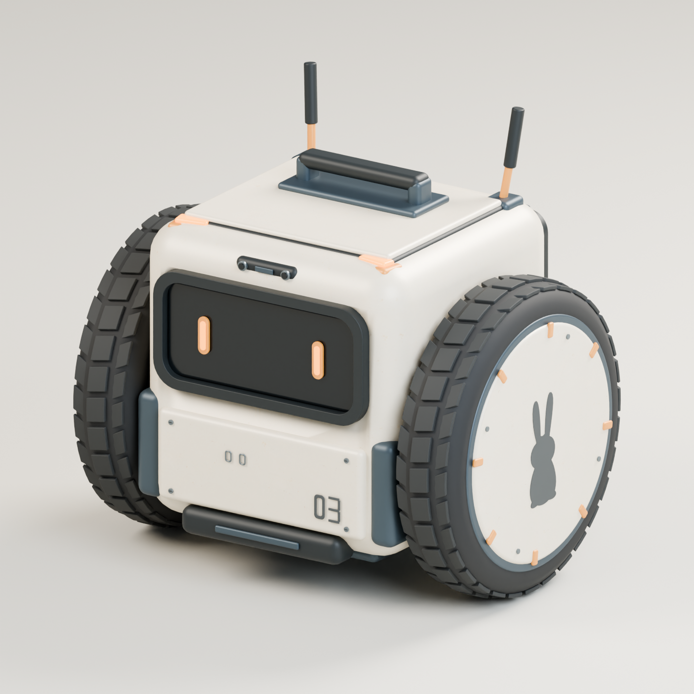

# Cube Delivery Robot

`REF/rabbit_suttle.png`의 큐브형 2륜 배송로봇을 바탕으로 제작한 편집 가능한 정적 모델입니다.



## 파일

- [CubeDeliveryRobot.blend](CubeDeliveryRobot.blend): 편집 원본, 패킹한 텍스처와 검토용 스튜디오 포함.
- [CubeDeliveryRobot.glb](CubeDeliveryRobot.glb): PNG를 내장한 독립 사용 가능한 glTF 2.0.
- [CubeDeliveryRobot.fbx](CubeDeliveryRobot.fbx): 같은 메시와 PNG를 내장한 FBX 7400.
- [화물함 개방](renders/cargo_open.png), [정면](renders/front.png), [후면](renders/rear.png), [측면](renders/side.png).
- [GLB 재가져오기 렌더](renders/glb_reimport_hero.png): 내보낸 GLB를 새 프로세스에서 읽은 실제 결과.
- [검증 요약](validation/validation.json), [UV 배치](validation/UV_Layout_2048.png), [생성 이미지 출처와 전체 프롬프트](validation/imagegen_provenance.json).

## 크기와 편집

Blender 4.5.12 LTS, 미터, Z-up, 전면 -Y입니다. 전체 크기는 폭 1.011m × 깊이 0.753m × 높이 0.988m입니다.
높이는 안테나를 포함하며 본체 상단은 약 0.80m입니다. 바퀴의 최저점은 Z=0.00002506m로 접지면에서 0.1mm 이내입니다.
20개 기능별 메시, 37,710개 원본 정점, 74,212개 삼각형, 11개 PBR 재질입니다.

`ASSET_CubeDeliveryRobot` 컬렉션에 모델만 있습니다. 메시별 버텍스 그룹은 원래 세부 부품 이름을 보존합니다.
`Wheel_Left`와 `Wheel_Right`의 원점은 각 차축 중심이며 X축을 기준으로 회전할 수 있습니다.
`Cargo_Door`의 원점은 상단 힌지에 있고, X축 +105도 회전이 화물함 개방 렌더에 사용됐습니다.
`Removable_Cargo`는 따로 이동할 수 있는 화물함입니다. 저장 원본과 내보내기는 문이 닫힌 기본 자세입니다.
실제 속이 빈 차체, 후면 고무 실링, 내장 레일과 앞쪽 화면 홈을 모델링했습니다.

## UV와 표면

모든 부품이 하나의 고유한 0–1 UV 공간을 사용합니다. 미러링이나 의도적 UV 중첩은 없습니다.
아이보리 표면은 built-in image_gen으로 새로 만든 1254×1254 PNG입니다.
원본 PNG를 그대로 보존했고, 다른 모델에서 텍스처나 메시를 가져오지 않았습니다.
이 표면과 재질별 기본색을 조명 없이 Emission 베이크하여 4096×4096 Base Color 아틀라스로 통합했습니다.
금속도·거칠기·발광은 별도의 PBR 파라미터입니다. 노멀맵은 없고 타이어 트레드·마크·패널·나사는 실제 형상입니다.

`Body_Ivory_Tintable` 재질의 `BODY_TINT_WHITE_DEFAULT` Multiply 입력을 바꾸면 아이보리 부품만 색을 바꿀 수 있습니다.
기본 배수는 흰색이며 GLB의 해당 baseColorFactor도 흰색입니다. 원래 아이보리 색은 아틀라스에서 공급합니다.

4K 픽셀 중심 검사에서 UV 겹침 0, 범위 이탈 0, 영면적 UV 삼각형 0입니다.
표면적 가중 텍셀 밀도 중앙값 690.89px/m,
5–95백분위 637.30–716.79px/m,
점유율 48.93%입니다. 패커 여백은 10.24px 설정, 베이크 확장은 8px입니다.
이는 연속 공간 최소 간격의 증명은 아니며 16,628개 작은 삼각형은 픽셀 중심을 덮지 않습니다.
따라서 서브픽셀 교차나 모든 밉 단계의 번짐까지 검사한 것은 아닙니다.

## 실제 검증

저장한 .blend를 새 Blender 프로세스에서 열고 검사했습니다. 모든 기능별 메시의 경계·비다양체 에지 및
영면적 기하 삼각형은 0이며 누락된 텍스처는 없습니다. 검사 전후 모델 파일 SHA-256도 동일합니다.
외부 아틀라스 PNG, .blend 패킹 이미지, GLB 및 FBX 내장 이미지의 SHA-256이 모두 일치합니다.
GLB와 FBX 모두 새로 가져왔을 때 20개 메시와 원본 치수를 유지합니다.
GLB에는 카메라·조명·바닥과 외부 파일 URI가 없습니다. FBX에도 메시만 내보냈습니다.
원본/GLB 재가져오기 실제 렌더의 RGB 평균 절대차는 0.00000771입니다.

검증 재실행:

```text
blender --background --factory-startup --threads 4 --python-exit-code 1 --python validation/validate_model.py
```

검사기는 원본 모델을 저장하지 않으며 validation 보고서와 GLB 검토 렌더만 갱신합니다.
검토 렌더는 Cycles CPU 4 threads, AgX Medium High Contrast, 32–40 samples, denoise입니다.
일회성 모델 생성기·베이크 스크립트와 중간 .blend 백업은 납품 폴더에 남기지 않았습니다.

## 범위

리깅·애니메이션 클립·충돌·LOD·물리·게임 로직은 포함하지 않습니다. UE import와 게임 적용은 수행하지 않았습니다.
GLB는 표준 Y-up으로 변환되며 FBX는 Blender의 -Y-forward/Z-up 설정으로 내보냈습니다.
기존 토끼 바이크·자판기·SSTO·ForestDemo 작업은 수정하지 않았습니다.
