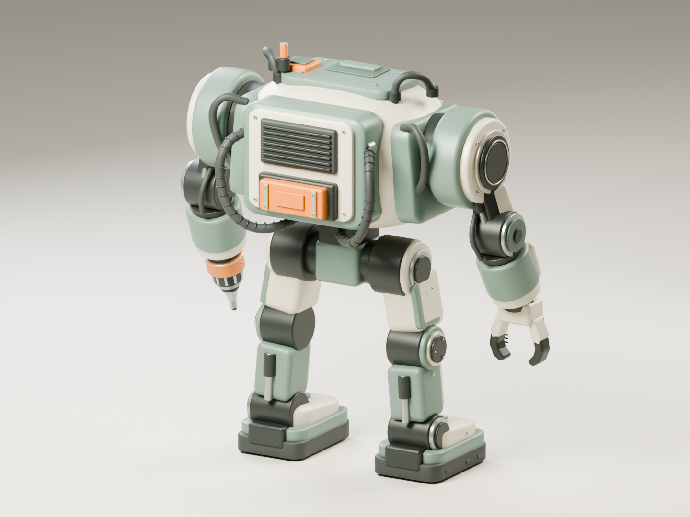

# Service mech — delivery result

Status: **ready_for_review**. Final model, exports, and render evidence are frozen.

## Actual timing

- Recorded work start: 2026-10-23T09:37:06Z / 2026-10-23T18:37:06+09:00.
- Completion record: 2026-10-23T10:01:55Z / 2026-10-23T19:01:55+09:00.
- Elapsed wall time: **1489 seconds**, including brief/reference inspection, modeling, renders, corrections, and validation.
- Final private Blender build: 2026-10-23T09:56:55.987989+00:00 to 2026-10-23T09:58:40.126806+00:00; **104.139 seconds**.
- Final actual renders: hero **44.342 seconds**, rear **36.647 seconds**. See `capture_manifest.json` for exact UTC timestamps and camera settings.
- No image generation, child workers, Git changes, tool installation, or shared Blender scene operations were performed by this worker.

## Delivered files

| File | Purpose | Size |
|---|---|---:|
| `service_mech.blend` | Editable named component meshes, PBR materials, ASSET and STUDIO collections | 11,123,668 bytes |
| `service_mech.glb` | Selected ASSET geometry and materials only | 4,416,224 bytes |
| `service_mech.fbx` | Selected ASSET geometry and materials only | 4,651,788 bytes |
| `build.py` | Deterministic model, export, and actual render source | 34,153 bytes |
| `renders/hero.png` | Actual Cycles front/right image, 1440 × 1080 | 1,776,287 bytes |
| `renders/rear.png` | Actual Cycles rear/left image, 1440 × 1080 | 1,805,593 bytes |
| `validation.json` | Fresh saved-file and import validation, including SHA-256 hashes | JSON |
| `validate.py` | Independent reopen / GLB and FBX round-trip validation source | Python |
| `capture_manifest.json` | Camera/render parameters and actual timestamps | JSON |
| `build_run.json` | Final Blender version and execution timing | JSON |

All files are under `D:/github/AstraEffort/Blender/Set01/service_mech/`.

## Model and visual evidence

The final mech is **2.583494 m wide × 1.288311 m deep × 2.800000 m high**. It uses meters, Z up, front negative Y, and a minimum geometry Z of zero.

The reference was directly inspected before modeling. The deliverable includes the rounded horizontal ivory torso, genuine recessed sensor cavity with one amber aperture, sage shoulder rotors with concentric bearings, articulated upper arms and elbows, ivory/sage forearm service panels, an industrial two-finger gripper, a stepped rotary service tool, distinct hip/knee/ankle joints, broad planted feet, and the rear radiator / battery pack with routed hoses. Small ochre panels and graphite mechanisms retain the supplied color hierarchy. No humanoid face motif was added.

Both final images were viewed directly after the final build. Inspection led to corrections for buried forearm service panels, floating chest fasteners, the lower chest panel's surface fit, hose endpoints, and material contrast.

## Verification evidence

Final validation command exited **0**, and `validation.json` has `status: passed`.

| Check | Saved BLEND | Imported GLB | Imported FBX |
|---|---:|---:|---:|
| Mesh objects | 395 | 395 | 395 |
| Evaluated triangles | 151,052 | 151,052 | 151,052 |
| Zero / near-zero area triangles (< 1e-12 m²) | 0 | 0 | 0 |
| Finite UV coverage | 100% | 100% | 100% |
| Nondegenerate UV triangles | 100% | 100% | 100% |
| Dimensions agree within 0.0001 m | Baseline | Pass | Pass |
| Nonempty finite geometry / assigned materials | Pass | Pass | Pass |
| Unapplied modifiers on exported meshes | 0 | 0 | 0 |

Exports contain only ASSET meshes. They contain no studio floor, camera, light, armature, or animation. The saved blend retains STUDIO for editing and rerendering. The GLB has UV and normal attributes on every primitive, no external resource URI, and no camera/animation payload. The blend has no missing external image paths.

The first geometry check found degenerate triangles on very thin parts where the bevel reached half the part thickness. `diagnose.py` and `degenerate_diagnosis.json` preserve that failure investigation. The primitive-generation functions now constrain bevels below half thickness; the final fresh-process checks show zero degenerate geometry and UV triangles.

## Actual commands and outcomes

Executable: `C:/Program Files/Blender Foundation/Blender 4.5/blender.exe` (reported **4.5.12 LTS**). All jobs ran in private background CLI processes with four threads.

1. Initial build: `-b --factory-startup -t 4 --python D:/github/AstraEffort/Blender/Set01/service_mech/build.py` → exit 0; `build.log`; initial actual renders inspected.
2. Visual refinement build: same command → exit 0; `build_refine.log`; refined actual renders inspected.
3. Initial verification: `-b --factory-startup -t 4 --python-exit-code 1 --python D:/github/AstraEffort/Blender/Set01/service_mech/validate.py` → exit 1; `validate.log`; thin-detail bevel degeneracy detected.
4. Diagnosis: `-b --factory-startup -t 4 --python-exit-code 1 --python D:/github/AstraEffort/Blender/Set01/service_mech/diagnose.py` → exit 0; `diagnose.log`; identified affected thin primitives.
5. Final corrected build: `-b --factory-startup -t 4 --python-exit-code 1 --python D:/github/AstraEffort/Blender/Set01/service_mech/build.py` → exit 0; `build_final.log`; `SERVICE_MECH_BUILD_COMPLETE`.
6. Final verification: command from step 3 → exit 0; `validate_final.log`; `SERVICE_MECH_VALIDATION` reports passed for BLEND, GLB, and FBX.

Blender emitted an extension-cache permission warning during importer discovery. The import operations themselves completed, and the final process exited 0. No cache permission change was made.

## Material / production limits

- Static model as requested; no rig or animation.
- Named solid PBR materials with real bevel geometry; no painted wear or generated texture images. The reference's fine surface distress is therefore simplified.
- UV islands are independently packed per component. A single globally packed atlas and uniform texture density are not claimed.
- Render evidence uses Cycles CPU, four threads, 32 samples with denoising, AgX, soft studio lights, and orthographic cameras. No generated imagery was substituted.

## Reference

Only the assigned reference was used: `D:/github/AstraEffort/REF/Set01/service_mech.png`. No external reference or other worker's output was inspected or reused.

