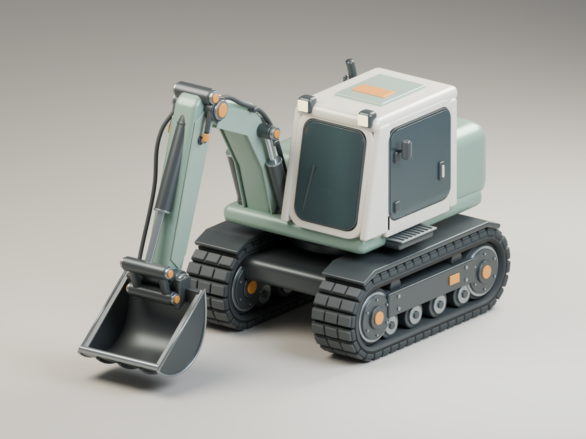
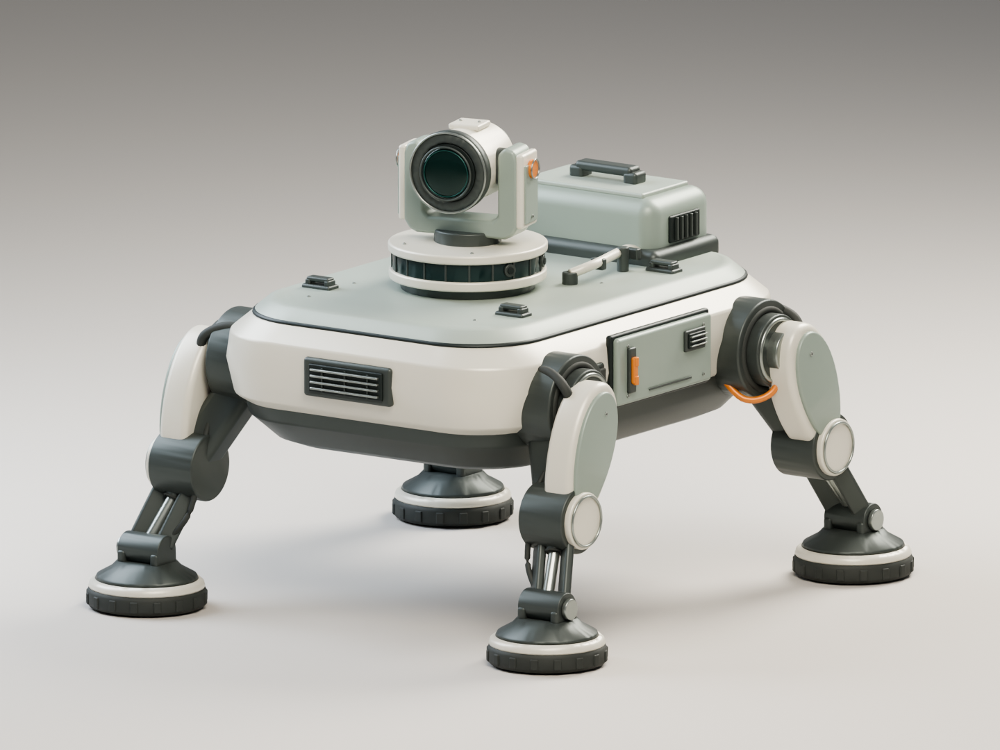
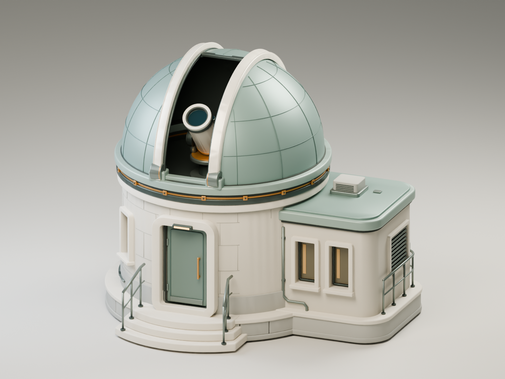
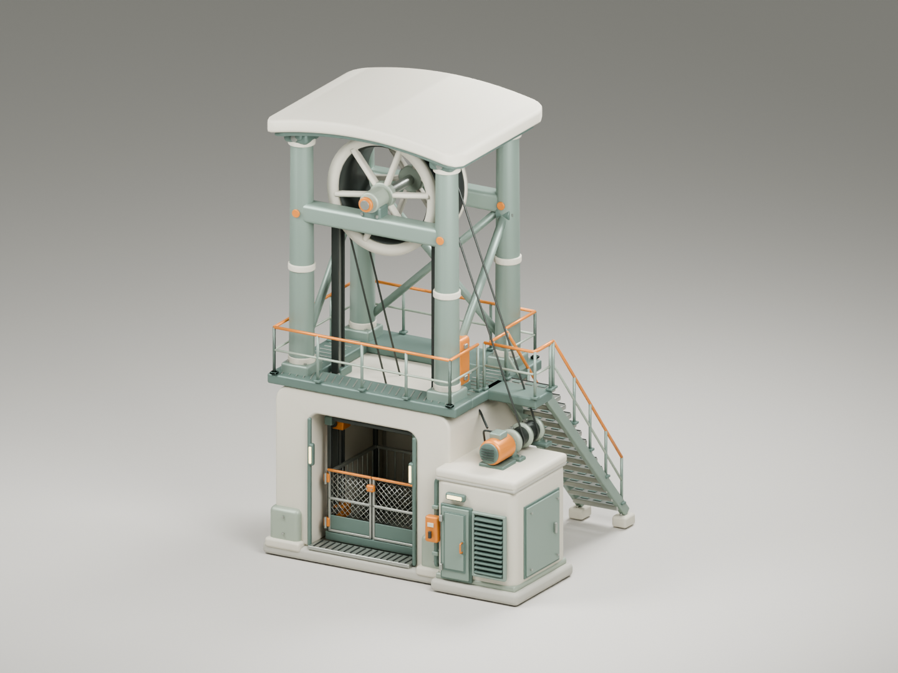

# Set 02 — 둥근 산업형 게임 에셋 4종

레퍼런스 이미지 4장을 메인에서 순차 생성한 후, 메인과 max 추론 서브에이전트 3개가 각각 모델 하나씩 병렬 제작했습니다. 아래 미리보기는 실제 Blender 렌더입니다.

| 모델 | BLEND | GLB | FBX | 삼각형 수 | 크기 X × Y × Z (m) |
|---|---|---|---|---:|---|
| 궤도형 탐사 굴착차 | [편집 파일](tracked_excavator/tracked_excavator.blend) | [GLB](tracked_excavator/tracked_excavator.glb) | [FBX](tracked_excavator/tracked_excavator.fbx) | 244,868 | 2.56 × 5.17 × 3.27 |
| 4족 측량 로봇 | [편집 파일](quadruped_surveyor/quadruped_surveyor.blend) | [GLB](quadruped_surveyor/quadruped_surveyor.glb) | [FBX](quadruped_surveyor/quadruped_surveyor.fbx) | 210,512 | 2.23 × 2.40 × 1.78 |
| 산악 관측소 | [편집 파일](mountain_observatory/mountain_observatory.blend) | [GLB](mountain_observatory/mountain_observatory.glb) | [FBX](mountain_observatory/mountain_observatory.fbx) | 226,944 | 7.05 × 6.06 × 5.99 |
| 광산 승강기 건물 | [편집 파일](mine_elevator/mine_elevator.blend) | [GLB](mine_elevator/mine_elevator.glb) | [FBX](mine_elevator/mine_elevator.fbx) | 145,712 | 5.22 × 4.88 × 8.06 |

각 모델은 편집 가능한 개별 부품과 이름이 지정된 PBR 재질을 포함합니다. `ASSET` 컬렉션은 모델, `STUDIO`는 미리보기용 조명·카메라·바닥입니다. 내보낸 GLB/FBX에는 모델 형상만 포함됩니다.

## 실제 모델 미리보기

### 궤도형 탐사 굴착차

[후면 렌더](tracked_excavator/renders/rear.png) · [생성 레퍼런스](../../REF/Set02/tracked_excavator.png) · [제작 기록](tracked_excavator/RESULT.md) · [재검증](validation/tracked_excavator.json)

### 4족 측량 로봇

[후면 렌더](quadruped_surveyor/renders/rear.png) · [생성 레퍼런스](../../REF/Set02/quadruped_surveyor.png) · [제작 기록](quadruped_surveyor/RESULT.md) · [재검증](validation/quadruped_surveyor.json)

### 산악 관측소

[후면 렌더](mountain_observatory/renders/rear.png) · [생성 레퍼런스](../../REF/Set02/mountain_observatory.png) · [제작 기록](mountain_observatory/RESULT.md) · [재검증](validation/mountain_observatory.json)

### 광산 승강기 건물

[후면 렌더](mine_elevator/renders/rear.png) · [생성 레퍼런스](../../REF/Set02/mine_elevator.png) · [제작 기록](mine_elevator/RESULT.md) · [재검증](validation/mine_elevator.json)

## 확인한 사항

모든 저장 BLEND와 재수입 GLB·FBX에서 크기와 삼각형 수가 일치했습니다. 누락된 UV·재질·외부 이미지, 비정상 좌표, 면적이 0인 삼각형은 공통 검증에서 발견되지 않았습니다. 앞·뒤 실제 렌더는 메인에서 직접 확인했습니다.

## 범위와 한계

정적 모델이며 리깅·애니메이션·LOD·충돌 메시와 엔진 통합은 포함하지 않습니다. UV는 부품별로 제공하며 통합 아틀라스와 공통 텍셀 밀도를 맞추는 작업은 수행하지 않았습니다. 재질은 단색 PBR 중심으로, 레퍼런스의 미세한 오염 표현을 텍스처로 굽지는 않았습니다. FBX 재질은 사용하는 엔진에서 조정이 필요할 수 있습니다.

레퍼런스 원본과 최종 프롬프트는 [REF/Set02](../../REF/Set02)에, 생성 시각은 [generation_manifest.json](../../REF/Set02/generation_manifest.json)에 있습니다.
