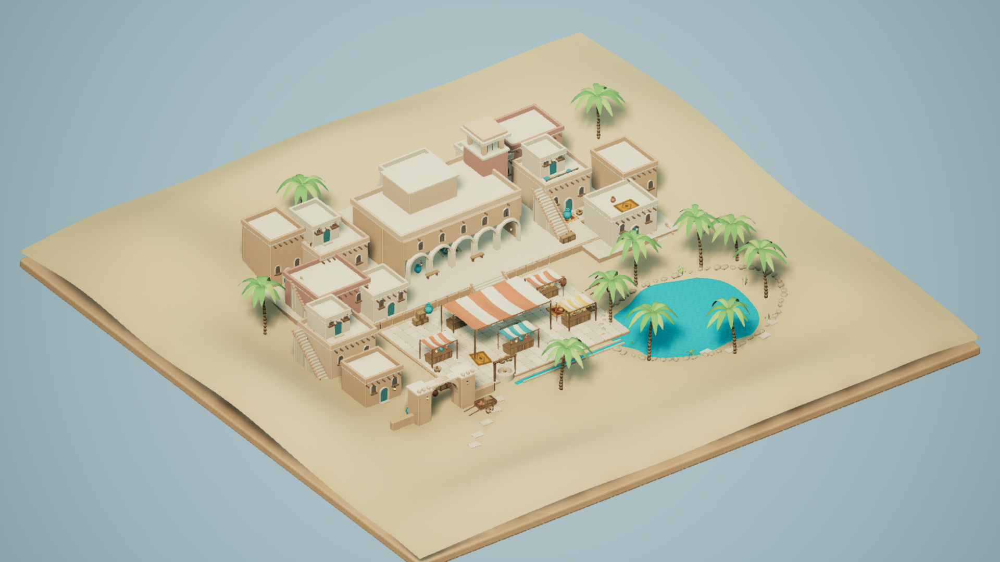
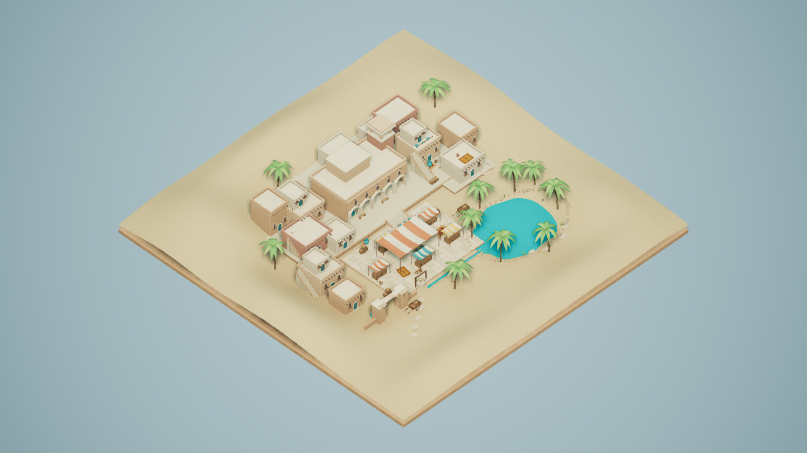
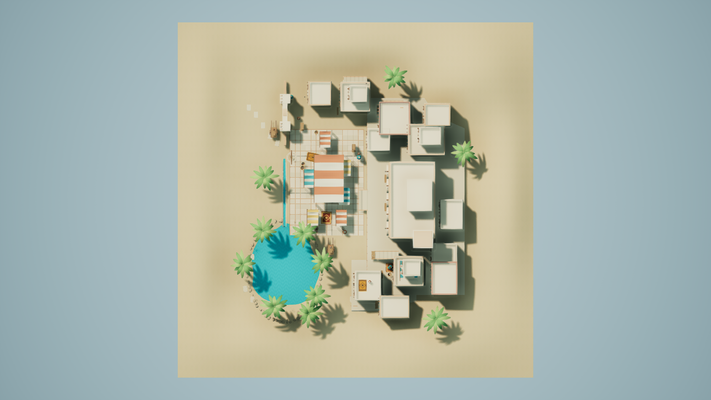
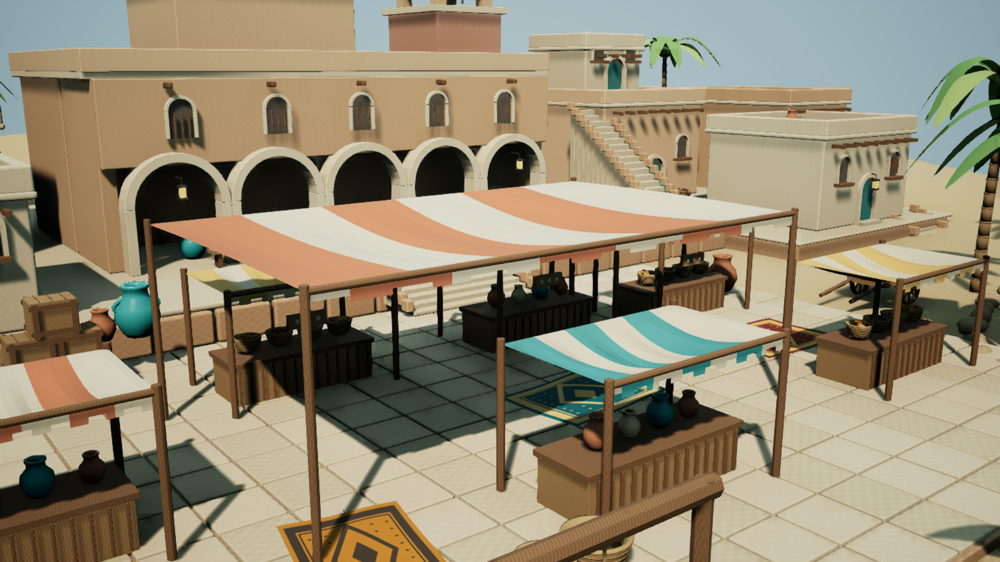
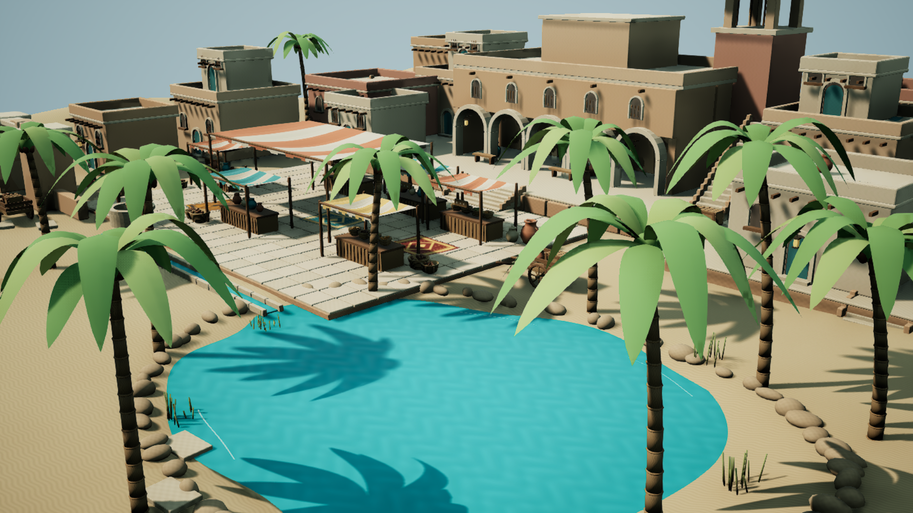

# 사막 오아시스 교역 마을 — DesertVillage / max

**제작·전달 및 독립 검토 완료.** 100×100m 원본 모래 지형 위에 청록색 오아시스와 야자수, 높이가 다른 흙벽 건축, 아케이드, 외부 계단과 그늘진 시장을 구성했다. 독립 UE **5.7.4** 프로젝트에서 저장·재로드·렌더를 검증하고, 전용 에디터 종료 후 지정된 자산 76개와 지도 1개만 공유 프로젝트의 소유 경로에 복사했다. **77/77 파일 SHA-256이 원본과 일치한다.** 조정자와 별도 max 검토 에이전트가 최종 파일과 실제 캡처 7장을 확인했다. [최종 감독 검증](Evidence/supervisor_acceptance.json). Git 작업은 하지 않았다.

## 실제 작업 시간과 실행 환경

| 항목 | 실제 기록 |
|---|---|
| 모델 / effort | **gpt-6-astra / max**, 실제 작업 turn_context를 감독이 확인 |
| 시작 UTC | 2026-10-23T09:33:43.969000+00:00 |
| 시작 KST | 2026-10-23T18:33:43.969000+09:00 |
| 완료 UTC | 2026-10-23T10:26:59.214537+00:00 |
| 완료 KST | 2026-10-23T19:26:59.214537+09:00 |
| 전체 벽시계 시간 | **3195.246초** (53.25분) |
| UE 대기 합계 | **18.285초** |
| UE 실행 합계 | **524.991초** |
| 이미지 생성 서비스 | 사용하지 않음, **0초**. 원본 PNG는 이 작업의 수학식·시드 기반 절차 제작 |
| 제작 도구 | Blender5.0.0 독립 background 프로세스, UE5.7.4 full editor/D3D12, 전용 PowerShell7.6.8 |

최초 수기 기록09:34:30.386UTC보다 이른 실제 turn_context09:33:43.969UTC를 시작으로 삼았다. [runtime 증거](Validation/runtime_effort_verified.json), [전체 시간 원장](Validation/timing_summary.json)에 원래 기록과 모든 실패·대체 시도를 보존했다. CPU 모델링·이미지 제작, 코드 작성, 이미지 검토와 보고서 시간은 전체 벽시계에 포함된다. 이미지 제작 서비스 시간과 절차 이미지 계산을 혼동하지 않는다.

모든 UE 프로세스는 변경하지 않은 `ForestDemo/Work/Tools/Run-UnrealIsolated.ps1`을 사용했다. 새 테마는 실행기에서Unknown/priority2로 등록되었으며 기존 우선순위와 FIFO를 존중했다. 다른 작업을 중단하거나 선점하지 않았다.

| UE 시도 | 대기(초) | 실행(초) | 종료 코드 |
|---|---:|---:|---:|
| 초기 큐 등록: CIM 접근 거부, UE 실행 전 종료 | 0.090 | 0.000 | 1 |
| FBX 축/단위 probe: 진단용 비노출 API 조회 오류 기록 | 0.300 | 16.255 | 0 |
| 최초 지도 구성/재로드: 자동종료로 캡처 미실행 | 0.343 | 158.320 | 0 |
| UV/면 수정 및 첫 촬영: 정사영 실패본 보존 | 16.552 | 127.380 | 0 |
| Lit/카메라/조명 수정: 수면·잎 개선 전 영상 보존 | 0.417 | 107.032 | 0 |
| 최종 수면·야자 잎·벽 재질 및 승인된7장 촬영 | 0.297 | 100.664 | 0 |
| 마지막 독립 읽기 전용 저장 지도 검사 | 0.286 | 15.341 | 0 |

## 디자인, 제작 범위와 최종 구성

사용자가 디자인 세부사항과 진행을 위임했으며, 이 보고서 하나 안에서 계획과 결과를 관리했다. 오아시스와 교역 광장을 앞에 두고 카라반 숙소·계단식 테라스·입구 아치가 마을의 중심과 동선을 잡도록 구성했다. 정사각형 외곽은100m 디오라마 경계이고 내부 지형은 평면이 아니다. 원본 지형의 높이 범위는 **-0.771~6.024m**이며 오아시스의 낮은 분지와 둘레 사구가 이어진다.

- **건축:** 큰 카라반 숙소의5개 열린 아치, 낮은 난간과 돌출 나무 보,12개 주택 배치와3개 추가 옥상 방, 바람탑, 외부 계단5개, 입구 아치와 테라스 옹벽.
- **교역 광장:** 포장 블록280개, 시장 좌판6개, 큰 그늘막과 옥상 천막, 원본 양탄자 문양3종을 쓴 양탄자6장, 항아리27개, 바구니19개, 농산물, 수레2대, 상자와 벤치·등·간판 장식.
- **오아시스:** 비정형 청록 수면, 굽은 줄기의 야자수11그루, 물가 돌과 갈대, 공동 우물과 약19m 수로. 잎과 천막은 형태를 직접 만든 정적 메시다.
- **전용 자산:** 의미 단위 정적 메시29개, UE 재질37개, 직접 만든512×512 PNG 텍스처10개. 원본 메시의 삼각형 분할 합계는495,103개이고 UV 검사는 비영면적 삼각형493,775개를 대상으로 했다.

진행 순서는 원본 모델/이미지 → private UE import/구성 → 저장 지도 재로드 → 실제 렌더 검토·수정 → 에디터 종료 → 소유 파일 복사·해시 검증이었다. 공용 Source/Config/Plugins/Binaries/uproject 및 다른 테마/effort의 창작 자산·보고서는 읽거나 변경하지 않았다.

## 실제 UE 렌더

모든 최종 이미지는 **1920×1080 PNG, High(2), ScreenPercentage100, Lit, Game View**이며 UI·그리드·선택 표시가 없다. 카메라를 명시적으로 pilot한 뒤 editor-wide/active 뷰포트를 모두Lit으로 설정하고 실제 반환값 `VMI_LIT`를 기록했다. 캡처 API에는 `camera=None`을 사용했다. 생성 이미지로 장면 증거를 대체하지 않았다. 아래4개 공통뷰와 전경·시간쌍7장을 작성자가 직접 열어 검사했고, 감독도4개 공통뷰를 별도로 확인했다.

### 공통 전경

카메라(12000,-12000,16000)cm → 원점, 정사영 폭20000cm.

### 공통 탑다운

카메라(0,0,20000)cm, pitch-90/yaw0/roll0, 정사영 폭20000cm.

### 교역 광장

카메라(1900,-2500,900)cm → (200,-300,240)cm, FOV58°. 가까운 소품과 아케이드·계단 관계를 보여준다.

### 오아시스

카메라(-4200,-4100,1550)cm → (-1250,-1250,250)cm, FOV55°.

### 같은 카메라의 시간쌍

요청 UTC10:14:12.107887과10:14:19.126384, 실제 간격 **7.018497초**. 카메라 위치·회전·FOV가 정확히 같다. `M_Water`에는 Panner(.013,.009), 원본 색/노멀 텍스처, 대비12%와 노멀 강도16%가 설정되어 있다. **픽셀 차이는 시간적 렌더링 잡음을 포함하며, 이 두 장만으로 셰이더 이동량이나 독립적인 가시 운동을 증명했다고 주장하지 않는다.** 물리적 유체·굴절·카우스틱 시뮬레이션도 아니다.

[카메라·렌더·UTC 원장](Screenshots/capture_manifest.json) / [이미지 크기·SHA-256·시간쌍 검사](Validation/capture_validation.json)

## 원본 이미지, 재질과 UV

`SourceArt/Textures/`의10개 PNG는 이 작업에서 직접 제작했다. 플라스터·모래·돌은 작은 주기 함수와 고정 시드 노이즈, 나무는 완만한 결, 천과 바구니는 직조 반복, 수면은 낮은 대비의 물결장과 그 기울기 노멀이다. 양탄자3종은 테두리·중앙 마름모·반복 작은 문양을 직접 정의했다. 외부 이미지나 다른 작업의 텍스처를 사용하지 않았고 이미지 생성 프롬프트는 해당하지 않는다.

UV는 베벨이 적용된 **최종 면에 world-meter dominant-normal box projection**을 했다. 반복 재질의 같은 표면군에는 같은m/반복 스케일을 쓴다. 곡면·경사면의 투영 밀도 감소는 의도된 예외이며, 전체 수치와 면적은 [UV 실측](Validation/uv_density_validation.json)에 있다.

| 표면군 | 반복 크기 | 목표(px/m) | 면적 가중 실측(px/m) |
|---|---:|---:|---:|
| 모래 | 3m | 170.7 | 169.0 |
| 황토 벽 | 2m | 256.0 | 254.0~254.9 |
| 석재 | 1.5m | 341.3 | 340.2~340.9 |
| 나무 | .7m | 731.4 | 716.6~731.4 |
| 천 | .5m | 1024.0 | 1001.0~1015.2 |
| 바구니 | .25m | 2048.0 | 1894.6 |
| 야자 줄기 | .65m | 787.7 | 754.8 |
| 수면 | 6m | 85.3 | 85.3 |
| 양탄자 | 각 장 전체0~1 | 크기에 따라 다름 | 169.0~180.5 |

반복 UV의 중첩은 의도된 것이며 unique-island atlas가 아니다. 반복 이미지에는 atlas 패딩을 적용하지 않았고 양탄자 원본은4% 안쪽 테두리를 둔다. 양탄자의 장단축 때문에 방향별 밀도는 다르다. 비영면적 삼각형 **493,775개에서 퇴화 UV0개**를 확인했다. 베이크 조명을 사용하지 않으므로 lightmap UV는 만들지 않았다.

## 검증 근거와 수정 기록

| 검사 | 최종 결과 / 근거 |
|---|---|
| 저장 지도 독립 재로드 | 2026-10-23T10:17:34.936399+00:00, [saved_map_validation.json](Validation/saved_map_validation.json) |
| World Partition | `WorldSettings.world_partition is None` 직접 확인 |
| 필수 장면 구성 | 기록한15종 의미 그룹 모두 존재, 메시29/29 |
| FBX 축·단위 | 비대칭 probe 실제 import로m→cm×100과Y 반전 확인; export 사본의Y미러+면 방향 보정 후 예상 경계와 일치 |
| 실제 배치 경계 | 전체29개, 원본 대비 최대 오차 0.000488281cm |
| 폐곡면 방향 / 저장 노멀 | 실제 FBX2,930개 폐곡면(probe1개 포함), 음수 부피0, 면과 반대인 저장 노멀0 — [FBX 검사](Validation/fbx_geometry_validation.json) |
| 재귀 의존성 | 지도 포함77개 `/Game` 패키지, 소유 경로 위반0 |
| 배치 재질 | 빈 슬롯0, 다른 `/Game` 재질0, 모든 배치 재질의 리소스가 재귀 의존성 검사에 포함됨 |
| 조명 | DirectionalLight·SkyLight 모두Movable, SkyLight실시간 캡처, `force_no_precomputed_lighting=True` |
| 외부 패키지 / 베이크 | private Content의 ExternalActors·ExternalObjects·BuiltData0, 지도1개 |
| 게시 전 종료 | 마지막 private editor 종료 2026-10-23T10:17:39.6875786+00:00, 게시 직전 해당 프로젝트 에디터 프로세스0 |
| 복사 검증 | 76uasset+1umap,77/77 원본·대상 SHA-256 일치 — [전달 목록](Validation/delivery_manifest.json) |

검토 중 확인한 결함은 원본에서 수정했다. 아치와 수평 고리의 안쪽 감기 방향을 실제 폐곡면 부피로 확인해 뒤집었고, 베벨이 너무 얇은 부품을 눌러 만든 작은 UV 퇴화면은 부품별 베벨 폭을 낮춰 없앴다. 수면 고리 면 방향과 export 축도 보정했다. 첫 정사영 캡처는 와이어프레임으로 실패했고 topdown positional Rotator가roll로 해석되는 오류가 있어 keyword 회전과 실제 뷰모드API로 수정했다. 캡처 함수 내부 Slate 재진입은 호출 전 상태 전환과 guard로 막았다. 수면 대비·잎 자기 그림자·벽 패턴은 실제 렌더를 보고 다듬었다.

실패/이전 이미지와 원장은 `Validation/RejectedCapture01/`, `Validation/RejectedCapture02/`에 보존했다. 이 보고서는 `Screenshots/`의 최종 승인된 이미지에만 연결한다.

## 전달 파일과 해시

- 지도: `ForestDemo/Content/Maps/DesertVillage_max.umap` → `/Game/Maps/DesertVillage_max`
- 전용 자산: `ForestDemo/Content/DesertVillage/max/` → `/Game/DesertVillage/max/`
- Blender 원본·FBX·이미지: `ForestDemo/Work/DesertVillage/max/SourceArt/`
- 재현 스크립트: `Scripts/build_scene.py`, `Scripts/build_unreal.py`; 검사·수정·촬영·게시 보조 스크립트도 같은폴더에 보존.
- 최종 보고서/상태/증거: 이 `RESULT.md`, `STATUS.json`, `Screenshots/`, `Validation/`, `Logs/`.

지도 SHA-256: `42f341d453907f900433642313f44da787527caef9bb28f46dfa6258c3dccc2f`

77개 전달 파일 경로+해시의 집합 SHA-256: `964a1447c59bdd718e58689f63109cbc87b5630f922084828536779e9dcc8241`. 정확한 정렬/직렬화 규칙과 각 파일 해시는 [delivery_manifest.json](Validation/delivery_manifest.json)에 있다.

## 제한과 외부 참조

이 결과는 감상용 장면이다. PIE 플레이, 충돌·내비게이션, 패키징과 프레임 성능 벤치마크는 검증하지 않았다. 건물은 조형 외관과 아케이드 중심이며 모든 실내를 구현하지 않았다. 대부분의 자산은 의미별 합쳐진 메시라 개별 소품 수정에는 원본 재생성이 편리하다. 일부 표면은 의도적으로 반복 UV를 쓰며, 물은 불투명한 미술적 근사이고 잎·천막은 정적이다. 시간쌍의 작은 픽셀 차이를 실제 유체 운동이나 정량 속도 증거로 해석하지 않는다.

외부 창작 레퍼런스·유료 라이브러리·다른 과제의 자산은 사용하지 않았다. `/Engine/BasicShapes/Sphere`를 하늘 배경용 구에 읽기 전용으로 사용했고, Unreal 기본 클래스와 설치된 UE/Blender API 소스를 참조했다. 설치된 `AutomationBlueprintFunctionLibrary.cpp`, `EditorPythonExecuter.cpp`, `WorldSettings.h`로 캡처·keep-alive·WorldPartition 동작을 확인했다. 공용 큐 실행기는 감독 소유 도구 그대로 사용했다. 소스·설정·Git 통합은 감독의 영역이며 이 작업에서 변경하지 않았다. 감독은 기존 고정 비교 보고서3개의 해시가 모두 유지됨을 별도로 확인해 [보존 증거](Evidence/parent_comparison_preservation.json)를 제공했다. 해당 보고서 내용을 이 작업이 읽지는 않았다.
