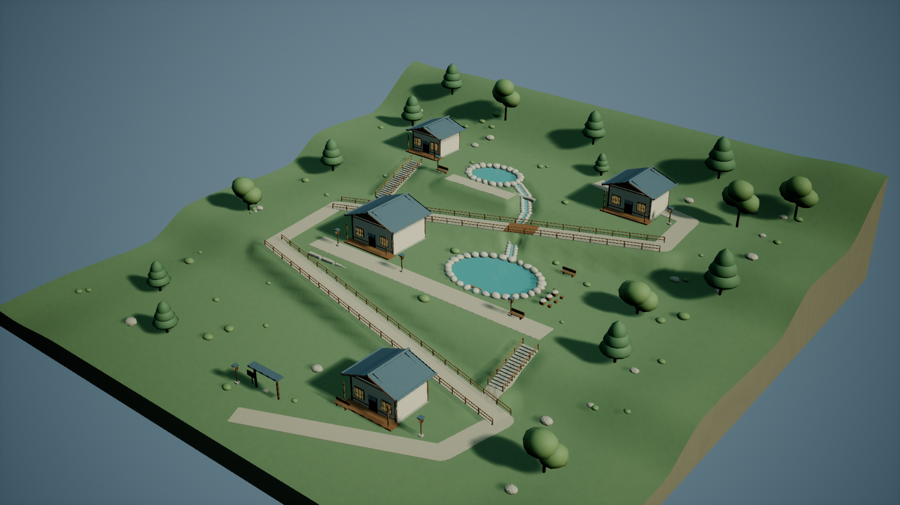

# 산솔 온천 — 사용자 중단 체크포인트

사용자가 **진행한 데까지만 커밋하고 중단**하도록 요청했다. 이 기록은 완성·검증 통과·최종 게시 선언이 아니다. 추가 제작과 하위 에이전트 작업을 중단했다.

- 실제 제작 시작: 2026-10-22 15:11:37 UTC / 2026-10-23 00:11:37 KST.
- 중단 기록: 2026-10-22 15:53:18 UTC / 2026-10-23 00:53:18 KST.
- 중단까지 경과: 2,501초. 기존 작업·비교 실험의 시간이나 토큰에 합산하지 않았다.

100×100m 지형, 세 단의 마을, 목재·석재 건물 네 채, 두 노천탕, 지그재그 길·계단·난간·다리·물길·식생을 새로 제작했다. 현재 원본은 18개 메시, 67,010개 삼각형이며, 독립 절차 생성 텍스처 10개와 UV 밀도 기록이 있다. 수면과 수증기는 UE 재질로 구현한 예술적 근사다. 물리 유체·굴절·열역학 시뮬레이션은 아니다.

실제 저장 맵과 자산은 전용 프로젝트에 있으며, 같은 파일을 SHA-256으로 대조하여 `Checkpoint/20261023T005318KST/Content/`에 보존했다. 최종 공유 Content에는 게시하지 않았다. `checkpoint_manifest.json`에 모든 패키지 경로·크기·해시가 있다. 기존 다른 테마·비교 보고서·산악 장면·커밋은 변경하지 않았다.

현재 확인한 내용:

- Blender 원본 검사: 유한 좌표, 삼각형, UV 차트 및 밀도 검사 기록이 있다. 계단 37개 블록과 건물 기초 모서리 16개가 접지돼 있다.
- 길에 7.16mm의 지형 침투가 한 정점에 남으며, 둥근 접속부의 최대 지형 간격은 약18.55cm다. 수치와 좌표는 `Validation/source_geometry.json`에 보존했다.
- 물길은 다리 아래와 인접 둑 일부에 가려진다. 의도한 경로 중심 2.2m 범위 밖에서도 네 개 삼각형 중심이 지형 아래에 있으며, 최대 깊이는0.898m다. 연속적인 물리 흐름으로 검증하지 않았다.
- UE에서 실제100×100m 범위를 확인했고, 저장·재로드와 실제1920×1080 미리보기를 수행했다.
- 첫 새 프로세스 검증은464개 검사에서 실패 판정이 없었으나, 지면 추적 도구의 Python API 예외로 전체 검증은 실패 상태다.
- 실제 캐릭터 보행은 스폰 API 예외로 이동 전에 실패했다. 검증 자동화 수정 도중 사용자 요청으로 중단했다. 보행·충돌 통과로 주장하지 않는다.
- 최종 네 시점과 시간차 수면·수증기 증거는 아직 없다. 현재 이미지는 최종 캡처 세트가 아닌 실제 미리보기다.
- build_05는 저장·미리보기 출력 후 종료 단계에서 Windows 접근 위반 코드를 반환했다. 이후 build_06은 종료 코드0이었다. 개별 로그와 실행기 기록은 `Logs/`에 있다.

재개할 경우 먼저 `STATUS.json`과 검증 실패 기록을 읽는다. `runtime_probe.py`와 `validate_engine.py`의 미노출 API를 수정하고, `verify_and_capture.py`로 새 프로세스의 정적 검사·실제 PIE 보행·충돌·최종 캡처를 다시 수행해야 한다. 원본 제작은 `author_scene.py`, 재질·맵 구성은 `build_unreal.py`다. 모든 UE 실행은 공용 `Run-UnrealIsolated.ps1`를 사용한다. 검증·실제 이미지 검사·전용 UE 종료가 확인된 뒤에만 `publish_validated.py`를 실행한다.

체크포인트 맵은 `/Game/Maps/HillsideOnsen_ultra`이며, 보존된 Content의 자기 자산 폴더와 지정 맵을 **자기 전용 프로젝트**의 같은 상대 경로에 복원하여 열 수 있다. `prepare_project.py`가 최소 baseline 실행 기반을 준비한다. 이번 중단 상태를 새 사용자 지시 없이 자동으로 재개하지 않는다.
