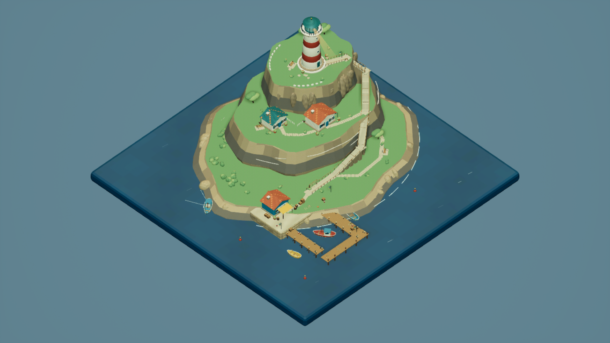
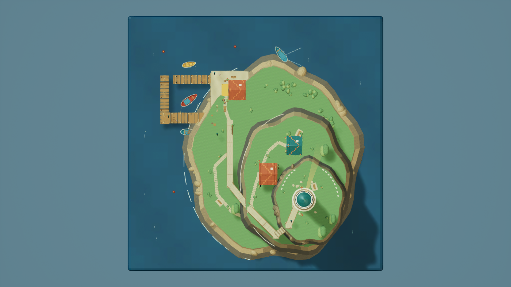
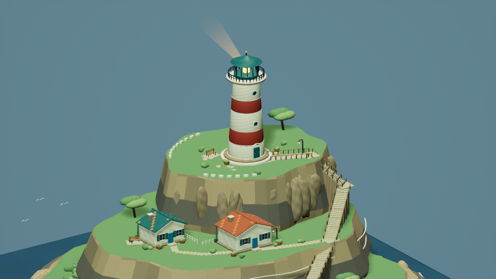
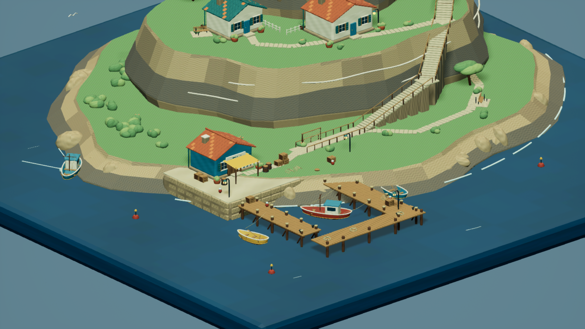
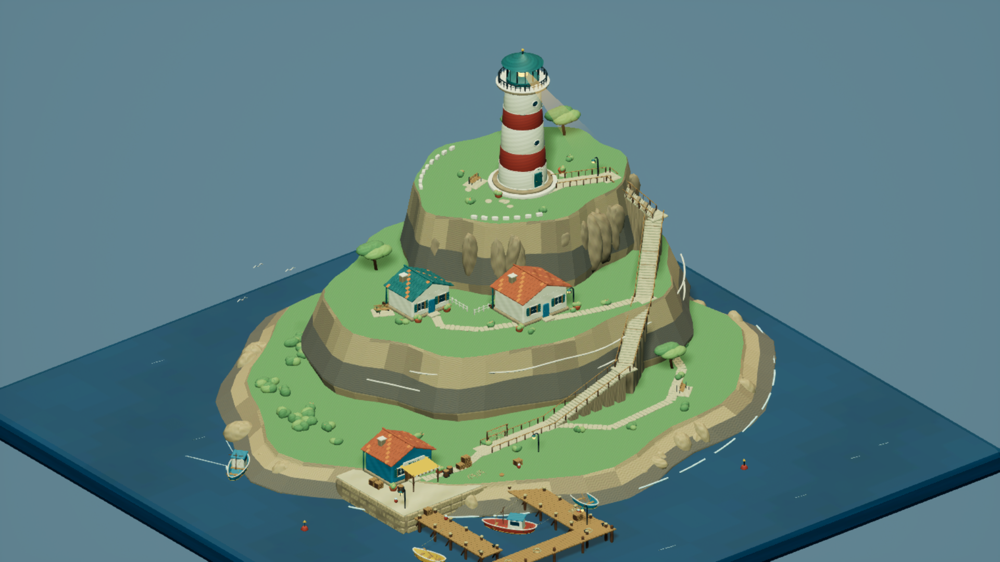
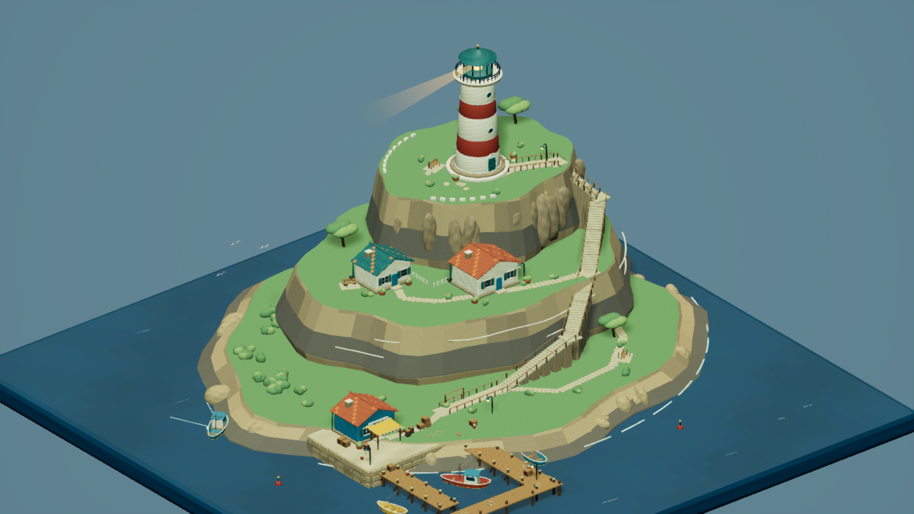

# LighthouseHarbor / max — 제작 결과

**제작·전달 및 독립 검토 완료.** 높은 절벽 위의 붉고 흰 등대, 관리인 주택 두 채, 바다로 내려오는 지지대 있는 꺾인 계단, 작은 어항과 배 네 척으로 구성한 독립 원본 환경이다. 검증된 소유 자산과 지도만 공유 Content에 게시했으며 Git 조작은 하지 않았다. 조정자와 별도 max 검토 에이전트가 최종 파일과 실제 캡처 6장을 확인했다. [최종 감독 검증](Evidence/supervisor_acceptance.json)

## 전달 경로와 범위

- 지도: `ForestDemo/Content/Maps/LighthouseHarbor_max.umap` (`/Game/Maps/LighthouseHarbor_max`).
- 자산: `ForestDemo/Content/LighthouseHarbor/max/` — 자체 메시 **57개**, 재질 **25개**, 임포트 텍스처 **23개**. 지도 포함 **106개** 파일의 개인 프로젝트/게시본 SHA-256이 전부 일치한다.
- 소스: [원본 Blender 장면](SourceArt/harbor.blend), [메시 목록](SourceArt/mesh_manifest.json), [표면 색·타일 크기](SourceArt/palette.json), `SourceArt/FBX/`, `SourceArt/Textures/`, `Source/`.
- 증거: [저장 맵 검사](Validation/saved_map_validation.json), [게시 해시](Validation/published_hashes.json), [캡처 설정](Screenshots/capture_manifest.json), [실제 픽셀 검사](Validation/capture_pixels.json).
- 지도 SHA-256: `a3fd7fa9cbc008d1fc7278ddb8b19743a5452ab66f4cd63304582a974ec60995`.

물 받침의 실제 UE 가로·세로는 각각 **100.000010m × 100.000010m**다. 바깥 하늘 구체는 전시 배경이며 지형 범위에 포함하지 않는다. 모든 창작물은 LighthouseHarbor/max 안에서 독립 제작했다. 유일한 배경용 기본 메시 참조는 읽기 전용 `/Engine/BasicShapes/Sphere`다.

## 설계·계획·진행 판단

사용자가 세부 설계를 위임하고 추가 질문 없이 실행하도록 지정했으므로, Blender 5.0 원본 제작 → 개인 UE 5.7 저장 → 새 에디터 재로드/실렌더 → 소유 파일 게시 순서로 진행했다. 세 층의 둥근 지형을 짧은 산책로와 벤치, 관리인 정원으로 연결하고, 해안 창고·격자 그물·통발·밧줄·부표·상자·통·노·선체 내부 늑재를 직접 모델링했다. 따뜻한 회벽과 점토 지붕, 청록 도장, 푸른 바다를 공통 팔레트로 삼았다.

- [x] 원본 메시·절차 이미지 작성 및 소스/실제 FBX 검증.
- [x] 소유 재질·움직임·동적 조명과 비 World Partition 지도 저장.
- [x] 재로드 의존성 검사, 실제 렌더 육안 확인, 제한된 결함 수정.
- [x] 개인 에디터 종료 확인, 소유 Content/지도만 복사하고 해시 일치 확인.

첫 실렌더에서 잔디 면별 색 분할이 방사형 줄무늬로 보이고 일부 계단이 절벽에 묻혔다. 잔디를 일관된 표면으로 바꾸고 외부 지지대가 있는 계단으로 다시 연결했다. 정면 조명과 부드러운 하늘 배경을 조정하고 메시의 최종 Z 배율을 0.85로 낮춰 지정된 공통 전경 카메라 안에 등대 꼭대기를 담았다. 상단 지면은 21.25m, 중단은 11.05m, 하단은 2.72m이며 등대 꼭대기는 약 41.9m다. 마지막에는 잔디와 같은 평면에 겹친 발판만 8.5cm 올렸다. 초기 화면은 [Preview_01](Validation/Preview_01/)에 보존했다.

기술적으로는 Python에 노출되지 않은 카메라 getter, 이미 존재하는 지도에 대한 NewLevel 호출, 비동기 캡처의 keep-alive 설정, 위치 인수 Rotator의 실제 축 순서를 확인해 교정했다. 함수 이름 추측 대신 설치된 UE 헤더/구현과 저장된 실제 회전값으로 검증했다. 조정자가 독립 검토를 제공했으며 하위 에이전트는 생성하지 않았다.

## 표면 이미지와 UV

외부 이미지나 다른 작업의 자산은 사용하지 않았다. **512×512 PNG 23장**은 고정 시드/수식 기반 NumPy 픽셀 생성 후 Blender로 저장한 독립 원본이다. 두 축의 정수 주기 사인파를 합성하고 목재는 가로결, 암석은 층리, 구리는 느린 색 변화를 더했다. 원본 코드와 PNG가 함께 남아 있다. 이미지 생성 모델 사용 시간은 **0초**다.

면의 우세 축을 기준으로 투영한 반복 UV를 사용한다. 원본 기준 1/2/3/4/8m 타일은 명목상 512/256/170.67/128/64px/m다. 실제 배치의 Y 반전과 Z=0.85 배율을 적용한 삼각형 면적에 대해 `512 × sqrt(UV 면적 / 3D 면적)`으로 측정했다.

| 메시 | 실제 표면적 m² | 면적 가중 밀도 px/m | 삼각형 밀도 최소–최대 |
|---|---:|---:|---:|
| Lighthouse_Tower | 820.46 | 52.46 | 35.11–268.74 |
| Cliff_Upper | 1760.91 | 128.75 | 106.33–138.13 |
| Keeper_House_A | 802.63 | 159.23 | 0.00–4381.08 |
| Pier_Deck | 535.44 | 147.95 | 93.06–665.54 |
| Boat_Fishing | 101.61 | 213.40 | 0.00–3408.04 |
| Coastal_Paths | 239.91 | 233.22 | 0.00–778.45 |

이는 고유 아틀라스 UV가 아니다. 반복 겹침을 의도적으로 사용하므로 비겹침 검증을 통과했다고 주장하지 않는다. 곡면·베벨·문자에는 투영 이음새와 밀도 손실/큰 편차가 있고, 일부 작은 면은 UV 면적 0 또는 높은 밀도 예외가 있다. Z 축 축소도 수직 밀도의 비등방성을 만든다. 타일 전체를 반복하므로 아틀라스 섬 패딩은 해당하지 않는다. 상세 측정과 예외는 [uv_measurements.json](Validation/uv_measurements.json)에 있다. 물은 월드 좌표 셰이더, 비콘 UV는 알파 감쇠용이다.

## 검증 결과

- Blender 소스 **57개 메시**에서 소유 범위, UV/재질 존재, 면적 0 면을 검사했다. 베벨·문자 변환의 퇴화면은 제거했다. 실제 FBX를 다시 가져온 **57개** 모두 단위와 정규화 노멀 검사를 통과했다. [FBX 재가져오기](Validation/fbx_roundtrip.json)
- UE 임포트의 실제 bounds는 **1m=100cm**, X 유지/Y 반전이었다. 액터에 Y 반전을 명시해 원본 구도를 복원하고 Z=0.85를 적용했다. [자산별 bounds](Validation/import_bounds.json)
- 최종 `capture_04` 실행에서 기존 지도를 읽고 계단 높이를 8.5cm 조정한 뒤 저장·재로드했다. 마지막 조정 이후의 재로드와 검증은 같은 실행 안에서 수행했다. `world_partition = null`, `force_no_precomputed_lighting = true`. 외부 액터/오브젝트 패키지와 BuiltData는 없다.
- 액터 **69개**, 배치된 StaticMesh 액터 **58개**의 리소스/재질을 검사했다. 누락 재질 **0개**, 재귀 /Game 패키지 **105개**, 소유 범위 밖 의존성 **0개**다.
- 최종 로그 `capture_04.log`에는 Python 예외·재질 컴파일 실패·handled ensure가 없으며, 에디터 종료 코드 **0**과 종료 시각을 확인했다. 그 뒤 파일을 게시했다.
- 실제 PNG **6장**은 1920×1080, High(2), 화면 비율 100%, Lit, Game View다. 카메라를 명시적으로 pilot하고 원근/직교 두 뷰 모드를 Lit로 설정했다. UI·선택 표시 없는 결과를 제작자가 모두 육안 확인했다.
- 동일 카메라 두 장의 요청 시각 차이는 **5.502887초**다. 비콘 회전은 12°/초이며 이 간격에서 약 **66.03°** 진행한다. 실제 화면에서 방향 변화가 보인다. 전체 픽셀의 **1.1303%**가 선형 RGB 임계 0.005 이상 달랐고, 물 영역 검사에서도 변화가 있었다. 시간 샘플링 차이도 포함하므로 이를 물리 시뮬레이션 성능 측정으로 해석하지 않는다.

## 실제 UE 캡처

전경 — 지정 공통 카메라 `(12000,-12000,16000)cm`, 원점 바라보기, 직교 폭 20000cm.

상단 — `(0,0,20000)cm`, 실제 pitch=-90°, yaw=0°, roll=0°, 직교 폭 20000cm.

등대와 관리인 주택 — 난간, 렌즈, 둥근 문·창과 외부 계단을 확인하는 가까운 화면.

항구 — 판재 부두, 선체 내부, 계류 로프, 작업 소품과 창고.

시간차 화면 T0 — `2026-10-23T10:19:13.388012+00:00`.

시간차 화면 T1 — `2026-10-23T10:19:18.890899+00:00`.

| 파일 | 실제 위치 cm | 실제 pitch/yaw/roll ° | 직교 폭 cm | 요청 UTC |
|---|---|---|---:|---|
| overview.png | [12000.0, -12000.0, 16000.0] | [-43.3139, 135.0, 0.0] | 20000 | 2026-10-23T10:18:43.634691+00:00 |
| top_down.png | [0.0, 0.0, 20000.0] | [-90.0, 0.0, 0.0] | 20000 | 2026-10-23T10:18:50.870355+00:00 |
| lighthouse.png | [2800.0, -5400.0, 6000.0] | [-21.7975, 124.6111, 0.0] | 9000 | 2026-10-23T10:18:58.378246+00:00 |
| harbor.png | [6800.0, -7800.0, 4000.0] | [-23.5703, 130.6013, 0.0] | 8500 | 2026-10-23T10:19:05.891046+00:00 |
| motion_t0.png | [4800.0, -6200.0, 6400.0] | [-28.3747, 129.1933, 0.0] | 13500 | 2026-10-23T10:19:13.388012+00:00 |
| motion_t1.png | [4800.0, -6200.0, 6400.0] | [-28.3747, 129.1933, 0.0] | 13500 | 2026-10-23T10:19:18.890899+00:00 |

## 실제 작업 시간

모델/노력은 런타임 `turn_context`에서 **gpt-6-astra / max**로 확인했다. [검증 증거](Evidence/runtime_effort_verified.json)

조정자는 2026-10-23 10:25:37 UTC에 기존 비교 문서 3개의 보존 해시가 모두 유지됨을 별도로 확인했다. [조정자 보존 확인](Evidence/parent_comparison_preservation.json)

| 항목 | UTC | KST |
|---|---|---|
| 시작 | 2026-10-23T09:33:04.207000+00:00 | 2026-10-23T18:33:04.207000+09:00 |
| 완료 기록 | 2026-10-23T10:26:16.736703+00:00 | 2026-10-23T19:26:16.736703+09:00 |

전체 벽시계 시간 **3192.530초 (53.21분)**. 최초 수동 기록 `2026-10-23T09:33:34Z`보다 앞선 실제 첫 턴 `09:33:04.207Z`부터 계산했고 준비 시간을 버리지 않았다. UE 큐 대기 합계 **290.726542초**, UE 실행 합계 **409.619183초**. 실패/미완료 시도도 모두 포함하며, CPU 작업과 큐 대기가 겹칠 수 있으므로 이 둘의 합을 전체 벽시계 시간으로 대체하지 않는다. Blender 실행 시간은 별도 계측하지 않았다.

| 시도 | 큐 대기 초 | UE 실행 초 | 종료 코드 | 실제 결과 |
|---|---:|---:|---:|---|
| build_01 | 0.368309 | 88.154079 | -1073741819 | 카메라 Python API 오류로 지도 미완성; 종료 이상도 기록 |
| build_02 | 114.044329 | 17.214894 | 0 | 이미 존재하는 지도에 NewLevel 호출하여 중단 |
| build_03 | 0.323920 | 26.375200 | 0 | 초기 지도 저장 |
| capture_01 | 0.313534 | 16.735973 | 0 | 저장 맵 검증 통과; keep-alive 누락으로 캡처 전 자동 종료 |
| capture_02 | 81.792350 | 77.063458 | 0 | 초기 실렌더 6장; 회전·조명·지형 개선 필요 확인 |
| build_04 | 0.326877 | 31.905255 | -1073741819 | 시각 개선 지도 저장; 종료 후 상태 이상 |
| capture_03 | 93.229439 | 75.246741 | -1073741819 | 개선 지도 검증/6장 완료; 종료 후 상태 이상 |
| capture_04 | 0.327784 | 76.923583 | 0 | 발판 높이 수정, 최종 재로드 검증/6장 완료, 정상 종료 |

모든 UE 프로세스는 변경하지 않은 공용 `Run-UnrealIsolated.ps1`과 개인 PowerShell 7 호스트로 실행했다. 이 신규 테마는 러너의 Unknown 우선순위/FIFO에 등록됐고 기존 우선순위나 실행 중인 작업을 선점하지 않았다. 원본 시간 JSON은 `Timings/`, 실제 로그는 `Logs/`에 있다.

## 제한사항과 실행 이상

물은 불투명한 색/노멀/WPO 사인파 셰이더이며 거품도 원본 곡선 메시의 작은 시간 변화다. 물리 유체·실제 굴절·파도 충돌은 구현하지 않았다. 비콘은 30초 주기의 반투명 발광 원뿔을 셰이더로 회전시키는 표현이며 실제 회전 스포트라이트나 체적 산란 시뮬레이션은 아니다. 선박은 고정 배치다. 보행·충돌·네비게이션, PIE, 성능 벤치마크는 수행하지 않았고 이 결과는 환경 장면 범위다.

중간 `build_01`, `build_04`, `capture_03`에서 로그상 에디터/RHI 종료 뒤 프로세스가 `-1073741819 (0xC0000005)`를 반환했다. 원인을 확정하지 않으며 정상 종료로 숨기지 않았다. 산출물 저장/독립 재로드/실렌더 검사와 프로세스 상태는 구분했다. 최종 `capture_04`는 **정상 종료 0**이었고, 동일 저장 맵의 의존성 검사와 최종 6장 캡처를 모두 완료했다. 최종 산출물의 차단 사항은 없다.

## 참고한 API 자료

창작 참고 이미지와 외부 에셋은 없다. 기술 API만 [Epic AutomationLibrary](https://dev.epicgames.com/documentation/en-us/unreal-engine/python-api/class/AutomationLibrary), [Epic LevelEditorSubsystem 5.7](https://dev.epicgames.com/documentation/en-us/unreal-engine/python-api/class/LevelEditorSubsystem?application_version=5.7) 및 설치된 UE 5.7의 `CameraActor.h`, `CameraComponent.h`, `LevelEditorSubsystem.cpp`, `EditorPythonScriptingLibrary.h`, `AutomationBlueprintFunctionLibrary.cpp`로 확인했다.
