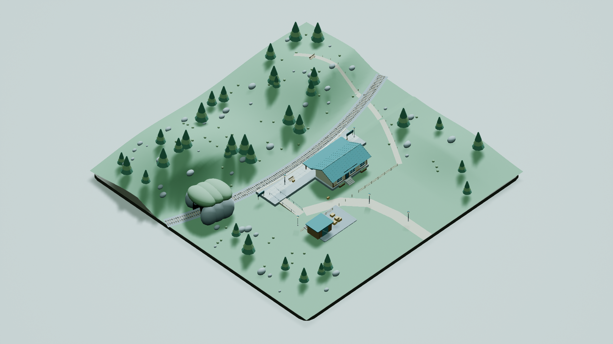
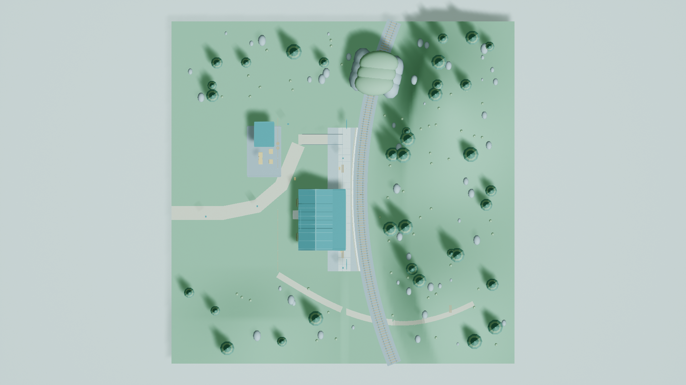
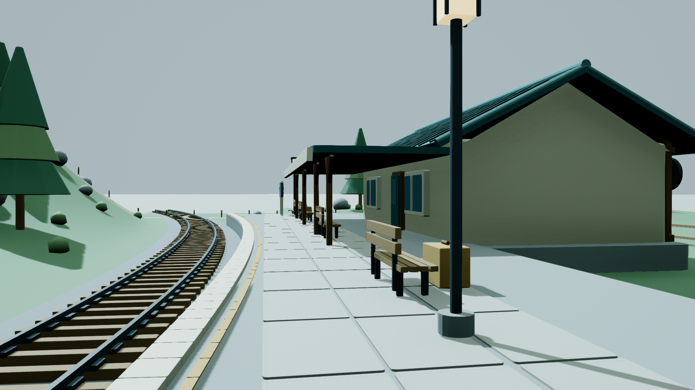
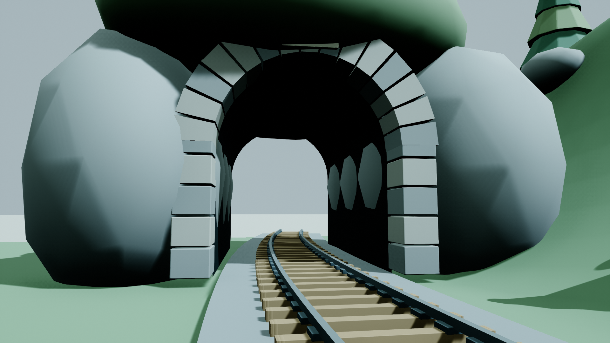

# MountainStation / high — Solmaru station

Status: ready_for_review. Independently authored and self-reviewed; integration and Git belong to the supervisor.

Started: 2026-10-21T12:27:18+00:00 UTC / 2026-10-21T21:27:18+09:00 KST.
Finished / first delivery: 2026-10-21T13:08:46.116387+00:00 UTC / 2026-10-21T22:08:46.116387+09:00 KST.
Actual total wall time: 2488.116 seconds. Start was preserved through all repairs and supervisor supplementation.
Mutex wait: 1181.849 seconds. Actual UE execution: 205.757 seconds (includes import, validation, runtime tests and captures; not additive to wall time).

| Run | Mutex wait seconds | UE execution seconds | Exit |
|---|---:|---:|---:|
| build | 341.329 | 13.055 | 3 |
| final_fix | 276.283 | 25.119 | 0 |
| pipeline | 162.743 | 109.427 | 0 |
| resume | 252.105 | 27.271 | 0 |
| runtime_clear | 24.077 | 15.176 | 0 |
| runtime_only | 125.312 | 15.710 | 0 |

The runtime supplement was requested at 2026-10-21T12:46:15Z. Its actual start, finish and elapsed are in runtime_validation.json; the containing process timing is listed above. The original build and all failed attempts remain documented in the private logs. No first delivery existed before this report.

## Delivered scene

A 100 × 100 m sculpted mountain meadow supports a cream station with muted teal folded roof, curved stone platform, continuous rails and 145 sleepers, open arched tunnel, freight shed, original crates/barrels, hillside footpath, 34 pines, benches, lanterns, station signs, clock and luggage. Rounded edges and a restrained palette tie the assemblies together. The platform has a 1:12.4 access ramp with handrails. Ground and environment use complex static collision; the baseline DefaultPawn and ScreenDebugLogger are retained.

- Content/MountainStation/high/: original meshes and materials.
- Content/Maps/MountainStation_high.umap: non-World-Partition map, dynamic lighting.
- Work/MountainStation/high/Source/: original Blender scene, 11 FBX assemblies and reproducible scripts.
- Screenshots/: four actual 1920×1080 UE renders, capture_manifest.json.
- validation.json, runtime_validation.json, baseline_validation.json, layout_checks.json, visual_review.json, publication.json, timings.json and UE_evidence.log.

## Validation evidence

The saved map was reloaded. Terrain extents are 5000 cm per half-axis. Recursive Asset Registry inspection covered 36 packages and found zero foreign /Game dependencies. PlayerStart, native ScreenDebugLogger, dynamic lighting, required assemblies and collision configuration passed. Runtime PIE confirmed controller/Pawn creation, possession, arrival position, three blocking collision sweeps, short platform movement and normal PIE shutdown. See the actual per-check results and trace endpoints in runtime_validation.json.

All 36 published files were copied only after the private UE process exited, and SHA-256 equality with scratch was checked. No external actor/object packages, map-adjacent BuiltData, shared project changes or Git mutations were made.

## Actual rendered evidence

Capture settings and UTC timestamps are in Screenshots/capture_manifest.json. The prescribed orthographic overview/top-down coordinates and 20000 cm width are used; close views use horizontal FOV 70 degrees. Actual UE SceneCapture2D final-color LDR rendering, High scalability, screen percentage 100. No editor UI or generated substitute imagery.

## Limitations and production notes

Static environment only; no train simulation, station interior or custom walking-character system. The default Pawn is the baseline flying DefaultPawn, and runtime verification is scripted movement/collision rather than an exhaustive human walk-through. The native Hello implementation remains unchanged; clean screenshots hide debug messages. Exact runtime evidence and the observation limit for Hello are recorded in runtime_validation.json.

Visual review notes: Stylized freestanding rock-covered short tunnel; open far exit and faceted interior shoulders remain visible.; Station is exterior-only. The small station occupies a restrained portion of the 100m terrain.; No performance benchmark or exhaustive human walk-through was performed.

The initial sandbox UE probe produced no engine log. A commandlet import then failed because Slate was not initialized; full-editor offscreen import succeeded. First capture rotations used an incorrect positional Rotator constructor; those blank frames were rejected and replaced after correction. Runtime sweeps exposed the presentation sky sphere reverting to BlockAll on reload; a persistent NoCollision profile and disabled actor collision fixed that obstruction. An optional diagnostic BreakHitResult helper was not exposed to Python and was removed before the final runtime pass. Source geometry sharing also needed an isolated-mesh copy before joining; the final source exports were checked afterward. Timing records include these repairs. A temporary Blender source preview was used for internal geometry QA only and is not substituted for UE evidence.

External references: no third-party artwork or another assignment's resources. Read-only baseline source/config from Git commit 7558c8f, existing baseline binaries, /Engine BasicShapes and DefaultTextureCube, and installed UE 5.7 C++ API headers were used. This author performed the final review; no other model or subagent authored the scene.

Supervisor supplement timing: see supplement_timing.json. Dedicated runtime-only slots waited 149.389s and executed UE for 30.886s. All measured PIE test intervals total 8.304s. The two additional capture-containing runs executed for 52.390s, including startup, fixes and checks. Combined work intervals overlap the task totals and are not added again.
