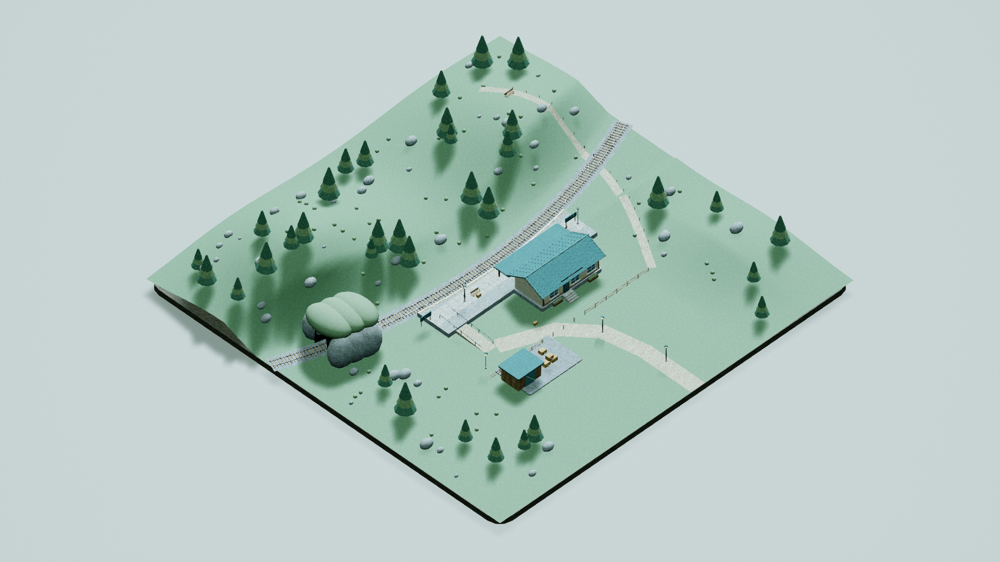
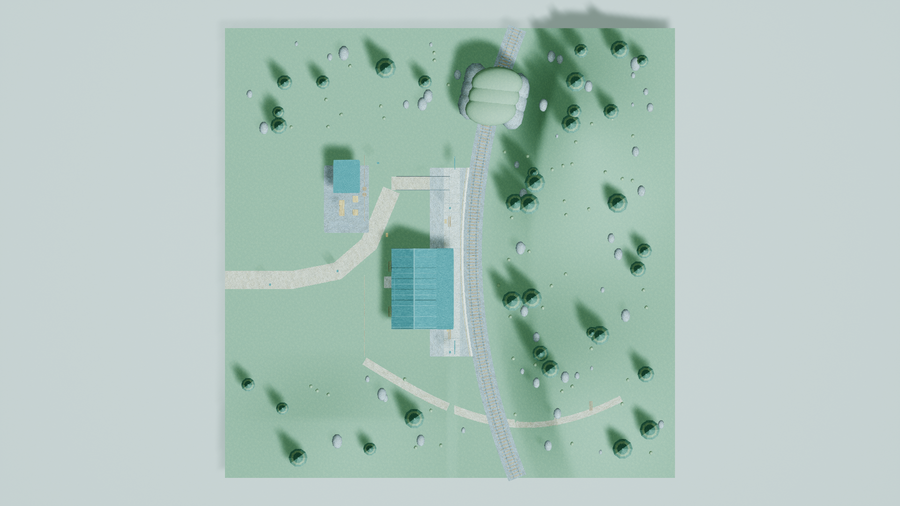
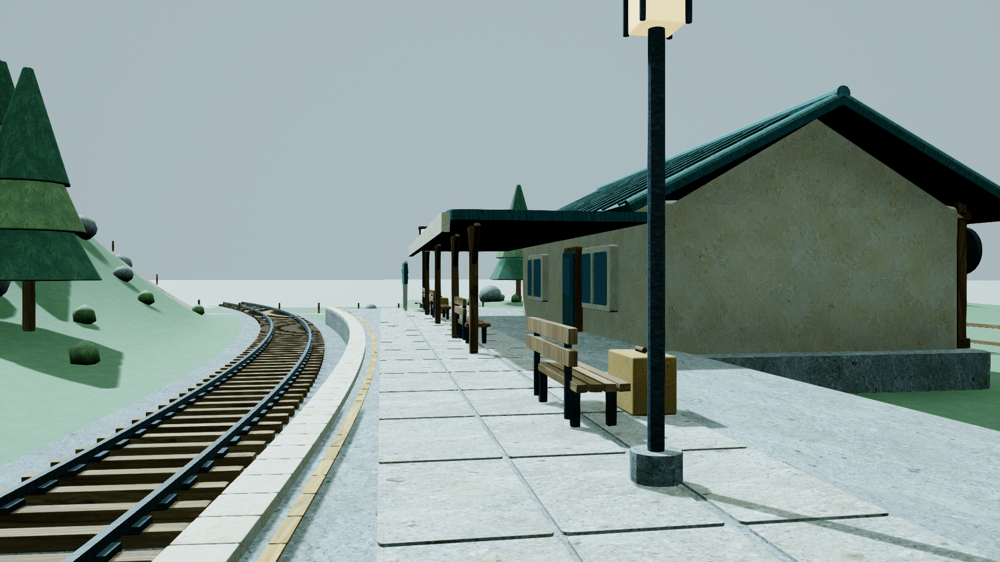
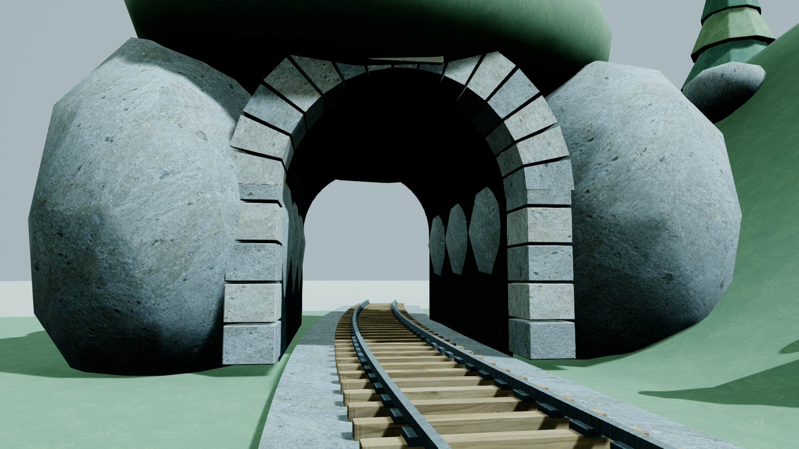

# MountainStation / high — second texture and UV pass

Status: ready_for_review. Final owned map: `/Game/Maps/MountainStation_high`. Published 43 packages (42 assets and one map). Original FirstDelivery and first-pass RESULT/STATUS were preserved. No Git mutation performed.

## Actual timing

- Start UTC: 2026-10-21T14:47:23+00:00; KST: 2026-10-21T23:47:23+09:00.
- Finish UTC: 2026-10-21T15:17:52.012490+00:00; KST: 2026-10-22T00:17:52.012490+09:00.
- Elapsed wall: 1829.012 s. UE mutex waits: 300.224 s. UE process execution: 239.526 s (all attempts).
- Five concurrent imagegen calls: 704 summed call seconds, 198 wall seconds, 506 overlap seconds. These are not additive with total wall time.
- Per-attempt UTC timestamps, waits and execution: [timing_summary.json](timing_summary.json). Token use is not measured here.

## Delivered changes

Existing station, curved railway, platform, terrain, tunnel and props retain their geometry/layout. All 11 authored assemblies now have measured UV0 surface charts plus UV1 inspection layouts. Five actual generated original images are preserved byte-for-byte in Generated/, with prompts, returned paths, SHA-256, timestamps, material mapping and output dimensions in [imagegen_manifest.json](imagegen_manifest.json). No external textures or another effort’s resources were used.

Source artwork: [Solmaru_Textured.blend](Solmaru_Textured.blend); imported meshes: FBX/; saved UE mesh roundtrip exports: UEExport/; reproducible scripts: Source/. Final shared deliverables: `Content/MountainStation/high/**` and `Content/Maps/MountainStation_high.umap`. [publication_manifest.json](publication_manifest.json) binds private/published package hashes to latest validation and actual render hashes.

Generated material mapping: plaster → Plaster/Cream/Leather; wood → Wood/Trim/Ochre; stone → Stone/StoneLight/Gravel/Path/Dark/Earth/Brick; metal → Roof/RoofEdge/Metal/Rail; foliage → Grass/Hill/Leaf/LeafLight/Flower. Furniture leather was separated from wooden Ochre props. Palette normalization uses the original per-material color divided by the generated image’s mean linear RGB. Generated contribution: 10% Grass/Hill, 24% Leaf/LeafLight/Flower, 72% remaining mapped surfaces. Samples use UV0 at 1×.

Visual review found that the presentation plane reused StoneLight, causing enlarged stone pattern outside the 100 m site. A dedicated constant M_PresentationGround restores its original color and roughness. Fresh-process graph verification confirms that this background uses no texture. The earlier evidence is retained in Attempts/BeforeVisualRefinement/. Terrain/tree generated textures remain connected with reduced contrast; no camera or geometry redesign was made.

## UV and saved-resource verification

Every LOD0 triangle of every saved authored assembly was exported from a fresh Unreal process and remeasured: 333,364 triangles. Target: 128 px/m at the actual 1254×1254 source/loaded size, equivalent to a 9.796875 m repeat. Actor scales have absolute value 1; cm-to-meter conversion is independently checked against loaded UE bounds. Repeated parts are baked into assemblies and counted individually. Area-density = 1254 × sqrt(UV area / world area).

| Saved mesh | Triangles | Area-weighted px/m | ≥1px triangle P05–P95 | Subpixel triangles | Degenerate excluded |
|---|---:|---:|---:|---:|---:|
| SM_Terrain | 20,188 | 127.9983 | 124.69–128.89 | 0 | 0 |
| SM_Railway | 85,380 | 128.0001 | 123.96–131.53 | 39,005 | 0 |
| SM_Platform | 44,820 | 128.0000 | 126.61–129.23 | 19,320 | 0 |
| SM_Station | 8,518 | 128.0000 | 125.42–130.91 | 1,088 | 0 |
| SM_Canopy | 1,480 | 128.0000 | 126.45–130.90 | 256 | 0 |
| SM_Signs | 85,460 | 128.0001 | 125.82–129.94 | 76,451 | 0 |
| SM_Tunnel | 3,740 | 128.0000 | 124.74–131.45 | 102 | 0 |
| SM_GroundPaths | 916 | 127.9996 | 127.97–128.15 | 0 | 0 |
| SM_Cargo | 7,392 | 128.0000 | 125.17–131.27 | 2,808 | 0 |
| SM_Furniture | 22,636 | 128.0001 | 125.72–130.51 | 11,027 | 0 |
| SM_Vegetation | 52,834 | 127.9999 | 124.60–131.23 | 6 | 32 |

All 35,372 source charts were reconstructed from saved UV continuity and checked: zero inter-island bounding-box overlaps or gaps below 31.96 source pixels. All saved-UE triangles remain within those chart bounds; 31.7092 px conservative roundtrip separation. Charts sit outside 0–1 and intentionally reuse texture samples through Wrap; this is not a unique baked atlas. UV1 is normalized inspection-only and has proportionally smaller padding. No baked lighting is generated.

Subpixel triangles occupy 1.680554 m² (0.004082% of measured area); excluded degenerate triangles occupy 0.000032905345 m². Source and saved-UE degenerate counts differ because import removes/retriangulates tiny faces. Detailed min/P05/median/P95/max, per-material areas, actual actor transforms, mesh bounds and exported-file hashes are in [ue_uv_validation.json](ue_uv_validation.json), [source_uv_validation.json](source_uv_validation.json) and [source_island_validation.json](source_island_validation.json).

Fresh reload: all recursive /Game dependencies remain within the owned theme/effort plus its map; 43 packages checked; all 11 meshes have two UV channels and full precision UVs; all generated textures are found upstream of BaseColor in the saved material graphs. Presentation background is constant. See [ue_validation.json](ue_validation.json). Direct loaded WorldSettings.world_partition is None, with the exact owned map world path verified in a subsequent read-only process: [world_partition_validation.json](world_partition_validation.json).

## Runtime evidence

Fresh PIE world, controller/pawn possession, arrival PlayerStart, 300 cm platform movement and normal PIE shutdown passed. Downward sweeps moved the pawn before contact, returned blocking hits with initial_overlap=false, and identified the actual actor/component/mesh:

| Site | Actual pawn travel cm | HitResult distance cm | Actor / mesh |
|---|---:|---:|---|
| arrival | 140.170 | 141.500 | GroundPaths / SM_GroundPaths |
| ramp | 143.551 | 144.881 | Platform / SM_Platform |
| platform | 141.420 | 142.750 | Platform / SM_Platform |

Full native HitResult fields and paths: [runtime_validation.json](runtime_validation.json). Native ScreenDebugLogger presence in active PIE was observed; no separate on-screen Hello observation or instrumented BeginPlay count is claimed.

## Actual UE captures

Latest saved scene rendered at 1920×1080, High (all observed scalability CVars = 2), screen percentage 100, no UI. All four camera transforms, projection, FOV and orthographic width match FirstDelivery exactly. [capture_manifest.json](Screenshots/capture_manifest.json) records actual timestamps and settings. All four images were visually inspected after material refinement.

### overview

### top_down

### platform

### tracks

## Limitations and attempts

- Original imagegen requests asked for 1024²; actual outputs are 1254². They remain unchanged and imported with NoMipmaps, so distant detail may alias. Tile seam continuity has not been numerically certified.
- Curved/beveled normal patches preserve area density, not every local direction. Tiny bevel triangles can have large min/max distortion. Within-chart triangle intersections were not exhaustively tested; inter-chart nonoverlap was checked. Glass, Lamp, SkyBackdrop and PresentationGround are intentionally untextured exceptions.
- First import attempt failed on an unavailable Lerp const_alpha property; fixed with an explicit Constant node. First runtime attempt failed because HitResult was expected to expose 19 fields; UE 5.7 exposes 18. Both are retained as attempted execution in timings; process exit zero alone is not treated as validation success. Latest checks all pass.
- Visual refinement added one dedicated background material; all other changes stay within this effort. Supervisor owns integration, Git and the consolidated cross-theme report.
