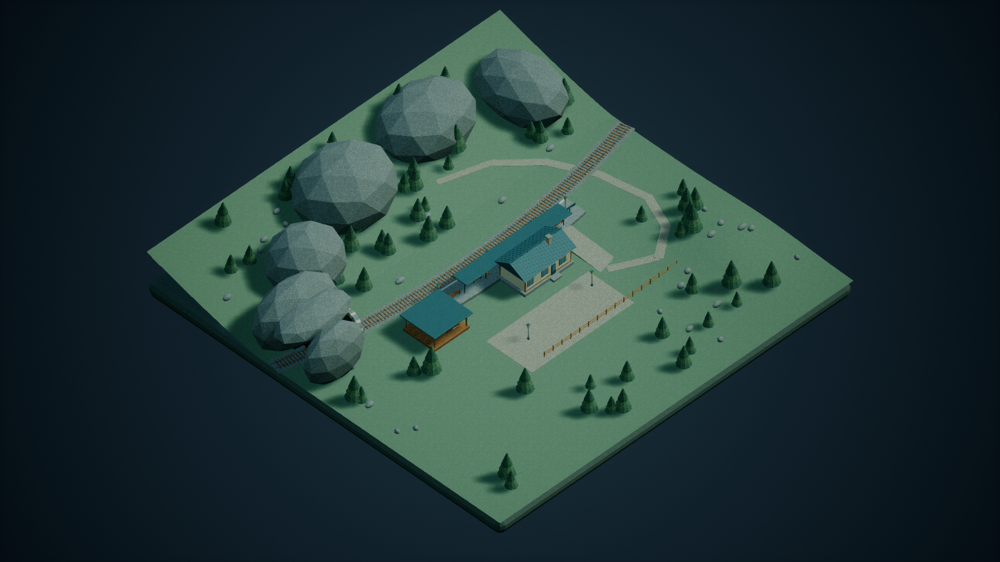
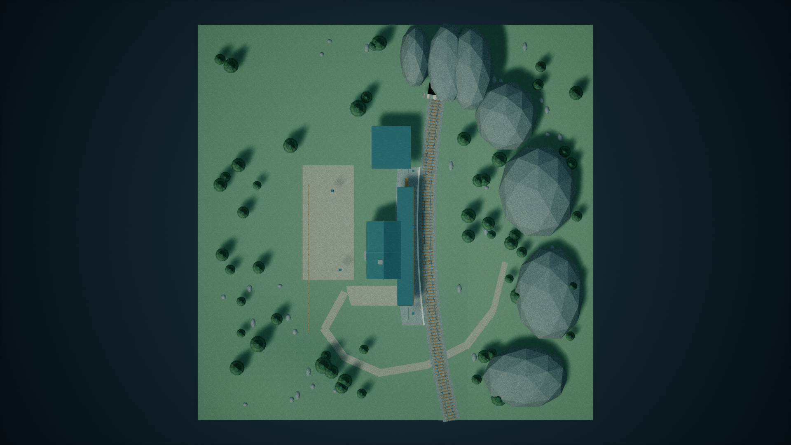
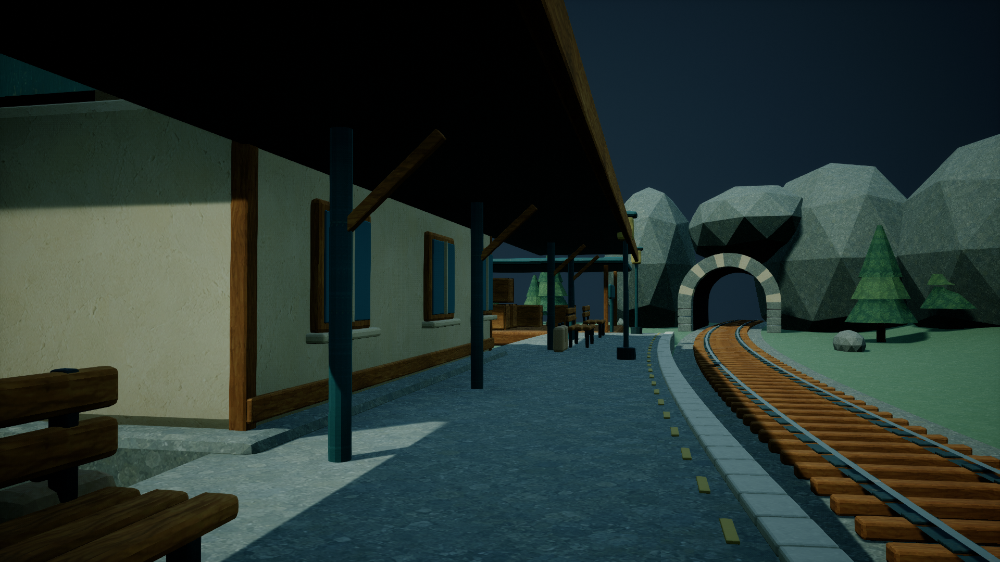
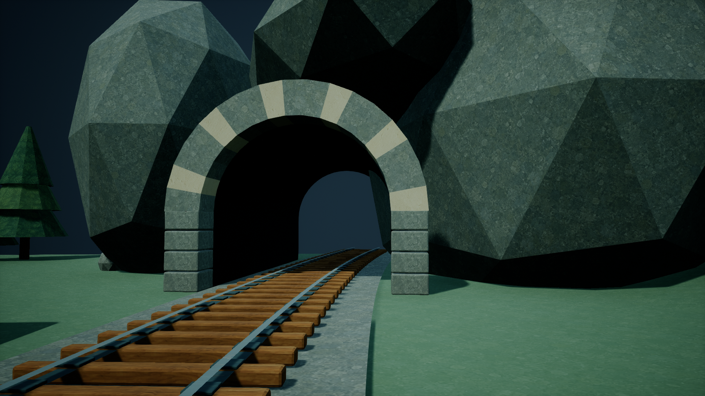

# MountainStation / medium — TexturePass

Ready for supervisor review. The existing Alder Pass geometry, layout, lights and four comparison cameras are retained. FirstDelivery and its initial timings are untouched. No Git operation was performed.

## Timing
- UTC start: 2026-10-21T14:46:41.0000000+00:00; finish: 2026-10-21T15:13:28.4507038+00:00.
- KST start: 2026-10-21T23:46:41.0000000+09:00; finish: 2026-10-22T00:13:28.4507038+09:00.
- Actual wall: 1607.4507038 seconds; UE queue wait: 300.0089776 seconds; UE execution: 363.9154862 seconds, including failed attempts.
- Imagegen: one real call, 26.0 tool-reported seconds, no parallel calls or overlap. The exact end clock was not sampled; imagegen_manifest.json explicitly distinguishes later completion observation from an exact finish timestamp. Token accounting remains supervisor-owned.

## Delivered
- /Game/Maps/MountainStation_medium
- /Game/MountainStation/medium/TexturePass: new UV mesh, 20 materials, one generated six-surface albedo atlas.
- Source/AlderPass_UV.blend, Source/AlderPass_UV.fbx, unchanged generated Source/SurfaceAtlas.png and exact Source/imagegen_prompt.txt.
- Four actual UE screenshots and Screenshots/capture_manifest.json; validation, full source-object CSV, mapping and SHA-256 manifests beside this report.

## UV and material evidence
All 1,247 authored Blender objects were measured after applying world transforms. Source geometry has 124,742 triangles and 45,905.11295 square metres of surface area, including terrain and the plinth. UV0 uses face-plane metric coordinates at 128 pixels/metre, with a 3.5m physical repeat. Each source panel is 512 square pixels with a 32px guard on every edge, leaving 448 square usable pixels.

Fresh UE process inspection read the saved mesh's actual RenderData LOD0, rather than reusing the source report: 120832 triangles, 45905.1132410267 square metres, 1 UV sets, UV island result (92353, True). All valid render triangles were checked; this is not a sample. For 84246 triangles covering at least four target texels, density is 127.095798205658–133.123374982531 pixels/metre, median 127.999992769977; outside 2% tolerance: 5. 36586 smaller triangles remain explicitly excluded from that tolerance claim. The five additional outliers are small extruded lettering sides on the two platform nameboards and freight label (white material slot 7), each under 0.001 square metres and under two target pixels wide. They are retained as explicit special-surface exceptions, verified by material and position. Full values and each exception triangle are in saved_asset_validation.json.

UVs intentionally overlap across charts and repeated props; this is a repeating surface map, not uniquely packed baked artwork. There is no between-island padding. Coplanar triangles have coherent coordinates, while curved faceted surfaces can show texture phase seams. Tiny bevels and lettering may collapse below one texel. Glass and dark materials stay untextured but their UV geometry is audited; the Engine backdrop is excluded. Source chart-group counts group plane equations and are not a claim of connected-island counts.

The generated atlas supplies timber, cream plaster, aggregate stone, teal painted metal, bark and conifer needles. Material mapping covers building walls/roof, rail/ties, platform/tunnel, trees and props. Surface colours blend the atlas with the original palette (18–60% texture weight). The actual saved mesh slot materials, BaseColor input nodes and compiled used-texture references were checked. This pass adds albedo only, with scalar roughness; it does not claim authored normal/displacement maps or photorealism.

## Runtime and scope validation
Fresh saved-map reload passed. Recursive dependencies were checked for the map and every asset under the owned theme/effort root, including retained legacy assets: zero foreign /Game references. Dynamic lighting and the original non-World-Partition scene structure remain. No baked-lighting or external actor/object package is delivered.

The actual player controller possessed the baseline Pawn. It moved 200cm from its spawn. Downward sweeps against terrain, ramp and platform each report blocking=true, initial_overlap=false, positive movement and the exact hit actor, component and new SM_AlderPass_UV mesh. These are actual Pawn movement sweeps, with normal PIE shutdown. Evidence is runtime_validation.json; runtime_hello.png documents the debug overlay. This validates the three stated surface positions, not every possible traversal route.

Private UE exited before publication. All 44 owned private/published package hashes agree (delivery_hashes.json). Source and evidence hashes are in evidence_hashes.json. FirstDelivery assets were not overwritten inside its archive.

## Visual inspection
All four final UE renders were inspected individually; baseline positions, projections and lenses match exactly. The same supplied rotation values differ by at most 0.000001374 degrees after UE Rotator constructor float rounding, explicitly recorded in the manifest. See visual_review.json for observations and limitations. Wide shots retain the original silhouette; close views show timber, plaster and stone texture while maintaining the stylized scene. Generated source artwork is never presented as scene evidence.

## Failures and references
Two apply attempts failed on UE material input-pin naming (Frac and texture coordinates); the third saved successfully after resolving actual pin names. The first audit failed on UE's triangle-ID Python naming; its error handler also reused a global package variable, so only that exact owned process was stopped. Two subsequent audits measured the density exceptions; the final audit validates the exact lettering exception scope rather than claiming all triangles satisfy tolerance. Subsequent attempts and outcomes are retained in timing_summary.json and failure records. No other's process or asset was touched.

Technical references: installed Unreal Engine 5.7 GeometryScript MeshAssetFunctions.h / MeshQueryFunctions.h, MaterialEditingLibrary.h, and the shared read-only Run-UnrealIsolated.ps1 runner. No external visual reference was used. Source imagery was generated independently for MountainStation/medium through image_gen.imagegen.

## Supplemental direct WorldPartition verification
At 2026-10-21T15:15:09.762128+00:00 (2026-10-22 00:15:09 KST), a new private UE process reloaded the final map and queried UnrealEditorSubsystem.get_editor_world(), world.get_world_settings(), then settings.get_editor_property('world_partition'). Actual world path: /Game/Maps/MountainStation_medium.MountainStation_medium. The returned pointer was None; passed=true. No exception occurred and no fallback value was substituted. Evidence: world_partition_validation.json.

This was a read-only follow-up after TexturePass delivery; its separate queue wait was 5.6786583 seconds and execution was 13.7287169 seconds. Original delivery timestamps and duration remain unchanged. The private editor exited normally, and all 44 private/published package hashes were rechecked unchanged. No resave, art change, publication copy or Git operation occurred.

## Superseding UV revision
The latest validated assets and captures are documented in [UVRevision/RESULT.md](UVRevision/RESULT.md). Original timestamps above are retained. The previous overlap policy and screenshots describe the superseded delivery, not the current map.

