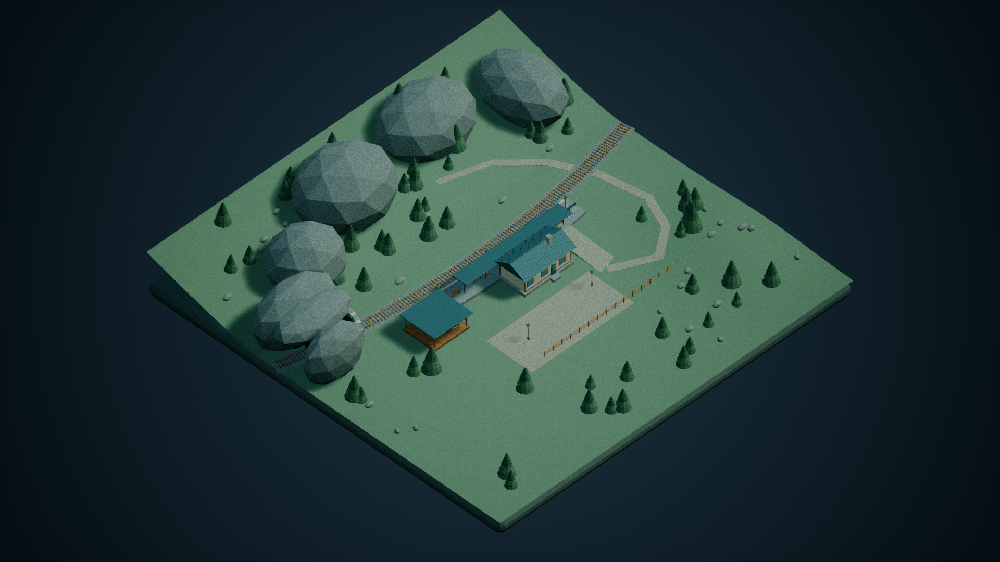
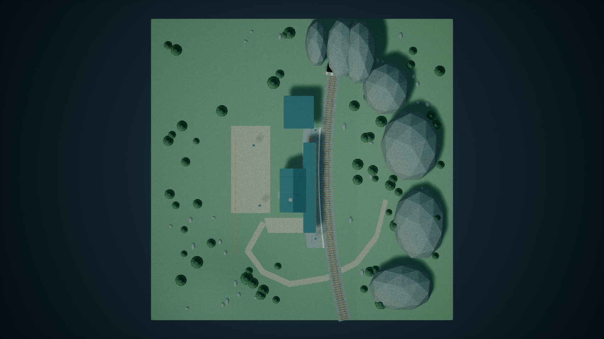
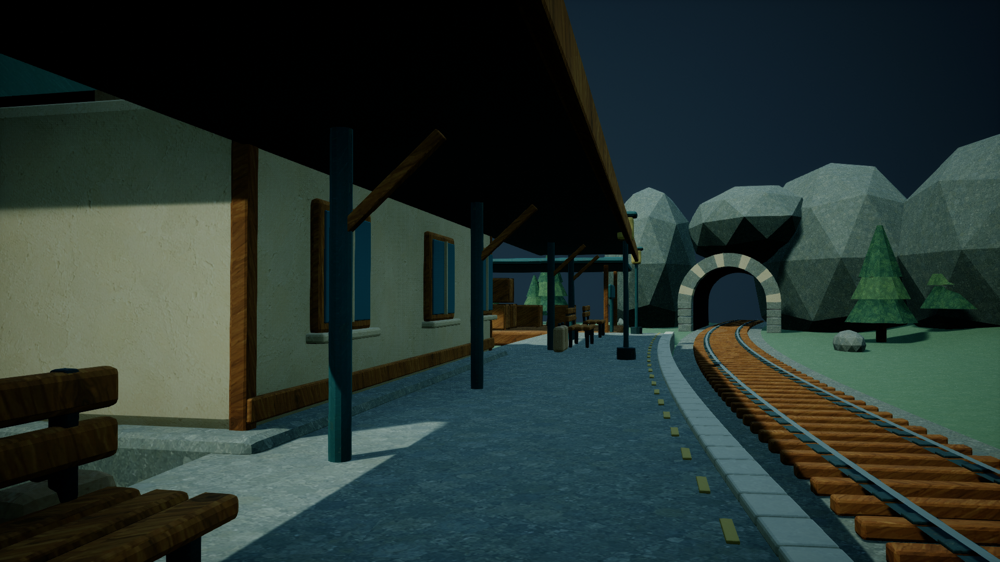
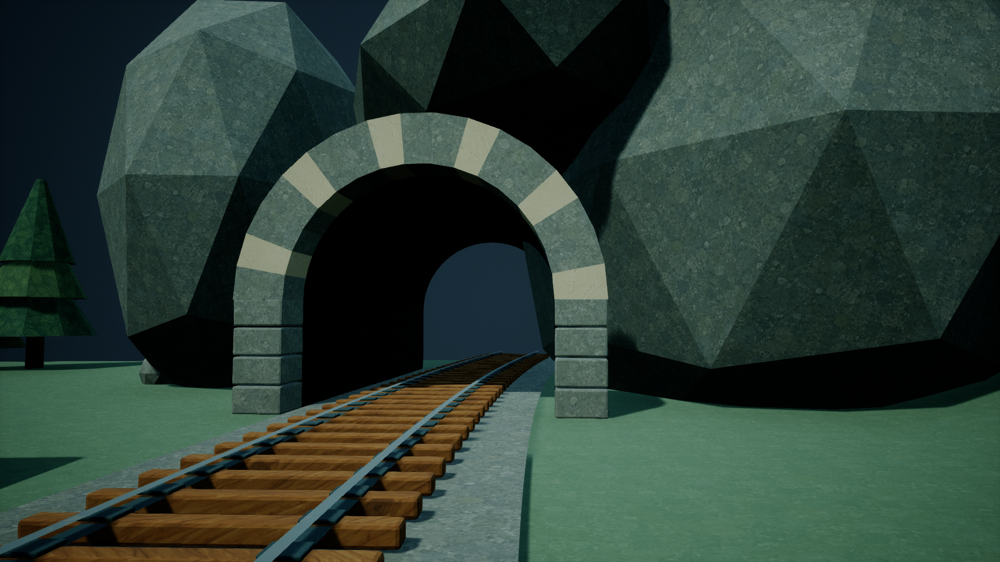

# MountainStation / medium — connected UV and shared-tree revision

Latest delivery, ready for supervisor review. This supersedes the original TexturePass UV packing and screenshots. FirstDelivery and the original TexturePass start, first ready and supplemental timestamps remain preserved. No Git operation was performed.

## What changed
The rejected 88,574-island attempt is not the final asset. Intrinsic triangle unfolding now joins actual adjacent triangles, preserving edge lengths and face areas and cutting where cycles or overlap prevent a valid continuation. The final source has 3776 station/terrain islands and 8 islands on one tree prototype. Plane-equation grouping is not used to count islands.

All 64 tree placements now reference the same SM_PinePrototype asset (152 triangles) and the same materials. UVs are authored once on that prototype. These are 64 StaticMeshActor instances sharing mesh data, not a claim of a single ISM/HISM draw call. Ground positions and height variation remain. To standardize geometry, the original selected tree is uniformly scaled: canopy proportions follow height; trunk thickness and tiny top-cap radius consequently scale too, unlike the previous procedural fixed widths. No new image generation, theme or layout was introduced.

## UV allocation and density
UV0 uses an unfolded multi-tile coordinate domain. Every distinct island in a unique mesh receives its own rectangle, with 8 effective texel pixels of padding on each side. No unique-surface overlap is permitted. Only afterwards does the shader apply Frac to reuse the original generated surface atlas. Reuse of one prototype's UVs by multiple tree actors is explicitly intentional and separate from unique-mesh allocation.

Source station mesh: 111074 triangles, 41917.8837264207 square metres, 3776 actual connected UV islands, zero positive-area overlaps, minimum island bounding-box gap 15.99609375 effective pixels. Source tree: 152 triangles, 8 islands, zero overlaps. Detailed source data: shared_source_validation.json and shared_source_objects.csv and per-object area/density source_object_metrics.csv; editable source: Source/SharedScene.blend, with separate station and prototype FBX exports.

Fresh-process saved UE RenderData LOD0: 111074 station triangles and 3776 actual connected UV islands. Overlap pairs: 0; minimum bounding-box gap: 15.99609375 effective pixels. Tree prototype: 152 triangles, 8 islands, 0 overlaps. Every triangle and actual shared edge is processed; this is not sampled. The checker uses exact position+UV edge connectivity, then a global triangle AABB sweep and strict SAT intersection test. Gaps are conservative bounding-box distances, with all pairs closer than 32 pixels covered. Shared boundaries inside an island are allowed.

The target remains 128 pixels/metre (448 usable atlas pixels per 3.5m repeat). For 74518 saved station triangles with at least four target texels, measured density is 127.21735411499–128.740537268327 pixels/metre, median 128.000030857601, outside 2% tolerance: 0. Smaller triangles are reported separately without a uniform-precision claim. Glass/dark stay untextured but their geometric UVs are measured. Shader PackedUVScale reads saved custom primitive data 0: 1 for the unit-scale station, and each uniform actor scale for trees. All 64 saved tree transforms, shared mesh references, scalar values and all 9,728 expanded tree triangles were checked; resulting density is 127.962022785004–128.058547737295 pixels/metre.

Unreal removes near-degenerate faces during building. Source cleanup therefore precedes unfolding: area below 1e-8 square metres or minimum altitude below 0.1mm is removed, totaling 3940 faces. This avoids deleting connectors after UV packing. It affects microscopic slivers, especially lettering; remaining small-face precision is explicitly reported. No normal/displacement maps were added. Frac-based image repetition and phase changes across seams can remain visible.

## Validation and evidence
Fresh reload directly read WorldSettings.world_partition: None. Actual world: /Game/Maps/MountainStation_medium.MountainStation_medium. All owned assets and the map were recursively checked; foreign /Game dependencies: 0. Actual BaseColor graph traversal verifies texture coordinates, scale parameter, custom primitive data and Frac connectivity, as well as mesh material slots and used textures. Full-precision UV storage is enabled and verified.

The real possessed Pawn moved 200cm. Ground, ramp and platform sweeps block with initial_overlap=false and positive displacement; the exact actor/component/new mesh are recorded. PIE shut down normally. Four new 1920x1080 UE renders use the FirstDelivery cameras and were individually inspected. These are actual scene renders, not generated evidence. No baked lighting or external actor/object packages were published.

The private editor closed before publication. All 67 owned package hashes match private and published files. See delivery_hashes.json, evidence_hashes.json, saved_asset_validation.json, runtime_validation.json, visual_review.json and Screenshots/capture_manifest.json.

## Timing
Revision UTC: 2026-10-21T15:18:30.0000000+00:00 → 2026-10-21T15:43:57.8460483+00:00.
Revision KST: 2026-10-22T00:18:30.0000000+09:00 → 2026-10-22T00:43:57.8460483+09:00.
Additional wall: 1527.8460483 seconds; additional UE queue wait: 204.3167608 seconds; additional UE execution: 396.2444052 seconds. Includes rejected attempts and corrections. New imagegen calls: 0. Original TexturePass start 14:46:41Z, first ready 15:13:28.4507038Z and supplemental 15:15:09.762128Z are not reset.

