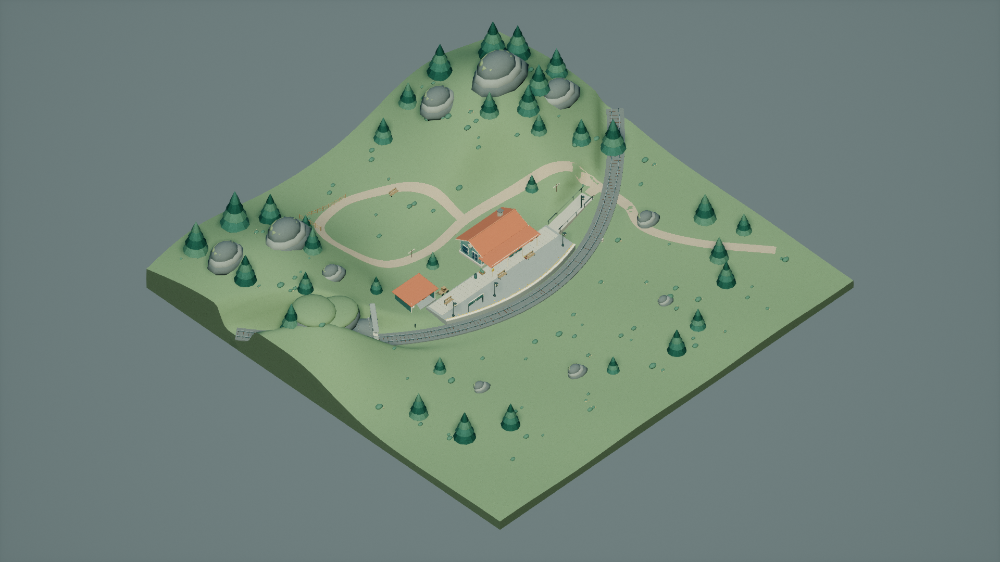
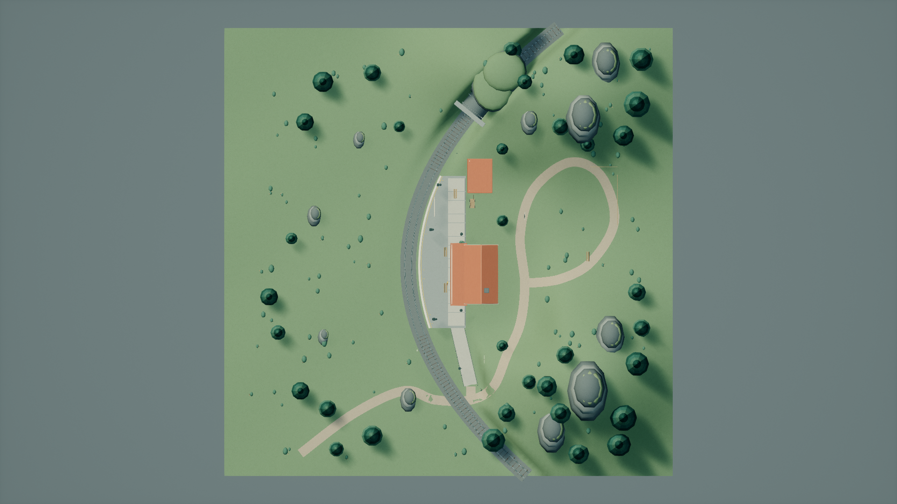
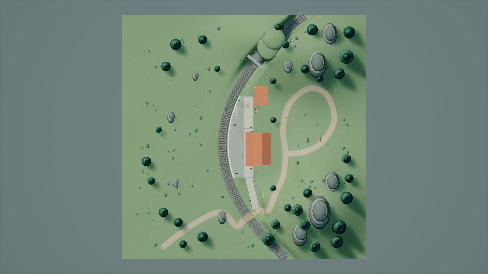
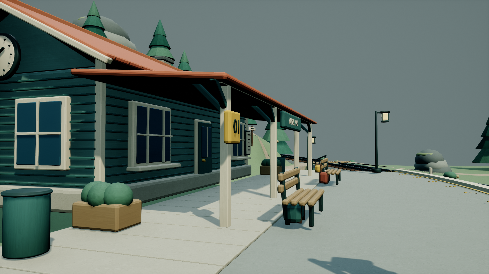
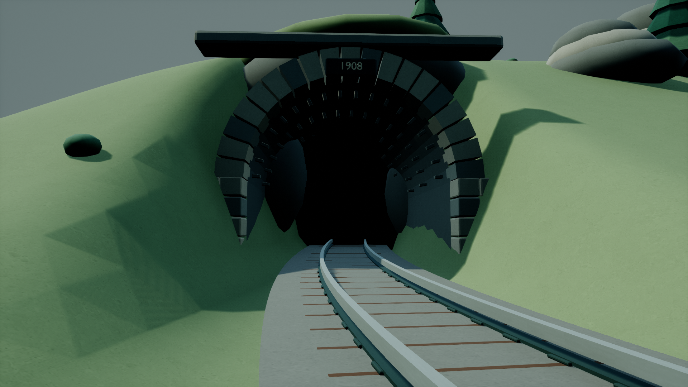
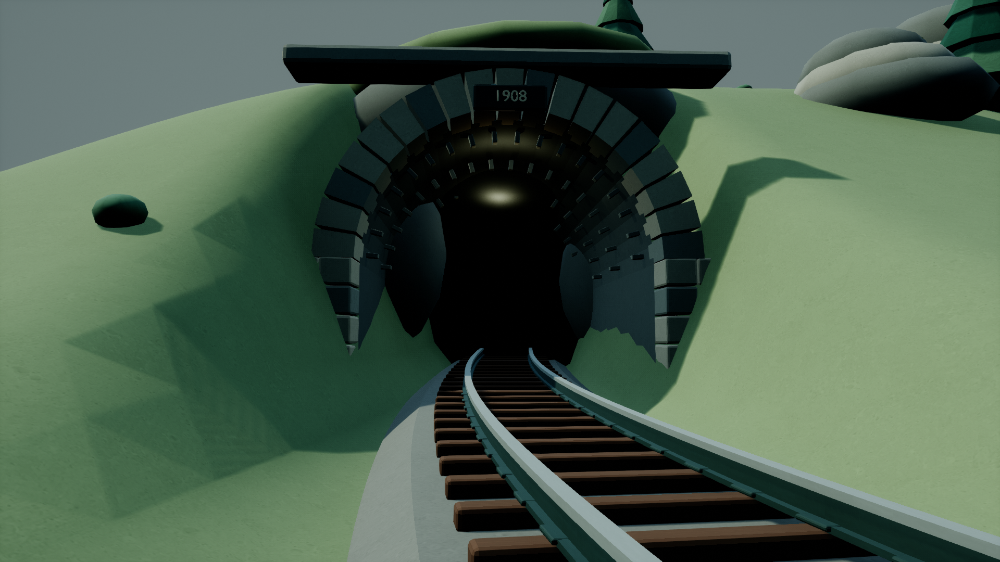
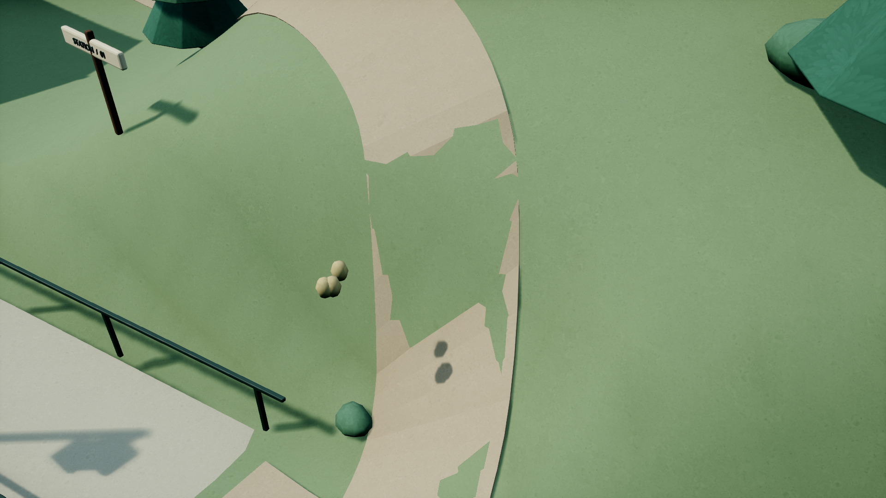
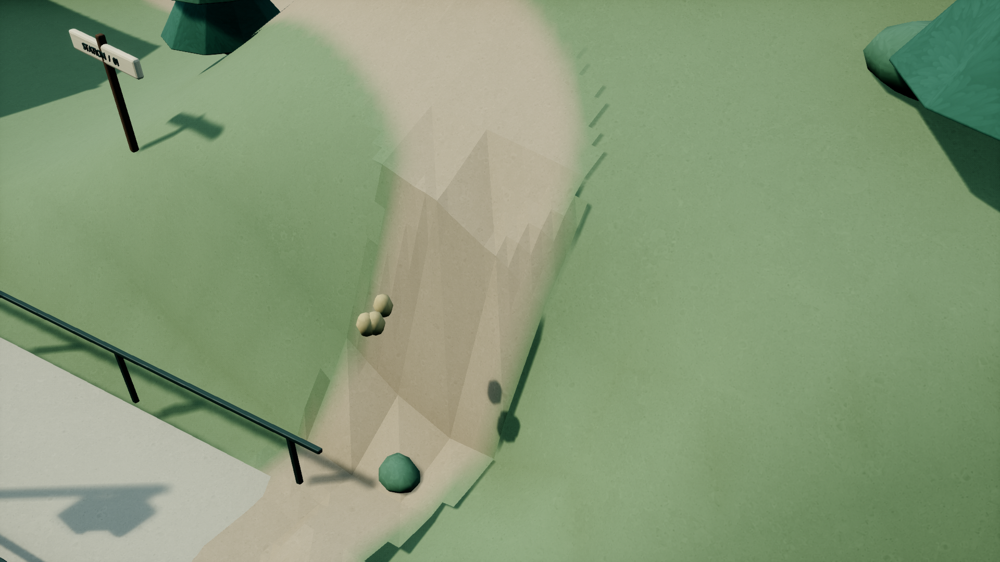
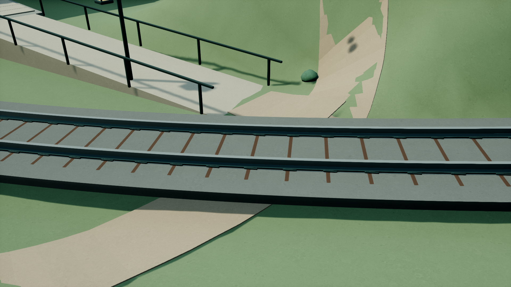
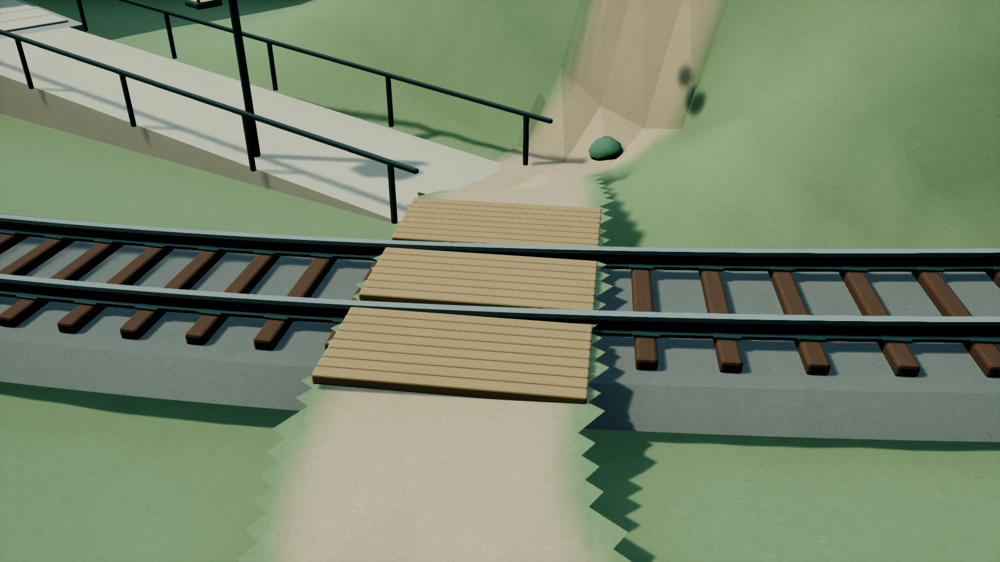

# MountainStation / ultra — SelfImprovement

Finite worker pass complete; ready for supervisor review and integration. No commit or push was made after the explicit resume request. The previous stopped checkpoint remains preserved in commit f7f46b7 and Checkpoint/.

## Scope and result

Repaired terrain clipping along the footpath, blended gravel edges into meadow with imported corner colors, added a timber railway crossing, exposed sleepers above a trapezoidal ballast bed, rebuilt continuous rail foot/web/head profiles, and added two movable tunnel fill lights. The original 44 other mesh geometries and all 56 original actor placements are unchanged. Terrain remains a 100 × 100 m static mesh; station, platform, 1:12 access ramp, freight shed, trees and props remain.

Owned delivery: `ForestDemo/Content/MountainStation/ultra/**` and `ForestDemo/Content/Maps/MountainStation_ultra.umap` (137 packages). All publication bytes match the privately validated package inventory. The private editor was closed before copying. Full manifest: [publication_manifest.json](publication_manifest.json).

## Validation evidence

- Saved map reloaded in a fresh UE process. World partition is absent; dynamic lighting is enabled; recursive dependencies contain no foreign /Game packages. No external-actor/object packages or BuiltData were published.
- Actual imported footpath: 86,368 centroid/edge samples, minimum terrain clearance 3.699 cm. Original source diagnostics found 13 penetrating samples out of 794, worst −39.758 cm. Sampling populations differ after retessellation; these are not equal-count tests.
- 17 actual rail/ballast/sleeper checks: exposed sleeper height 14.000–14.010 cm. Downward rail collision agrees with the imported head surface. Two movable fill lights verified.
- All 48 placed owned meshes / 320,524 imported triangles checked for UV chart containment, padding, material dimensions/scales and overlap. 99.91584% of surface area is within ±5% of 128 effective base texels/m. Preserved terrain nonplanarity and tiny subpixel numerical intersections are itemized in [uv_validation.json](uv_validation.json).
- Saved soft-path material parent and VertexColor.R → Lerp → Multiply → BaseColor connections verified. Imported nonwhite vertex colors confirmed; numerical imported color ranges are not claimed. Source Blender/FBX color ranges are in color_source_diagnostics.json.
- Actual possessed DefaultPawn: original arrival-ramp movement, native logger BeginPlay probe, positive blocking sweeps against terrain/platform, plus 222 successful moves across three changed routes in both directions. See [Runtime](Runtime/changed_routes.json).
- All 201 FirstDelivery/TexturePass evidence files retain their original inventory and hashes. Comparison packages are preserved separately. New evidence is confined to SelfImprovement.

## Actual before / after renders

Six actual UE captures per state. Camera poses/projection/FOV, 1920 × 1080 resolution, manual exposure and quality CVars match exactly. After renders bind to the validated package manifest and package hashes were reconfirmed after capture. before_current is a rejected sky-only attempt and is excluded from comparison.

| View | Before | After |
|---|---|---|
| overview |  |  |
| top_down |  |  |
| platform |  |  |
| tracks |  |  |
| path_junction |  |  |
| crossing |  |  |

Visual findings are recorded in [visual_review.json](visual_review.json).

## Timing and interruption

- Original start: 2026-10-21T15:38:54+00:00 UTC / 2026-10-22T00:38:54+09:00 KST.
- User stop: 2026-10-21T16:05:23.649339+00:00; resumed: 2026-10-22T12:34:31.600529+00:00 UTC / 2026-10-22T21:34:31.600529+09:00 KST.
- Finish: 2026-10-22T13:15:01.961064+00:00 UTC / 2026-10-22T22:15:01.961064+09:00 KST.
- Start-to-finish wall time: 77767.961 s; user-requested pause: 73747.951 s; time excluding pause: 4020.010 s.
- Recorded UE queue wait: 320.427 s; UE execution: 1077.550 s. All attempts, failed runs and rejected capture costs are included. [timing_summary.json](timing_summary.json) contains individual runs.
- New image generation: 0 calls / 0 s. Existing owned TexturePass textures reused. Parent and verified-child token deltas require supervisor accounting; no counts are invented.

## Corrections and limits

Review found a real 12 cm path/ramp overlap, repaired by conforming path vertices below the original ramp surface. It also found a 14.99 cm penetration where Blender and UE triangulated nonplanar terrain differently; the path was rebuilt against the actual UE terrain triangles. Imported vertex colors were absent after mixed legacy/Interchange reimport; conversion bypassing task options was confirmed, but the exact color-loss mechanism was not established. The private Footpath asset was recreated through UE with explicit legacy FBX import; saved colors and material wiring then passed. Tangent-versus-color API misuse and initialization cleanup were corrected. Source export/backup failures required new output filenames; review04 used the prior geometry and is explicitly superseded. Failed attempts and logs are retained, including four unsuccessful UE processes with Windows access-violation shutdown exit codes; none count as successful validation.

Movement evidence uses a 35 cm DefaultPawn sphere, with center positions 80 cm above crossing/ramp support and 150 cm above the steep repaired slope. Paths may detour laterally by up to 75 cm within verified supporting path surfaces. The original 80 cm-clearance steep-slope sweep was blocked by the path itself and remains a documented failed test; raising flight clearance does not establish walkability. It does not certify grounded Character walking, wheelchair accessibility along the mountain trail, or train operations. Terrain is a mesh rather than Landscape. Five inherited 1254² textures repeat over polygon UV charts, use no mipmaps/NeverStream, and are not uniquely painted atlases. Tiny UV numerical intersections and terrain density exceptions are reported. Tunnel depth remains dark; sparse landscape styling, triangulated steep path faces and visible 20 cm grid edges in close views remain limitations. Final fill intensities are 35 and 25 lumens, reduced after the first after-render showed excessive brightness. No additional external artwork was used; installed UE source was consulted for import/API behavior.

Final scene validation (review09) exited 0. The separate final capture wrote all six PNGs, its successful manifest and post-capture package hash confirmation, then returned Windows access violation (-1073741819) after engine shutdown/log-close messages. The editor process was independently confirmed closed, all final PNGs were inspected and hashed, and all 137 published package hashes matched the validated inventory. Clean final-capture process exit is not claimed. This adds a fifth nonzero-exit process to the four earlier unsuccessful runs.
