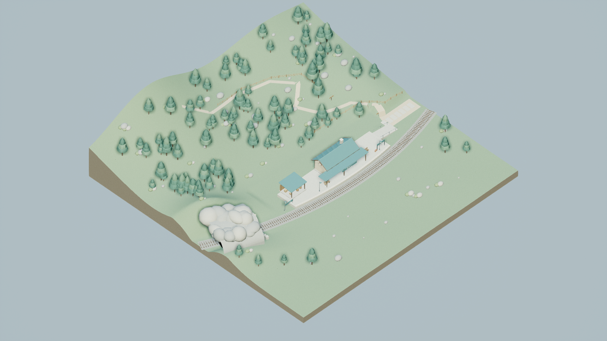
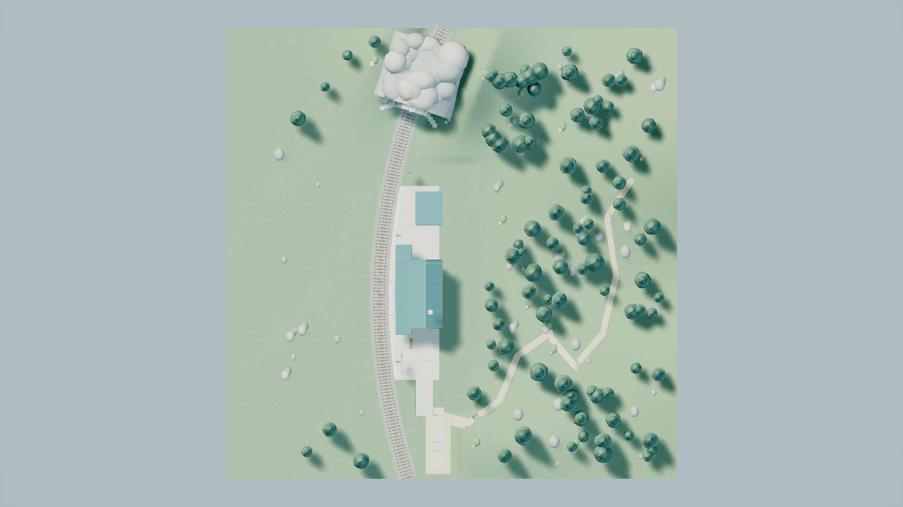
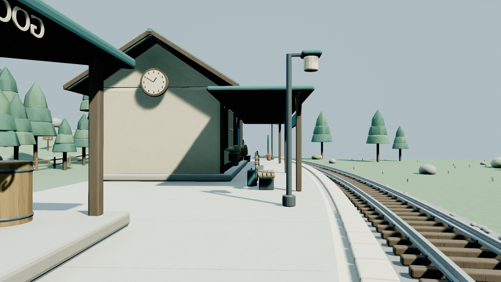
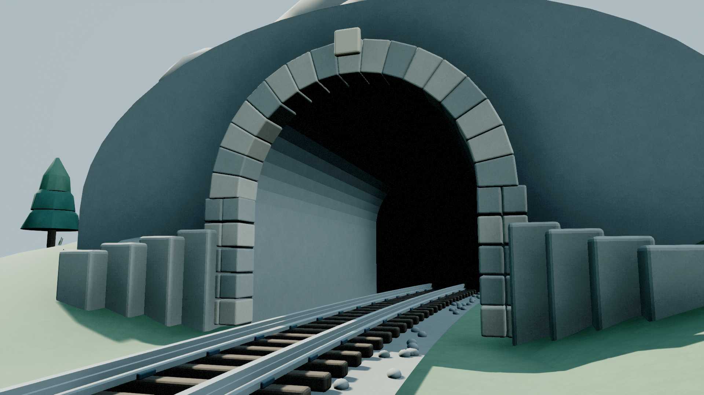

# MountainStation / xhigh — TexturePass

Status: **ready_for_review**. 기존 100×100m Alder Pass 구성을 유지하면서 UV와 imagegen 표면 텍스처를 보강했습니다. 최종 private editor 종료 후 41개 패키지를 소유 경로에 게시했고, 저장 맵을 검증한 프로세스의 해시와 private/published 해시가 모두 일치합니다. FirstDelivery 파일의 해시도 그대로입니다. 첫 납품의 STATUS/RESULT/시각·커밋을 덮어쓰지 않았습니다. Git 조작과 보조 에이전트 사용은 없었습니다.

## 두 번째 패스 실제 시간

- 시작 UTC: 2026-10-21T14:47:03+00:00
- 시작 KST: 2026-10-21T23:47:03+09:00
- 완료 UTC: 2026-10-21T15:13:56.606004+00:00
- 완료 KST: 2026-10-22T00:13:56.606004+09:00
- 벽시계: **1613.606초 (26.89분)**.
- UE mutex/우선순위 대기 합계: **254.645초**. UE 실행 합계: **221.837초**. 실패 종료도 포함합니다.
- Blender UV 작성 실행: 24.286초. 이 값과 UE/이미지 생성은 벽시계 내 작업이며 총 wall에 다시 더하지 않습니다.
- imagegen: 독립 이미지 4건, 동시 요청 4개, 재시도·중복 호출 0회. 호출 구간 전체 wall **96.743초**, 중첩을 포함한 요청별 시간 합 **250.796초**, 중첩분 **154.053초**. 내부 서버의 실제 병렬 실행 여부는 모릅니다.
- 토큰 증분은 감독자의 dispatch/완료 누적값으로 계산합니다. 이 작업자가 토큰 수를 추정하지 않았습니다.

| UE 실행 | 대기 초 | 실행 초 | 종료 코드 |
|---|---:|---:|---:|
| build | 0.308 | 97.516 | -1073741819 |
| capture | 44.442 | 93.704 | 0 |
| runtime | 102.028 | 18.576 | 0 |
| partition | 107.868 | 12.041 | 0 |

`build`에서 에셋 저장과 스크립트 완료 후 엔진 종료 단계의 비정상 코드 -1073741819가 발생했습니다. 로그는 Exiting까지 도달했지만 정상 종료로 처리하지 않았습니다. `capture`의 별도 새 프로세스에서 저장 에셋 재로드·검증, 실제 렌더와 PIE를 수행해 종료 코드 0을 확인했습니다. `runtime`은 지형 메시 자체에 대한 sweep을 보완한 추가 새 프로세스이며 정상 종료했습니다. 전체 로그와 원본 시간 기록은 `Evidence/ue_*.log`, `process_timings.json`에 있습니다. Forest 우선 runner를 사용했고 다른 실행을 종료하지 않았습니다.

`partition`은 감독 요청에 따른 마지막 읽기 전용 재로드 검사입니다. `WorldSettings.get_editor_property("world_partition")`에서 실제 저장 맵의 값이 None임을 확인했습니다. UE 5.7 헤더의 VisibleAnywhere 프로퍼티와 엔진 getter 구현을 확인한 뒤 사용했으며, 외부 패키지 부재만으로 non-WP를 추정하지 않았습니다. 자세한 값은 `world_partition_validation.json`에 있습니다.

## UV와 표면 밀도

목표 **256px/m**, 실제 이미지 **1254×1254**, UV 배율 **256/1254 per metre**, 반복 폭 **4.8984375m**입니다. 요청 프롬프트의 1024 해상도를 실제 값으로 주장하지 않습니다. 실제 면적 공식은 `density = sqrt(UV 삼각형 면적 × 1254² / 배치 후 m² 면적)`입니다. source 변환을 적용하고 UE cm→m, BuildScale, actor/component scale `(1,-1,1)`을 확인했습니다. 반사 배율의 절대값은 1입니다. 원본과 저장 UE 모두 UV0이며 머티리얼 추가 UV 배율은 1입니다.

공면·동일 재질·인접 삼각형을 고유 표면 아일랜드로 묶고 직교 투영했습니다. 원본 전체 사각 경계의 shelf 간격 검사는 nominal **8px 이상**이며 아일랜드 경계 사각형 간 겹침은 없습니다. UV는 0..1 밖으로 확장되고, wrap 후 같은 타일을 재사용하는 겹침은 의도된 것입니다. 고유 베이크 atlas나 라이트맵이라고 주장하지 않습니다. 곡면은 면 단위 아일랜드여서 베벨/곡면 경계에서 결 방향이 연속적이지 않을 수 있습니다.

| 메시 | 원본 삼각형 | 원본 면적 m² | 원본 면적 가중 px/m | 저장 UE Render 삼각형 | UE 전체 면적 가중 px/m | UE Render 표본 수 |
|---|---:|---:|---:|---:|---:|---:|
| Cargo | 24,996 | 319.997 | 256.0000 | 24,876 | 256.0102 | 1,656 |
| LandscapeDetails | 191,824 | 6354.632 | 256.0000 | 166,937 | 256.1754 | 1,792 |
| Paths | 1,534 | 369.845 | 256.0000 | 1,310 | 256.0001 | 474 |
| Platform | 13,118 | 1124.317 | 256.0000 | 13,118 | 255.9995 | 968 |
| Props | 131,060 | 141.585 | 256.0000 | 130,680 | 256.6584 | 1,792 |
| Railway | 97,056 | 1030.139 | 256.0010 | 97,056 | 256.7353 | 1,280 |
| Station | 60,526 | 1213.997 | 256.0002 | 57,054 | 256.2361 | 2,938 |
| Terrain | 20,988 | 33377.301 | 256.0000 | 20,956 | 255.9988 | 512 |
| Tunnel | 11,040 | 3087.936 | 256.0000 | 11,040 | 256.0001 | 968 |

원본은 **552,142개 삼각형 전수**, 전체 면적 **47019.748m²**입니다. 이는 보이는 부지 면적이 아니라 바닥/뒷면/겹쳐진 내부 표면/반복 나무를 포함한 모든 기하 면적입니다. 16 target pixel² 이상인 **246,474면**은 전부 목표 ±1% 안입니다. 1..16 pixel²인 전나무 작은 면 6개는 ±1%를 벗어났고, 그보다 작은 글자·베벨과 퇴화 면의 편차도 원본 CSV에서 숨기지 않았습니다. 재질별 면적과 밀도는 `source_uv_validation.json`, 예외는 `source_exception_audit.json`을 참고하십시오.

저장 UE에서는 새 프로세스에서 SourceModel/RenderData LOD0의 전체 삼각형/재질 목록, 총 기하·UV 면적, 아일랜드 수를 검사했습니다. Render 삼각형은 **523,027개**이며 수입 과정에서 퇴화/아주 작은 면이 정리되어 원본과 개수가 다릅니다. 총 기하 면적의 상대 차이는 모든 메시에서 0.000001 미만입니다. 개별 밀도는 재질당 최대 256개씩 두 LOD 합 **24,760개 표본**이며, 16 pixel² 이상 표본은 모두 ±2% 안입니다. 정확한 배치 위치/UV/재질/작은 면 예외를 `*_uv_samples.json`에 보존했습니다. **저장 UE의 개별 면 밀도나 패딩·겹침을 전수 검사했다고 주장하지 않습니다.** source의 전수 패킹 검사와 UE 표본 확인 범위는 다릅니다.

## 이미지 생성과 실제 연결

내장 **image_gen.imagegen**을 사용했습니다. 목재, 미네랄, 도장 금속, 전나무 4개 원본은 `Textures/`에 원본 바이트로 보존했습니다. 정확한 전체 프롬프트는 `texture_prompts.json`, 호출 UTC/KST·원본 경로·해시·동시 구간은 `Evidence/imagegen_calls.json`입니다. 외부 창작 에셋, 다른 작업의 텍스처, API/CLI 대체 생성은 사용하지 않았습니다.

21개 머티리얼에 실제 TextureSample을 UV0로 연결하여 기존 색을 곱하고 거칠기도 약하게 변조했습니다. 새 프로세스에서 각 저장 머티리얼의 컴파일된 used-texture 목록과 실제 텍스처 크기를 확인했습니다. 세부 표면 매핑과 연결식은 `Evidence/build_textures.json`, `saved_ue_validation.json`, `README.md`에 있습니다. Glass/Cream/Amber/Dark/Flowers와 Backdrop은 유리·글자·작은 색 요소/배경 예외로 단색을 유지합니다. 모든 authored 파일은 본인 MountainStation/xhigh 루트에 속합니다.

## 장면·런타임 검증

저장 맵 재로드, 100m 범위, 모든 재귀 `/Game` 의존성의 소유 경로, non-WP·외부 패키지/BuiltData 없음, 동적 조명과 정적 바닥 표본이 통과했습니다. 부지·역·곡선 선로/침목·플랫폼·터널 연결과 기존 건축 비례를 유지했습니다. Sun의 forward priority를 1, fill을 0으로 지정하여 첫 납품의 동순위 경고를 정리했습니다. 새 실제 Hello 캡처에서 그 노란 경고가 보이지 않음을 확인했습니다.

실제 PIE world에서 PlayerStart, PlayerController와 DefaultPawn 빙의, 100cm sweep 이동, 아래의 하향 차단과 정상 종료를 검증했습니다. 모든 차단은 `blocking=true`, `initial_overlap=false`, 양의 실제 이동거리이며 정확한 actor/component/mesh를 JSON에 기록했습니다.

| 표본 | 실제 이동 cm | hit actor label | hit mesh | blocking / initial overlap |
|---|---:|---|---|---|
| approach | 382.836 | Alder_Paths | SM_Paths.SM_Paths | true / false |
| terrain | 385.436 | Alder_Terrain | SM_Terrain.SM_Terrain | true / false |
| ramp_middle | 339.644 | Alder_Platform | SM_Platform.SM_Platform | true / false |
| platform | 291.400 | Alder_Platform | SM_Platform.SM_Platform | true / false |

네이티브 소스 해시와 실제 PIE 녹색 **Hello**를 확인했습니다. `Evidence/runtime_hello.png`는 UI 포함 보조 증거이며 네 비교 이미지와 분리됩니다. DefaultPawn의 비행 이동/하향 충돌 검사이며 실제 보행 캐릭터 주행 시험이라고 주장하지 않습니다.

## 실제 UE 비교 캡처

첫 납품과 네 카메라의 위치·회전·투영·FOV·1920×1080·High·100% 설정이 정확히 같습니다. manifest에서 항목별 비교를 통과했고 FirstDelivery manifest 해시를 연결했습니다. 아래는 실제 UE 렌더이며 imagegen으로 만든 장면 이미지가 아닙니다. 원본 PNG를 후처리하지 않았습니다. 직접 열어 목재 기둥/통/침목의 결, 벽과 석재 표면, 선로와 승강장 연결 및 터널 입구를 확인했습니다. 원경은 여전히 차분한 낮은 대비이고, 기존 공통 overview의 높은 원거리 모서리 잘림은 유지됩니다.

### overview

2026-10-21T15:01:35.314194+00:00 / 2026-10-22T00:01:35.314194+09:00

### top_down

2026-10-21T15:01:47.561426+00:00 / 2026-10-22T00:01:47.561426+09:00

### platform

2026-10-21T15:01:59.844251+00:00 / 2026-10-22T00:01:59.844251+09:00

### tracks

2026-10-21T15:02:12.109068+00:00 / 2026-10-22T00:02:12.109068+09:00

## 납품 경로와 한계

- `Content/Maps/MountainStation_xhigh.umap`
- `Content/MountainStation/xhigh/`: 9 meshes, 27 materials, 4 generated-source textures.
- `Work/MountainStation/xhigh/TexturePass/`: 원본 이미지/Blender/FBX, 작성 스크립트, 실제 캡처, 검증 및 이번 별도 기록.
- `Evidence/published_hashes.json`: 검증 시 private 패키지 → 종료 후 private → published 해시 및 증거 해시 연결.

1254 NPOT 원본은 변형하지 않아 mipmap/streaming을 사용하지 않습니다. 이로 인한 원거리 minification/메모리 한계가 있으며 FPS·LOD 최적화 성과를 주장하지 않습니다. 반복 텍스처와 작은 면의 UV 양자화, 곡면 seam 예외가 있습니다. 역 내부·열차 운행은 추가하지 않았고 터널 뒤는 닫힌 배경입니다. 원본 그림은 seamless를 요청했으나 모든 경계의 수학적 무봉합을 보증하지 않습니다. 첫 import 종료 실패도 위에 별도 기록했습니다.
