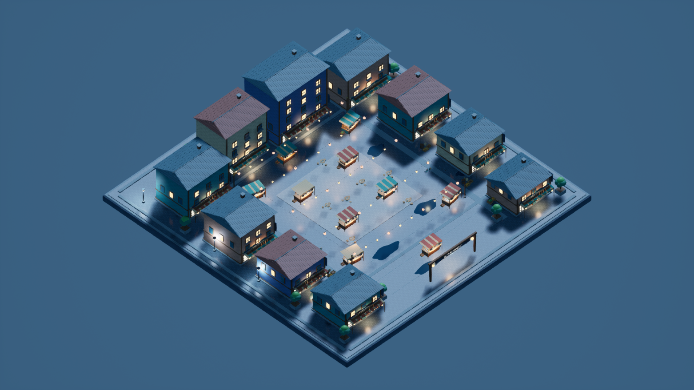
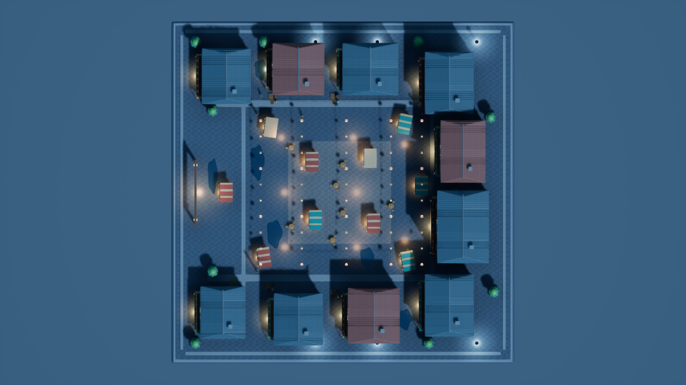
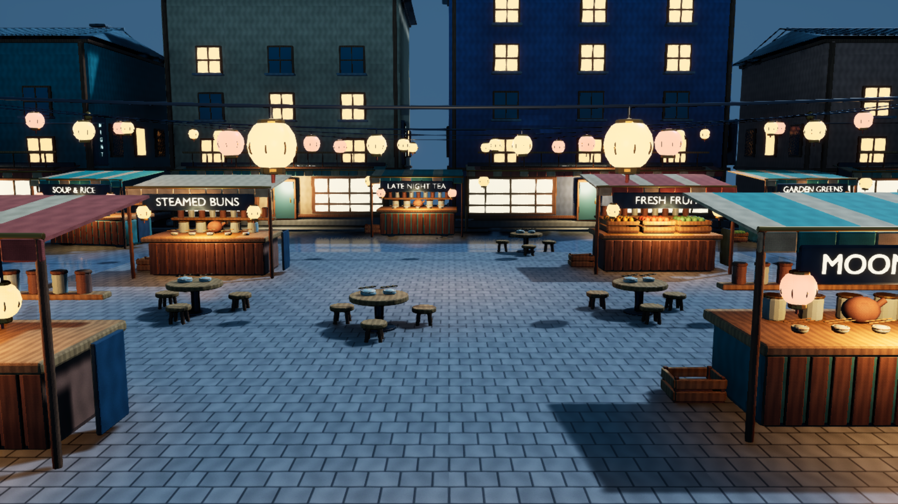
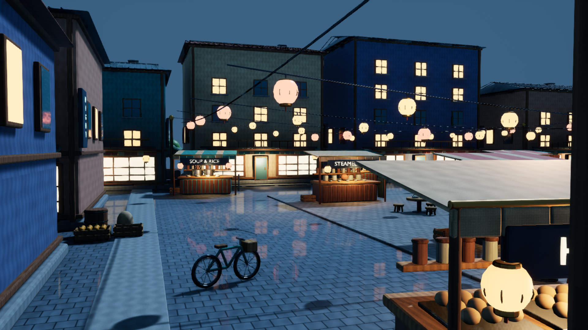

# NightMarket / max — 등불 골목 야시장

100 × 100 m의 비가 그친 저녁 야시장 디오라마를 제작하고 실제 UE 렌더·저장 맵·의존성 검증을 마쳤다. **제작·전달 및 독립 검토 완료.** 조정자와 별도 max 검토 에이전트가 게시 파일 68개와 최종 캡처 4장을 확인했다. [최종 감독 검증](Evidence/supervisor_acceptance.json). Git 작업은 수행하지 않았다.

## 결과와 배치

높이가 다른 상가 10동이 중앙 장터를 감싼다. 음식·차·과일·채소·제과 노점 10개, 식기와 조리 용기, 상자·자루·통, 자전거 4대와 손수레, 원탁과 의자, 수목 화분, 연결된 등불과 입구 간판을 원본 기하로 만들었다. 청록·남색 저녁 조명과 따뜻한 상점·등불을 대비하고, 포장 바닥과 얕은 웅덩이에 젖은 반사를 표현했다.

- 최종 맵: `ForestDemo/Content/Maps/NightMarket_max.umap` — `/Game/Maps/NightMarket_max`
- 소유 에셋: `ForestDemo/Content/NightMarket/max/**` — `/Game/NightMarket/max/`
- 원본·재현 코드: [Source](Source/) / [Blender 원본](Source/NightMarket_Source.blend) / [소스 명세](Source/source_manifest.json)
- 게시 파일 **68개**, 저작 메시 **27개 / 892,188 삼각형**, 재질 **34개**, 텍스처 **6개**. 배경 구에만 `/Engine/BasicShapes/Sphere`를 사용했다.
- 실제 런타임 작업 메타데이터: **gpt-6-astra / max** ([검증 기록](Evidence/runtime_effort_verified.json)).

## 실제 UE 화면

아래 네 이미지는 저장 맵을 재로딩한 UE 5.7 에디터에서 촬영한 원본 PNG이다. 생성형 장면 이미지를 사용하지 않았다. **1920×1080, High(2), Screen Percentage 100%, Lit, Game View**, UI·그리드·기즈모 없는 상태를 API 값과 파일 크기로 확인했다. 카메라 파일럿 후 전체·활성 뷰포트 모두 Lit으로 지정했다. [실제 카메라·설정·촬영 시각·SHA-256](Screenshots/capture_manifest.json)

| 시점 | 위치(cm) | 방향/투영 |
|---|---|---|
| 개요 | (12000, -12000, 16000) | 원점 지향, 직교 폭 20000 cm |
| 평면도 | (0, 0, 20000) | pitch -90°, yaw 0°, 직교 폭 20000 cm |
| 장터 | (0, -2100, 530) | (0, -300, 280) 지향, FOV 67° |
| 골목 | (2550, -2700, 480) | (1400, 900, 340) 지향, FOV 65° |

### 전체 개요

### 평면도

### 중앙 장터

### 음식 노점과 골목

## 제작·수정과 시각 검토

자체 Blender 스크립트로 원본을 만들고 별도 배경 프로세스에서 실행했다. 전체 모델 제작은 한 번만 수행했다. 첫 렌더에서 중거리 글자가 끊기는 원인을 저장 원본의 열린 글자 앞면 법선에서 확인했다. 닫힌 메시 검사와 별도로 문자 앞·뒤 면의 36 mm 범위를 검사하여 **11,672개 문자 면**을 바로잡았다. 변경된 21개 메시만 재임포트했고 골목 카메라는 전경 기둥을 피하도록 옮겼다. [원인 검사](Evidence/font_geometry_inspection.json), [수정 기록](Evidence/font_winding_correction.json), [수정 후 검사](Evidence/font_geometry_after.json), [UE 재임포트 기록](Evidence/targeted_fix_validation.json)

최종 화면에서 해당 중거리 간판과 골목 구도를 재확인했다. 첫 촬영 네 장은 [Review01](Evidence/Review01/)에 보존했다. [작성자 최종 육안 검토](Evidence/visual_review.json)

## UV와 텍스처 출처

모든 PNG는 `Source/build_night_market.py`의 고정 시드 **231023**을 사용하는 자체 절차 무늬다. 이미지 생성 서비스 호출은 **0회 / 0초**다. 외부 사진·다른 테마/effort의 이미지나 메시를 사용하지 않았다. 절차 이미지 작성 시간은 최초 Blender 제작 시간에 포함되며 따로 측정하지 않았다.

| 원본 이미지 | 실제 재질 용도 |
|---|---|
| `Source/Textures/T_stone.png` | 기반 석재·연석·화분 |
| `Source/Textures/T_cobble.png` | 젖은 포장·중앙 광장 |
| `Source/Textures/T_plaster.png` | 상가 회벽·칠한 노점 몸체 |
| `Source/Textures/T_wood.png` | 목재 틀·가구·상자·카운터 |
| `Source/Textures/T_roof.png` | 지붕 |
| `Source/Textures/T_fabric.png` | 차양·자루 |

UV0는 변환 적용 후 면의 주 법선 방향으로 투영한 **4 m 반복 단위**다. 512 px 표면의 목표는 **128 px/m**, 1024 px 포장 표면은 **256 px/m**다. 실제 조립 메시별 면적 가중 밀도는 512 px 환산 **119.646–127.912 px/m**이다. 곡면·베벨의 투영 특성으로 최대 약 6.53% 낮아지는 예외를 측정했다. 반복 면 사이 UV 중첩은 의도적이며 유일 표면 아틀라스가 아니다. 패킹 아틀라스가 아니므로 섬 간 패딩은 적용하지 않았다. 모든 루프의 UV가 유효하고 UE 임포트 후에도 각 메시 UV 채널 1개를 확인했다. [면적·밀도·중첩 방식·법선 감사](Evidence/source_uv_verification.json)

## 저장·의존성·게시 검증

- 실제 지상 바운드: **10000.001 × 10000.001 cm**. FBX 단위·축은 실제 임포트 바운드로 검증했으며 27개 중심 바운드 오차 합계는 0.008169 cm다.
- 저장 맵 재로딩 후 `world_partition is None` 직접 확인. 외부 액터/외부 오브젝트 패키지와 `_BuiltData` 파일 **0개**.
- 배치 리소스 **67개**가 비어 있지 않은 재귀 `/Game` 의존성 **68개(맵 포함)**에 모두 들어 있다. 타 테마/effort 참조, 누락 메시·재질, 누락 사용 텍스처 **0개**. 실제 재질에서 사용한 텍스처 6개도 확인했다.
- 조명 **37개 전부 Movable**, `force_no_precomputed_lighting=True`. 조명 베이크를 수행하지 않았다.
- 닫힌 연결 요소 **4,559개**의 새 부피 방향 감사에서 음의 방향 **0개**. 열린 요소 **1,732개**는 분리해서 기록했다. 열린 글자는 앞·뒤 면 검사를 추가했다. `source_initial_aggregate_signed_volume_m3` 값은 초기 역사 기록이며 최종 법선 판정에 사용하지 않았다.
- 전용 UE 프로세스가 종료된 것을 확인한 후 소유 `.uasset` 디렉터리와 지정 `.umap`만 게시했다. **68개 전부 private/published SHA-256 일치**.

[저장 맵 최종 검증](Evidence/saved_reload_validation.json) · [임포트 바운드·UV·카메라 검증](Evidence/build_validation.json) · [게시 해시 목록](Evidence/publication_hashes.json) · [감독자 기존 비교 자료 보존 검사](Evidence/parent_comparison_preservation.json)

맵 SHA-256: `0b2ce61b71f7e539b03635fe64de38ceef591c7c2e343c32beb378400123bf8e`

## 실제 시간

| 항목 | UTC | KST |
|---|---|---|
| 최초 작업 턴 시작 | 2026-10-23T09:34:50.677000+00:00 | 2026-10-23T18:34:50.677000+09:00 |
| 최종 검증·게시·보고 완료 | 2026-10-23T11:04:33.466315+00:00 | 2026-10-23T20:04:33.466315+09:00 |

전체 경과 **5382.789초 (89.71분)**. 수동 시작 기록 `09:35:02 UTC`도 보존했으며 그 이전 11.323초를 제외하지 않았다. 최초 Blender 모델 생성은 실제 출력 기준 **3106.719초(51분46.719초)**였다. 개별 `bpy.ops`의 반복 갱신이 주 병목이었다. 이후 원본 전체 재생성 없이 저장된 메시만 처리했다. UV 첫 후처리는 RNA 컬렉션 참조 무효화 오류로 중단됐고 현재 레이어를 매번 조회하도록 수정한 뒤 재검증했다. 이 시간과 모든 수정·재촬영은 전체 경과에 포함된다.

| UE 실행 | 실행 시작 UTC | 종료 UTC | 큐 대기(초) | 실행(초) | 종료 코드 |
|---|---|---|---:|---:|---:|
| build_01 | 2026-10-23T10:37:26.3027616+00:00 | 2026-10-23T10:44:43.9443314+00:00 | 0.227 | 437.642 | 0 |
| capture_01 | 2026-10-23T10:45:40.6385115+00:00 | 2026-10-23T10:47:48.0948800+00:00 | 0.219 | 127.456 | 0 |
| capture_02 | 2026-10-23T10:57:33.5765060+00:00 | 2026-10-23T10:59:41.0837212+00:00 | 0.210 | 127.507 | 0 |
| fix_01 | 2026-10-23T10:54:29.0080825+00:00 | 2026-10-23T10:55:36.3729892+00:00 | 0.213 | 67.365 | 0 |

UE 큐 대기 합계 **0.869초**, 실행 합계 **759.970초**. 새 테마는 변경하지 않은 공용 실행기의 `Unknown/priority 2`로 등록되어 해당 FIFO 정책을 따랐다. 실행 중 UE를 중단·선점하지 않았다. [모든 실행 로그와 타이밍](Logs/)

## 제한과 재현

- 렌더 장비는 실행 로그상 **NVIDIA GeForce RTX 4060 / DirectX 12**다. 동적 조명과 Lumen 반사를 사용한다. 실시간 FPS, PIE 게임 동작, 패키징은 시험하지 않았다.
- 웅덩이는 낮은 거칠기의 불투명 재질과 예술적 경계 무늬다. 실제 굴절·강우·유체 시뮬레이션은 없다. 증기와 등불은 정적 조형이며 애니메이션을 구현하지 않아 시간차 화면 쌍은 없다.
- 100 m 전체를 보는 공통 개요·평면도에서 작은 글자는 판독용 크기가 아니다. 식품과 생활 소품은 근접 화면에서 확인한다. UV 반복과 곡면 밀도 편차는 위 측정대로 남는다.
- 촬영 로그의 realtime override 관련 handled ensure는 기록을 보존했다. 네 이미지의 실생성, 메타데이터, 최종 재로딩 검증과 정상 프로세스 종료를 별도로 확인했으며 로그 전체가 무오류라고 주장하지 않는다.
- 전체 원본 재현은 `build_night_market.py` → `verify_source_uv.py` → `fix_source_signs.py` → `build_unreal.py` 순서다. 마지막 스크립트는 전용 프로젝트와 공용 실행기를 통해 실행한다. 현재 최종 카메라의 골목 보정은 `fix_unreal.py`와 `camera_definitions.json`에 기록했다. 전체 생성은 비용이 크므로 전달된 `.blend`·FBX·UE 에셋의 재사용을 권장한다.

외부 창작 참고 자료는 사용하지 않았다. Blender 내장 글꼴을 메시로 변환했다. 기술 문서는 Epic의 [LevelEditorSubsystem](https://dev.epicgames.com/documentation/en-us/unreal-engine/python-api/class/LevelEditorSubsystem?application_version=5.7), [AutomationLibrary](https://dev.epicgames.com/documentation/en-us/unreal-engine/python-api/class/AutomationLibrary?application_version=5.7), [AssetRegistryDependencyOptions](https://dev.epicgames.com/documentation/en-us/unreal-engine/python-api/class/AssetRegistryDependencyOptions?application_version=5.7)와 설치된 UE 5.7 헤더를 확인했다.
