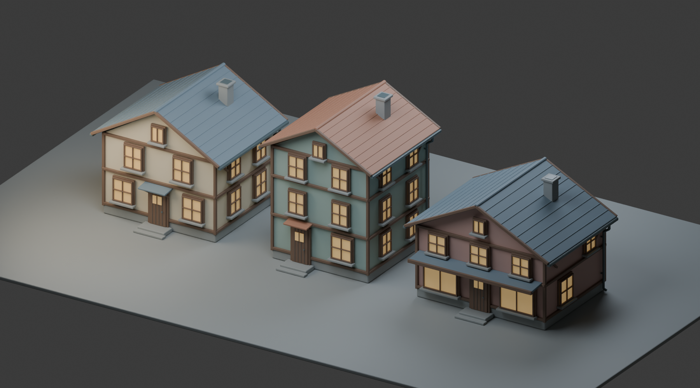

# RainyCanal ultra — architecture delivery

Three independently authored joined meshes are ready for parent UE import. Source preview below is rendered in Blender 4.5.12 and is authoring evidence only; it is not a UE scene capture.

## Integration interface

- `SM_CanalHouseA.fbx`: cream plaster, slate roof, two storeys and attic; body 7 × 6 m.
- `SM_CanalHouseB.fbx`: sage plaster, clay roof, three storeys and attic; body 6 × 6 m.
- `SM_CanalShop.fbx`: rose plaster, slate roof, display windows and continuous rain canopy; body 8 × 6 m.
- Front direction is local **−Y**. Origin is body base center, local z=0. All geometry is at or above z=0. Place with original scale 1.0; UE imports metres as centimetres through FBX unit metadata.
- Full exported bounds include gutters, eaves, chimney and stoop. Bounds, not wall footprints, should be used for block clearance. All models extend to y=−4.18 m and about y=+3.505 m. Reserve 1.2 m outside the front wall for the stoop/canopy, then additional clear walking space.
- Upper stoop top is 0.24 m; lower front step top is 0.12 m. Both stone step solids start at z=0. Doors have a threshold at z=0.25 m.
- Exact slot order: `Stone`, `PlasterCream`, `PlasterSage`, `PlasterRose`, `Timber`, `RoofSlate`, `RoofClay`, `Metal`, `WindowGlass`. Every FBX retains all nine slots, including unused plaster/roof alternatives.
- Use **TextureCoordinate index 1** for surface textures. Preview materials are colors only, and WindowGlass is opaque. Parent supplies the owned UE texture materials.
- Meshes include foundation, plaster, timber trim, doors, windows and mullions, broad roof eaves, roof courses, chimney, gutters, downpipes, brackets and grounded steps. They contain no text or symbolic decorations.

## Actual FBX readback

After export, the build deleted original scene objects and materials, reimported each FBX into a clean Blender scene, and inspected its mesh data. All three checks passed.

| Mesh | Triangles | Full dimensions, metres | UV1 measured px/m range |
|---|---:|---|---|
| HouseA | 24,520 | 8.160 × 7.685 × 7.2975 | 127.9794–128.0157 |
| HouseB | 29,596 | 7.160 × 7.685 × 8.9505 | 127.9817–128.0185 |
| Shop | 21,496 | 9.160 × 7.685 × 6.7646 | 127.9866–128.0157 |

The imported mesh bounds exactly matched source bounds in the measurements. Every face is explicitly triangulated. Each imported file has one joined mesh, the same nine slots, two UV layers, zero zero-area geometry triangles and zero UV0 degenerate triangles. Detailed values and FBX SHA-256 hashes are in `manifest.json`.

`UV0_Unique` assigns one triangle to each distinct atlas grid cell. Its minimum measured distance to a cell boundary is 2.24997 px at 1024, proving a minimum 4.49994 px separation between neighboring island bounds. No cell is shared or exceeded. This channel has deliberately variable density and is reserved for unique coordinates; dynamic lighting is expected.

`UV1_Density128` uses an orthonormal planar surface basis at 0.125 UV units per metre. The target is 128 px/m for 1024 px repeating textures at original scale 1.0. Mean measured density is approximately 128.0000 px/m for every building. UV1 intentionally overlaps and extends beyond 0–1 for tiling. Across sharply different face normals, texture orientation can change; this is an explicit exception rather than an unmeasured overlap claim. Bevels use the same density mapping.

The visual preview was inspected after render. Roof silhouettes, window placement, chimney caps, eaves, wall/foundation alignment and grounded front steps are visible and consistent with the intended calm village style.

## Reproduction and actual timing

Run the delivered `build_architecture.py` with `C:/Program Files/Blender Foundation/Blender 4.5/blender.exe --background --factory-startup --threads 4 --python <absolute-script-path>`.

The final successful build, render and readback ran from **2026-10-22 15:02:47.356 UTC / 2026-10-23 00:02:47.356 KST** to **2026-10-22 15:03:20.654 UTC / 2026-10-23 00:03:20.654 KST**, taking **33.297 seconds**. This is the successful process duration, not total authoring wall time. Earlier diagnostics identified a thin chimney-cap bevel that collapsed after coordinate conversion; the bevel width is now capped at 24% of the thinnest dimension, and the successful exported readback has zero degenerate triangles. Build logs are in the owned scratch `Saved/Workers/RainyCanal/ultra/Architecture` directory.

## Limits and ownership

- These are exterior building shells; doors are closed and interiors are not modeled.
- There are intentionally intersecting closed component shells within the joined mesh, as typical for trim assemblies. It is not a watertight single boolean-unioned solid.
- No collision, UE import, UE materials, runtime behavior or UE scene rendering was performed by this asset worker. Parent validation remains necessary.
- Parent handles generated image textures; no images were generated for these source assets.
- `source.blend` is arranged as the three-building source preview. Its displayed objects are translated for presentation, while each delivered FBX exports its building at the origin.
- No external creative source, old theme asset, shared Blender scene, shared UE project, Git operation or non-owned output was used.

Deliverables: three FBXs, `source.blend`, `build_architecture.py`, `manifest.json`, `source_preview.png`, and this `REVIEW.md`.
