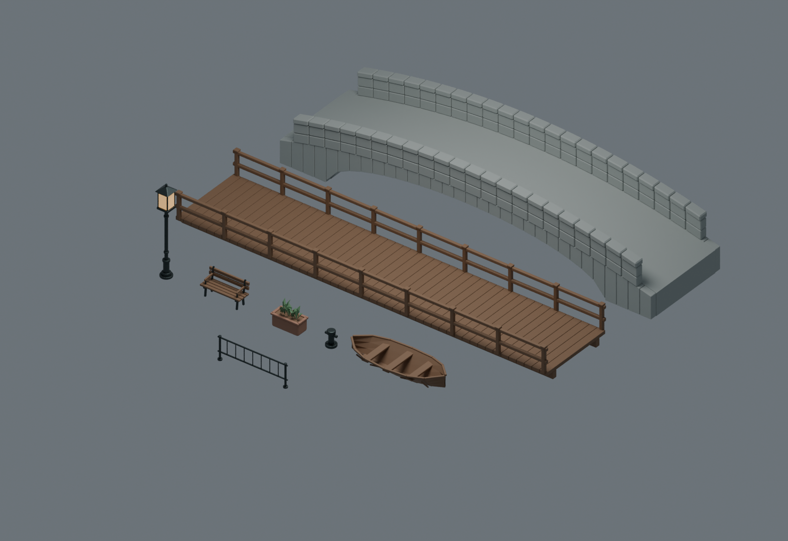

# RainyCanal ultra — original bridges and props

Eight original static meshes are ready for parent import from `FBX/`. All work was authored under this prop assignment, with no external creative assets or cross-theme source reuse. A separate background Blender 4.5.12 process built and exported the meshes and closed normally. The source preview below is a **Blender asset preview**, not an Unreal scene capture.

## Deliverables and interface

- `source.blend`: original export meshes at local origin in a hidden source collection, plus a separate visible preview layout using the same mesh datablocks.
- `build_props.py`: complete original procedural construction and FBX export source.
- `FBX/SM_StoneBridge.fbx`, `SM_TimberBridge.fbx`, `SM_CanalLamp.fbx`, `SM_Bench.fbx`, `SM_Planter.fbx`, `SM_MooringBollard.fbx`, `SM_Boat.fbx`, `SM_RailingSegment.fbx`.
- `manifest.json`: per-asset bounds, dimensions, orientation, material names and placement notes.
- `validate_props.py` and `validation.json`: fresh-FBX-import geometry, UV and density measurements.
- `Preview/source_preview.png`: inspected 1600×1100 Cycles source preview, 24 samples, orthographic camera, AgX, restrained source colors.

Meshes use meters, Z up, X as bridge span or prop length, and FBX forward `-Y` / up `Z` with scene units applied. Import at scale 1 in Unreal and verify centimeter bounds. Origins are at local ground zero except the boat's zero waterline; bridge origins define their landing elevation rather than their below-deck supports. No collision object is included: the parent must choose and validate collision in Unreal.

Material slots are exact and case-sensitive: `Stone`, `Timber`, `Metal`, `WindowGlass`, `RoofClay`, `Leaf`. Each mesh contains only its needed slots; the preview colors are placeholders for the parent's final materials. Lamp glass panels and the point-light placement center are at `(0,0,3.17)` meters. The bench faces negative Y.

## Geometry and placement

| Mesh | Triangles | Dimensions X × Y × Z, meters | Notes |
|---|---:|---|---|
| SM_StoneBridge | 8,948 | 16 × 4.04 × 3.050 | Clear walk 3.22 m; endpoints z=0; center deck z=1.1; parapets 1 m above deck |
| SM_TimberBridge | 9,720 | 16 × 3.47 × 1.515 | Plank tops z=0; rail caps z=1.06; beams below deck |
| SM_CanalLamp | 2,842 | 0.561 × 0.561 × 3.8 | Four independent glass panels in a metal frame |
| SM_Bench | 1,944 | 1.7 × 0.610 × 0.996 | Slatted timber seat/back, metal legs and brackets |
| SM_Planter | 738 | 1.2 × 0.6 × 1.0 | Container height 0.55 m; the planted leaves extend to 1.0 m |
| SM_MooringBollard | 1,360 | 0.5 × 0.44 × 0.65 | Base, bolts, rounded cap and mooring crossbar |
| SM_Boat | 2,988 | 4.041 × 1.672 × 0.769 | Open thin shell, gunwales, ribs and three seats; hull bottom z=-0.35 |
| SM_RailingSegment | 2,916 | 3 × 0.18 × 1.0 | Exact 3 m outer span; post centers x=±1.41 |

The stone bridge has a continuous arched center deck over a shaped structural underside, separate side masonry and coping. It does not contain a full-span solid collision box. The center underside is z=0.63 m, so canal water at z=-1.2 m has 1.83 m center clearance. The source geometry's conservative analytic maximum deck slope is 15.38°. Fresh reimport ray tests hit the center walking surface at all nine sampled X positions; a transverse ray beneath the bridge at x=0, z=-0.5 passes without a hit. These are Blender geometry checks, not runtime walk tests. Use complex-as-simple collision for both bridge meshes, then validate the parent character's walking route in Unreal.

The timber bridge uses 12 mm visible plank gaps. Capsule walking should bridge those gaps, but that behavior requires the parent's actual character test. The boat is a static visual prop with no buoyancy behavior. Its rounded gunwales make it slightly larger than the nominal 4×1.6 m hull.

## UV and export validation

Every FBX was reimported in a fresh Blender process. Each imports as one mesh with two UV layers, the expected material slots and correct dimensions. Maximum source/reimport bounds deviation is below 0.000001 m. Every mesh is below 15,000 triangles, with zero geometric degenerate triangles and zero degenerate triangles in either UV channel.

UV0 (`UVMap`) uses unique packed islands. Triangle overlap candidates were audited with a 2D separating-axis test, and island boundary segments were checked for spacing. All assets have zero positive-area overlap pairs and zero gaps below 2 px at 1024. A final border inset prevents islands reaching the image edge. The smallest measured inter-island gap is 3.12 px on the railing. Some recorded gaps equal 8 px because the audit searches only within 8 px; those values mean **at least 8 px**.

UV1 (`Physical128`) uses orthonormal physical projection with 8 meters per 1024-pixel texture tile: target **128 px/m**. Materials must use **TextureCoordinate index 1**. This channel intentionally repeats, overlaps and extends outside 0–1; it is not a lightmap channel. Median measured density is 128 px/m on every asset. The full range across every reimported triangle is approximately 127.01–128.004 px/m, with zero triangles outside ±1% of the target. The small remaining differences come from projecting rounded/beveled source polygons before triangulation. A preliminary nonplanar leaf backface projection was corrected before final validation.

## Recorded execution times and limits

The first measured source execution started **2026-10-22 15:01:56.889084 UTC / 2026-10-23 00:01:56.889084 KST**. The final source geometry/export run started **15:06:49.454964 UTC / 00:06:49.454964 KST** and completed export at **15:06:51.430989 UTC / 00:06:51.430989 KST**, followed by source preview rendering. The final fresh-import validation ran **15:08:33.879922–15:08:37.897282 UTC / 00:08:33.879922–00:08:37.897282 KST**, taking 4.017 seconds. The interval from first recorded execution to final validation is 401.008 seconds; it excludes earlier script authoring and is not claimed as total task duration.

This subagent launched no Unreal process, used no shared Blender MCP scene, changed no Git state and wrote no parent STATUS/RESULT. UE wait/run time is zero for this subtask. No image generation was performed here. Runtime rendering, materials, collision, character navigation and final scene evidence remain the parent's integration work.

Reproduce with the Blender 4.5 executable and `--background --factory-startup --threads 2 --python` followed by the absolute path to `build_props.py`, then `validate_props.py`. The scripts write only this owned prop directory. Logs are under the assigned `Saved/Workers/RainyCanal/ultra/Props/` scratch directory.
