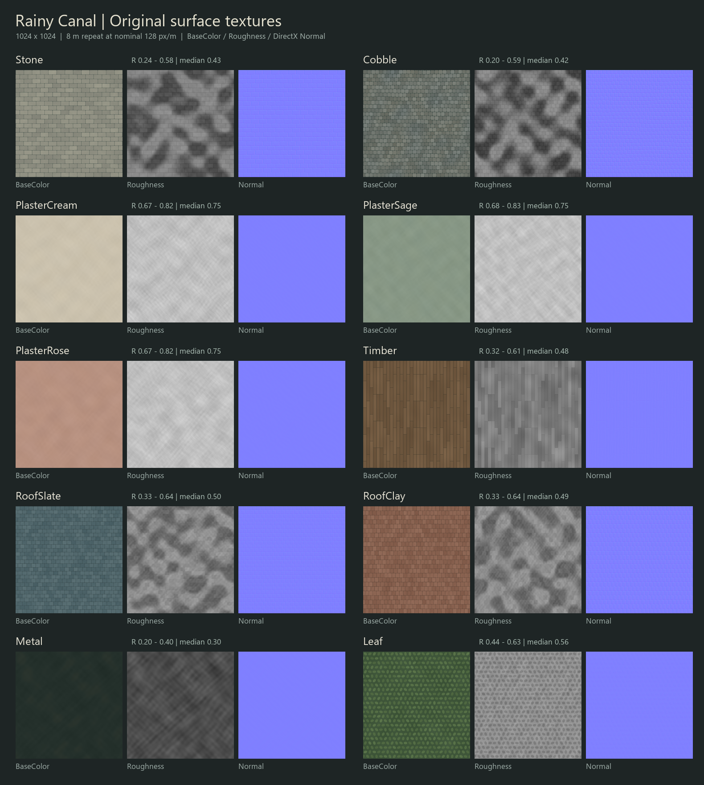
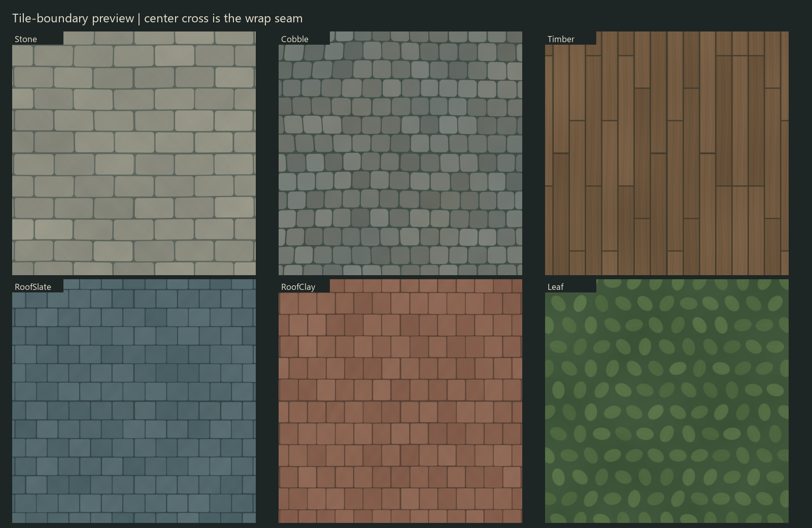

# RainyCanal ultra — original procedural texture set

Thirty 1024×1024 source PNGs: BaseColor, linear Roughness, and DirectX tangent Normal for Stone, Cobble, PlasterCream, PlasterSage, PlasterRose, Timber, RoofSlate, RoofClay, Metal, and Leaf.

All source artwork is original deterministic code in `build_textures.py`. No external images, earlier themes, existing source art or shared creative assets were read or reused. Seed, color values, feature sizes, heights, roughness targets and full SHA256 values are recorded in `texture_manifest.json`.

## Material usage

- Use world-scaled UVs with one repeat per 8 m for the intended 128 px/m nominal density. The exact sampled interval is 1023/8 = 127.875 px/m because an endpoint pixel is duplicated to make opposite edges exactly equal.
- BaseColor: sRGB enabled. Roughness: sRGB disabled and a linear grayscale/masks sampler. Normal: UE normal compression, sRGB disabled, DirectX (+green down texture V), no green flip. Wrap both axes.
- Stone: warm grey rounded limestone; Cobble: darker rounded wet pavers. Both use broad roughness variation, not a uniform mirror sheen.
- Plaster variants use independent low-contrast limewash patterns with dry roughness. Timber grain follows V; rotate island UVs so V follows the member length.
- Metal is opaque dark green-black iron; select a metallic parameter appropriate to iron or painted metal in the parent material.
- Leaf is an opaque canopy/shrub surface with softly rotated leaves, not a leaf-card opacity atlas.
- No shadows, AO or reflected scene lighting are deliberately baked into BaseColor. Gentle mortar/joint colors are surface pigmentation; actual scene lighting remains dynamic.

## Executed file validation

- Build start UTC: 2026-10-22T15:02:18.286426+00:00. Finish UTC: 2026-10-22T15:02:41.166624+00:00. Measured generation seconds: 22.880.
- Reopened all 30 PNGs: each is 1024×1024, expected mode and readable. Every horizontal and vertical opposite-edge channel is exactly equal (maximum error 0, unequal channel count 0).
- Normals are derived from periodic meter-scaled height central differences, normalized, encoded as DirectX RGB, and have positive Z throughout. Opposite normal-map edges are exactly equal.
- Edge-derivative neighborhoods and roughness ranges/percentiles are recorded per image. Preview `Tile_Seam_Preview.png` shows 1:1 crops crossing the wrap join.

| Surface | Roughness min / median / max | Normal max tilt |
|---|---:|---:|
| Stone | 0.239 / 0.431 / 0.580 | 12.28° |
| Cobble | 0.200 / 0.420 / 0.592 | 14.23° |
| PlasterCream | 0.671 / 0.749 / 0.824 | 0.32° |
| PlasterSage | 0.678 / 0.749 / 0.827 | 0.32° |
| PlasterRose | 0.675 / 0.749 / 0.824 | 0.32° |
| Timber | 0.322 / 0.482 / 0.612 | 10.55° |
| RoofSlate | 0.333 / 0.502 / 0.639 | 8.25° |
| RoofClay | 0.325 / 0.494 / 0.639 | 11.58° |
| Metal | 0.200 / 0.298 / 0.400 | 0.32° |
| Leaf | 0.435 / 0.565 / 0.631 | 3.82° |

## Scope and limits

This folder provides source material artwork. No Unreal session, import, scene render, mesh UV density check or final material compilation was performed by this texture task. The scene builder must perform those checks. Screenshots in this folder are texture previews only and must not be presented as actual UE scene evidence.

Reproduce with the supplied bundled Python interpreter and `build_textures.py`; only NumPy and Pillow are required. Output file bytes are deterministic for the same Pillow implementation; manifest build timestamps and elapsed runtime change on each run.

Visual inspection status is recorded separately in `VISUAL_QA.md` after reviewing the generated previews.

