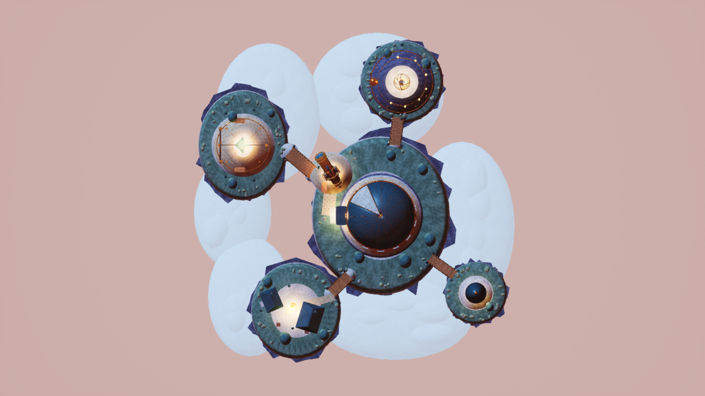
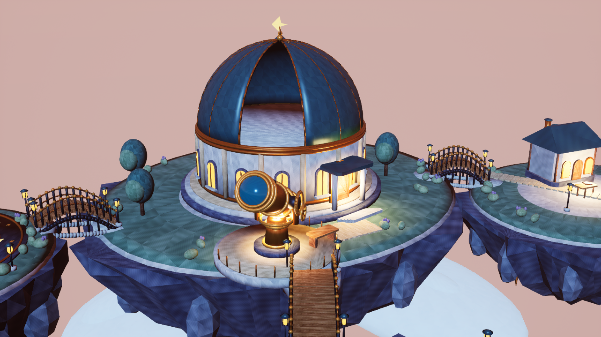
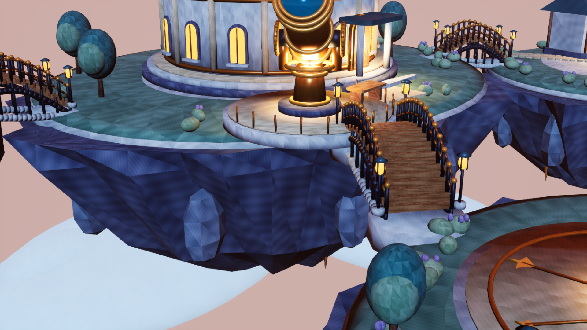
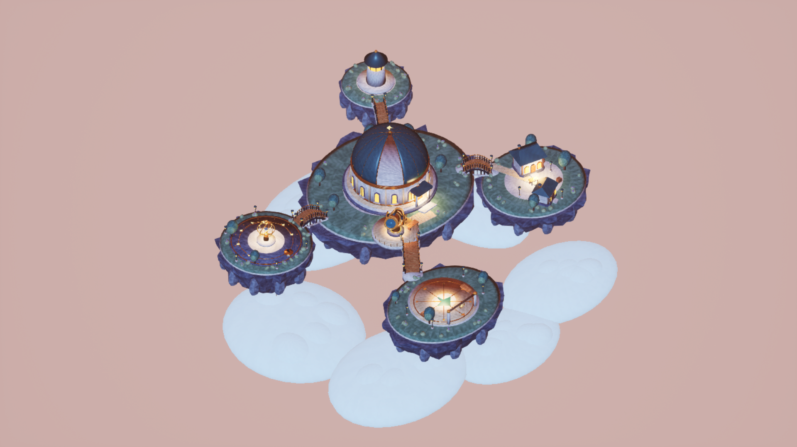
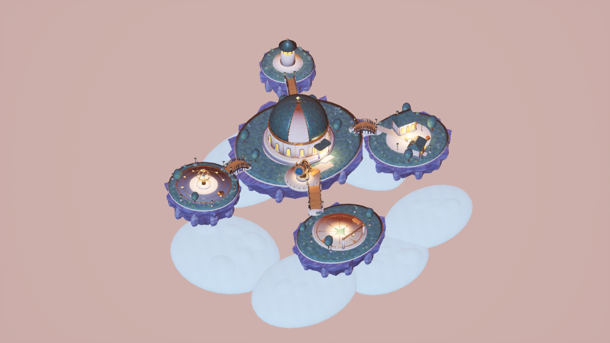
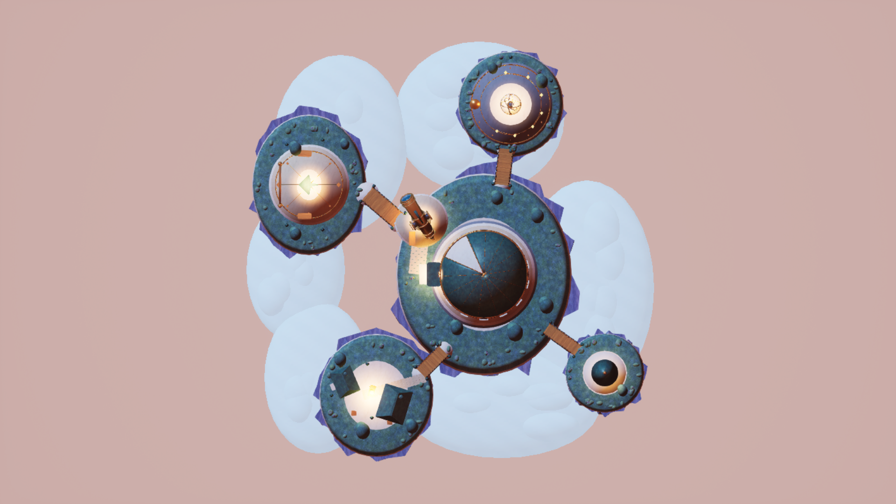
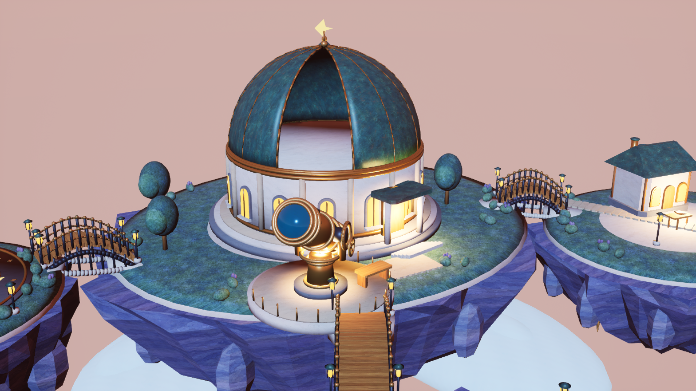
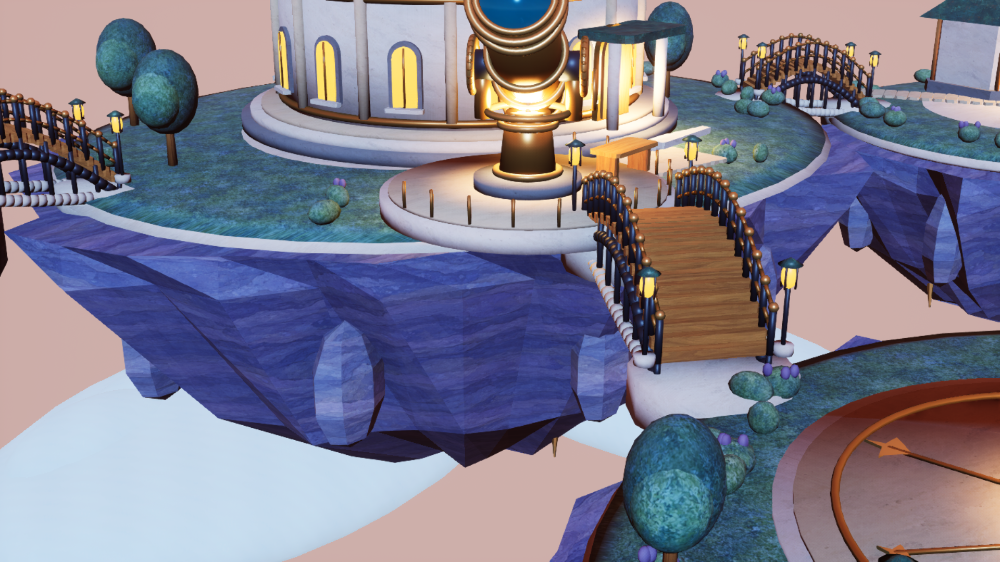
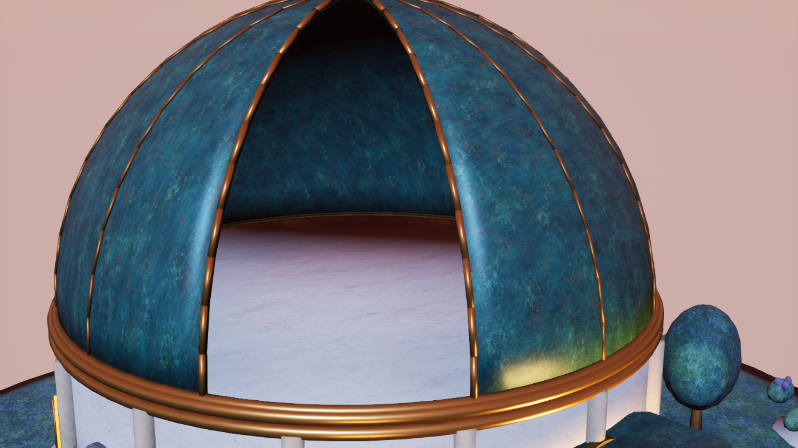
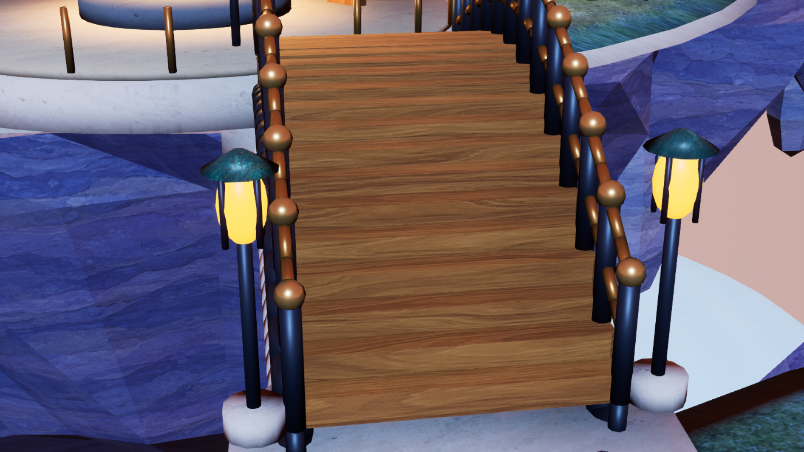

# SkyObservatory/max — 두 번째 텍스처 품질 패스 전달

최신 텍스처 개선본의 독립 검토와 감독 확인을 완료했다. 실제 UE 캡처 6장과 배포 파일 60개의 해시를 확인했다. [최종 승인 기록](TextureImprovement/Evidence/supervisor_acceptance.json), [감독 파일·보존·링크 검사](TextureImprovement/Evidence/parent_final_verification.json), [검토 후 문서 보정 기록](TextureImprovement/Evidence/parent_amendment.json).

현재 전달본은 텍스처 개선과 실제 UE 재검증·게시를 완료한 버전이다. 이 문서 앞부분의 첫 전달 이력은 보존했으며, 아래 「두 번째 텍스처 품질 패스 — 실제 결과와 전후 비교」에 현재 결과·시간·이미지를 기록했다. 독립 최종 검토와 감독 확인을 완료했다.

---

# 하늘섬 천문대 — SkyObservatory / max

## 첫 전달본 (커밋 a96406a9f71b49328e0d70d576bb9ae0660466f7)

## 설계와 구현 계획

사용자가 승인한 100×100m의 차분하고 둥근 게임 아트 천문대 디오라마를 제작한다. 중앙 섬의 청록색 돔, 황동 대형 망원경, 바위 밑면의 수직 실루엣, 따뜻한 창빛이 주제다. 전경 도착 섬, 동쪽 별자리 정원, 서쪽 학자 주택, 작은 등대 섬을 난간과 지지 아치가 있는 교량으로 연결한다. 부유하는 바위와 구름 사이에 충분한 빈 공간을 둔다.

접근 방식은 Blender의 독립 절차적 원본 메시·표면 이미지를 생성하고, 전용 빈 UE 5.7 프로젝트에 가져와 동적 조명과 실제 렌더를 검증하는 방식이다. 기본 도형만 UE에서 배열하는 방식보다 돔 개구부·망원경 기계 부품·암석 밑면을 정교하게 제어할 수 있다. 외부 창작 자산과 다른 작업의 자산은 사용하지 않는다. 실행 방식은 직접 구현이며 부모 감독자가 최종 검토한다.

- [x] 시작 시각·전용 작업 경로·독립 프로젝트 경계 기록
- [x] `Source/build_scene.py`: 원본 지형·건축·교량·소품·표면 이미지 생성, 단위·UV·법선 검사
- [x] `Source/build_unreal.py`: 소유 자산 가져오기·재질·배치·동적 조명·카메라·비 World Partition 맵 저장
- [x] 저장 맵 재로드 후 `/Game` 전체 의존성과 실제 배치 메시/재질/텍스처 대조
- [x] 지정한 1920×1080 UE 실제 렌더 4장과 카메라·UTC·해시 매니페스트 기록
- [x] 이미지 검토 및 필요한 수정, 감독자 검토 후 private UE 종료 상태에서 소유 결과만 게시·파일별 SHA256 대조
- [x] 실제 작업/큐 대기/UE 실행/원본 제작 시간, 제약, 결과를 이 문서와 `STATUS.json`에 기록

검토 중점: 메시 cm 스케일과 100m XY 경계, 열린 돔과 망원경 렌즈의 앞면 방향, 다리의 양끝 연결, 비어 있지 않은 재귀 의존성 그래프, 모든 시점의 Lit/GameView 실제 렌더. UV는 표면별 평면 삼각형 섬에 64px/m를 적용하고 반복 절차적 재질의 타일 반복은 의도적 예외로 명시한다. 구름과 별빛은 정적 예술적 표현이며 대기 시뮬레이션이나 게임플레이를 주장하지 않는다.

## 작업 기록과 실제 결과

- 독립 검토와 감독 확인을 완료했다. [최종 검토 증명](Evidence/supervisor_acceptance.json), [감독 파일·링크 대조](Evidence/parent_publication_check.json), [기존 비교 자료 최종 보존 확인](Evidence/parent_comparison_preservation_final.json). 상태 값은 `ready_for_review`로 보존하며 Git 변경·커밋·푸시는 하지 않았다.
- 시작 UTC: `2026-10-23T12:04:38.840000+00:00` / KST: `2026-10-23T21:04:38.840000+09:00`. 감독자가 확인한 실제 최초 turn 시각이다.
- 최초 수동 상태 기록: `2026-10-23T12:05:03.8566664+00:00`; 최초 시작으로 소급 대체하지 않고 별도 보존한다.
- 완료 UTC: `2026-10-23T12:36:48.647992+00:00` / KST: `2026-10-23T21:36:48.647992+09:00`.
- 총 벽시계: **1929.808초**, 모든 UE 큐 대기 **143.140초**, 모든 UE 실행 **323.274초**. 큐 분류는 변경하지 않은 공용 runner의 `Unknown`, 우선순위 2/FIFO이며 기존 우선순위 작업을 선점하지 않았다.
- 원본 생성·검사 명령의 실제 관측 벽시계 합계 **41.336초**. 셸/프로세스 시작을 포함하며 설계·스크립트 작성·검토 시간은 총 벽시계에 포함된다. 최종 전체 원본 생성 내부 계측 7.480초; 타깃 수정과 재검사는 별도 명령으로 기록했다. ImageGen 사용 및 시간 **0초**.
- 스레드: `01a168a6-1456-7803-8dc6-c6409596987c`. 실제 turn의 `gpt-6-astra` / `max` 확인. 로컬 `fast` 설정과 도구의 `priority` 지원은 확인되지만 turn 기록에는 요청별 실제 serving tier가 노출되지 않는다. [모델·effort 검증 근거](Evidence/runtime_effort_verified.json).

| UE 시도 | 대기 초 | 실행 초 | 종료 코드 | 실제 결과 |
|---|---:|---:|---:|---|
| 1 | 42.578 | 0.000 | 1 | 프로세스 가드의 sandbox 조회 거부; UE 실행 없음 |
| 2 | 0.182 | 32.480 | 0 | 재질 Multiply 속성 접근 오류; 종료코드 0이어도 제작 성공 아님 |
| 3 | 0.168 | 60.627 | 0 | 맵 저장 후 편집기 카메라 프록시 검사 오탐; 종료코드 0이어도 검증 성공 아님 |
| 4 | 87.361 | 101.300 | 0 | 첫 실제 4장 캡처; 축·조명 보정 필요 |
| 5 | 12.851 | 128.867 | 0 | 축을 FBX에 bake하고 면 방향·조명·구름 보정, 최종 재검증·4장 캡처 성공 |

[전체 계측](Evidence/timing_summary.json), [UE 원본 로그](Evidence/UnrealLogs/phase05.log). 초기 축·조명 상태의 실제 렌더 4장과 매니페스트는 [BeforeCorrection](Evidence/BeforeCorrection/capture_manifest.json)에 보존했다. 최초 원본의 캡 winding 오류는 성분별 인접 면 방향 전파와 양의 체적으로 수정했고, UV를 좁은 선반에 패킹해 float32 밀도 편차를 줄였다.

## 전달 경로와 장면 구성

- 최종 맵: `ForestDemo/Content/Maps/SkyObservatory_max.umap` (`/Game/Maps/SkyObservatory_max`).
- 최종 자산: `ForestDemo/Content/SkyObservatory/max/` 아래 메시 17개, 재질 21개, 텍스처 21개. 맵 포함 **60개 파일**이며 [게시 파일별 SHA256](Evidence/publication_manifest.json)의 private/published 해시가 전부 일치한다.
- 원본: `SourceArt/SkyObservatory_Master.blend`, `SourceArt/Meshes/*.fbx`, `SourceArt/Textures/*.png`; 제작·검사·게시 스크립트는 `Source/`에 보존했다.
- 다섯 부유섬, 중앙 관측 틈이 있는 돔, 황동 망원경의 포크·트러니언·고도 기어·핸드휠·파인더·카운터웨이트·렌즈, 지지 아치와 난간을 가진 네 교량, 별자리 바닥 정원·혼천의·해시계, 학자 주택 두 채, 도착 광장·등대·식생·책/탁자/상자를 제작했다.
- 실제 전체 XY 경계: **93.7985×91.0000m**, X 약 −46.799~47.000m, Y −45.000~46.000m. 높이 **−28.600~25.350m**. 모든 제작 형상과 구름을 100×100m 안에 배치했다.

## 검증 근거

- [저장 맵 재로드와 UE 자산 검사](Evidence/ue_validation.json): `world_partition=None`, `force_no_precomputed_lighting=True`, 실제 조명 9개 전부 Movable. 외부 액터/오브젝트 패키지와 BuiltData 없음.
- `/Game` 재귀 의존성 **60개 패키지**: 자신의 맵 1개와 자신의 자산 59개. 실제 배치 메시·모든 슬롯의 재질·재질이 사용하는 텍스처 59개가 그래프에 모두 포함됨. 범위 밖 의존성·누락 재질·누락 텍스처 0개. `/Engine` 편집기 카메라 프록시는 Game View에 렌더되지 않는 시각화 컴포넌트로 분리했다.
- 전체 **158,816삼각형 / 2,446닫힌 연결 성분**. [저장된 .blend 재검사](Evidence/persisted_source_audit.json)에서 열린/방향 불일치 edge 0, UV NaN/Inf 0, 저장 UV의 사각형 영역 교차 0. [FBX 축 보정 검사](Evidence/export_axis_validation.json)에서 반사 변환 뒤 면 winding을 반전하고 성분별 체적 양수를 확인했다. 열린 면 예외 없음; 돔 개구부 가장자리는 두께 캡을 갖고 렌즈 원판은 닫힌 앞면이다.
- 축은 export 메시 안에 Y 반사와 winding 보정으로 굽고 UE importer의 Y 반사를 상쇄했다. UE의 모든 메시 액터 스케일은 **(+1,+1,+1)**. 각 메시의 실제 cm bounds와 설계 원본 bounds 최대 차이 **0.000472cm**로 단위와 축을 확인했다.
- UV 목표 **64px/m**, 저장된 실제 UV 실측 **63.980373~64.025250px/m**. 1024² 텍스처 기준 각 삼각형을 독립 평면 섬으로 만들고 각 면에 4px padding을 확보했다. 모든 UE 메시 UV는 full precision. 의도된 예외는 0..1 바깥의 절차적 타일 반복이며, 고유 atlas 베이킹이나 lightmap UV를 주장하지 않는다.
- 표면 이미지는 이 작업에서 새로 만든 결정적 절차적 PNG 21장이다. 외부 이미지/다른 테마·effort 자산을 복사하거나 재사용하지 않았다. 실제 UE 렌더만 장면 증거로 사용했다.
- 감독자가 네 최종 시점을 모두 확인하고 게시를 지시했다. 게시 전에 자신의 private Unreal 프로세스 종료를 조회했고 60개 파일을 복사한 뒤 모든 파일 해시를 다시 확인했다.
- 기존 비교 기록의 보존은 감독자가 독립 검사한 [보존 증명](Evidence/parent_comparison_preservation.json)을 참조한다. 작업자는 기존 보고서 내용을 읽거나 쓰지 않았다.

## 실제 UE 렌더

모두 **1920×1080 PNG**, `High`(모든 sg 그룹 2), `r.ScreenPercentage=100`, 실제 활성 `VMI_LIT`, Game View, 그리드·선택 표시 없음. [카메라 좌표·실제 회전·렌더 UTC·SHA256 매니페스트](Screenshots/capture_manifest.json).

- Overview: 위치 `(12000,-12000,16000)`cm → 원점, orthographic width `20000`cm.
- Top down: 위치 `(0,0,20000)`cm, pitch `−90` / yaw `0` / roll `0`, orthographic width `20000`cm.
- Observatory와 Bridge: 매니페스트에 기록한 perspective 48° 상세 카메라. 정적 환경으로 시간별 움직임을 주장하지 않아 timed pair는 만들지 않았다.

## 한계와 외부 참조

삼각형별 UV 섬의 타일 위상이 달라 가까운 거리에서 재질 이음과 삼각형 패턴이 보인다. 구름은 밝게 채운 겹친 타원체의 정적 예술적 표현이며 볼륨 기상 시뮬레이션이 아니다. 별자리·별 장식과 해질녘 조명은 예술적 배치다. 건축 내부의 실제 관측 설비 작동이나 내부 생활 공간, 망원경 추적·물리·게임플레이를 구현했다고 주장하지 않는다. 교량은 환경 모델이며 플레이어 충돌/경로 탐색을 제작 범위에 넣지 않았다. 렌더는 에디터 Game View에서 확인했고 패키지 빌드·PIE 게임플레이·FPS 보장은 수행하지 않았다.

외부 창작 이미지·메시·폰트 참조는 없다. API 동작은 설치된 Blender 5.0 및 Unreal Engine 5.7 헤더/실제 실행으로 확인했다. 모델/서비스 계층에 관한 외부 공식 링크는 감독자 제공 runtime 증거에 포함되어 있으며 이 보고서는 요청별 serving tier를 추정하지 않는다. 공유 Source/Config/Plugins/Binaries/uproject, 다른 맵과 작업 디렉터리는 변경하지 않았다. 새 단계나 범위 확장 없이 이 유한 제작과 보정 작업을 종료한다.

---

## 두 번째 텍스처 품질 패스 — 설계와 구현 계획

사용자의 “텍스쳐 시간들여서 한번더 개선해”, “커밋후 진행해” 지시에 따라 첫 전달본의 커밋과 불변 보관을 확인한 후 시작했다. 첫 전달본의 시간·이미지·소스·검증 기록은 `FirstDelivery/`와 전용 scratch의 `FirstDeliveryContent/`에 보존되며 변경하지 않는다. 검증된 별도 시작 UTC는 `2026-10-23T14:00:36.464Z`이며 첫 수동 상태 기록 `2026-10-23T14:00:53.6105607+00:00`은 별도 보존한다.

해결할 주요 결함은 모든 삼각형마다 회전·위상이 달라지던 UV 때문에 풀·암석·석벽·돔에 나타난 삼각형 조각무늬다. 연결된 표면을 연속적으로 투영하고, 자연물/석재에는 동일한 미터 스케일의 연속 투영을, 돔과 원통에는 곡면 매핑을, 목재에는 부품 길이 방향 매핑을 사용한다. 표면 대비를 감추는 대신 실제 샘플 좌표의 연속성을 고친다. 100m 범위, 다섯 섬과 모든 형상·배치, 양의 unit actor scale, 카메라와 조명은 보존한다.

청록 금속 도장·옅은 석회암·청보라 암석·따뜻한 목재의 주요 표면 4종을 built-in ImageGen으로 독립 생성한다. 원본은 타일 가능한 정면 알베도이며 글자·그림자·원근을 넣지 않는다. 황동은 저잡음 색상과 금속성/거칠기 차이, 약한 재질 노멀로 정리한다. 신규 원본·프롬프트·계측·검증·스크린샷은 모두 `TextureImprovement/` 아래에 둔다.

- [x] 첫 전달 커밋·보존 위치 확인 및 별도 패스 상태/시간 기록
- [x] 주요 알베도 4종 생성·검토·프롬프트/원본/시간/해시/용도 기록
- [x] 삼각형 단위 UV를 연속 곡면·부품 방향 매핑으로 교체하고 밀도·연속성·의도된 seam/overlap 검사
- [x] 실제 재수출 FBX를 다시 읽어 형상/면 방향/UV를 검사하고 기존 17개 메시·158,816삼각형·2,446닫힌 성분 보존 확인
- [x] 전용 UE 프로젝트의 재질/텍스처/메시 갱신 후 저장 맵 재로드와 비어 있지 않은 재귀 의존성·실제 배치 자산 대조
- [x] 같은 카메라 4장과 실제 UE 재질 상세 시점 최소 2장을 캡처하고 첫 전달본과 전후 비교
- [x] 감독자 시각 검토 후 전용 UE 종료, 소유 경로만 게시·SHA256 대조, 실제 패스 결과와 전후 근거 추가

검증 완료 전 개선 성공을 주장하지 않는다. ImageGen 실패 시 실제 오류를 기록하며 임의 CLI/API 경로로 대체하지 않는다. 기존 실행·검증 스킬을 적용하되 별도 보고서/커밋/다른 경로의 지침은 사용자 지정 소유 범위와 단일 보고서 규칙으로 대체한다.

## 두 번째 텍스처 품질 패스 — 실제 결과와 전후 비교

삼각형마다 달라지던 텍스처 위상·방향을 연결 UV와 연속 월드 투영으로 교체했다. 청록 돔·석벽·암석·목재의 표면이 이어지고, 첫 개선 렌더에서 남았던 풀·잎의 규칙적인 줄무늬도 새 이끼 알베도로 교체했다. 감독자가 최종 실제 UE 이미지 6장을 확인했고, 소유 자산 게시까지 완료했다. 독립 최종 검토와 감독 확인을 완료했으며 상태 열거값은 `ready_for_review`로 보존한다. **형상·배치·조명·노출·기존 카메라는 유지했다.**

- 별도 패스 시작 UTC **`2026-10-23T14:00:36.464000+00:00`**, KST **`2026-10-23T23:00:36.464000+09:00`**: 감독자가 확인한 최초 turn_context 시각이다. 수동 첫 기록 `2026-10-23T14:00:53.6105607+00:00`은 별도 보존했다.
- 작성·게시 완료 UTC **`2026-10-23T14:46:19.075955+00:00`**, KST **`2026-10-23T23:46:19.075955+09:00`**. 이 패스 벽시계 **2742.612초**. 첫 전달의 시작·종료·소요 시간은 위 기록 및 불변 보관본에 그대로 남아 있다.
- 모든 UE 시도의 대기 **1.1844821초**, 실행 **377.2898486초**. ImageGen 5회 개별 호출 시간 합계 **303.577초**, 겹침을 제거한 실제 생성 구간 **134.055초**. 계측된 원본/FBX 검사 명령 4개의 시간 합계 **32.309초**. 이 수치를 전체 저작 CPU 시간으로 해석하지 않는다.
- 모델 `gpt-6-astra` / effort `max`, 로컬 `fast` 설정 유지. 요청별 실제 serving tier는 turn_context에 노출되지 않으므로 추정하지 않는다. [시작·실행 설정 검증](TextureImprovement/Evidence/parent_runtime_effort_verified.json), [전체 실제 시간](TextureImprovement/Evidence/timing_summary.json).

| UE 시도 | 대기 초 | 실행 초 | 종료 코드 | 실제 결과 |
|---|---:|---:|---:|---|
| 01 | 0.226 | 17.519 | 0 | CustomInput 생성자 API 오류로 중단; 종료 코드 0도 성공으로 해석하지 않음 |
| 02 | 0.199 | 191.086 | -1073741819 | 재질·FBX 갱신/첫 6장 캡처 완료, 로그 종료 뒤 비정상 종료 |
| 03 | 0.288 | 137.845 | 0 | 식생 줄무늬 교체, 저장·재로드·최종 6장 캡처와 밉 검사 완료 |
| 04 | 0.229 | 15.191 | 0 | Custom HLSL 미집계 샘플 통계를 필수 조건으로 둔 검증식 중단; 자산 수정 없음 |
| 05 | 0.241 | 15.648 | -1073741819 | 새 세션 저장 맵·21개 컴파일 재질·60개 해시 검증 완료, 로그 종료 뒤 비정상 종료 |

두 번의 종료 코드 `-1073741819`는 정상 종료로 바꾸어 기록하지 않았다. 해당 세션은 검증/캡처 완료와 `Log file closed` 뒤에 비정상 종료했고 원인은 해결됐다고 주장하지 않는다. 최종 저장·캡처 세션 03은 코드 0이다. 세션 05에서 새로 로드한 최종 21개 재질은 실제 셰이더 명령 수와 샘플러를 가지며 재질 컴파일 경고가 0개였다. 03의 그래프 교체 중 `missing input N` 경고는 최종 저장 전의 중간 상태였고, 최종 저장 재질 검사에서 재현되지 않았다. Custom HLSL의 `Texture2DSample` 호출은 UE 추정 샘플 카운터에 집계되지 않아 세션 04의 검사식을 바로잡았다. [새 저장 재질 검증](TextureImprovement/Evidence/saved_material_validation.json), [종료 진단](TextureImprovement/Evidence/shutdown_diagnostics.json), [세션 03 원본 로그](TextureImprovement/Evidence/ue_phase03.log), [세션 05 원본 로그](TextureImprovement/Evidence/ue_phase05.log). 이 패스에서 전용 `Saved/Crashes`에 새 dump/context 파일은 생성되지 않았으며 원본 로그와 runner 종료 기록을 보존했다.

### UV와 실제 샘플 좌표 검증

실제 최종 FBX 17개의 vertex 배열과 polygon index 배열은 첫 전달본과 **완전히 같다**. 158,816삼각형, 2,446닫힌 양의 체적 성분, 기존 Y 반사 bake와 winding 보정, UE actor scale `(1,1,1)`을 유지했다. 맵 경계는 93.7985×91.0000m이며 높이도 기존 범위다. [실제 binary FBX 검증](TextureImprovement/Evidence/actual_fbx_validation.json), [독립 UV 검토](TextureImprovement/Evidence/independent_uv_review.json).

연결된 chart 15,917개에서 공유 edge **168,465개가 정확히 연속**, 의도된 chart 경계 **69,759개**, 예상하지 않은 불연속 **0개**다. 첫 전달본에서는 공유 edge 238,224개 모두 위상이 끊겼다. UV NaN/Inf·축퇴 삼각형·chart 내부 foldover는 0개다. chart별 nominal 8px padding을 둔 확장 경계가 서로 겹치지 않으며, 반복 텍스처를 사용하는 서로 떨어진 부품의 타일 재사용은 의도된 예외다. 고유 lightmap atlas를 주장하지 않는다.

돔은 외피·내피를 분리한 Lambert 등면적 반구 chart, 슬릿·바닥·꼭대기 두께는 별도 chart를 쓴다. 경도 특이점 없이 주 돔 면적 밀도는 실제 1024²/UV×2에서 **126.081–129.967px/m**, 최대 방향 신장비 **1.941**이다. 나무 부재는 부품 PCA 길이축을 V로 고정하고 옆면·단면을 분리했다. 독립 검사한 명확한 옆면 2,998개의 축 정렬 오차는 최대 `5.446619e-7` UV다. 다리 판재의 길이축은 통행 방향에 직각인 가로 방향이며 실제 렌더의 나뭇결이 이를 따른다.

아래는 **최종 FBX의 실제 좌표와 UV**, 실제 런타임 1024 해상도, 최종 재질 UV 배율로 계산한 재질별 면적 밀도다. 연결성을 보존하는 bevel·곡면 투영에서는 표면 방향에 따라 목표보다 낮은 밀도가 남는다. 이를 삼각형마다 재정규화하지 않고 방향별 신장과 함께 기록했다. [재질별 실제 밀도·방향 신장](TextureImprovement/Evidence/actual_fbx_density.json).

| UV 재질 | 목표 px/m | 실제 면적 밀도 px/m | 최대 방향 신장비 |
|---|---:|---:|---:|
| Brass | 256 | 211.291–256.121 | 1.468 |
| BrassLight | 256 | 208.628–256.046 | 1.506 |
| Iron | 128 | 107.635–128.048 | 1.414 |
| Lens | 64 | 50.854–64.004 | 1.584 |
| RoofLight | 128 | 107.635–128.015 | 1.414 |
| RoofTeal | 128 | 103.817–129.967 | 1.941 |
| Timber | 128 | 107.621–128.044 | 1.415 |
| WoodLight | 128 | 107.633–128.004 | 1.414 |

석재·암석·풀·잎 등 13종 재질은 UV 대신 월드 위치의 고정 XYZ 투영을 기하 노멀 가중치로 부드럽게 합성한다. 석벽/길은 축 기준 **128px/m·8m 반복**, 암석/식생은 **64px/m·16m 반복**이다. 경사 표면에서는 세 투영을 혼합하므로 한 장의 UV 면적 밀도와 동일하지 않다. 사용하지 않는 fallback UV에 RockBlue 겹침 **13쌍**(Beacon 8, Cottages 3, Garden 2)이 남아 있으며 실제 셰이더는 이를 샘플링하지 않는다. **UV로 샘플링하는 재질의 내부 겹침은 0쌍**이다. [실제 재질 샘플 경로·물리 스케일](TextureImprovement/Evidence/material_sampling_manifest.json), [13쌍 예외와 chart 검사 근거](TextureImprovement/Evidence/independent_uv_review.json).

### 생성 텍스처와 재질

독립 ImageGen 원본 5장은 요청한 1024가 아니라 실제 **1254×1254**로 반환됐다. 모든 선택 원본과 13개 import 소스는 생성 결과와 SHA256이 같으며 외부 이미지 편집·리사이즈를 하지 않았다. UE의 `ResizeToSpecificResolution` 빌드에서 1024×1024로 변환했다. 실제 사용 텍스처 21개 모두 **1024², 11단계 mip, sRGB 알베도, wrap 주소 방식**을 검증했다. [원본·용도·시간·전체 프롬프트 4종](TextureImprovement/ImageGen/generation_manifest.json), [추가 이끼의 전체 프롬프트](TextureImprovement/ImageGen/auxiliary_generation_manifest.json), [원본 해시·밉 실측](TextureImprovement/Evidence/texture_final_validation.json), [13개 표면 배정](TextureImprovement/Evidence/texture_source_manifest.json).

| 독립 생성 원본 | 실제 호출 초 | 원본 |
|---|---:|---|
| teal | 31.467 | [원본](TextureImprovement/ImageGen/teal_albedo_original.png) |
| limestone | 52.964 | [원본](TextureImprovement/ImageGen/limestone_albedo_original.png) |
| rock | 85.091 | [원본](TextureImprovement/ImageGen/rock_albedo_original.png) |
| timber | 101.528 | [원본](TextureImprovement/ImageGen/timber_albedo_original.png) |
| moss | 32.527 | [원본](TextureImprovement/ImageGen/moss_albedo_original.png) |

Teal은 RoofTeal/RoofLight, limestone은 Limestone/StoneDark/Path, rock은 RockBlue/RockPale, timber는 WoodLight/Timber, moss는 Grass/Moss/Leaf/LeafLight에 적용했다. 황동은 색 노이즈를 줄인 일정한 금속 색과 metallic 0.78, 거칠기 0.31–0.34를 사용한다. 금속·목재의 미세 노멀과 거칠기 차이는 알베도에서 유도한 예술적 보조 디테일이며 별도 실측 PBR 스캔 맵이 아니다. MikkTSpace tangent를 재계산하고 full precision UV를 유지했다. 타일 가능한 표면을 요청하고 실제 UE 반복 표면을 시각 검토했으나 맞은편 픽셀 경계가 수학적으로 완전히 같다고 주장하지 않는다.

### 동일 카메라 전후 증거

모두 실제 UE 5.7의 1920×1080 PNG, High(모든 sg 2), ScreenPercentage 100, Lit/Game View다. 원래 네 카메라의 위치·회전·투영·화각/ortho width가 첫 전달 manifest와 정확히 같고, 조명 9개·노출도 그대로다. Overview `(12000,-12000,16000)`cm→원점/ortho 20000cm, top down `(0,0,20000)`cm/pitch −90/yaw 0/roll 0/ortho 20000cm를 유지했다. 추가 상세 카메라 2개만 증거 수집용으로 넣었으며 렌더 형상을 추가하지 않았다. [캡처 manifest·UTC·해시](TextureImprovement/Screenshots/capture_manifest.json), [카메라/조명 동일성·캡처 자산 해시 연결](TextureImprovement/Evidence/capture_asset_identity.json).

| 시점 | 첫 전달본 보존 이미지 | 텍스처 개선 최종 이미지 |
|---|---|---|
| 전체 |  |  |
| 평면 |  |  |
| 천문대 |  |  |
| 다리 |  |  |

식생 보정 전의 첫 개선 렌더 6장도 [InitialTextureRender manifest](TextureImprovement/Evidence/InitialTextureRender/capture_manifest.json)에 별도 보존했다. 모든 장면 증거는 실제 UE 출력이며 생성 이미지나 후처리 이미지로 교체하지 않았다.

### 저장·게시·보존과 남는 한계

최종 구성은 메시 **17**, 재질 **21**, 텍스처 **21**, 맵 포함 **60패키지**로 동일하다. 13개 텍스처를 교체하고 8개 기존 텍스처는 그대로 유지했다. 게시된 파일 중 첫 전달과 bytes가 바뀐 것은 **52개**(17메시+21재질+13텍스처+맵)다. 새 UE 세션의 저장 맵 재로드에서 재귀 `/Game` 그래프 60패키지와 배치 메시/재질/텍스처 59개 전체를 대조했다. 범위 밖 의존성·누락 재질 0, World Partition 없음, 동적 Movable 조명 9개, 외부 actor/object/BuiltData 없음. [저장 맵 검증](TextureImprovement/Evidence/ue_validation.json).

전용 UE가 종료된 상태에서 `Content/SkyObservatory/max/**`와 `Content/Maps/SkyObservatory_max.umap`만 게시했다. 모든 private/published SHA256은 새 저장 재질 검사 시점과 같고, 모든 자산 저장 시각은 최종 캡처보다 앞선다. 게시 전 공유 경로의 60개 파일은 첫 전달 커밋과 같았다. [파일별 게시·캡처 자산 해시](TextureImprovement/Evidence/publication_manifest.json). 원본은 `TextureImprovement/SourceArt/SkyObservatory_TextureImprovement.blend`, `SourceArt/Meshes/*.fbx`, `SourceArt/Textures/*.png`에 있다.

첫 전달의 Work 보관 102개, Content 보관 60개 및 원래 활성 Source/SourceArt/Evidence/Screenshots 100개 파일은 모두 불변 해시를 확인했다. 변경을 허용한 활성 문서는 이 `RESULT.md`와 `STATUS.json`뿐이다. [첫 전달 보존 대조](TextureImprovement/Evidence/first_delivery_preservation.json), [기존 비교 기록의 감독자 보존 증거](TextureImprovement/Evidence/parent_comparison_preservation_before.json). 다른 theme/effort의 창작 자료·보고서·scratch는 읽거나 재사용하지 않았으며 Git 작업은 하지 않았다.

월드 투영은 이 정적 환경에 맞춰 세계 좌표에 고정되어 있다. 향후 물체를 움직이면 텍스처가 표면에 붙어 이동하는 방식은 아니다. 곡면/부품 경계의 의미 있는 seam, 원래 모델의 암석 면 분할, 앞서 기록한 사용하지 않는 fallback UV 겹침 예외는 남는다. 구름·별은 정적 예술적 표현이고 기상/천문/내부 생활/게임플레이/물리 시뮬레이션이 아니다. 에디터 실제 렌더와 저장 자산을 검증했으며 패키지 빌드·PIE·FPS 보장은 주장하지 않는다. 종료 뒤 비정상 코드 원인도 해결을 주장하지 않고 근거를 보존했다. 이 유한 텍스처 품질 패스의 저작을 종료하고 최종 독립 검토를 기다린다.
