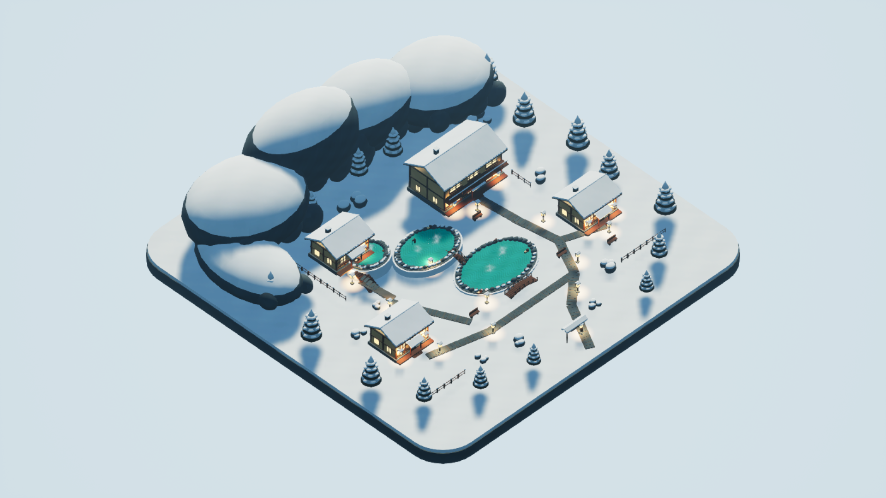
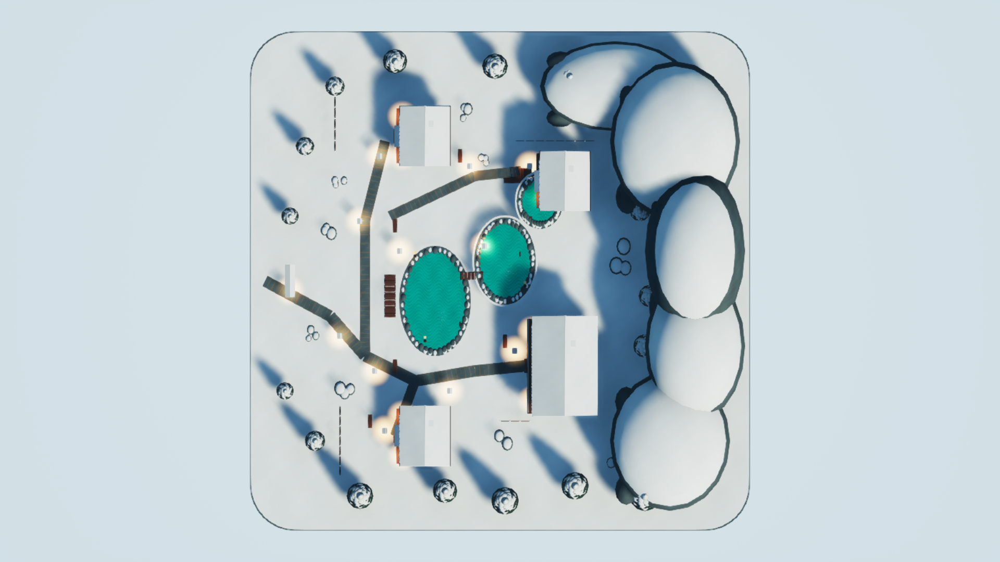
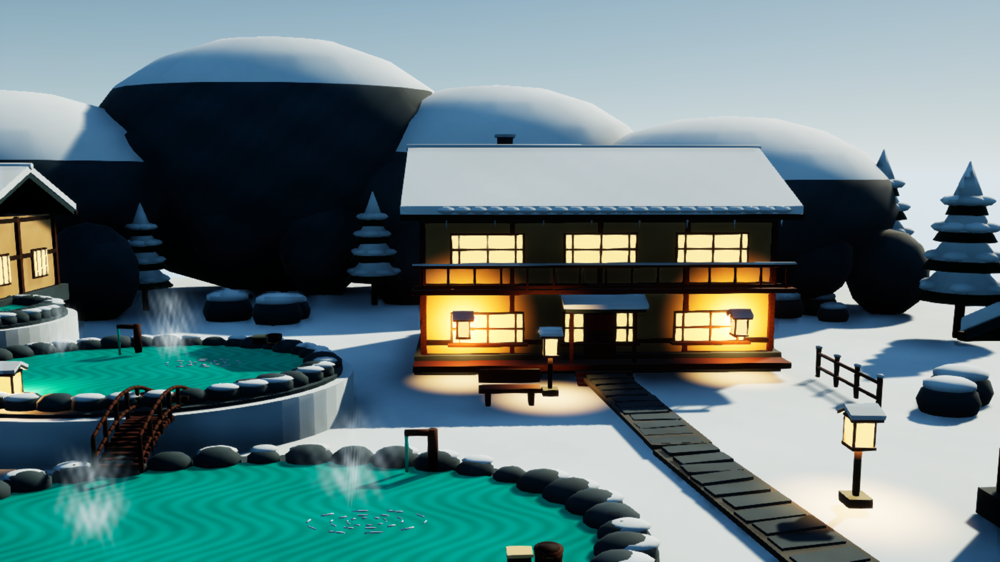
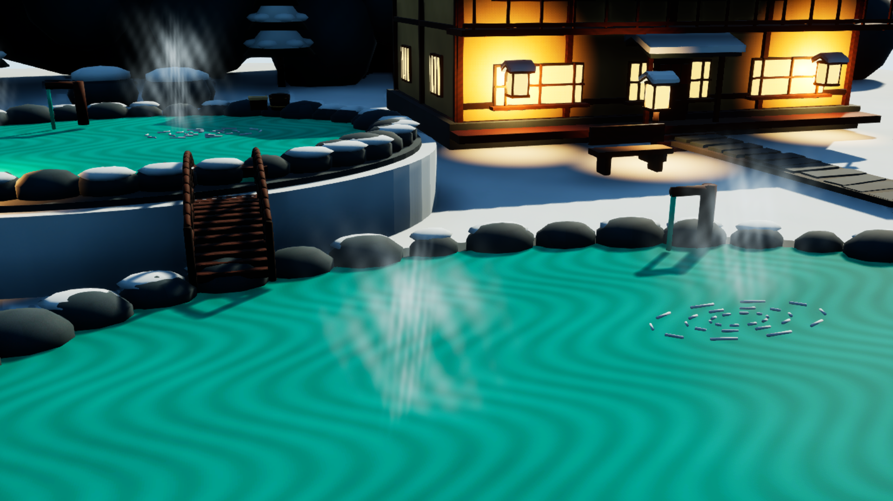

# 설산 온천 마을 — SnowyOnsen / max

## 설계·구현 계획

- [x] 100×100m, 차분하고 둥근 게임 아트의 독립 설산 온천 마을을 설계한다.
- [x] 전경 입구·돌길, 중경 온천·숙소, 후경 설산으로 이어지는 구도를 만든다.
- [x] 목조 숙소 4동, 계단식 온천 3개, 다리·계단·길·등롱·바위·설송·생활 소품을 원본 메시로 제작한다.
- [x] 자체 절차적 텍스처와 측정 가능한 UV를 만들고, 최종 형상의 법선·연결·면적을 검사한다.
- [x] 전용 UE 5.7 프로젝트에서 동적 조명, 청록색 수면과 읽기 쉬운 증기를 구성한다.
- [x] 저장한 맵을 새 UE 프로세스에서 다시 열고 실제 크기·World Partition·모든 /Game 의존성을 검증한다.
- [x] 공통 overview·top_down 및 onsen·village, 동일 카메라 시간차 2장을 실제 UE에서 촬영한다.
- [x] 모든 최종 이미지를 직접 확인하고 감독 검토를 받는다.
- [x] 전용 에디터 종료 후 소유 자산·지정 맵만 발행하고 파일별 SHA256을 대조한다.
- [x] 실제 시간·실패 시도·결과·한계와 근거를 이 문서 및 STATUS.json에 기록한다.

## 완성 결과

눈 덮인 목조 여관과 노천탕을 중심으로 한 전시용 환경이다. 숙소에는 기둥·보·창호·발코니·처마·고드름·출입문 커튼·현관 계단을, 온천에는 돌 테두리·목교·급수구·물통·수건·세면 의자·벤치를 배치했다. 청록색 3단 수면과 옅은 증기, 따뜻한 창·등롱이 겨울 지형과 대비된다.

최종 자산은 메시 **16개 / 165,742개 삼각형**, 머티리얼 **14개**, 자체 생성 **1024² 텍스처 12개**, 맵 **1개**다. 다른 테마·effort의 창작 자원과 외부 에셋을 사용하지 않았다. 원본은 [Blender 파일](Source/SnowyOnsen_original.blend), [생성 스크립트](Source/build_source.py), [UE 구성 스크립트](Source/build_unreal.py)에 보존했다. 최초 88,276개 수치는 수정·베벨 적용 전 원본 단계이며 최종 수치가 아니다.

- 발행 자산: `ForestDemo/Content/SnowyOnsen/max/**`
- 발행 맵: `ForestDemo/Content/Maps/SnowyOnsen_max.umap`
- UE 맵 경로: `/Game/Maps/SnowyOnsen_max`
- 발행 파일 **43개 전부** 전용 프로젝트 원본과 SHA256 일치: [발행 증명](Validation/publication_sha256.json)
- 독립 검토와 감독 확인을 완료했다. [최종 검토 증명](Evidence/supervisor_acceptance.json), [감독 파일·링크 대조](Evidence/parent_publication_check.json), [기존 비교 자료 최종 보존 확인](Evidence/parent_comparison_preservation_final.json). 상태 값은 `ready_for_review`로 보존하며 Git 인덱스·브랜치·커밋은 변경하지 않았다.

## 실제 시간과 실행 설정

| 항목 | 실제 기록 |
|---|---|
| 정식 시작 UTC | `2026-10-23T12:03:54.226000+00:00` |
| 정식 시작 KST | `2026-10-23T21:03:54.226000+09:00` |
| 완료 UTC | `2026-10-23T12:39:20.213749+00:00` |
| 완료 KST | `2026-10-23T21:39:20.213749+09:00` |
| 전체 경과 | **2125.988초** |
| UE 큐 대기 합계 | **154.765초** |
| UE 실행 합계 | **607.295초** |
| 원본 생성 스크립트 실행 합계 | **15.721초** |
| AI 이미지 생성 | **0초 — 사용하지 않음** |

가장 이른 실제 turn_context를 시작으로 사용했다. 최초 수동 시계 조회 `2026-10-23T12:04:08Z`는 별도로 보존했으며 시작 시간을 재설정하지 않았다. 전체 경과에는 설계·코드 작성·디버깅·검토·대기가 포함된다. 원본 생성 합계는 Blender 내부 스크립트 실행만 합친 값으로 코드 작성·프로세스 시작·검사 시간과 다르다. [전체 시간 원장](Validation/timing_summary.json)

실제 메타데이터는 **gpt-6-astra / max**를 확인한다. 로컬 설정은 `fast`, 호출 도구에서 제공한 tier는 `priority`다. 개별 요청의 실제 serving tier는 turn_context에 노출되지 않아 그 범위까지 검증했다고 주장하지 않는다. [실행 설정 증거](Validation/runtime_effort_verified.json)

| UE 시도 | 대기 초 | 실행 초 | 종료 코드 | 결과 |
|---|---:|---:|---:|---|
| 1 | 0.070 | 0.000 | 1 | CIM 권한 제한으로 UE 시작 전 종료 |
| 2 | 0.196 | 29.098 | 0 | Panner editor property 접근 수정 필요 |
| 3 | 0.181 | 16.590 | 0 | UE 5.7 입력 핀 축약명 수정 필요 |
| 4 | 0.183 | 57.328 | 0 | 임포트 완료, 변경된 fog 속성명 수정 필요 |
| 5 | 13.699 | 13.995 | 0 | 맵 저장 완료, 에디터 전용 카메라 메시 검사 분리 |
| 6 | 53.977 | 113.341 | 0 | 최초 실제 렌더·재열기 성공, 구도/지지대 결함 확인 |
| 7 | 0.261 | 145.254 | 0 | 형상·좌표·UV 수정 및 실제 렌더 성공 |
| 8 | 85.988 | 118.415 | -1073741819 | 수면 머티리얼 수정·촬영 후 native access violation 종료 |
| 9 | 0.210 | 113.272 | 0 | 최종 텍스처 정렬·새 프로세스 재열기·6장 촬영·정상 종료 |

시도 08의 종료 코드는 실패로 보존했다. 최종 시도 09는 종료 코드 0이며, 새 프로세스에서 저장한 맵과 텍스처 원본 해시를 다시 확인한 뒤 모든 최종 이미지를 생성했다. 첫 렌더에서 발견한 Y축 반전·수면을 덮는 타원체·베벨 UV/퇴화면·과도한 수면 반사는 수정했다. 이전 렌더와 검증은 `Validation/Preview06`, `Preview07`, `Preview08`에 남겨 두었다.

## 저장 자산 검증

- 실제 임포트 바닥 크기: **10000.000977×10000.000977cm**, 부동소수점 오차를 제외한 100×100m. 모든 배치 메시의 actor 위치는 원점, 회전 0, 스케일 `(1,1,1)`이다. 의도한 위치와 실제 메시 bounds의 최대 오차는 **0.281555cm**다.
- World Settings의 `world_partition`을 직접 조회하여 **None** 확인. `force_no_precomputed_lighting=True`, 모든 조명 Movable. 외부 액터·외부 객체·BuiltData 패키지 없음.
- 저장 맵을 재열기한 Asset Registry의 비어 있지 않은 재귀 그래프 **43개 /Game 패키지** 전부 `/Game/SnowyOnsen/max/`와 자기 맵에 한정된다. 배치 메시·사용 머티리얼·사용 텍스처의 그래프 누락은 **0개**다. 에디터 전용 카메라 시각화는 `is_editor_only=True`를 별도 기록했다.
- 텍스처 12개 전부 실제 임포트 원본 경로·SHA256·1024² 크기 확인. [텍스처 출처](Validation/texture_import_sources.json)
- [UE 재열기·의존성·크기 증거](Validation/unreal_validation.json), [정상 종료 후 프로세스 확인](Validation/private_editor_closed.json)
- 독립 FBX 검토: 닫힌 연결 컴포넌트 **2,156개** 모두 양의 부호 체적. 예상된 열린 면은 수면 3개(+Z), 증기 카드 10개다. 최종 형상의 와인딩 충돌·비정상 연결·퇴화면·면적 0 UV·비유한 UV는 모두 **0개**다. [최종 원본 직접 검사](Validation/uv_winding_audit.json)

## UV·텍스처와 움직임의 범위

1024px 타일을 기준으로 일반 표면 **128px/m**, 눈 **64px/m**를 목표로 정했다. 실제 최종 메시에서 Wood 중앙값 122.84px/m, Stone 120.59px/m, Snow 59.13px/m, Water 128.00px/m다. 곡면·베벨의 주축 평면 투영으로 일반 표면 최저 약97px/m, 눈 48.72px/m까지 줄어든다. 증기는 한 카드에 정규화된 마스크를 쓰므로 276.86–433.91px/m의 별도 예외다.

고유 아틀라스 패킹 대신 반복 타일 UV를 사용했다. 서로 다른 부품·반대쪽 면의 좌표 겹침은 의도된 재사용이며, 정확히 같은 UV 삼각형 재사용 **53,832개**를 계수했다. 타일 래핑 방식이라 아틀라스 패딩은 해당하지 않는다. 베벨 적용 후 최종 면에 UV를 다시 작성하고, 실제 최종 메시 전체를 검사했다. [밀도·겹침 정책과 수치](Validation/uv_winding_audit.json). 원본 생성 과정의 중간 통계와 최종 검사를 혼동하지 않는다.

텍스처는 씨드를 고정한 자체 수식으로 만든 목재 결·눈·돌·천·수면 패턴이다. 외부 이미지·생성형 이미지 프롬프트는 없다. 물은 불투명 표면에 Panner와 Time/Sine의 미세 높이 변화, 증기는 알파가 부드럽게 사라지는 양면 교차 카드에 Panner를 적용했다. **유체·기체 물리 시뮬레이션이나 실제 굴절이 아닌 예술적 근사**다. 시간차 실제 렌더의 카메라·투영은 동일하며 간격은 **14.000초**다. 수면/증기 영역 변화와 고정 건물 영역을 비교했다. [시간차 이미지 검증](Validation/capture_validation.json)

전시용 환경으로 충돌·플레이어 제어·게임플레이·FPS 목표를 약속하지 않는다. 증기는 카드 방식이므로 시점에 따라 밀도가 달라질 수 있고, 산 전면의 짙은 음영은 현재 연출의 한계다.

## 실제 UE 최종 렌더

6장 모두 **1920×1080 PNG, High 2, ScreenPercentage 100, Lit, Game View**이며 UI·그리드·디버그 표시가 없다. 공통 overview는 위치 `(12000,-12000,16000)cm`, 원점 지향, Ortho Width 20000cm다. top_down은 `(0,0,20000)cm`, Pitch -90/Yaw 0/Roll 0, Ortho Width 20000cm다. 모든 실제 카메라·촬영 UTC·SHA256은 [capture_manifest.json](Screenshots/capture_manifest.json)에 기록했다. 생성 이미지를 장면 증거로 사용하지 않았다.

검토한 최종 이미지 해시: [시각 검토 기록](Validation/visual_review.json). 최종 독립 검토에서 시간차 변화량은 정규화된 PNG RGB 값으로 확인되어 분석 스크립트와 JSON의 필드명을 바로잡았다. 수치·이미지·촬영 시각과 당시 로그는 보존했다. 기존 비교 자료 보존은 감독이 독립적으로 확인한 [소유 범위 내 증거](Evidence/parent_comparison_preservation.json)를 연결하며, 다른 테마 보고서를 읽거나 수정하지 않았다.

## 참고 자료

외부 창작 참고 이미지는 사용하지 않았다. API는 설치된 UE 5.7의 MaterialEditingLibrary.cpp, MaterialGraphNode.cpp, WorldSettings.h, ExponentialHeightFogComponent.h와 AutomationBlueprintFunctionLibrary.h를 확인했다. 환경은 Blender 5.0·Unreal Engine 5.7이며 모든 UE 실행에 변경하지 않은 감독 소유 `Run-UnrealIsolated.ps1` 큐를 사용했다.
