# 설산 온천 마을 — SnowyOnsen / max

최신 텍스처 개선본의 독립 검토와 감독 확인을 완료했다. 실제 UE 캡처 8장과 배포 파일 46개의 해시를 확인했다. [최종 승인 기록](TextureImprovement/Evidence/supervisor_acceptance.json), [감독 파일·보존·링크 검사](TextureImprovement/Evidence/parent_final_verification.json), [검토 후 문서 보정 기록](TextureImprovement/Evidence/parent_amendment.json).

> 아래 기존 기록은 **첫 납품**이다. 기준 커밋은 `f8d97a81562ff9a1ea25cbb55b58bcaf542181ab`이며 원본 기록·이미지·자산은 FirstDelivery에 보존되어 있다. 두 번째 텍스처 개선 기록은 이 문서 마지막에 별도로 이어진다.

## 설계·구현 계획

- [x] 100×100m, 차분하고 둥근 게임 아트의 독립 설산 온천 마을을 설계한다.
- [x] 전경 입구·돌길, 중경 온천·숙소, 후경 설산으로 이어지는 구도를 만든다.
- [x] 목조 숙소 4동, 계단식 온천 3개, 다리·계단·길·등롱·바위·설송·생활 소품을 원본 메시로 제작한다.
- [x] 자체 절차적 텍스처와 측정 가능한 UV를 만들고, 최종 형상의 법선·연결·면적을 검사한다.
- [x] 전용 UE 5.7 프로젝트에서 동적 조명, 청록색 수면과 읽기 쉬운 증기를 구성한다.
- [x] 저장한 맵을 새 UE 프로세스에서 다시 열고 실제 크기·World Partition·모든 /Game 의존성을 검증한다.
- [x] 공통 overview·top_down 및 onsen·village, 동일 카메라 시간차 2장을 실제 UE에서 촬영한다.
- [x] 모든 최종 이미지를 직접 확인하고 감독 검토를 받는다.
- [x] 전용 에디터 종료 후 소유 자산·지정 맵만 발행하고 파일별 SHA256을 대조한다.
- [x] 실제 시간·실패 시도·결과·한계와 근거를 이 문서 및 STATUS.json에 기록한다.

## 완성 결과

눈 덮인 목조 여관과 노천탕을 중심으로 한 전시용 환경이다. 숙소에는 기둥·보·창호·발코니·처마·고드름·출입문 커튼·현관 계단을, 온천에는 돌 테두리·목교·급수구·물통·수건·세면 의자·벤치를 배치했다. 청록색 3단 수면과 옅은 증기, 따뜻한 창·등롱이 겨울 지형과 대비된다.

최종 자산은 메시 **16개 / 165,742개 삼각형**, 머티리얼 **14개**, 자체 생성 **1024² 텍스처 12개**, 맵 **1개**다. 다른 테마·effort의 창작 자원과 외부 에셋을 사용하지 않았다. 원본은 [Blender 파일](Source/SnowyOnsen_original.blend), [생성 스크립트](Source/build_source.py), [UE 구성 스크립트](Source/build_unreal.py)에 보존했다. 최초 88,276개 수치는 수정·베벨 적용 전 원본 단계이며 최종 수치가 아니다.

- 발행 자산: `ForestDemo/Content/SnowyOnsen/max/**`
- 발행 맵: `ForestDemo/Content/Maps/SnowyOnsen_max.umap`
- UE 맵 경로: `/Game/Maps/SnowyOnsen_max`
- 발행 파일 **43개 전부** 전용 프로젝트 원본과 SHA256 일치: [발행 증명](Validation/publication_sha256.json)
- 독립 검토와 감독 확인을 완료했다. [최종 검토 증명](Evidence/supervisor_acceptance.json), [감독 파일·링크 대조](Evidence/parent_publication_check.json), [기존 비교 자료 최종 보존 확인](Evidence/parent_comparison_preservation_final.json). 상태 값은 `ready_for_review`로 보존하며 Git 인덱스·브랜치·커밋은 변경하지 않았다.

## 실제 시간과 실행 설정

| 항목 | 실제 기록 |
|---|---|
| 정식 시작 UTC | `2026-10-23T12:03:54.226000+00:00` |
| 정식 시작 KST | `2026-10-23T21:03:54.226000+09:00` |
| 완료 UTC | `2026-10-23T12:39:20.213749+00:00` |
| 완료 KST | `2026-10-23T21:39:20.213749+09:00` |
| 전체 경과 | **2125.988초** |
| UE 큐 대기 합계 | **154.765초** |
| UE 실행 합계 | **607.295초** |
| 원본 생성 스크립트 실행 합계 | **15.721초** |
| AI 이미지 생성 | **0초 — 사용하지 않음** |

가장 이른 실제 turn_context를 시작으로 사용했다. 최초 수동 시계 조회 `2026-10-23T12:04:08Z`는 별도로 보존했으며 시작 시간을 재설정하지 않았다. 전체 경과에는 설계·코드 작성·디버깅·검토·대기가 포함된다. 원본 생성 합계는 Blender 내부 스크립트 실행만 합친 값으로 코드 작성·프로세스 시작·검사 시간과 다르다. [전체 시간 원장](Validation/timing_summary.json)

실제 메타데이터는 **gpt-6-astra / max**를 확인한다. 로컬 설정은 `fast`, 호출 도구에서 제공한 tier는 `priority`다. 개별 요청의 실제 serving tier는 turn_context에 노출되지 않아 그 범위까지 검증했다고 주장하지 않는다. [실행 설정 증거](Validation/runtime_effort_verified.json)

| UE 시도 | 대기 초 | 실행 초 | 종료 코드 | 결과 |
|---|---:|---:|---:|---|
| 1 | 0.070 | 0.000 | 1 | CIM 권한 제한으로 UE 시작 전 종료 |
| 2 | 0.196 | 29.098 | 0 | Panner editor property 접근 수정 필요 |
| 3 | 0.181 | 16.590 | 0 | UE 5.7 입력 핀 축약명 수정 필요 |
| 4 | 0.183 | 57.328 | 0 | 임포트 완료, 변경된 fog 속성명 수정 필요 |
| 5 | 13.699 | 13.995 | 0 | 맵 저장 완료, 에디터 전용 카메라 메시 검사 분리 |
| 6 | 53.977 | 113.341 | 0 | 최초 실제 렌더·재열기 성공, 구도/지지대 결함 확인 |
| 7 | 0.261 | 145.254 | 0 | 형상·좌표·UV 수정 및 실제 렌더 성공 |
| 8 | 85.988 | 118.415 | -1073741819 | 수면 머티리얼 수정·촬영 후 native access violation 종료 |
| 9 | 0.210 | 113.272 | 0 | 최종 텍스처 정렬·새 프로세스 재열기·6장 촬영·정상 종료 |

시도 08의 종료 코드는 실패로 보존했다. 최종 시도 09는 종료 코드 0이며, 새 프로세스에서 저장한 맵과 텍스처 원본 해시를 다시 확인한 뒤 모든 최종 이미지를 생성했다. 첫 렌더에서 발견한 Y축 반전·수면을 덮는 타원체·베벨 UV/퇴화면·과도한 수면 반사는 수정했다. 이전 렌더와 검증은 `Validation/Preview06`, `Preview07`, `Preview08`에 남겨 두었다.

## 저장 자산 검증

- 실제 임포트 바닥 크기: **10000.000977×10000.000977cm**, 부동소수점 오차를 제외한 100×100m. 모든 배치 메시의 actor 위치는 원점, 회전 0, 스케일 `(1,1,1)`이다. 의도한 위치와 실제 메시 bounds의 최대 오차는 **0.281555cm**다.
- World Settings의 `world_partition`을 직접 조회하여 **None** 확인. `force_no_precomputed_lighting=True`, 모든 조명 Movable. 외부 액터·외부 객체·BuiltData 패키지 없음.
- 저장 맵을 재열기한 Asset Registry의 비어 있지 않은 재귀 그래프 **43개 /Game 패키지** 전부 `/Game/SnowyOnsen/max/`와 자기 맵에 한정된다. 배치 메시·사용 머티리얼·사용 텍스처의 그래프 누락은 **0개**다. 에디터 전용 카메라 시각화는 `is_editor_only=True`를 별도 기록했다.
- 텍스처 12개 전부 실제 임포트 원본 경로·SHA256·1024² 크기 확인. [텍스처 출처](Validation/texture_import_sources.json)
- [UE 재열기·의존성·크기 증거](Validation/unreal_validation.json), [정상 종료 후 프로세스 확인](Validation/private_editor_closed.json)
- 독립 FBX 검토: 닫힌 연결 컴포넌트 **2,156개** 모두 양의 부호 체적. 예상된 열린 면은 수면 3개(+Z), 증기 카드 10개다. 최종 형상의 와인딩 충돌·비정상 연결·퇴화면·면적 0 UV·비유한 UV는 모두 **0개**다. [최종 원본 직접 검사](Validation/uv_winding_audit.json)

## UV·텍스처와 움직임의 범위

1024px 타일을 기준으로 일반 표면 **128px/m**, 눈 **64px/m**를 목표로 정했다. 실제 최종 메시에서 Wood 중앙값 122.84px/m, Stone 120.59px/m, Snow 59.13px/m, Water 128.00px/m다. 곡면·베벨의 주축 평면 투영으로 일반 표면 최저 약97px/m, 눈 48.72px/m까지 줄어든다. 증기는 한 카드에 정규화된 마스크를 쓰므로 276.86–433.91px/m의 별도 예외다.

고유 아틀라스 패킹 대신 반복 타일 UV를 사용했다. 서로 다른 부품·반대쪽 면의 좌표 겹침은 의도된 재사용이며, 정확히 같은 UV 삼각형 재사용 **53,832개**를 계수했다. 타일 래핑 방식이라 아틀라스 패딩은 해당하지 않는다. 베벨 적용 후 최종 면에 UV를 다시 작성하고, 실제 최종 메시 전체를 검사했다. [밀도·겹침 정책과 수치](Validation/uv_winding_audit.json). 원본 생성 과정의 중간 통계와 최종 검사를 혼동하지 않는다.

텍스처는 씨드를 고정한 자체 수식으로 만든 목재 결·눈·돌·천·수면 패턴이다. 외부 이미지·생성형 이미지 프롬프트는 없다. 물은 불투명 표면에 Panner와 Time/Sine의 미세 높이 변화, 증기는 알파가 부드럽게 사라지는 양면 교차 카드에 Panner를 적용했다. **유체·기체 물리 시뮬레이션이나 실제 굴절이 아닌 예술적 근사**다. 시간차 실제 렌더의 카메라·투영은 동일하며 간격은 **14.000초**다. 수면/증기 영역 변화와 고정 건물 영역을 비교했다. [시간차 이미지 검증](Validation/capture_validation.json)

전시용 환경으로 충돌·플레이어 제어·게임플레이·FPS 목표를 약속하지 않는다. 증기는 카드 방식이므로 시점에 따라 밀도가 달라질 수 있고, 산 전면의 짙은 음영은 현재 연출의 한계다.

## 실제 UE 최종 렌더

6장 모두 **1920×1080 PNG, High 2, ScreenPercentage 100, Lit, Game View**이며 UI·그리드·디버그 표시가 없다. 공통 overview는 위치 `(12000,-12000,16000)cm`, 원점 지향, Ortho Width 20000cm다. top_down은 `(0,0,20000)cm`, Pitch -90/Yaw 0/Roll 0, Ortho Width 20000cm다. 모든 실제 카메라·촬영 UTC·SHA256은 [capture_manifest.json](Screenshots/capture_manifest.json)에 기록했다. 생성 이미지를 장면 증거로 사용하지 않았다.

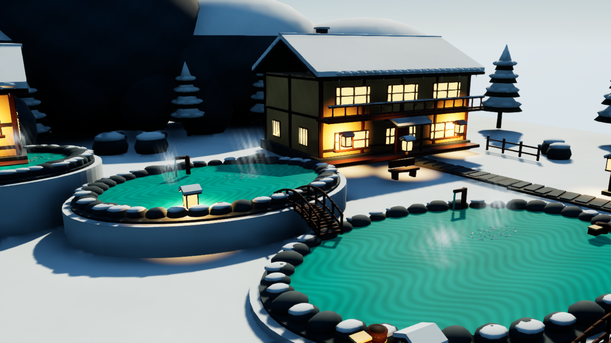

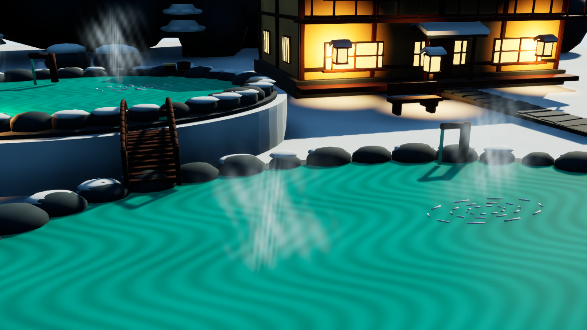

검토한 최종 이미지 해시: [시각 검토 기록](Validation/visual_review.json). 최종 독립 검토에서 시간차 변화량은 정규화된 PNG RGB 값으로 확인되어 분석 스크립트와 JSON의 필드명을 바로잡았다. 수치·이미지·촬영 시각과 당시 로그는 보존했다. 기존 비교 자료 보존은 감독이 독립적으로 확인한 [소유 범위 내 증거](Evidence/parent_comparison_preservation.json)를 연결하며, 다른 테마 보고서를 읽거나 수정하지 않았다.

## 참고 자료

외부 창작 참고 이미지는 사용하지 않았다. API는 설치된 UE 5.7의 MaterialEditingLibrary.cpp, MaterialGraphNode.cpp, WorldSettings.h, ExponentialHeightFogComponent.h와 AutomationBlueprintFunctionLibrary.h를 확인했다. 환경은 Blender 5.0·Unreal Engine 5.7이며 모든 UE 실행에 변경하지 않은 감독 소유 `Run-UnrealIsolated.ps1` 큐를 사용했다.

---

## 두 번째 작업 — 텍스처 품질 개선

사용자가 첫 결과 커밋 후 개선을 승인했다. 정식 시작은 **2026-10-23T14:00:03.073Z / 2026-10-23T23:00:03.073+09:00**이며 최초 수동 시계 조회 `14:01:02Z`는 별도로 남긴다. 첫 납품의 시작·완료·시간·커밋과 동결 파일은 변경하지 않는다.

### 설계·체크박스 계획

- [x] 기준 커밋과 동결 범위를 확인하고 새 작업을 `TextureImprovement/`에 격리한다.
- [x] built-in ImageGen으로 목재·광물성 돌·눈의 독립적인 타일형 평면 알베도 원본 3종을 만든다. 원본 이미지·전체 프롬프트·실제 시간·해시를 보존한다.
- [x] 목재 부품마다 장축을 찾고 결 방향을 기둥·보·데크·난간과 일치시킨다. 형상·배치·100×100m 크기·와인딩을 보존하면서 UV 또는 명확한 셰이더 투영을 수정한다.
- [x] 눈·돌·벽·천에 일관된 실제 표면 크기와 절제된 roughness·detail-normal 변화를 적용한다. 방향성 조명이 알베도에 들어가지 않도록 확인한다.
- [x] 규칙적인 수면 줄무늬를 약한 비주기적 잔물결로 바꾸고 기존 시간 변화·증기를 유지한다.
- [x] UV 밀도·방향·경계·타일 겹침 예외와 최종 메시·임포트 크기·텍스처 원본 및 색 공간을 실제 값으로 검증한다.
- [x] 기준 카메라·노출·조명을 유지한 overview·top_down·onsen·village·14초 시간차 2장을 실제 UE로 촬영한다. 목재·돌/눈 상세 고정 카메라 렌더를 추가한다.
- [x] 새 프로세스에서 저장 맵과 비어 있지 않은 재귀 의존성을 확인하고, 감독의 이미지 검토 후 에디터를 종료해 소유 자산만 발행한다.
- [x] 파일별 private/published SHA256과 첫 납품 동결 해시를 대조하고, 이 문서에 전후 이미지·실제 시간·결과·한계를 기록한다.

방식: 새 ImageGen 알베도는 편집 없이 원본으로 보존·임포트한다. roughness와 작은 표면 굴곡은 셰이더에서 별도로 구성한다. 목재는 장축 방향의 연결된 UV 투영, 돌·눈은 일정한 물리 스케일의 투영을 사용하며 의도적 타일 겹침은 수치로 기록한다. 건물·소품 형상, 광원, 노출과 기본 구도는 이번 변경 범위에 넣지 않는다.

### 실제 개선 결과

첫 납품의 형상·배치·조명·노출을 유지하면서 **머티리얼 9개와 목재를 포함한 메시 10개의 UV**를 개선했다. 맵 파일은 기준 커밋과 **바이트 단위로 동일**하다. 새로 만든 원본 알베도 3개가 실제 UE 재질에 연결되어 있고, 모든 메시의 위치·면 인덱스·법선은 원본과 동일하다. 최종 **16개 메시 / 165,742개 삼각형 / 14개 머티리얼 / 15개 소유 텍스처 / 맵 1개**다.

목재 결은 긴 보·판자·기둥을 따르고, 휜 난간과 지붕 보에는 중심선 길이를 따라 UV를 배치했다. 돌과 눈에는 월드 좌표의 연속적인 3방향 투영을 적용했다. 벽은 6cm 크기의 약한 얼룩과 0.35mm 높이 근사를, 천은 화면상 크기에 따라 감쇠하는 2mm 직조와 0.18mm 높이 근사를 추가했다. 수면의 넓은 줄무늬는 65cm 스케일의 이동하는 부드러운 noise로 바꾸고, 기존 5.7초 주기·1.3cm 높이 변화와 증기는 유지했다. [재질 매핑](TextureImprovement/Validation/material_mapping.json), [실제 제작 코드](TextureImprovement/Source/build_materials.py)

### 생성 원본과 표면 크기

built-in ImageGen으로 독립 생성한 원본은 모두 **1254×1254 PNG**이며 선택한 파일은 도구 원본과 SHA256이 같다. 픽셀 편집·명암 굽기·장면 이미지 생성은 하지 않았다. 전체 프롬프트·실제 요청 시각·원본 경로·해시·표면 배정은 [생성 기록](TextureImprovement/ImageGen/generation_manifest.json)에 있다.

| 표면 | 원본 | 한 타일의 실제 크기 | 원본 정보 밀도 | UE 빌드 샘플 밀도 | 기본 roughness / 높이 근사 |
|---|---|---:|---:|---:|---|
| 목재·어두운 목재 | T_IMG_Timber | 2.5m | 501.6px/m | 819.2px/m | 0.72·0.77 / 0.65mm |
| 돌·돌길 | T_IMG_Stone | 2.5m | 501.6px/m | 819.2px/m | 0.82 / 1.4mm |
| 눈 | T_IMG_Snow | 5m | 250.8px/m | 409.6px/m | 0.91 / 1.6mm |

UE 고유 `StretchToPowerOfTwo` 빌드는 2048²·PF_DXT1·12단계 mip을 생성했다. 알베도는 sRGB이며 자산은 streaming 가능 상태를 유지한다. 촬영에서는 첫 납품과 동일하게 streaming을 끄고, overview와 두 근접 촬영 시점의 **실제 resident 2048² / 12 mips**를 기록했다. 확대 빌드는 원본에 새로운 세부 정보를 추가하지 않는다. [임포트 원본·색 공간](TextureImprovement/Validation/texture_import_validation.json), [런타임 mip 증거](TextureImprovement/Validation/texture_runtime_mips.json)

원본 가장자리에는 측정 가능한 작은 불일치가 있어 무조건 seamless라고 주장하지 않는다. Mirror addressing으로 경계값을 이어 붙였으며 전체 무늬는 타일 길이의 2배마다 반복되고 경계에서 방향이 뒤집힌다. 실제 목재·돌·눈 근접 화면에서 두드러진 접힘은 확인되지 않았으나, 모든 시점에서 이음새가 없다는 뜻은 아니다. [원본 경계 측정](TextureImprovement/Validation/image_source_analysis.json)

### UV·형상 검증과 예외

목재 **656개 연결 부품**의 장축을 기본으로 삼되, 축이 모호한 62개는 결정적인 축 선택을 사용했고, 휜 부품 16개는 중심선 근사를 사용했다. 측면은 둘레가 이어지는 U / 길이 방향 V, 끝면은 별도 평면 차트다. 곡선 근사는 기하를 변경하지 않는다.

| 면적 가중 밀도 | Wood | DarkWood |
|---|---:|---:|
| 대상 면적 m² | 1492.509 | 1069.563 |
| 5백분위 px/m | 489.129 | 501.600 |
| 중앙값 px/m | 501.600 | 501.600 |
| 95백분위 px/m | 501.666 | 501.600 |
| 목표 70–150% 밖 면적 | 0% | 0% |

밀도가 일정해도 모든 방향의 왜곡이 같지는 않다. 독립 검토에서 Wood 비등방성의 95·99백분위는 **1.689·2.114**, 비율 2 초과 면적은 **2.016%**, 4 초과는 **0.0448%**였다. Wood의 끝면·베벨·곡선에 대한 평면 차트 예외는 **64.373m², 전체 Wood 면적의 4.31%**이며 이 경계에는 UV 위상 이음새가 생긴다. 이를 작은 베벨만의 예외로 축소하지 않는다. DarkWood 같은 예외 면적은 0.138m²다.

반복 타일 방식으로 서로 다른 부품 사이의 UV 겹침은 의도적이다. 정확히 재사용된 UV 삼각형은 27,981개이며 고유 아틀라스·무겹침 패킹을 주장하지 않는다. 아틀라스 패딩은 적용 대상이 아니며 끝면·둘레 랩·평면 예외 차트를 분리했다. 독립 재구성은 목재 폴리곤 70,822개의 선언된 매핑과 일치했고 설명되지 않은 UV 경계는 0개였다. 유한하지 않은 UV·면적 0 UV·퇴화 기하·와인딩 충돌·비정상 연결은 모두 0개다. [최종 UV·기하 검사](TextureImprovement/Validation/uv_geometry_validation.json), [독립 FBX·UV 검토](TextureImprovement/Evidence/independent_uv_review.json), [제작 원본](TextureImprovement/Source/SnowyOnsen_TextureImproved.blend)

Stone·Snow·Path의 이전 메시 UV 수치는 활성 재질 밀도를 뜻하지 않는다. 이 표면의 실제 스케일은 위 월드 투영 값이며, 격자 방향 경사면은 3방향 가중 혼합을 사용한다.

### 저장 맵·실제 움직임·발행

저장 맵의 직접 `world_partition=None`, 동적 Movable 조명과 `force_no_precomputed_lighting=True`를 다시 확인했다. 지형의 실제 UE 크기는 **10000.000977×10000.000977cm**, 배치 메시 16개의 actor 위치는 원점·회전 0·스케일 1이다. 외부 액터·외부 오브젝트·BuiltData가 없다.

새 프로세스의 재귀 그래프는 **45개 소유 /Game 패키지**이며 실제 배치 메시 16개·재질 14개·사용 텍스처 9개가 모두 포함된다. 텍스처 총 15개 중 기존 텍스처 6개는 활성 재질에서 사용하지 않지만 소유 디렉터리에 보존했다. 그중 5개는 직렬화된 의존성에 남아 있어 활성 사용 목록과 그래프 개수가 다르다. 그래프 누락·타 테마 참조는 0개다. 활성 텍스처 9개의 실제 사용·누락 0개는 [UE03 D3D 재열기 검사](TextureImprovement/Validation/Preview03/unreal_validation.json)가 증명한다. 후속 [UE04 NullRHI 저장 맵 검사](TextureImprovement/Validation/unreal_validation.json)는 같은 의존성 그래프와 자산 해시를 확인했지만 활성 텍스처 열거는 비어 있으므로 해당 수치의 증거로 사용하지 않는다.

동일 카메라의 **14.000초** 차이에서 평균 PNG RGB 변화량(0–255)은 **물만 있는 영역 1.5162 / 정적인 건물 0.5391 / 증기 23.7331**였다. 수면은 의도적으로 약한 변화이며, 증기와 분리해서 검증했다. 이는 예술적인 셰이더 변화이고 물리 유체·굴절 시뮬레이션 측정은 아니다. [픽셀 영역과 측정](TextureImprovement/Validation/capture_validation.json)

최종 8장은 실제 D3D UE03 렌더다. UE02도 같은 자산으로 정상 종료한 8장을 보존했다. UE03은 로그를 닫은 뒤 access violation으로 종료했으므로 정상 실행으로 바꾸어 기록하지 않았다. 후속 UE04는 **촬영 없는 full-editor NullRHI**에서 동일 46개 자산 해시·저장 맵·의존성을 재검증하고 정상 종료했다. NullRHI를 시각 증거로 사용하지 않았다. 종료 오류의 정확한 원인은 확인되지 않았고 수정했다고 주장하지 않는다. [렌더→재열기 검증 연결](TextureImprovement/Validation/render_validation_chain.json)

에디터가 닫힌 것을 확인한 뒤 소유 자산과 지정 맵 **46개 전부**를 발행했고 private/published SHA256이 일치한다. 기준 대비 새 파일 3개, 변경 19개, 동일 24개다. 맵 바이트는 동일하며 새 텍스처·UV·재질만 갱신했다. [발행 SHA256](TextureImprovement/Validation/publication_sha256.json), [프로세스 종료](TextureImprovement/Validation/private_editor_closed.json)

첫 납품 아카이브 125개, 변경 금지 활성 Work 파일 123개, 별도 Content 보존본 43개 모두 원래 해시와 일치한다. 첫 납품 커밋은 `f8d97a81562ff9a1ea25cbb55b58bcaf542181ab`이며 Git 변경 작업은 감독이 담당한다. [동결 보존 증거](TextureImprovement/Validation/baseline_preservation.json)

### 실제 시간

| 항목 | 기록 |
|---|---|
| 시작 UTC / KST | `2026-10-23T14:00:03.073000+00:00` / `2026-10-23T23:00:03.073000+09:00` |
| 완료 UTC / KST | `2026-10-23T14:43:09.061116+00:00` / `2026-10-23T23:43:09.061116+09:00` |
| 전체 경과 | **2585.988초** |
| 모든 UE 대기 / 실행 합계 | **315.363초 / 408.290초** |
| UV 원본 스크립트 실행 합계 | **40.649초** |
| ImageGen 동시 요청 경과 / 개별 요청 합계 | **80.596초 / 152.734초** |

UV 시간은 두 Blender 스크립트 내부 실행 시간으로 시작 비용·코드 작성 시간과 다르다. 전체 경과는 계획·코드·검토·대기를 포함한다. 첫 납품 시간과 합치거나 시작을 재설정하지 않았다. 실제 설정은 계속 **gpt-6-astra / max**, 로컬 fast이며 개별 요청의 실제 serving tier는 노출되지 않는다. [시간 원장](TextureImprovement/Validation/timing_summary.json), [실행 설정 검증](TextureImprovement/Evidence/parent_runtime_effort_verified.json)

| UE 시도 | 대기 초 | 실행 초 | 종료 코드 | 결과 |
|---|---:|---:|---:|---|
| 1 | 0.199 | 78.256 | -1073741819 | 기준 상세 2장 촬영 후 로그 종료 뒤 native access violation |
| 2 | 186.961 | 176.814 | 0 | 새 UV·재질 적용, 실제 8장 촬영, 정상 종료 |
| 3 | 127.994 | 141.175 | -1073741819 | 새 프로세스 재열기·최종 8장 촬영, 로그 종료 뒤 native access violation |
| 4 | 0.209 | 12.045 | 0 | 동일 46개 자산을 NullRHI로 재열기·검증, 정상 종료 |

UE02의 재질 그래프 조립 중 Missing Sine input 경고는 최종 저장 후 UE03에 남아 있지 않았다. 캡처 파일이 교체되는 중 시작한 첫 분석의 해시 실패도 보존했으며, 전체 촬영 완료 후 8장 검사를 다시 통과했다. 추가 외형 수정·무한 반복은 진행하지 않았다.

### 같은 카메라의 전후 화면

모든 렌더는 **1920×1080, High 2, ScreenPercentage 100, Lit, Game View**다. 공통 overview는 `(12000,-12000,16000)cm`에서 원점을 향하며 Ortho Width 20000cm, top_down은 `(0,0,20000)cm`, Pitch -90/Yaw 0/Roll 0, Ortho Width 20000cm다. 기본 6개 카메라와 추가 상세 2개의 전후 위치·회전·화각 일치를 검증했다. 조명·노출은 동일 맵 바이트로 보존했다. [촬영 명세·시각·해시](TextureImprovement/Screenshots/capture_manifest.json)

목재 개선 전:

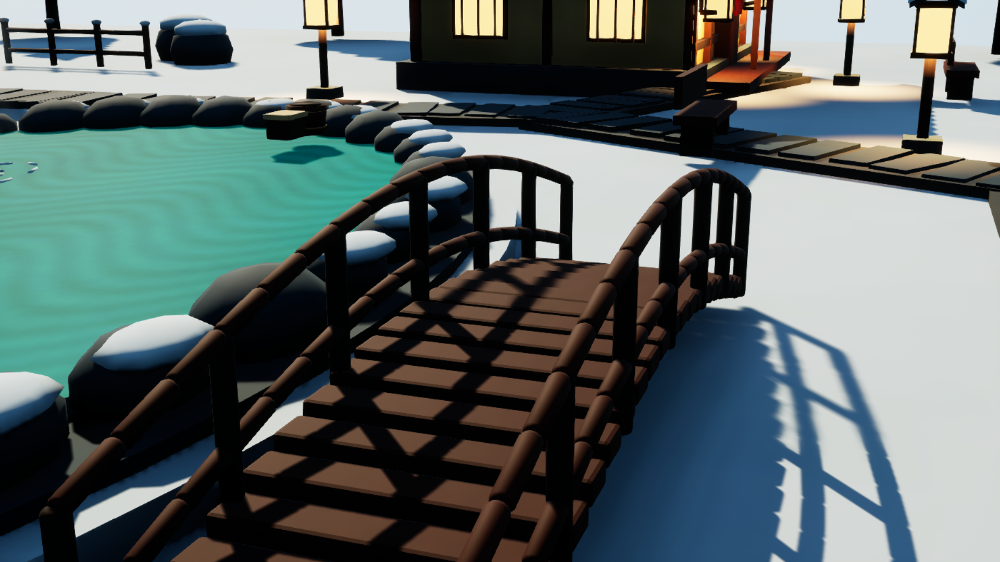

목재 개선 후:

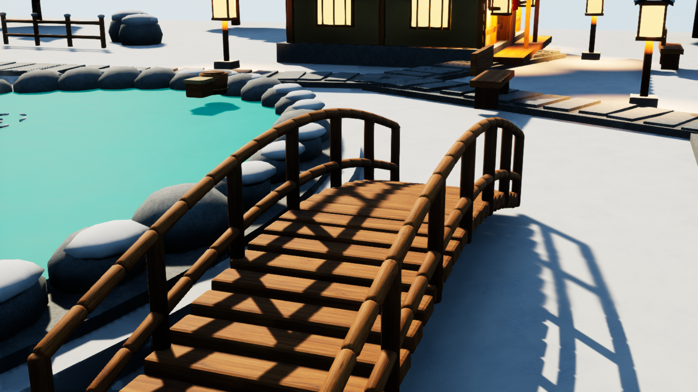

돌·눈 개선 전:

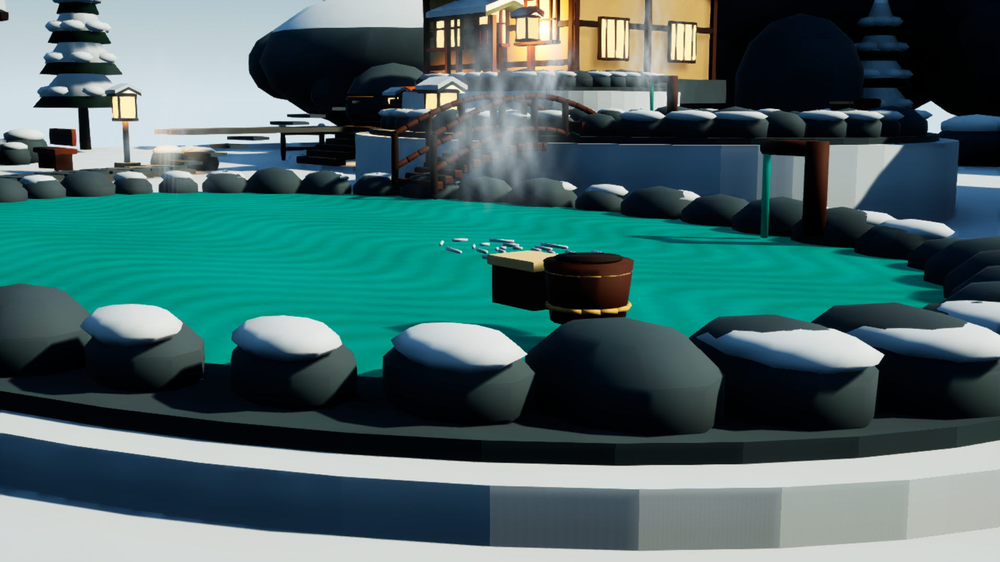

돌·눈 개선 후:

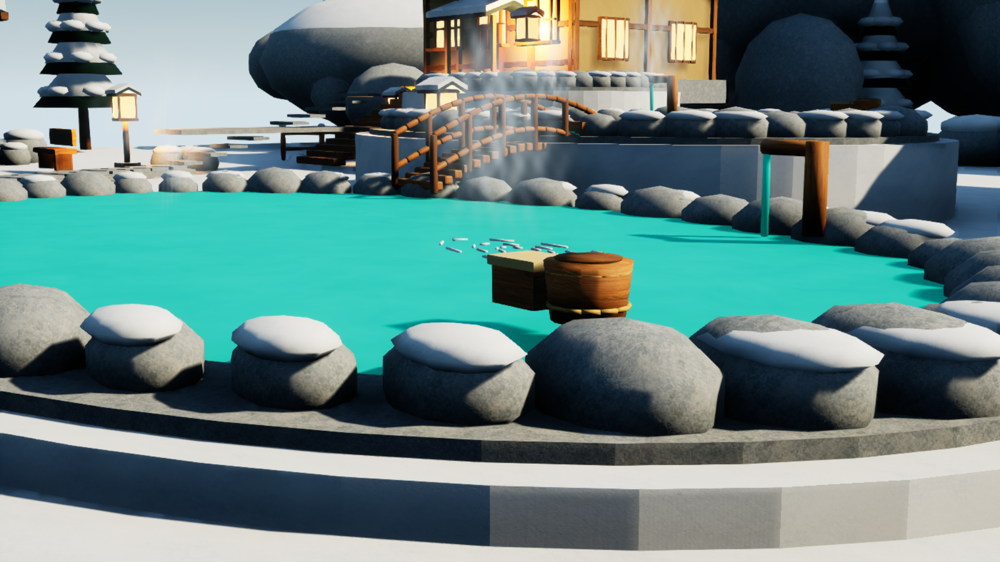

전체 구성 개선 전:

전체 구성 개선 후:

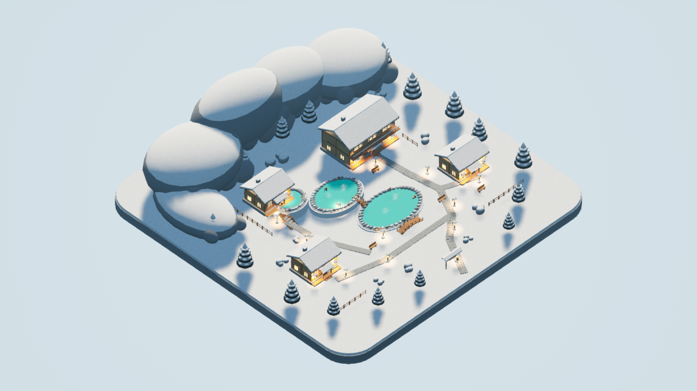

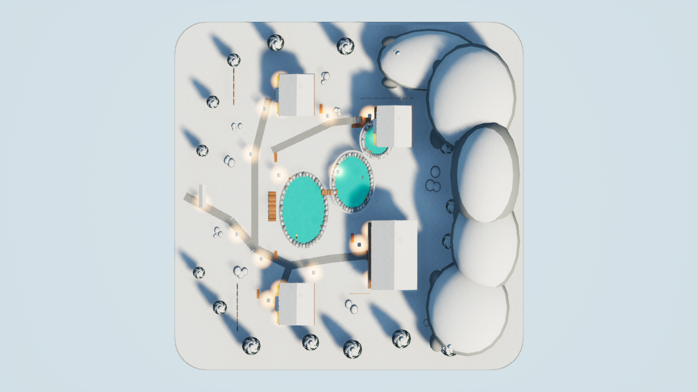

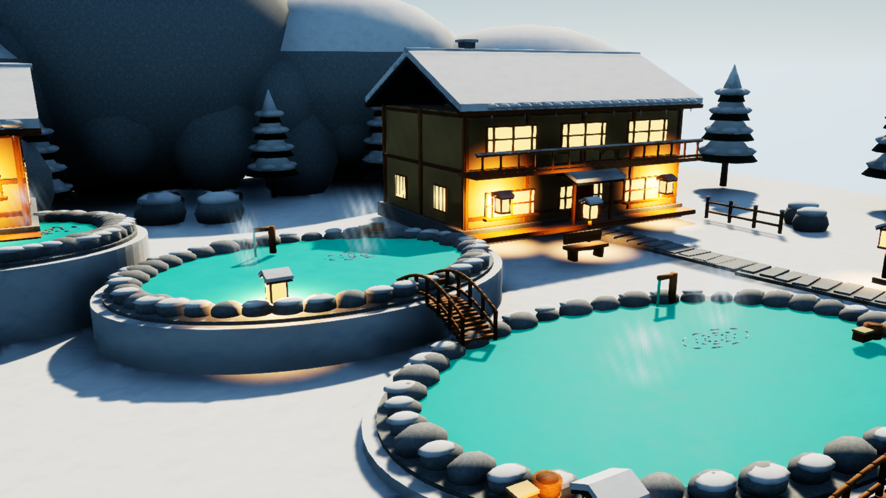

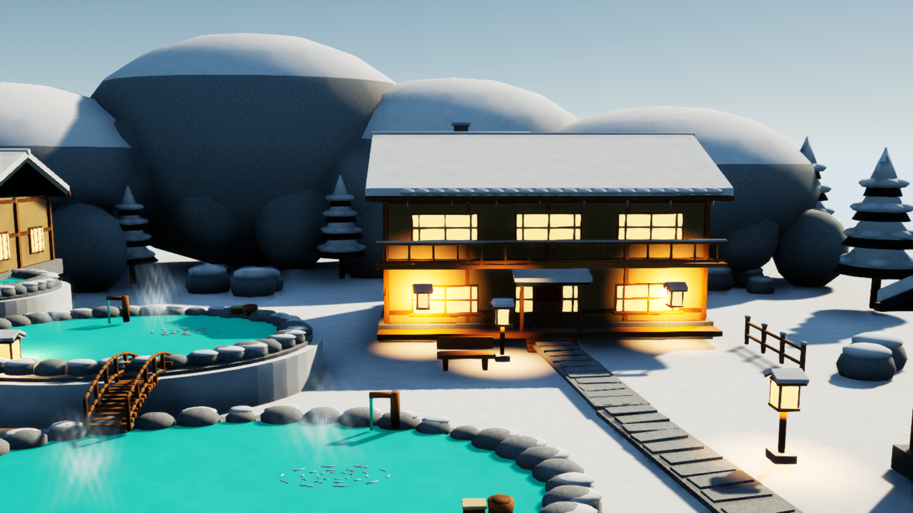

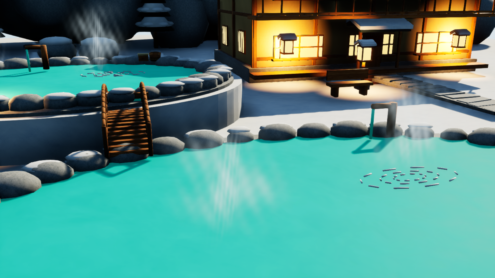

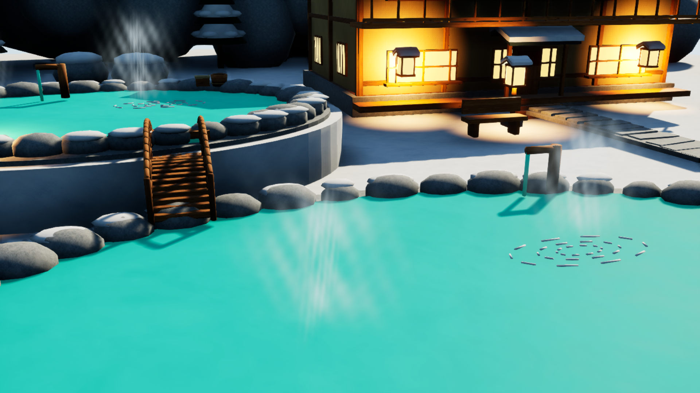

원래의 강한 창 조명·어두운 절벽 전면과 교차 카드 증기 표현을 유지했다. 큰 수면은 불투명한 재질 근사이며 실제 굴절·유체 계산은 없다. 충돌·게임플레이·FPS 목표를 추가하지 않았다. 목재 차트 이음새와 Mirror 방향 반전은 위에 기록한 한계다. 감독이 최종 이미지를 확인했으며 [작업자 시각 검토](TextureImprovement/Validation/worker_visual_review.json)와 [감독 검토](TextureImprovement/Evidence/parent_final_visual_review.json)를 남겼다.
