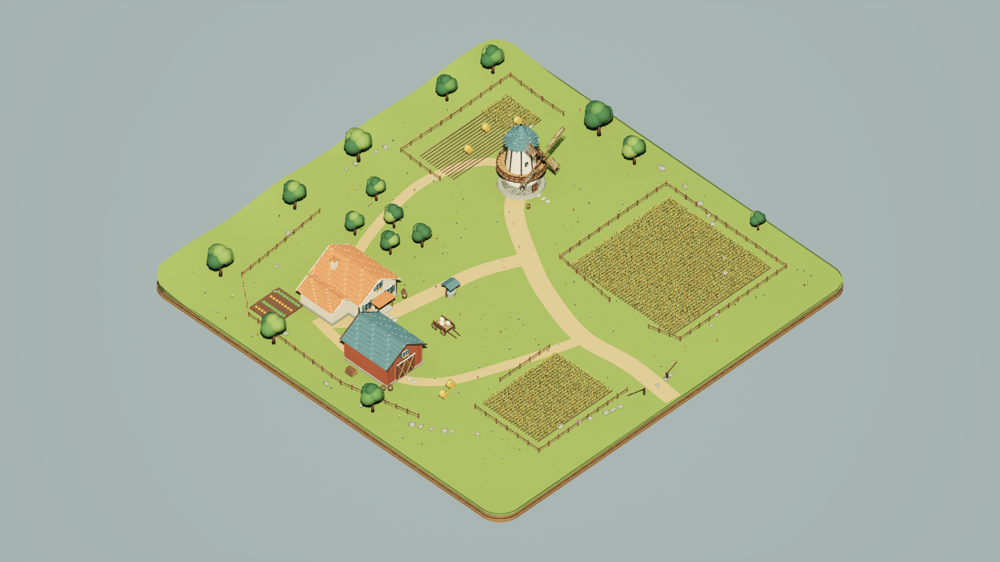
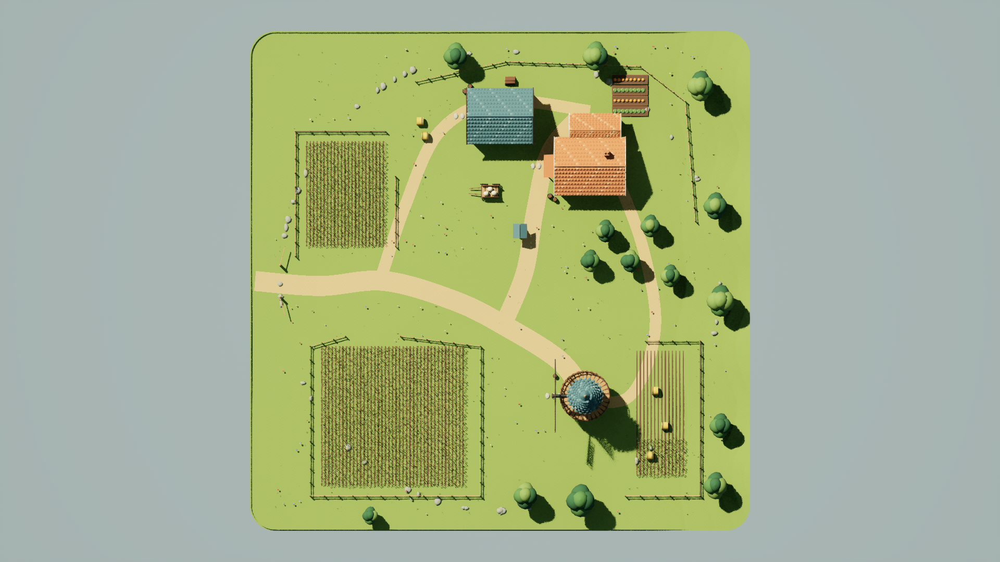
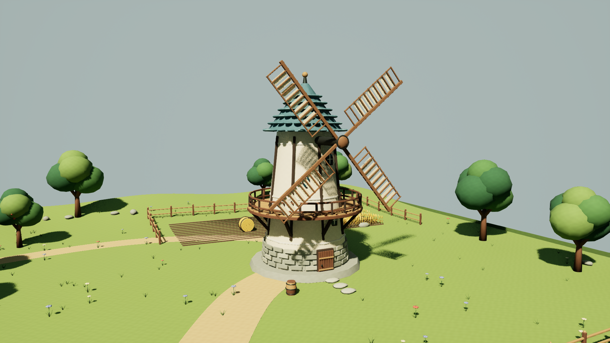
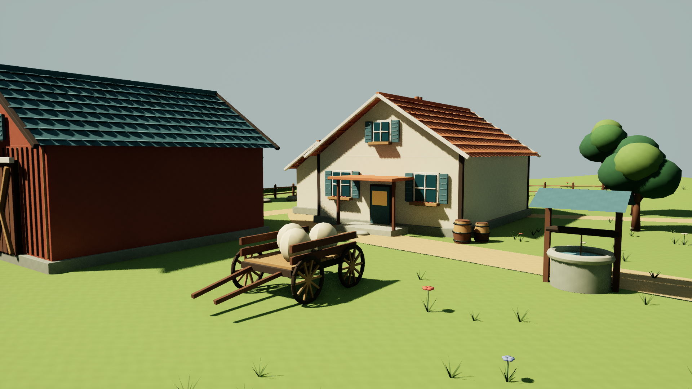

# WindmillFarm / max 완료 보고서

100×100m 전통 풍차 농장 장면을 Unreal Engine 5.7에 제작하고, 저장 맵과 전용 자산, 실제 UE 스크린샷 6장을 전달했다. 전용 프로젝트에서 저장·재로드 검증을 마친 뒤 에디터를 종료하고 지정된 최종 경로에 복사했다. 63개 파일의 SHA-256이 원본과 모두 일치한다. 제작 상태는 `ready_for_review`이며, 감독 대화의 최종 납품 검증도 통과했다.

이 문서는 이 작업의 설계·계획·분석·결과를 모은 단일 보고서다. 기존 Forest/MountainStation 비교 보고서나 WindmillFarm/ultra 작업과 별개다.

## 전달 파일

| 구분 | 경로·수량 |
|---|---|
| UE 맵 | [WindmillFarm_max.umap](../../../Content/Maps/WindmillFarm_max.umap), 패키지 `/Game/Maps/WindmillFarm_max` |
| 전용 UE 자산 | [Content/WindmillFarm/max](../../../Content/WindmillFarm/max): Static Mesh 16개, Material 38개, Texture 8개 |
| 원본 | [Blender 장면](Source/WindmillFarm_max.blend), [FBX 16개](Source/Models), [절차형 텍스처 8개](Source/Textures), [소스 명세](Source/scene_manifest.json) |
| 실제 캡처 | [Screenshots](Screenshots), [카메라·렌더·시각 기록](Screenshots/capture_manifest.json) |
| 상태·검증 | [STATUS.json](STATUS.json), [저장 맵 검증](Evidence/saved_scene_validation.json), [게시 파일 해시](Evidence/publication.json) |
| 재현 스크립트 | [Scripts](Scripts): 원본 제작, UE 가져오기·저장, 검증, 촬영, 게시 |

최종 Content 전달량은 **20,898,496 bytes / 63개 파일**이다. 맵 SHA-256은 `7448a5d119828f311b8c267dda33d52301e79475fce6eed2becfcf44b02ef22b`이다. 자산별 전체 SHA-256과 원본·복사본 경로는 `Evidence/publication.json`에 기록했다.

## 장면과 제작 방식

크림색 미장 풍차에 석조 기단, 목조 회랑, 청록색 지붕과 네 개의 격자·천 날개를 구성했다. 농가와 붉은 목조 헛간 앞 마당을 길로 연결하고, 두 개의 밀밭과 수확 중인 밭, 건초 더미, 과수원, 텃밭, 울타리, 우물, 수레·포대·통·장작·작은 꽃과 돌을 배치했다. 낮고 둥근 지형과 절제한 황토·크림·청록·녹색 계열을 사용했다.

소유한 전용 Blender 5.0 백그라운드 작업과 UE 프로젝트에서 독립 제작했다. 최종 Blender 소스는 정점 **537,924개**, 폴리곤 **440,912개**이며, 이는 FBX/UE 삼각분할 전 소스 집계다. 저장 맵은 **25개 Actor**를 포함한다. 설치된 엔진 로그는 UE **5.7.4 / CL 51494982**를 표시한다.

텍스처는 `build_textures.py`가 수식으로 만든 원본 512×512 PNG 8장이다. Plaster, Wood, Stone, Earth, Grass, Clay, Canvas, Straw를 실제 UE 재질에 연결했다. 이미지 생성 도구나 외부 창작 이미지는 사용하지 않았다. 표면 UV는 지배적인 면 방향에 평면 투영한 미터 좌표를 2로 나눈 반복 방식이다. 축에 정렬된 평면의 명목 밀도는 256 px/m이며, 기울어진 면의 투영 왜곡과 의도적인 중첩을 허용한다. 모든 소스 면 루프에 UV가 있는지 확인했지만 유니크 아틀라스, 아일랜드별 실측 밀도·패딩 검증은 수행하지 않았다.

동적 Directional Light와 Sky Light를 사용하고 베이크 조명은 비활성화했다. 자체 단색 배경 재질을 엔진 기본 Sphere에 적용했으며, Sky Light는 엔진 내장 `DaylightAmbientCubemap`을 읽기 전용으로 참조한다. 이 배경 구는 농장 100×100m 면적 밖의 프레젠테이션 환경이다.

풍차는 Time 기반 재질 WPO와 노멀 회전으로 시각적으로 움직인다. 설정 속도는 0.12 rad/s, 명목 1회전 시간은 약 52.36초다. 회전 전용 Wood/Iron/Canvas 재질을 분리했으며 포대의 Canvas는 정적이다. 실제 FBX 형상 기준 전 회전 회랑 여유는 약 0.70m, 날개 회전 범위의 최저 높이는 약 3.89m로 계산됐다. 실제 UE 에디터에서 같은 카메라로 **20.022742초 간격** 촬영한 두 이미지의 날개 자세 변화를 확인했다. 물리적 구동이나 회전 충돌체를 구현한 결과는 아니다.

## 실제 UE 스크린샷

모든 최종 이미지는 저장 맵을 다시 연 UE DX12 오프스크린 렌더다. **1920×1080 PNG, High(2), Screen Percentage 100%, Lit, Game View**, 모션 블러 끔으로 촬영했으며 UI·선택선·디버그 문구를 숨겼다. 생성 이미지 대체나 촬영 후 이미지 보정은 없다. 최종 6장을 직접 열어 구도, 재질, 길 연결과 풍차 움직임을 확인했다. [이미지 크기·해시·검토 기록](Evidence/capture_verification.json)에 결과를 남겼다.

전체 보기: 카메라 `(12000, -12000, 16000)` cm, 원점을 바라보는 직교 투영, 폭 20000cm.

탑다운: 카메라 `(0, 0, 20000)` cm, pitch -90°, 직교 폭 20000cm. 지형 보완 후 길이 연속해서 보인다.

풍차: 카메라 `(-650, -1750, 1250)` cm, 수평 FOV 70°.

농가: 카메라 `(650, -1500, 500)` cm, 수평 FOV 70°.

풍차 시간 증거 t0: 캡처 요청 `2026-10-23T08:52:01.151079+00:00`.

풍차 시간 증거 t1: 같은 카메라, 캡처 요청 `2026-10-23T08:52:21.173821+00:00`. 두 이미지에서 대각선과 수직·수평에 가까운 날개 자세가 구분된다. 캡처 간격은 요청 시각 기준이며 이미지에서 회전 각도를 실측한 것은 아니다.

## 검증과 수정 결과

| 검증 항목 | 실제 결과·근거 |
|---|---|
| FBX 크기와 형상 | 지형 100×100m, 길의 위쪽 삼각형 532개·아래쪽 0개, 돌 53개·과수원 125개 연결 요소의 음수 체적 0개. [FBX 검증](Evidence/fbx_validation.json) |
| 저장 맵 재로드 | 성공. 필수 풍차·농가·헛간·밀밭·길·울타리·과수·소품 범주와 모든 재질 슬롯을 확인 |
| `/Game` 재귀 의존성 | 맵 포함 **62개 패키지** 순회. 자기 맵과 `/Game/WindmillFarm/max/`만 허용했으며 금지 참조 0개. 배치된 자산이 순회 결과에 포함됐는지도 검사 |
| World Partition | WorldSettings의 `world_partition`을 직접 읽어 null 확인. 관련 Actor 없음 |
| 외부·조명 패키지 | 외부 Actor/Object 패키지 0개, BuiltData 0개. `force_no_precomputed_lighting=true` |
| 실제 렌더·움직임 | 최종 Lit PNG 6장, 각 1920×1080. 동일 카메라의 날개 움직임 확인 |
| 최종 로그 | 마지막 촬영·검증 로그에 Python 오류, 재질 컴파일 실패 없음. 촬영 로그에 VSM 성능 경고 1개는 남음. [로그 검토](Evidence/final_log_review.json) |
| 게시 | 전용 UE 프로세스 0개 확인 후 복사. 자산 62개+맵 1개 원본·복사 SHA-256 일치. [종료 확인](Evidence/process_closed.json), [게시 기록](Evidence/publication.json) |
| 다른 보고서 보존 | 감독 대화가 제공한 해시 확인 자료에서 기존 세 보고서 모두 불변. 작업자가 해당 보고서를 편집하지 않았음. [감독 확인 사본](Evidence/report_preservation_verification.json) |

검토 중 FBX 단위 중복 배율, 일부 면 방향, 날개와 회랑 간섭을 발견해 원본을 수정하고 실제 FBX를 다시 검사했다. UE 가져오기 과정의 Y축 반전은 모든 전용 메시에 `(1,-1,1)` 배치를 적용해 원래 배치를 복원했으며, 풍차 타워·회전축의 위치와 6m 축 방향 간격을 저장 맵에서 재확인했다. 초기 촬영의 wireframe과 어두운 전면은 Lit 강제 설정·조명·재질 대비 조절로 해결했다. 마지막으로 거친 지형 삼각형이 길을 가리던 부분은 지형 둘레를 1.5m 이하 간격으로 세분화한 뒤 Terrain/Paths만 다시 가져와 해결했다. 감독 대화와 별도 검토자가 초기 형상 문제 및 최종 캡처를 검토했으며, 이 제출물의 최종 승인은 감독 대화가 담당한다.

원본 제작·검사, UE 장면 저장·검증, 실제 촬영·검토·게시의 세 작업 단계를 완료했다. 초기 실패 결과와 중간 캡처는 소유한 Evidence 및 scratch 로그에 남겨 두었고 최종 캡처와 구분했다.

## 실제 시간 기록

| 사건 | UTC | KST |
|---|---|---|
| 최초 작업 시작 | 2026-10-23T07:40:00.747000+00:00 | 2026-10-23T16:40:00.747000+09:00 |
| max로 확인된 첫 턴 | 2026-10-23T07:50:07.562000+00:00 | 2026-10-23T16:50:07.562000+09:00 |
| 진행 승인 후 구현 턴 | 2026-10-23T07:56:20.935000+00:00 | 2026-10-23T16:56:20.935000+09:00 |
| 구현 시작 기록 | 2026-10-23T08:10:21.085211+00:00 | 2026-10-23T17:10:21.085211+09:00 |
| 최종 캡처 스크립트 시작 | 2026-10-23T08:50:05.407753+00:00 | 2026-10-23T17:50:05.407753+09:00 |
| 최종 캡처 완료 | 2026-10-23T08:52:41.186307+00:00 | 2026-10-23T17:52:41.186307+09:00 |
| 최종 저장 맵 검증 | 2026-10-23T08:54:09.471406+00:00 | 2026-10-23T17:54:09.471406+09:00 |
| 에디터 종료 확인 | 2026-10-23T08:58:44.787800+00:00 | 2026-10-23T17:58:44.787800+09:00 |
| 최종 경로 복사·해시 검증 | 2026-10-23T09:01:50.321121+00:00 | 2026-10-23T18:01:50.321121+09:00 |
| 작업 완료 기록 | 2026-10-23T09:06:38.931261+00:00 | 2026-10-23T18:06:38.931261+09:00 |

원래 시작 시각부터 완료 기록까지 **5198.184261초 (86.64분)**다. 처음 xhigh로 시작한 턴은 준비 확인만 수행했다. 감독 대화가 이 스레드 설정을 수정한 뒤 `gpt-6-astra / max`가 확인됐고, 구현은 그 후 진행했다. 글로벌 설정 변경은 하지 않았다. 모델·effort 전환과 설계 응답 대기를 포함하여 최초 시작 시각을 유지했다. [실제 turn_context 근거](Evidence/runtime_effort.json)와 STATUS의 구현 시작 기록을 보존했다.

UE 실행은 전부 수정하지 않은 감독 전용 `Run-UnrealIsolated.ps1`을 통했다. 총 **15회**, 큐·뮤텍스 대기 합계 **2.7155065초**, UE 프로세스 실행 합계 **882.3900677초**다. 새 테마는 러너의 Unknown/priority 2로 처리됐고 실행 중인 다른 작업을 중단하지 않았다. 아래 합계는 **실패한 실행과 교체된 촬영도 모두 포함**한다. 이미지 생성 도구는 0회·0초다. 수식 기반 텍스처 제작 시간은 전체 벽시계 시간에 포함된다. 아래 값은 프로세스의 실제 경과 시간으로 CPU 사용 시간이나 전체 작업 시간과 같지 않다.

| 러너 기록 시각 UTC / 단계 | 대기 초 | 실행 초 | 종료 코드 | 결과 |
|---|---:|---:|---:|---|
| 08:15:43 / build | 0.1759410 | 37.7429091 | 3 | 실패: commandlet 텍스처 가져오기 중 Slate assertion |
| 08:23:40 / build | 0.1510391 | 43.0407646 | 0 | 실패: CustomInput 생성 Python 오류. 프로세스 종료 코드는 0 |
| 08:25:33 / build | 0.2076065 | 130.9961723 | 0 | 성공: 자산·재질·맵 저장 |
| 08:30:14 / layout | 0.1982823 | 16.2055286 | 0 | 성공: UE 가져오기 후 Y축 배치 보정 |
| 08:31:18 / validate | 0.1735228 | 7.9606210 | -1 | 실패: commandlet의 의존성 수집 오류 |
| 08:32:19 / validate | 0.1948720 | 6.9307709 | -1 | 실패: 비어 있는 맵 의존성에 대한 검증 방어 조건 |
| 08:33:12 / validate | 0.1641014 | 14.6467718 | 0 | 성공: 전체 에디터에서 저장 맵 검증 |
| 08:33:27 / capture | 0.1812667 | 171.1006529 | 0 | 촬영 실행 완료. 일부 wireframe·어두운 조명으로 최종본에서 제외 |
| 08:42:32 / polish | 0.2360112 | 40.8863963 | 0 | 조명·재질·배경 보완 |
| 08:43:13 / validate | 0.1602092 | 14.1433410 | 0 | 성공: 보완된 저장 맵 검증 |
| 08:43:28 / capture | 0.1667004 | 169.5085027 | 0 | Lit 촬영 완료. 길 가림을 확인하여 지형 보완 후 교체 |
| 08:49:11 / terrain | 0.1950300 | 25.7656498 | 0 | 성공: 지형과 길만 다시 가져와 저장 |
| 08:49:37 / validate | 0.1689078 | 17.6681508 | 0 | 성공: 지형 보완 후 검증 |
| 08:49:55 / capture | 0.1772473 | 169.6519693 | 0 | 성공: 최종 실제 렌더 6장 |
| 08:53:59 / validate | 0.1647688 | 16.1418666 | 0 | 성공: World Partition 직접 확인을 포함한 최종 검증 |

원시 시작·종료 시각과 로그 경로는 [timing_summary.json](Evidence/timing_summary.json) 및 개별 `ue-*-timing.json`에 있다. 특히 08:23:40 실행은 프로세스가 0으로 종료됐어도 Python 오류가 있었으므로 성공으로 세지 않았다. 감독 대화의 토큰 집계는 이 작업자가 추정하거나 다른 비교 보고서에 기록하지 않았다.

## 알려진 한계와 사용 범위

- 풍차 움직임은 GPU 재질 변형이다. 날개 충돌은 비활성화했고 물리 시뮬레이션·기계 구동을 구현하지 않았다. 실제 에디터 렌더로 검증했으며 PIE·패키징 실행이나 FPS 벤치마크는 수행하지 않았다.
- 묶음 형태의 non-Nanite 메시를 사용했으며 별도 LOD를 제작하지 않았다. 최종 촬영에서 `Non-Nanite Marking Job Queue overflow` VSM 성능 경고가 있었고 일부 동적 그림자에 입자가 보인다. 상용 게임 성능 최적화를 완료했다는 의미는 아니다.
- 타일형 UV에는 의도적인 중첩과 투영 왜곡이 있다. 유니크 표면 아틀라스나 아일랜드별 밀도·패딩 보증은 제공하지 않는다. 가져오기 중 일부 접선/종법선 경고가 있었으며 노멀 맵은 사용하지 않았다.
- 건물은 외관 장면이며 내부 공간·게임플레이 루프를 제작하지 않았다. 100×100m는 농장 지형의 범위이며 배경 구는 그 바깥에 있다.

## 소유 범위와 참고

새 창작 자산은 전부 `/Game/WindmillFarm/max/` 안에 있고 자기 맵만 `/Game/Maps/WindmillFarm_max`에 있다. 제작 세션은 `Saved/Workers/WindmillFarm/max/Project`만 사용했다. 다른 테마·effort의 창작 자산·스크립트·scratch는 읽거나 재사용하지 않았고, 공유 Source/Config/Plugins/Binaries/uproject, 다른 맵, 기존 비교 보고서를 수정하지 않았다. Git 추가·커밋·브랜치 변경은 수행하지 않았다.

외부 창작 리소스는 없다. 읽기 전용 엔진 기본 리소스는 `/Engine/BasicShapes/Sphere`와 `/Engine/MapTemplates/Sky/DaylightAmbientCubemap`이다. 기술 참고는 저장소 [AGENTS.md](../../../../AGENTS.md), 감독의 실행 러너, 설치된 UE5.7 API/헤더 및 [Epic AutomationLibrary API](https://dev.epicgames.com/documentation/en-us/unreal-engine/python-api/class/AutomationLibrary?application_version=5.7), [Epic MaterialExpressionCustom API](https://dev.epicgames.com/documentation/en-us/unreal-engine/python-api/class/MaterialExpressionCustom?application_version=5.7)다.
