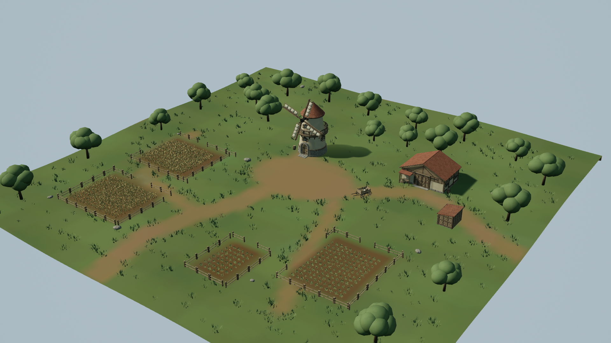
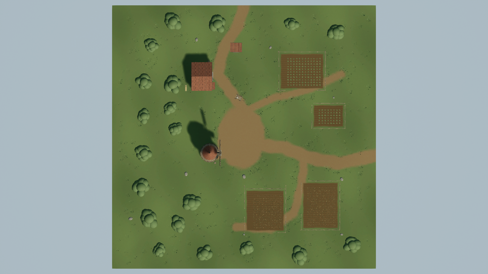
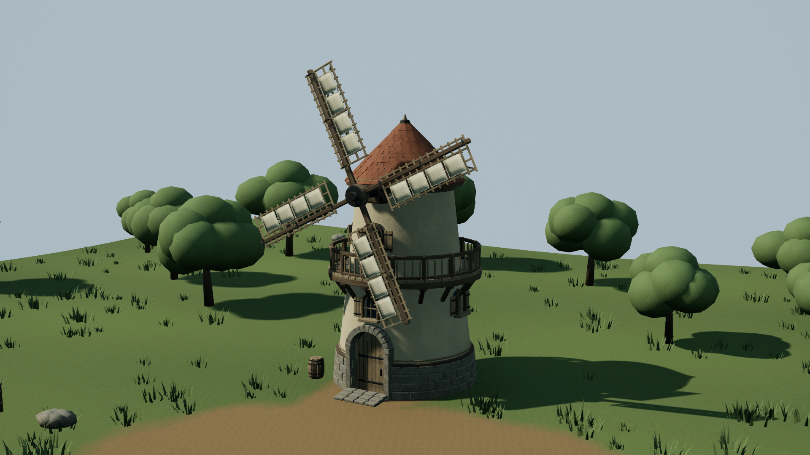
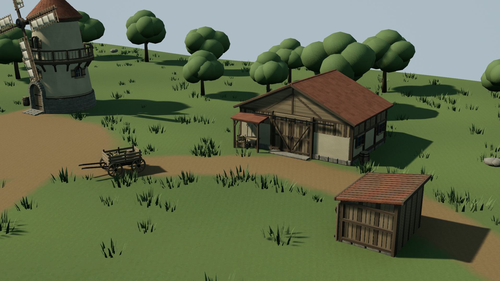

# 오래된 풍차 농장 — WindmillFarm / ultra

100×100m 독립 농장 장면을 제작하고 저장·재로드·PIE 검증 후 게시했다. 차분한 초록과 회벽, 풍화된 목재, 둥근 수관으로 관리되는 오래된 농장의 외관을 구성했다. 상태는 **ready_for_review**이며 최종 검토·커밋은 감독자 담당이다.

## 전달 경로와 구성

- 맵: `ForestDemo/Content/Maps/WindmillFarm_ultra.umap` (`/Game/Maps/WindmillFarm_ultra`).
- 자산: `ForestDemo/Content/WindmillFarm/ultra/` — 메시 20개, 머티리얼 17개, 텍스처 35개.
- 원본·제작 스크립트·검증·렌더: `ForestDemo/Work/WindmillFarm/ultra/`.
- private 프로젝트: `ForestDemo/Saved/Workers/WindmillFarm/ultra/Project/WindmillFarm.uproject`.
- 게시한 패키지 73개, 45,825,814bytes. [publication.json](publication.json)에 원본/게시본 SHA-256 전수 일치 기록이 있다. private UE 종료 후 자기 자산과 지정 맵만 복사했다.

장면은 1,224개 actor로 구성된다. 높이 12.63m 풍차 타워, 지름 11.355m 회전 날개, 석재 입구 계단과 갤러리, 헛간, 작업 창고, 밭 4개, 나무 20그루, 울타리 66개, 풀 덩어리 650개, 수레·도구·통·건초를 배치했다. 길의 가장자리는 지면 마스크의 불규칙한 혼합과 띄엄띄엄 놓은 풀로 연결했다. 구름 장식·얼굴·하트는 없다.

## 실제 Unreal 렌더

모든 이미지는 UE5.7 SceneCapture2D의 1920×1080 원본이다. D3D12 SM5, High(sg2), FinalColorLDR/RGBA8, gamma2.2, 동적 햇빛/스카이라이트로 렌더했다. 생성 이미지나 이미지 보정으로 장면 증거를 대체하지 않았다. 카메라 위치/회전/FOV, 개별 UTC, 월드 시간, 워밍업 프레임은 [capture_manifest.json](Screenshots/capture_manifest.json)에 있다.

추가 [소품 접지 렌더](Screenshots/prop_contact.png)는 수정한 건초 적재를 보여준다. 날개는 머티리얼 WPO로 초당0.08rad 회전한다. 같은 카메라의 [t0](Screenshots/windmill_motion_t0.png)와 [t1](Screenshots/windmill_motion_t1.png)은 월드 시간 17.915528→22.117258초(4.201730초 간격)이며 실제 날개 각도 변화가 보인다. RGB 차이12 초과 픽셀은 103,125개로, 그림자와 시간적 렌더 차이도 포함한다. 물리 토크/바람 시뮬레이션은 아니다.

## 검증과 검토

최종 새 프로세스 검증 UTC: **2026-10-22T13:48:14.046872+00:00**. [validation.json](validation.json), [visual_review.json](visual_review.json), [독립 구현 검토](QA/implementation_review.md), [렌더 분석](render_analysis.json)을 제공한다.

| 실제 검사 | 결과 |
|---|---|
| saved_map_reload | PASS |
| non_world_partition | PASS |
| no_external_packages | PASS |
| owned_dependencies | PASS |
| footprint_100m | PASS |
| materials_and_uvs | PASS |
| dynamic_lighting | PASS |
| player_start | PASS |
| upright_placement | PASS |
| prop_contact_and_clearance | PASS |
| pie_possession | PASS |
| ground_collision | PASS |
| building_collision | PASS |
| pawn_sweep_blocks | PASS |
| pawn_can_move | PASS |
| pie_ended | PASS |

재귀 /Game 의존성은 자기 자산 루트와 자기 맵에 한정된다. ground 측정값은 X/Y 각각10000.001953cm이며 비월드파티션 레벨이다. ExternalActors/ExternalObjects/BuiltData가 없다. 모든20개 메시에서 UV2채널과 소유 머티리얼을 확인했다. UV의 엄격한 수학적 예외는 아래에 별도로 공개한다.

PIE에서 Engine DefaultPawn 소유, 지면3지점 trace, 풍차 벽 trace, 지면에 막히는 pawn sweep, 수평200cm 스크립트 이동과 PIE 종료를 확인했다. 이는 실제 입력으로 플레이한 보행 캐릭터 검증이나 모든 건물의 전수 충돌 검증은 아니다.

독립 검토의 건초 부유/헛간 벽 겹침과 배럴 벽 겹침을 수정했다. 수정한 upper bale와 두 support의 높이 차이는 0.485402/0.000000cm, 건초와 헛간 전체 경계 간격 162.350cm, 배럴과 동측 벽 간격 31.003cm다. 저장본 수치 검사와 진단 렌더로 확인했다.

## UV·표면 원본과 알려진 한계

Blender 원본은 `Art/Windmill`, `Art/Farm`, `Art/Landscape`, 최종 FBX20개는 `Art/FinalMeshes`에 있다. 독립적으로 만든 결정론적 절차 텍스처33개(11표면×BaseColor/Roughness/Normal)와 지면 텍스처2개를 실제 UE 머티리얼에 연결했다. 외부 창작 자산/이미지와 image-generation 서비스는 사용하지 않았다. 이미지 생성 프롬프트/출력도 없다. 텍스처 코드·seed·색공간·DirectX normal 규칙·hash·타일 경계 검사는 [텍스처 manifest](Art/Textures/manifest.json)에 기록했다.

UV0은 고유 섬을0–1에 패킹하고 UV1은 반복 표면을 위해 확장했다. UV0 패킹 padding은0.0015UV(1024기준1.536px)이며 [최종 메시 manifest](Art/FinalMeshes/manifest.json)에 표면적/스케일이 있다. 원본 평균 텍셀 목표는128px/m(1024텍스처), 독립 재임포트의 면적가중 평균은127.145–128.000px/m다. 지면은 의도적으로2048 macro20.48px/m와512px/m detail을 쓴다.

엄격한 [독립 메시 QA](QA/REVIEW.md)에서20개 중19개는 UV 무결성 검사를 통과했다. MillTower의4개 미세 WoodLight 삼각형(각6.31e-11m²)은 UV0/UV1 면적0, Plaster1개(2.75e-8m²)는 UV1 면적0이다. Plaster UV0의2개 겹침은1024기준 각각0.003621/0.003778px²다. 가장 큰 밀도 이상치는9.95e-9m² 미세 삼각형의34117.482px/m다. 이 미세 예외를 수용하며 문자 그대로 zero-overlap/zero-degeneracy라고 주장하지 않는다. 이 독립 QA가 제작 manifest의 느슨한 threshold 요약보다 우선한다.

면별 밀도도 완전 균일하지 않다. ±15%를 벗어난 면적은 FieldRock25.9708%, CropClump12.7590%, OrchardTree2 3.0696%, WheatPatch2.7070%, GrassTuft2.7018%다. 인스턴스 스케일 보상 없이 배치했으므로 평균밀도는 나무 약106.7–150.6, 풀71.1–196.9, 돌85.3–196.9, 작물116.4–152.4px/m 범위가 된다. 상세 triangle/material 통계는 QA JSON에 있다.

장면은 외관 중심이며 문/실내 상호작용은 없다. 창은 불투명한 색/반사 표현이다. 날개는 시각적 머티리얼 회전이며 충돌을 끈다. 기본 free-fly pawn을 쓰며 별도 보행 캐릭터나 shipping LOD/성능 최적화는 구현하지 않았다. 렌더와 검증은 위의 지정 설정에서 수행했으며 모든 플랫폼 동작을 보증하지 않는다.

## 실제 시간

| 항목 | 기록 |
|---|---|
| 시작 UTC / KST | 2026-10-22T12:57:42+00:00 / 2026-10-22T21:57:42+09:00 |
| 완료 UTC / KST | 2026-10-22T13:53:05.076879+00:00 / 2026-10-22T22:53:05.076879+09:00 |
| 총 wall seconds | 3323.077 |
| UE mutex/우선순위 대기 합계 | 35.306s |
| UE 실행 합계 (실패 시도 포함) | 392.682s |
| 이미지 생성 서비스 시간 | 0s (미사용) |

아래는 이 작업의 모든 고유 runner 시도다. 종료코드0만으로 성공을 판정하지 않았다. 초기 인자 인용 오류, reflected Python API 차이, NullRHI static actor 생성 중 crash(코드3), Rotator positional 인자에 따른 기울어짐/상면 시점 오류를 수정했다. 최종 D3D12 렌더와 새 프로세스 검증은 통과했다. 이전 error JSON/log는 이력을 위해 남겼으며 최종 성공을 대체하는 자료가 아니다. 각 세부 시각과 queue priority2는 [timings.json](timings.json)에 있다. 병렬 source-art 작업 시간은 wall time에 포함되고 별도로 더하지 않는다.

| Phase | Wait seconds | UE seconds | Process exit |
|---|---:|---:|---:|
| assemble_gpu2 | 0.193 | 15.214 | 0 |
| assemble_gpu3 | 0.186 | 22.795 | 0 |
| assemble_gpu | 0.173 | 16.213 | 0 |
| build2 | 0.180 | 25.168 | 3 |
| build | 0.203 | 29.066 | 0 |
| draft2 | 0.176 | 27.961 | 0 |
| draft | 0.172 | 15.164 | 0 |
| final | 0.225 | 39.676 | 0 |
| polish2 | 0.168 | 47.627 | 0 |
| polish | 0.164 | 20.168 | 0 |
| probe_argument_attempt1 | 0.174 | 19.763 | 0 |
| probe | 32.575 | 13.177 | 0 |
| propfix | 0.237 | 43.795 | 0 |
| runtime | 0.238 | 29.185 | 0 |
| verified | 0.243 | 27.711 | 0 |

## 재현과 전달 확인

UE5.7에서 `/Game/Maps/WindmillFarm_ultra`를 열면 게시한 장면을 볼 수 있다. 실행은 Engine DefaultPawn 자유 이동이다. 재검증은 공유 프로젝트를 저장 세션으로 열지 말고 전용 private 프로젝트와 `Run-Private.ps1 -Phase verified -Render`를 사용한다. 실제 재캡처는 `-Phase final -Render`; Python API·카메라·렌더 설정은 `ue_capture_pipeline.py`와 `ue_common.py`에 있다. `test_delivery.py`는 파일/캡처/실행 검증 조건을 검사하고 `publish_delivery.py`는 닫힌 private UE,16개 검증 조건, 이미지 hash/크기, 소유 경로와 모든 패키지 hash를 확인한다.

공유 실행기와 Engine 기본 Sphere/DaylightAmbientCubemap만 읽기 전용으로 사용했다. 새 패키지는 자기 경로에만 게시했다. 기존 테마/비교 자료, 공유 코드/설정, Git index/branch/commit은 변경하지 않았다. 외부 창작 참고/다운로드 링크는 없다.
