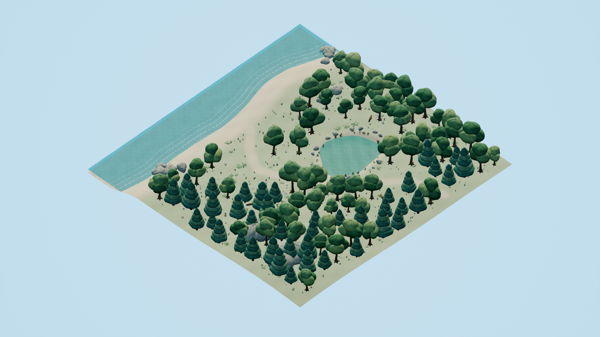
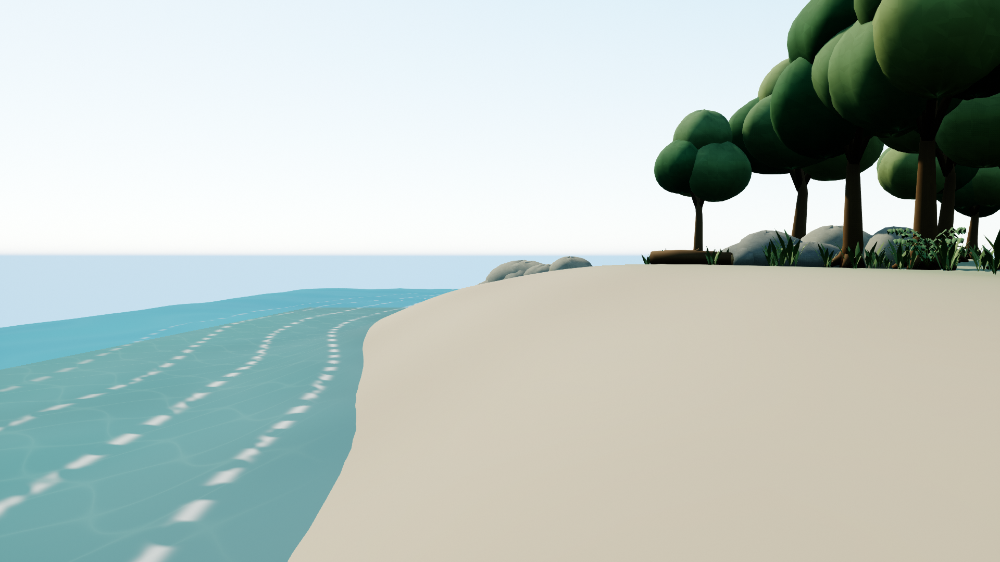

# Quietwater Grove — Forest ultra texture pass

Status: **ready_for_review**. No Git/index operations were performed. Supervisor owns the second-pass commit.

## Actual timing

- Started UTC: 2026-10-21T13:43:06+00:00; KST: 2026-10-21T22:43:06+09:00.
- Finished UTC: 2026-10-21T14:35:48.601183+00:00; KST: 2026-10-21T23:35:48.601183+09:00.
- Elapsed wall seconds: 3162.601.
- UE queue/mutex wait: 1015.912s; execution: 653.252s. All attempts included; per-run UTC records are in `Execution/`.
- Built-in image_gen observed call latency: Bark 23s, Canopy 79s, Stone 79s, Wood 79s. Canopy/Stone/Wood calls overlapped; their durations must not be added to wall time.
- `timing_correction.json` preserves the erroneous interim elapsed value and its UTC correction. The initial start timestamp is unchanged. Capture and queue timestamps were checked using UTC-aware parsing.
- Per-pass token delta is unavailable to worker tools; supervisor should compute it against the preserved first-delivery token record.

## Delivered paths

- `ForestDemo/Content/Maps/ultra.umap`.
- `ForestDemo/Content/Forest/ultra/`: original owned assets plus 922 UV mesh variants and four generated-image textures; updated materials.
- `ForestDemo/Work/ultra/TexturePass/`: source FBX, original images, prompts, scripts, audit data and actual screenshots.
- Frozen `FirstDelivery/` and original root `RESULT.md` are unchanged. Root STATUS retains the original timing fields and adds a separate texture_pass record.

## Validation evidence

- Fresh saved-map process: 19 checks passed; 979 packages recursively checked, zero forbidden /Game dependencies. No old /Game/ultra refs, World Partition, external actor/object packages or baked-lighting data.
- 922 scale-baked prop variants preserve original saved positions/rotations; final actor scales are all 1. Total measured world surface area 30542.260m², summed UV area 19.888685 across separate atlases.
- Target 32px/m; per-mesh measured area-weighted range 31.99998491–32.00001542px/m. 466,996 triangle islands, zero overlapping bounding boxes, minimum separation 2.999934px. Independent FBX re-import measurements are in `uv_fbx_validation.json`.
- UE UV channels/full precision, material slot mapping, four actual 1254×1254 textures and solid-prop collision were checked after asset compilation completed. Generation prompts/raw originals/SHA256 are in `Generated/generation_records.json`.
- Actual PIE created a PlayerController with possessed pawn, moved it through a horizontal sweep, blocked downward movement on terrain, traced trees/rocks/ground and exited play normally. See `runtime_validation.json`.
- Actual downward HitResult: blocking_hit=true, initial_overlap=false, hit fraction 0.143624, hit distance 73.311882cm; actual pawn displacement 71.811877cm. Hit actor, component and static mesh all equal the owned SM_Ground. This is not only a final-position test.
- Seven original UE SceneCapture2D images at 1920×1080: overview, top_down, lake, beach, hero, water_t0, water_t1. Common camera/render settings are preserved. Fixed water camera world-time separation 3.174s; 4.54% of sampled pixels changed by at least 12 summed RGB units. Visual review confirmed water detail changes; the numeric difference can also contain temporal rendering noise.
- Private editor closed before publication; 979 files copied and SHA256 matched. See `publication.json`.

## Limitations and interpretation

- Sea/lake waves, crest foam and ground caustics are animated artistic shaders, not physical refraction or ray-traced caustic transport. Ground and water use world-space detail rather than prop atlas density.
- Final foam is integrated into the sea material with soft animated cellular breakup; legacy thin surf ribbons are hidden. The analytic crest bands retain some periodicity. `normal_audit.json` confirms continuous shared-vertex normals in broadleaf, pine and rock FBX samples; texture contrast was reduced after actual render review.
- Triangle islands trade paint continuity for exact metric density and a simple provable overlap check. Very small faces can be subpixel. 32 existing zero-area triangles are excluded from density; UE removes degenerate geometry. Nondegenerate per-triangle measurements range 31.8926–32.0937px/m due to precision on tiny faces.
- Original NPOT texture outputs remain unchanged, with NoMipmaps/NeverStream. This has a memory/aliasing tradeoff. Per-placement mesh variants also increase asset count and reduce mesh sharing.
- `texture_source_links.json` connects each raw image output and SHA256 to its preserved original, UE texture and material-binding evidence. `publication.json` includes these links and hashes of the final evidence files.
- Surface images modulate the retained palette through luminance. Small petal/iron/sand accents retain their first-pass materials; prop UVs are still unique. No hand-painted seam continuity or physical texture scale for these untextured accents is claimed.
- Native Hello logger presence/PIE lifecycle is verified through the existing baseline class; clean render captures exclude debug text.

## References

- Built-in image_gen tool, this effort’s own first-pass source geometry and scene scripts, UE5.7 installed engine headers/source for Python/material APIs, and Blender 4.5 background FBX import/export.
- `/Engine/MapTemplates/Sky/DaylightAmbientCubemap` and baseline `/Script/ForestDemo.ScreenDebugLogger` are shared read-only engine/project resources. No external or other-effort asset references.

