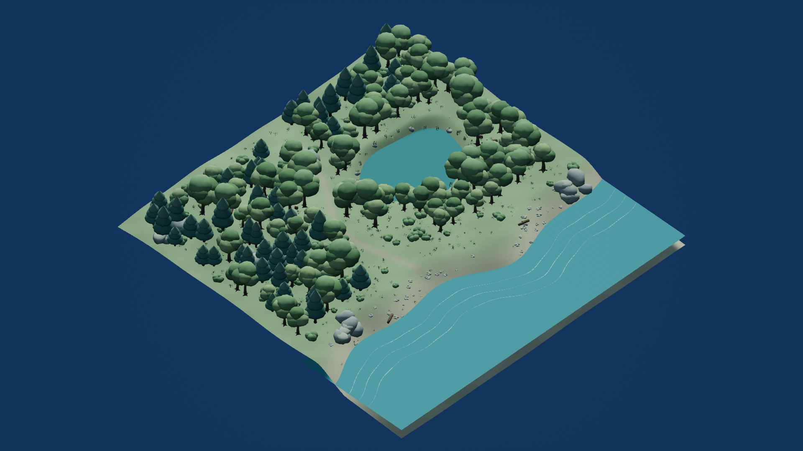
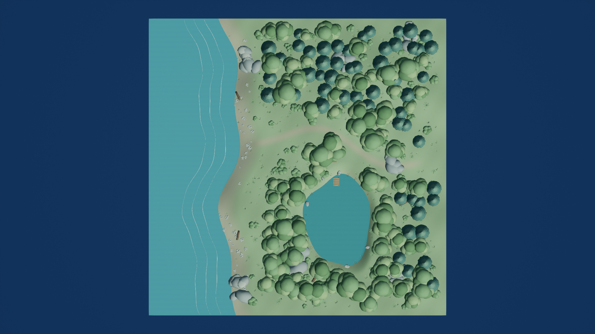
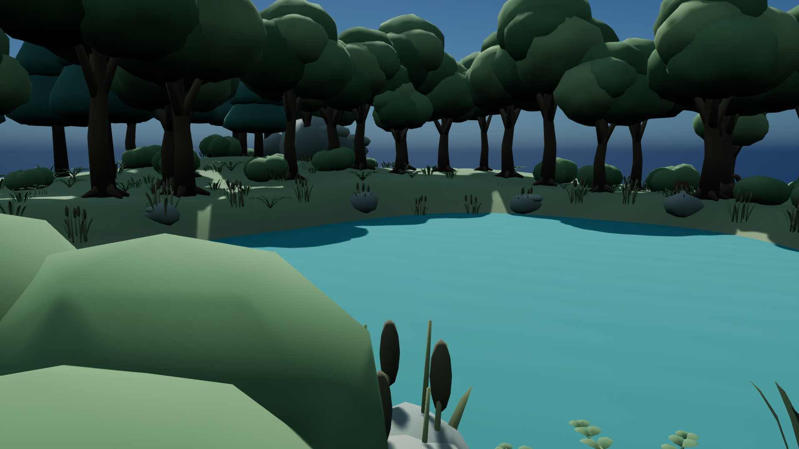
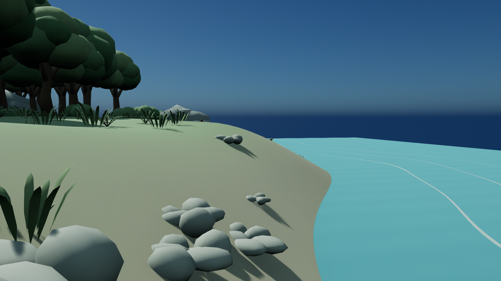

# xhigh 결과 — Quiet Cove

상태: ready_for_review. Git 스테이징·커밋·브랜치 변경은 수행하지 않았습니다.

## 실제 시간

| 구간 | UTC | KST |
|---|---|---|
| 작업 시작 | 2026-10-21T12:11:57+00:00 | 2026-10-21T21:11:57+09:00 |
| 최종 환경 저장 | 2026-10-21T13:20:07.779133+00:00 | 2026-10-21T22:20:07.779133+09:00 |
| 최종 캡처 시작 | 2026-10-21T13:20:09.223396+00:00 | 2026-10-21T22:20:09.223396+09:00 |
| 최종 캡처 종료 | 2026-10-21T13:21:37.018395+00:00 | 2026-10-21T22:21:37.018395+09:00 |
| 게시·검증 완료 | 2026-10-21T13:23:13.500449+00:00 | 2026-10-21T22:23:13.500449+09:00 |

- 전체 실제 경과: **4276.500초**.
- 시작부터 최종 환경 저장까지: 4090.779초. 디버깅과 해당 구간의 자원 대기를 포함합니다.
- 최종 실제 렌더 캡처 구간: 87.795초. 이후 직접 이미지 확인과 게시 검증 시간을 전체 경과에 포함했습니다.
- 공유 named mutex에 기록된 대기 합계: **1861.511초**, 해당 유틸리티의 실행 합계: 558.692초. 유틸리티 도입 이전 실행은 이 합계에 포함되지 않습니다. 대기시간은 전체 경과에 이미 포함됩니다.
- 사용자 Forest 경로 변경 적용 구간: 2026-10-21T12:22:32.544565+00:00 → 2026-10-21T12:25:49.162629+00:00, 196.618초. /Game/Forest/xhigh 아래 UE 에셋을 재생성하고 맵을 재조립했습니다. 이 구간에는 병행한 API/실행 모드 수정도 포함되므로 순수 경로 변경만의 추가 비용으로 해석하지 않습니다. 시작 시각을 재설정하지 않았습니다.
- 감독 런타임 보완 착수: 2026-10-21T12:46:06.220292+00:00. 실제 PIE 구간: 2026-10-21T13:21:37.020398+00:00 → 2026-10-21T13:21:50.442500+00:00 (13.422초). 대기 중이던 캡처 세션에 합쳤으며 별도 맵 재설계는 없었습니다. 해당 세션의 mutex 대기·실행 값은 delivery_evidence.json의 water_final_timing.json 항목에 있습니다.

## 산출물과 구성

- 최종 맵: `ForestDemo/Content/Maps/xhigh.umap` → `/Game/Maps/xhigh`.
- 최종 에셋: `ForestDemo/Content/Forest/xhigh/` → `/Game/Forest/xhigh/`. 정적 메시 28종, 재질 22종. 게시 파일 51개의 SHA-256이 private scratch 원본과 일치합니다.
- 원본: `SourceArt/QuietCove_Source.blend`, 개별 FBX 28개, `make_art.py`, `scene_manifest.json`.
- 재현·검증: `build_scene.py`, `validate_scene.py`, `capture_scene.py`, `capture_entry.py`, `finalize_delivery.py`, `AUTHORING.md`.
- 증거: `validation.json`, `delivery_evidence.json`, `Screenshots/capture_manifest.json`, `Screenshots/visual_review.json`.

100m 정사각형 지형 위에 남쪽 해변과 바다, 서북쪽 내륙 호수, 동·북쪽 완만한 숲 능선을 구성했습니다. 호수와 해변은 별도의 수면이며 육지와 숲으로 분리됩니다. 남쪽 열린 도착 지점에서 굽은 흙길을 따라 중앙 숲으로 들어가고 호수 동쪽의 작은 나무 데크와 벤치로 접근할 수 있습니다.

나무 148그루는 굽은 줄기·뿌리·분지와 겹치는 둥근 활엽수 수관 3종, 부드러운 층을 가진 침엽수 2종으로 구성했습니다. 바위 군집, 자갈, 양치식물, 풀, 갈대, 작은 꽃, 관목, 고사목, 그루터기, 벤치와 데크를 직접 제작했습니다. 지면 식생 589군집과 해변 자갈 48군집, 해변 풀 17군집, 호수 갈대 26군집을 배치했습니다. 색은 이끼·세이지·청록·모래·나무갈색을 사용하고 표면은 거칠고 둥글게 처리했습니다. 장식 구름이나 얼굴·하트 모티프는 없습니다.

## 검증 결과

- 새 UE 에디터 세션에서 맵을 실제 재로드했습니다. terrain XY bounds는 10000 × 10000cm(부동소수점 오차 0.001cm 수준)입니다.
- Asset Registry로 맵과 모든 소유 에셋의 의존성 51개 패키지를 재귀 검사했습니다. `/Game/Forest/xhigh/`와 자기 맵 이외 `/Game` 참조는 **0개**입니다. 이전 `/Game/xhigh/` 경로도 없습니다.
- WorldSettings의 WorldPartition은 None, 외부 액터 패키지는 0개입니다. 최종 Maps에 BuiltData를 생성하지 않았습니다.
- terrain의 complex collision을 실제 component line trace로 7지점 검사했습니다. 원본 높이와 최대 오차 0.434cm, PlayerStart 지면 검사를 통과했습니다.
- 충돌 사용 정적 메시 액터 258개. 물·지면 장식 식생에는 저장 후 재로드해도 NoCollision이 유지됩니다.
- PlayerStart, 개요 CameraActor, `/Script/ForestDemo.ScreenDebugLogger`가 있습니다. 기준 소스의 BeginPlay Hello 동작을 그대로 사용하는 네이티브 인스턴스입니다.
- 실제 PIE 월드에서 PlayerController/Pawn 생성과 빙의, PlayerStart 일치, 런타임 지형 trace, Pawn을 지면 아래로 이동시키는 sweep의 차단, 100cm 짧은 이동, 정상 PIE 종료를 검증했습니다. `runtime_validation.json`에 실제 위치와 체크 결과가 있습니다. 기준 바이너리에 포함된 `ForestDemo.ScreenDebugLogger.HelloOnBeginPlay` 자동화 테스트가 성공해 기존 BeginPlay의 화면 메시지 등록 동작을 실제 확인했습니다. Hello의 별도 화면 증거 직접 확인 여부는 False이며, 네이티브 테스트의 실제 로그를 함께 보존합니다.
- 동적 DirectionalLight/SkyLight와 ForceNoPrecomputedLighting을 확인했습니다.
- 캡처는 최종 경로의 저장 맵을 실제 UE SceneCapture2D로 렌더링한 1920×1080 PNG 4장입니다. High(sg.*=2), screen percentage 100. 선택선·그리드·기즈모·콘솔·UI·Hello 오버레이 없이 촬영했습니다. 이미지 생성·보정은 하지 않았습니다.
- private 에디터 종료가 wrapper timing에 기록된 뒤 소유 경로만 복사하고 바이트 해시를 비교했습니다.

검증 실행은 `Run-UnrealIsolated.ps1 -Project <xhigh private ForestDemo.uproject> -LogPath <xhigh log> -TimingPath <xhigh timing.json> -EditorArguments @('-ExecutePythonScript=.../capture_entry.py','-RenderOffscreen','-windowed','-ResX=1920','-ResY=1080',...)`입니다. 전체 실제 명령·출력 경로는 이 대화와 자체 scratch 로그에 남아 있습니다. 원본 아트는 독립 Blender 4.5 `--background --factory-startup --python make_art.py`로 생성했습니다.

## 캡처

공통 사이트 중심 (Cx,Cy)=(0,0)cm, 기준 Z0=350.387cm(사이트 중심의 지면 높이). 개요는 (12000,-12000,Z0+16000)→(0,0,Z0), 직교폭 20000cm. 탑뷰는 (0,0,Z0+20000), pitch -90/yaw 0/roll 0, 직교폭 20000cm입니다. 호수·해변은 실제 지면 +170cm, 수평 FOV 70도입니다. 각 위치·회전·시각은 capture_manifest.json에 기록했습니다. 장소별 눈높이 시점은 위치가 달라 직접 프레이밍 동등 비교에 한계가 있습니다.

## 한계와 참고

환경 레벨이며 별도 보행 캐릭터·수영·부력·AI 내비게이션이나 패키징 성능 인증은 구현하지 않았습니다. 수면은 스타일화한 불투명 재질입니다. 표면 충돌은 정적 complex collision로 검증했고 동적 물리 오브젝트 운용을 위한 convex 최적화는 하지 않았습니다. 기본 Pawn으로 실제 PIE/sweep 검증을 수행했습니다. Hello는 네이티브 자동화 테스트의 실제 메시지 등록 검사로 확인했으며 unattended PIE 화면 캡처에서는 문구가 보이지 않았습니다. 공통 비교용 네 장은 UI 없는 장면 캡처입니다.

초기 UE Interchange/NullRHI와 Python 바인딩 문제, FBX Y축 좌표 변환 및 저장되는 충돌 프로필 문제를 로그와 재로드 검사로 확인해 수정했습니다. 실제 렌더 검토 후 지면 VertexColor 출력·수면 unary 입력의 핀 연결과 환경광도 수정했습니다. 수정 내역은 PLAN.md에 기록했습니다. 외부 아트 다운로드·다른 effort의 에셋 사용은 없습니다. 허용된 엔진 내장 `/Engine/MapTemplates/Sky/DaylightAmbientCubemap`을 환경광용으로 읽기 전용 참조합니다. API 확인은 설치된 UE 5.7.4 헤더와 Python 런타임을 사용했습니다. 나머지 재료·배치·원본은 xhigh가 직접 작성했습니다. 평가는 자기 완료 조건에 한정하며 다른 결과와 비교 점수는 부여하지 않았습니다.

### Supervisor verification note

The final water/render session logged a handled viewport realtime-override ensure
at 2026-10-21 13:20:08 UTC. It subsequently saved/reloaded, rendered all four views,
passed PIE and the native Hello automation, and exited 0. Earlier failed runtime
attempts remain in Logs with their timing records. Final water packages were
reloaded and rendered in the producing process; a fresh-process check of the exact
published final packages remains part of supervisor integration validation.
