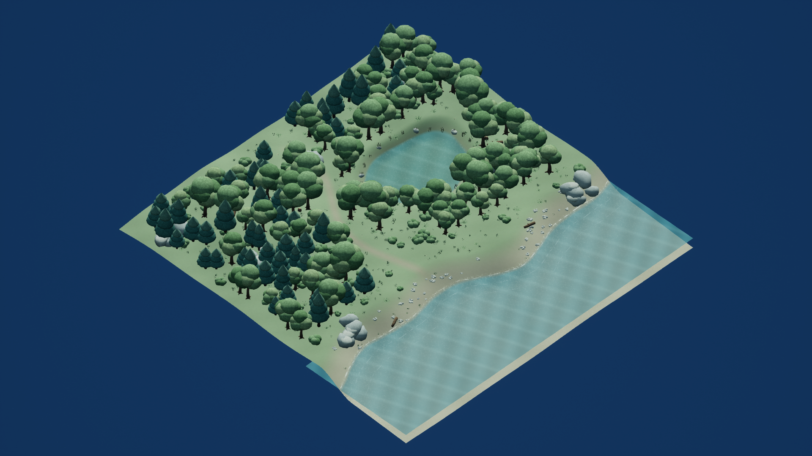
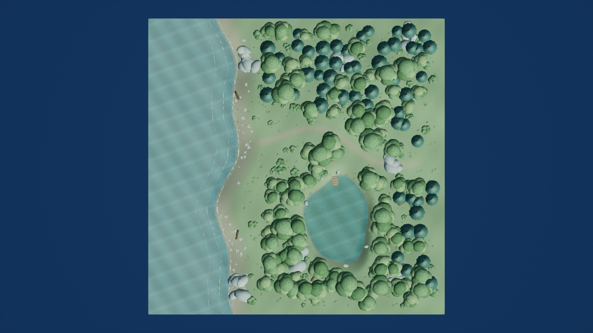
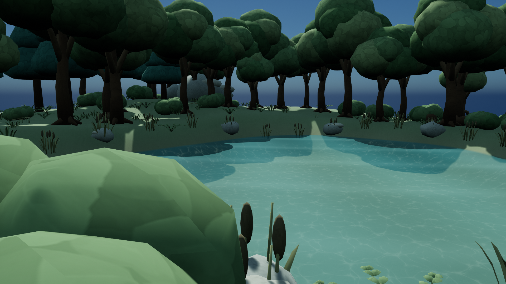
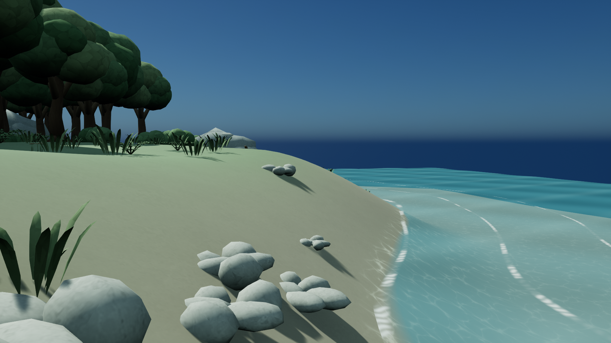
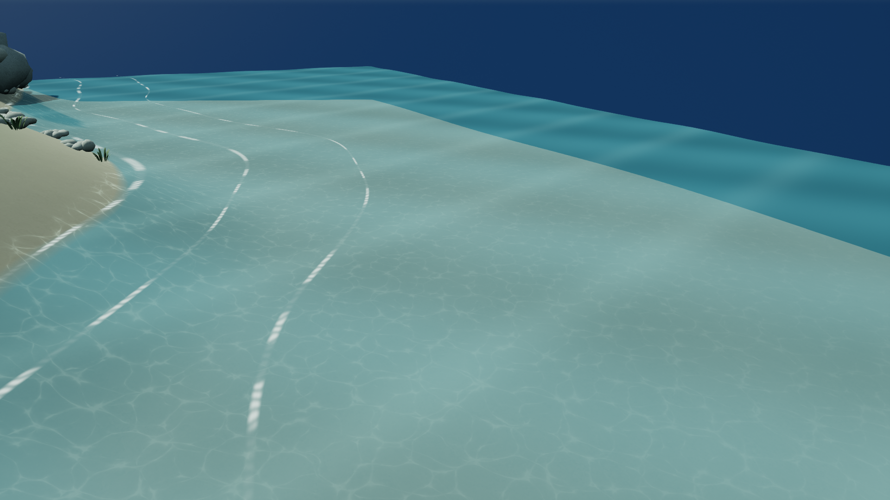
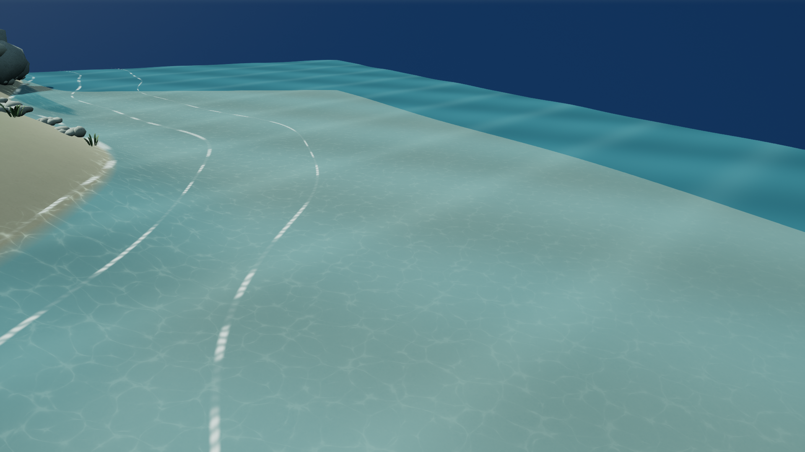

# Quiet Cove xhigh — Texture pass

상태: **ready_for_review**. 최초 제출 사본 `FirstDelivery`와 최초 시작·완료 시각을 보존했습니다. Git 스테이징·커밋·브랜치 변경은 하지 않았습니다.

## 실제 시간

| 항목 | UTC | KST |
|---|---|---|
| 두 번째 패스 시작 | 2026-10-21T13:45:50+00:00 | 2026-10-21T22:45:50+09:00 |
| 게시·검증 완료 | 2026-10-21T14:27:57.943323+00:00 | 2026-10-21T23:27:57.943323+09:00 |

- 실제 경과 **2527.943초**. UE 큐 대기 **517.758초**, UE 실행 **586.188초**를 포함합니다.
- 독립 imagegen 호출 5회. 기록된 호출 창 합계 **128.000초**. 초 단위 UTC로 호출 전후를 기록했으며 첫 bark 창에는 직전 프롬프트 파일 저장 시간이 포함됩니다. 모델 내부 계산 시간은 노출되지 않습니다. 개별 시각·프롬프트·원본 경로·SHA-256은 `Imagegen/manifest.json`에 있습니다.
- UE 세션별 실제 대기/실행은 `delivery_evidence.json`에 있습니다. Forest 우선/FIFO, 비선점 정책을 사용하는 감독 제공 실행기로 수행했습니다.
- 최초 기록의 시간과 커밋/토큰 기록을 재설정하지 않았습니다. 이 워커에서 정확한 대화 토큰 카운터는 제공되지 않아 토큰 차이는 만들지 않았으며, 감독의 동결 기록과 종료 기록으로 산정해야 합니다.

## 변경과 실제 산출물

- 맵: `ForestDemo/Content/Maps/xhigh.umap` → `/Game/Maps/xhigh`.
- 에셋: `ForestDemo/Content/Forest/xhigh/`. 게시 파일 56개의 SHA-256이 검증된 private 프로젝트와 일치합니다.
- 나무껍질·잎·돌·목재·caustic 마스크를 실제 built-in `image_gen.imagegen`으로 각각 생성했습니다. 5개 원본 PNG는 수정하지 않고 보존했습니다. `/Game/Forest/xhigh/Textures/T_IG_*`로 실제 임포트했고 저장된 재질의 의존성으로 확인했습니다.
- 기존 28종 메시를 UV 처리했습니다. 889개 소품의 배치와 100m 지형, 숲·작은 호수·별도 해변 구성은 유지했습니다. 수면 격자를 세분화하고 해안에 흰 포말 띠 3개를 다듬었습니다.
- `SourceArt/QuietCove_TexturePass.blend`, FBX 28개, 네 UV SVG, `SourceArt/uv_report.json`, `Imagegen/manifest.json`, 생성·적용·검증 스크립트를 제공합니다.

## UV와 밀도

목표는 **128 px/m**입니다. `1254 × sqrt(UV 면적 / 원본 표면적)`으로 기본 밀도를 측정하고, 각 액터의 저장된 Custom Primitive Data[0]에 `(128 / 기본 밀도) × 실제 균일 배율`을 넣었습니다. 재질은 `UV0 × 이 값`으로 이미지를 샘플링합니다. 새 프로세스에서 정적 메시 액터 895개의 저장된 보정값을 다시 확인했습니다. 889개 소품 각각의 배율·월드 표면적·UV 면적은 원본 보고서에 있습니다.

UV0의 고유 섬은 서로 겹치지 않습니다. 생성 재질 이미지는 보정된 좌표에서 의도적으로 타일링되며, 각 인스턴스마다 별도로 그린 아틀라스는 아닙니다. 섬별 면적 밀도를 정규화했지만 곡면의 삼각형별 투영 변형은 남습니다. 아래 범위는 표면적 가중 5–95 백분위이며, 정확한 최소/최대도 JSON에 기록했습니다. 모든 메시의 면적 RMS 목표는 128입니다.

| 메시 | 원본 표면적 m² | UV 면적 | 섬 | 유효 밀도 P05–P95 px/m | 최소 섬 간격 px |
|---|---:|---:|---:|---:|---:|
| SM_Broadleaf_0 | 281.975 | 0.465055 | 137 | 115.09–138.48 | 15.83 |
| SM_Broadleaf_1 | 394.115 | 0.464226 | 129 | 114.80–138.69 | 16.05 |
| SM_Broadleaf_2 | 195.642 | 0.457344 | 147 | 112.37–139.44 | 15.99 |
| SM_Pine_0 | 139.639 | 0.222147 | 644 | 128.00–128.00 | 16.01 |
| SM_Pine_1 | 118.986 | 0.212098 | 666 | 128.00–128.00 | 15.51 |
| SM_Boulder_0 | 23.223 | 0.528591 | 16 | 113.95–139.15 | 16.36 |
| SM_Boulder_1 | 19.775 | 0.481715 | 8 | 112.63–143.08 | 17.33 |
| SM_Boulder_2 | 29.950 | 0.590202 | 15 | 109.85–138.80 | 15.94 |
| SM_Boulder_3 | 28.018 | 0.530198 | 7 | 111.36–140.51 | 16.24 |
| SM_Pebbles_0 | 3.886 | 0.589970 | 33 | 111.48–137.99 | 16.08 |
| SM_Pebbles_1 | 3.834 | 0.556383 | 32 | 114.26–139.51 | 16.13 |
| SM_Grass_0 | 0.460 | 0.285874 | 144 | 128.00–128.00 | 16.00 |
| SM_Grass_1 | 0.414 | 0.297453 | 144 | 128.00–128.00 | 16.00 |
| SM_Grass_2 | 0.463 | 0.290942 | 144 | 128.00–128.00 | 16.03 |
| SM_Fern | 1.670 | 0.075549 | 1322 | 128.00–128.00 | 15.98 |
| SM_Reeds | 2.391 | 0.177408 | 530 | 128.00–128.00 | 16.04 |
| SM_Wildflowers | 0.425 | 0.364155 | 180 | 113.12–141.32 | 16.05 |
| SM_Shrub | 31.749 | 0.581092 | 30 | 114.01–140.15 | 16.05 |
| SM_FallenLog | 12.989 | 0.741509 | 20 | 110.10–138.16 | 16.09 |
| SM_Stump | 4.723 | 0.598338 | 12 | 115.71–136.51 | 16.05 |
| SM_Bench | 6.469 | 0.683597 | 49 | 112.72–135.92 | 16.05 |
| SM_Dock | 19.504 | 0.511265 | 90 | 109.76–130.53 | 16.05 |
| SM_Terrain | 10215.836 | 0.949566 | 1 | 123.15–133.21 | single island |
| SM_Sea | 3500.000 | 0.341070 | 1 | 128.00–128.00 | single island |
| SM_Lake | 685.588 | 0.545797 | 1 | 128.00–128.00 | single island |
| SM_Surf_0 | 33.548 | 0.003312 | 1 | 128.00–128.00 | single island |
| SM_Surf_1 | 20.987 | 0.002072 | 1 | 128.00–128.00 | single island |
| SM_Surf_2 | 14.997 | 0.001481 | 1 | 128.00–128.00 | single island |

겹침 검사는 UV 삼각형 교집합의 양의 면적을 계산했습니다. 1e-8 UV², 즉 약 0.0157 원본 픽셀² 이하는 공유 경계의 부동소수점 오차로 제외합니다. 그 기준에서 원본 28종 모두 겹침 0입니다. 요청 패딩은 UV 경계당 0.0064이며 실제 섬 사이 최소 거리는 위와 같이 측정했습니다. 소나무 끝면과 퇴화한 풀 끝 삼각형을 재분리·정리한 후 다시 검사했습니다. 실제 UE 왕복 검사는 활엽수·소나무·바위·데크 **4종 표본**입니다. 최종 UE 저장 파일을 재수출하고 독립 Blender 재임포트하여 표면적·UV 면적·겹침·퇴화 0을 확인했습니다.

첫 UE 왕복에서 SM_Pine_0의 3개 삼각형에 UV 면적 0이 발생했습니다. 기하 퇴화는 아니며 합계 0.003267473m²의 작은 끝면에서 half-precision UV 값이 합쳐진 문제였습니다. 소나무 2종을 full-precision UV로 저장하여 수정했고, 수정 시각 2026-10-21T14:19:19.559174+00:00 이후 최종 새 재로딩과 왕복 결과로 검증했습니다. 원인·좌표·면적·수정 전후 결과는 `uv_precision_diagnosis.json`에 있습니다.

저장된 재질 보정값을 적용한 실제 UE 왕복 4종의 면적 RMS 밀도는 127.999286–128.014305px/m입니다. 이는 삼각형별 밀도가 완전히 동일하다는 뜻은 아닙니다.

## 해변과 수중 빛

바다와 호수는 시간에 따라 변하는 정점 높이와 노멀을 사용합니다. 흰 포말은 이동과 밝기 변화가 있고, 생성한 caustic 마스크를 실제 수중 지형에 이동 투영하여 밝은 빛무늬를 더했습니다. 반투명 수면을 통해 바닥이 보입니다. **굴절광 추적이나 물리 광학 시뮬레이션은 아니며 미술적 근사**입니다.

고정 수면 카메라 두 화면 간 실제 시간차는 13.196초입니다. 4픽셀 간격 129600개 표본의 평균 RGB 절대차는 6.465/255, 차이가 8을 넘은 픽셀 비율은 32.04%입니다. 원본 렌더를 변경하지 않고 비교했습니다.

## 검증 증거

- 새 UE 프로세스 재로딩: 기존 월드·배치·충돌·동적 조명 검사 17개 통과.
- 재귀 의존성 패키지 56개, 금지 `/Game` 의존성 0. `/Game/Forest/xhigh/**`와 자기 맵만 사용하며 옛 `/Game/xhigh` 참조가 없습니다.
- non-World-Partition, 외부 액터/객체와 BuiltData 없음.
- 5개 실제 생성 텍스처의 재질 사용, 저장 UV 채널, 배치 밀도 보정 및 반투명 물/포말 재질 검사 통과.
- 실제 PIE에서 컨트롤러·폰 생성/소유, 시작 위치, 런타임 지형 트레이스, 100cm 이동, 정상 종료 확인. 하강 전 40cm 상승 이동과 폰 구체 반경/바닥 여유를 기록하고, 하강 HitResult의 `blocking_hit=true`, `initial_overlap=false`, 실제 양의 이동 거리, 정확한 대상 지형 액터·컴포넌트·메시를 확인했습니다. 최종 위치만으로 차단을 단정하지 않았습니다. baseline Hello BeginPlay 자동화 검사도 통과했습니다.
- 최초 제출과 동일한 4개 카메라/렌더 설정으로 실제 1920×1080 UE 화면을 캡처했습니다. 추가 고정 수면 2장을 포함한 6장을 직접 검토했습니다. 생성 이미지로 장면 증거를 대체하지 않았습니다.
- private UE 프로세스 종료 확인 후 소유 폴더와 자기 맵만 게시하고 해시를 검증했습니다.

## 한계와 참조

곡면 투영의 국소 밀도 편차와 UV 경계에서 무늬 방향이 끊기는 부분이 있습니다. 원본 1254² 이미지는 무수정 보존하며 NPOT 무밉맵 방식이어서 먼 거리의 세부 무늬는 흔들릴 수 있습니다. 현재의 균일 배율 889개를 검증했으며 향후 배율 변경 시 보정값도 갱신해야 합니다. 지형은 월드 XY 투영이라 경사면 밀도가 낮아지고, 물/포말/caustic은 별도 움직이는 월드 좌표를 사용합니다. 물의 굴절·caustic은 위에 명시한 미술적 근사입니다.

초기 새 재로딩에서 realtime override가 없다는 UE handled ensure가 발생했습니다. 프로세스는 계속 실행되어 검증을 마쳤으며 원본 로그를 보존했습니다. 이후 override를 먼저 설정하도록 캡처 코드를 보정했습니다. CaptureEveryFrame과 명시적 캡처 호출을 함께 사용한다는 효율 경고도 있으며, 증거 수집용이므로 런타임 캡처 시스템으로 최적화하지 않았습니다.

외부 API 참조와 재현 순서는 `AUTHORING.md`에 있습니다. 외부 미술 에셋, 다른 effort/theme의 파일, 공유 Blender 장면을 사용하지 않았습니다.
