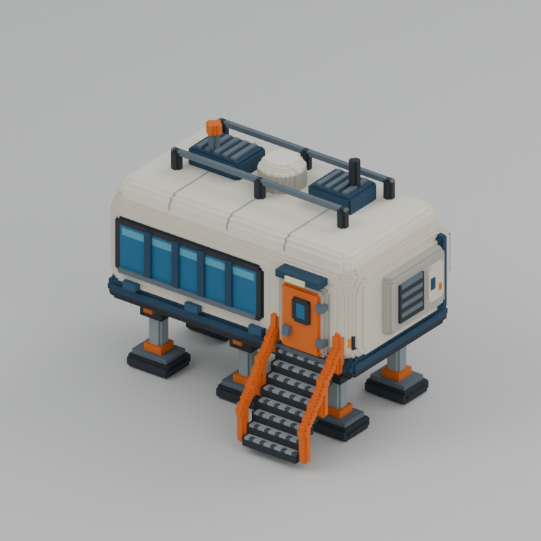
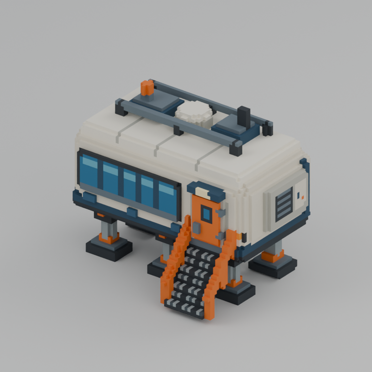
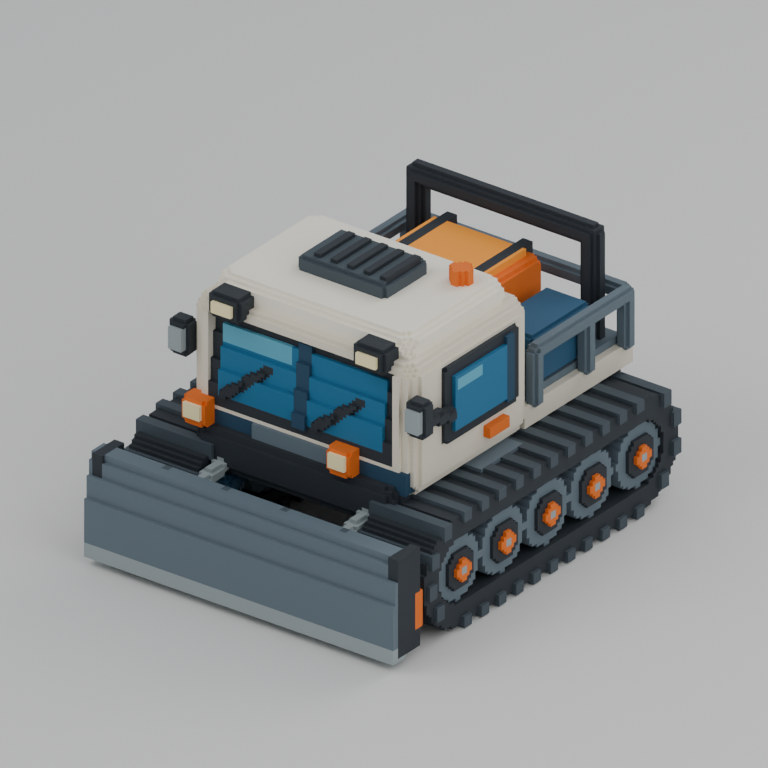
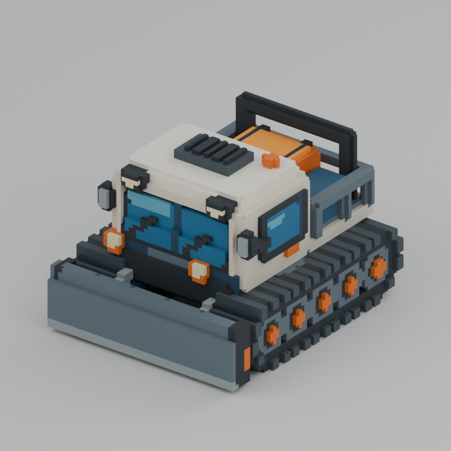
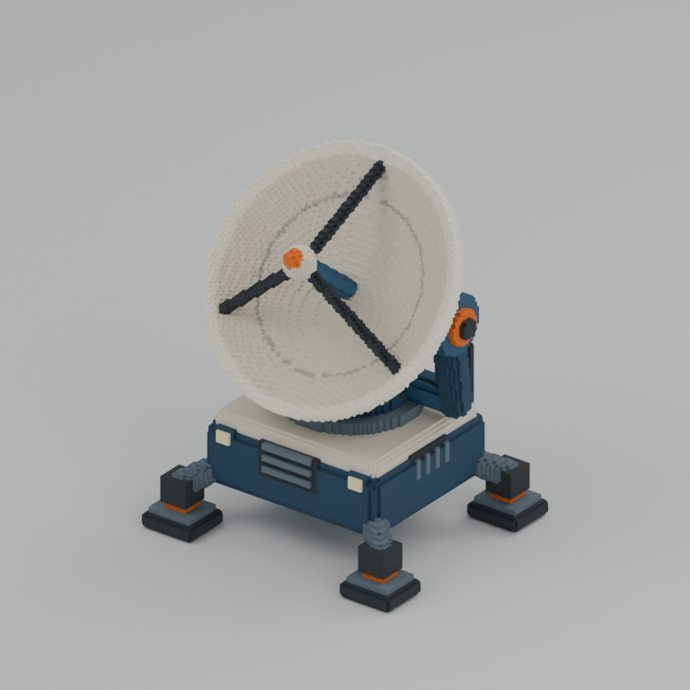
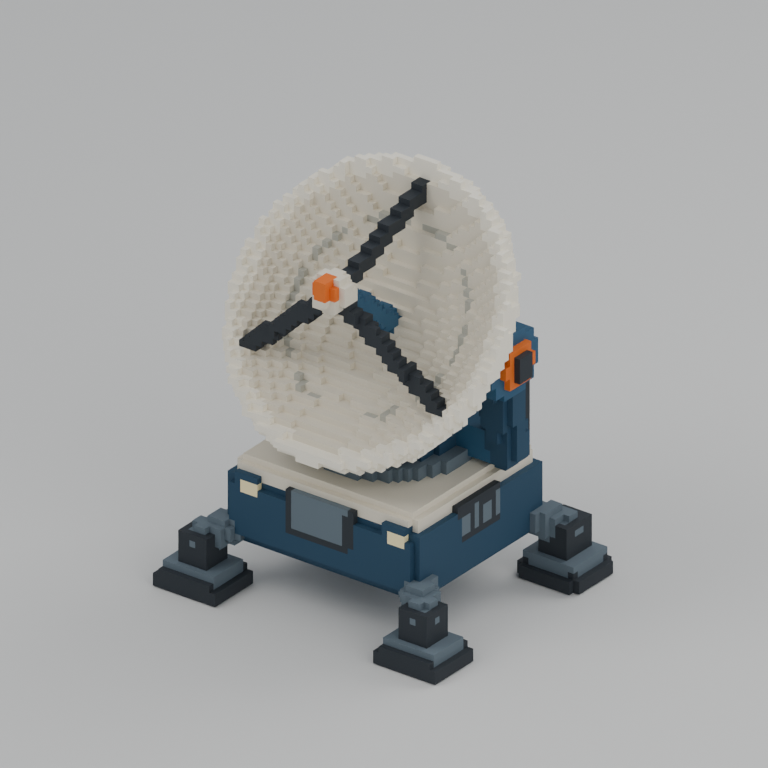
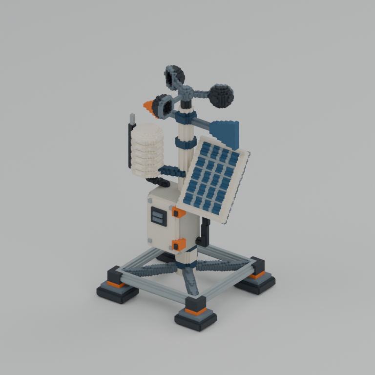
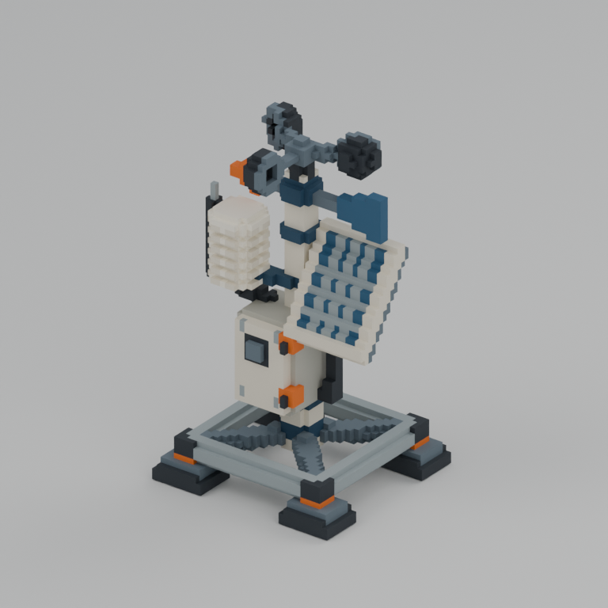

# Antarctic voxel asset delivery

Ready for parent review. Four original voxel models are delivered at two independent grid resolutions. Native VOX files are authoritative; GLB/FBX contain extracted occupied-voxel surfaces. BLEND files also contain the separate preview studio collection.

Started: **2026-10-23T14:06:05Z UTC / 2026-10-23T23:06:05+09:00 KST**. Finished: **2026-10-23T14:20:49Z UTC / 2026-10-23T23:20:49+09:00 KST**. Actual elapsed wall time: **884.321 seconds**. Three build/export/render runs measured **126.771 seconds** internally; fresh import verification measured **20.943 seconds** internally. These internal durations exclude Blender startup. Tools became ready during authoring; no independent wait interval was measured. Worker image-generation time was zero.

| Model | Large / half grid | Occupied voxels, large / half | Triangles, large / half | Shared physical grid extents (m) |
|---|---|---:|---:|---|
| research_station | 128 × 100 × 100 / 64 × 50 × 50 | 416,647 / 55,929 | 8,866 / 3,758 | 8.32 × 6.5 × 6.5 |
| snowcat | 104 × 128 × 84 / 52 × 64 × 42 | 356,716 / 49,767 | 12,540 / 5,254 | 4.68 × 5.76 × 3.78 |
| radar | 112 × 112 × 128 / 56 × 56 × 64 | 182,693 / 26,982 | 31,172 / 9,106 | 4.48 × 4.48 × 5.12 |
| weather_instrument | 80 × 80 × 128 / 40 × 40 × 64 | 49,559 / 8,621 | 12,306 / 4,588 | 2 × 2 × 3.2 |

Each `assets/NAME/{large,half}/` contains `NAME.vox`, `NAME.blend`, `NAME.glb`, `NAME.fbx`, `preview.png`, and `metadata.json`. All dimensions halve exactly; meters per voxel double, preserving the physical grid extents. There are 8 native grids, 24 mesh/project files and 8 actual previews. Source: [build.py](build.py). Named palette: [palette.json](palette.json). Checksums, paired camera audit and timing: [delivery_manifest.json](delivery_manifest.json).

The research station has six telescopic legs, insulated rounded shell, five-bay window band, orange airlock, eight stair treads, side heat exchanger, aft service bay and roof HVAC. The snowcat has two separate hollow track belts, road wheels and raised treads, a blunt curved blade with attached supports, glazed cab and protected cargo equipment. The radar has an open tilted paraboloid, a real feed with tripod supports, rear ribs, bearing yoke and four-foot electronics base. The weather mast has an open outrigger base, sealed logger, tilted solar cells, radiation-shield plates, three hollow cups, wind vane and cable routes.

[Independent validation](validation_export.json) passed all 4 models / 8 variants and **24 fresh BLEND/GLB/FBX imports**, with no errors. Every imported triangle was checked against the outward native voxel boundary and correct palette; invalid boundary, material, off-grid and degenerate triangle counts are all zero. Native occupancy, bounds, counts, palette indices, duplicates and hashes passed. [Semantic checks](geometry_semantics.json) cover six station pads, front-exposed windshield, air inside both tracks, open radar bowl and hollow weather cup. Final file hashes still match metadata.

All eight final previews below were inspected. Inspection exposed an initially occluded snowcat windshield; a source occupancy probe reproduced it, the cab shell was cut back, and both resolutions were re-rendered. Blade supports were extended into the blade. A visible station service cassette was added and re-rendered. The half grids needed no manual postprocessing. The initial failing diagnostic is retained as [geometry_before_fix.json](geometry_before_fix.json). Separate station/snowcat rebuild records are retained; `build_validation.json` is the last selective run, while `validation_export.json` covers every final deliverable.

| Model | Large actual Blender render | Half actual Blender render |
|---|---|---|
| research_station |  |  |
| snowcat |  |  |
| radar |  |  |
| weather_instrument |  |  |

Capture settings: Cycles CPU, 4 threads, 24 samples with denoising, 768 × 768, AgX, matched orthographic camera per large/half pair. [capture_manifest.json](capture_manifest.json) records actual timestamps, cameras and image hashes. The images above are renders of the supplied voxel meshes.

Limitations: glass is opaque stylized color; models have no rig, animation, collision, game-engine integration or automatic LOD chain. Flat palette materials do not require UV textures. Small cosmetic louvers, joints and panel grid lines simplify in half resolution. Conservative reduction can expand the occupied silhouette by a large-grid cell at individual boundaries, while the physical grid domain stays identical. No random color noise or unrelated decorations were used.

Design reference: the parent-supplied `REF/voxel/antarctic/reference.png`, visually inspected before authoring. No other theme assets, prior Blender scenes, ForestDemo files or external creative resources were read or reused. No Git operations, image generation or shared live Blender session were used. Final files are frozen pending parent review.
