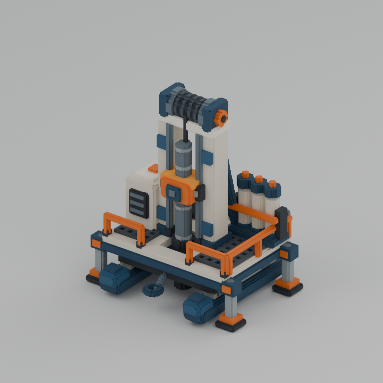
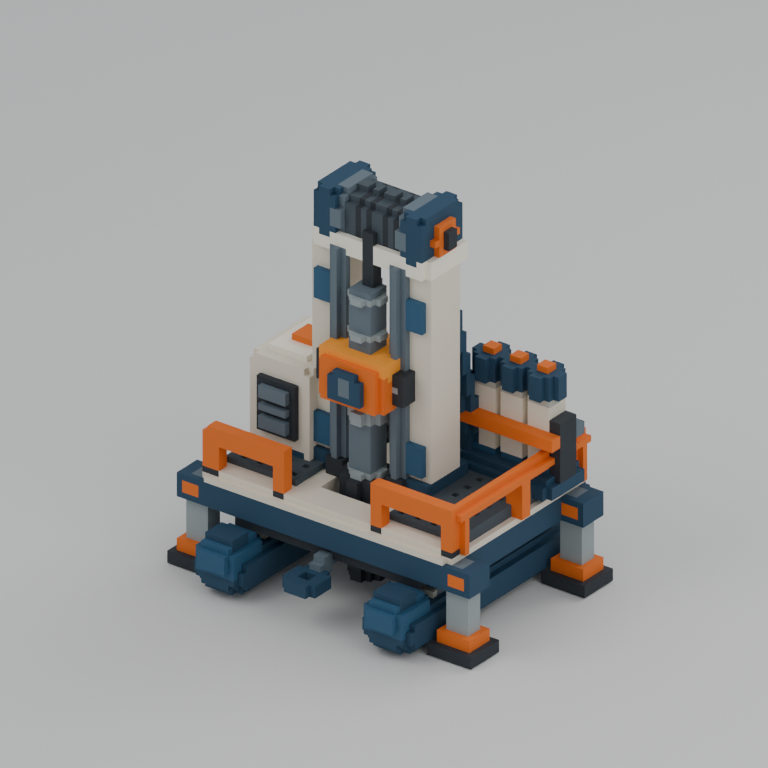

# Antarctic addition: ice core drill

Ready for parent review and frozen. One original sled-mounted scientific core rig is delivered at two true voxel resolutions. The accepted original Antarctic models were not modified.

Actual start: **2026-10-23T15:33:44Z UTC / 2026-10-24T00:33:44+09:00 KST**. Actual finish: **2026-10-23T15:44:02Z UTC / 2026-10-24T00:44:02+09:00 KST**. Elapsed wall time: **618.709 seconds**. The single Blender build/export/render pipeline measured **18.845 seconds**; independent validation measured **2.655 seconds** internally, and its full command measured **3.247 seconds**. Pipeline times exclude Blender startup; the full build command interval was not separately timed. No worker image generation or blocking tool wait occurred.

| Size | Native grid | Meters per voxel | Occupied voxels | Triangles |
|---|---|---:|---:|---:|
| large | 112×98×128 | 0.045 | 190,054 | 10,694 |
| half | 56×49×64 | 0.09 | 29,048 | 4,574 |

Both grids occupy the same **5.04 × 4.41 × 5.76 m** physical domain. Half dimensions are exactly divided by two and cell size doubles. Each `assets/ice_core_drill/{large,half}/` contains `ice_core_drill.vox`, `.blend`, `.glb`, `.fbx`, `preview.png` and `metadata.json`. Native VOX is authoritative. Source is [build.py](build.py); the authorized Antarctic color palette is recorded in [palette.json](palette.json). [delivery_manifest.json](delivery_manifest.json) records final hashes and timings.

The rig has two rounded sled runners, four deployed stabilizers, a platform with a genuinely open coring slot, a blunt vertical barrel passing through it, two mast columns and steel guide rails, a top winch, orange sliding drive, side power cabinet and three capped sample cylinders. Split guard rails preserve access to the coring area. Rear braces, supply lines, couplers and a tow eye provide useful secondary detail.

[Independent native/export validation](validation_export.json) passed both variants and all **six fresh BLEND/GLB/FBX imports**, with `errors: []`. Occupancy, 1-based palette, coordinates, duplicate rejection, bounds, file hashes, exact half sizes and shared physical grid extents passed. Imported surfaces match occupied-cell boundaries with outward orientation and correct materials. Degenerate, invalid-boundary, invalid-material and off-grid triangle counts are zero. [Native mechanism checks](native_feature_checks.json) verify through-deck air beside the barrel, the barrel above/below the deck, both runners, four stabilizers and three sample cylinders separated by air at both sizes.

Both actual final previews were visually inspected. The 64-cell model preserves the opening and principal mechanisms. The first build passed; no geometry fix, optional polish cycle or manual half-grid correction was needed. A final audit confirmed delivered hashes and identical paired camera settings.

| Large actual render | Half actual render |
|---|---|
|  |  |

Captures are actual Blender renders: Cycles CPU, 4 threads, 24 samples, denoising, AgX, 768×768 and paired orthographic cameras. [capture_manifest.json](capture_manifest.json) contains the camera settings, actual timestamps and hashes. BLEND includes a separate studio collection; GLB/FBX contain only asset geometry.

Limitations: static deployed pose, solid opaque palette materials, no rig, animation, collision, LOD chain, game-engine integration or simulated core extraction. Flat-color materials require no image textures or UV layout. Minor grate holes and windings simplify at half resolution; conservative boundary growth is permitted while the grid domain remains unchanged.

Creative input was limited to `REF/voxel/antarctic/additions/reference.png`, inspected before authoring, and the authorized original Antarctic palette. Geometry was authored independently inside this addition root. No previous creative scripts/assets, other themes, ForestDemo, shared Blender scene, image generation, Git operations, installations or other agents were used. Awaiting phase-A acceptance and explicit dispatch before any new theme.
