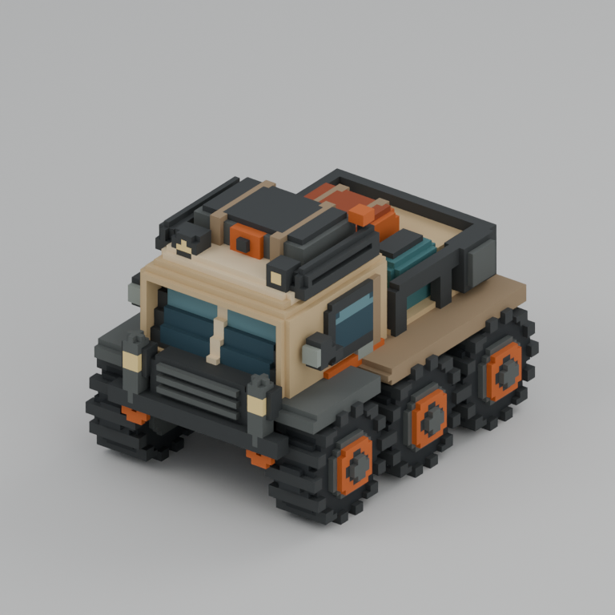
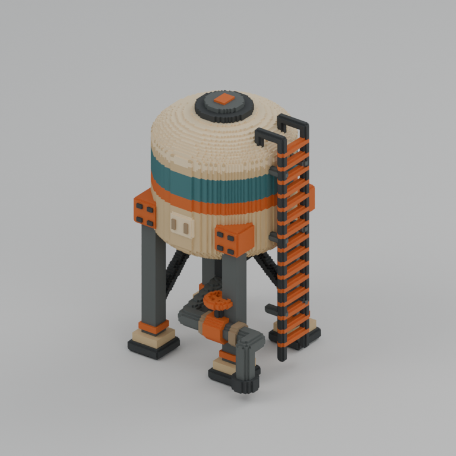
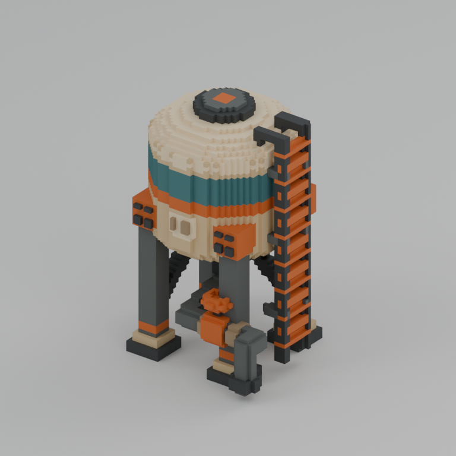
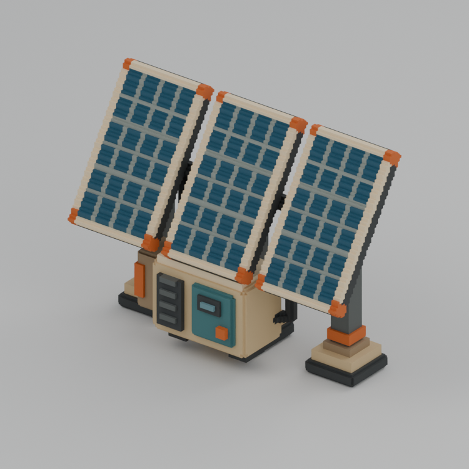
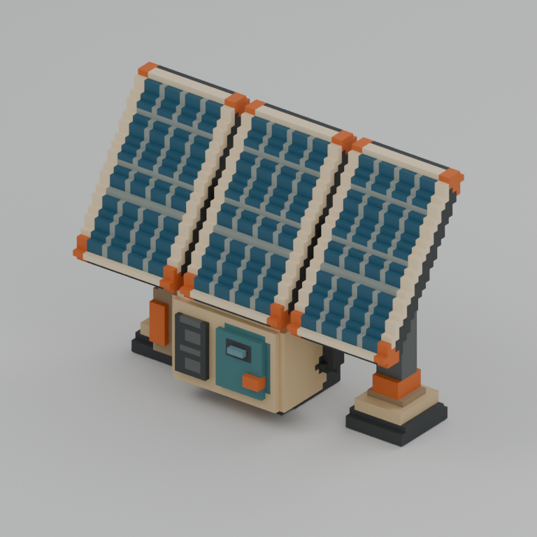
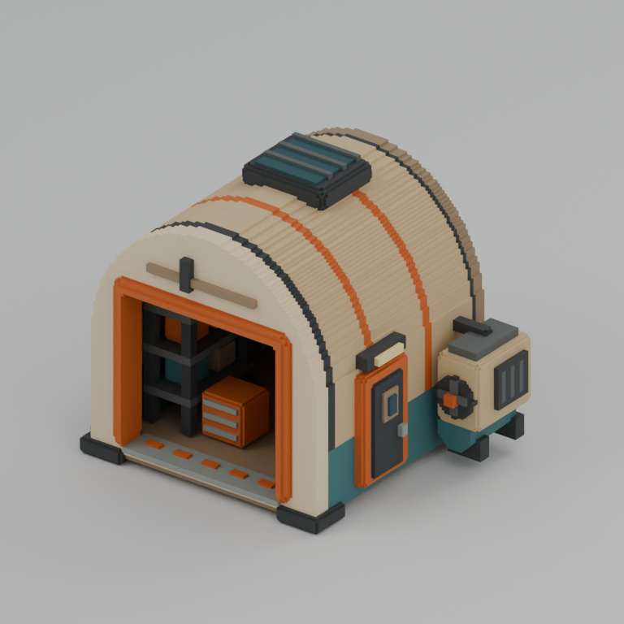
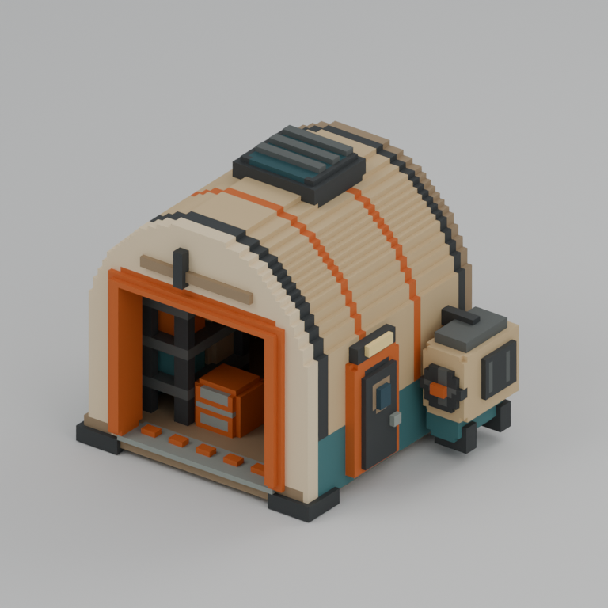

# Desert voxel delivery

Ready for review; asset files are frozen. Four independently authored assets have large and half native grids plus BLEND, GLB, FBX and actual preview images. Native VOX occupancy is authoritative.

Start: **2026-10-23T14:21:34Z UTC / 2026-10-23T23:21:34+09:00 KST**. Finish: **2026-10-23T14:42:19Z UTC / 2026-10-23T23:42:19+09:00 KST**. Actual elapsed wall time: **1245.603 s**. Build/export/render measured **163.141 s** internally across five runs. Final independent verification measured **19.265 s**; both verification runs total **36.536 s**. Internal timings exclude Blender startup. Worker image generation: zero. Common tools were available at dispatch, with no blocking tool wait.

| Model | Large / half grid | Voxels, large / half | Triangles, large / half | Same physical grid extents (m) |
|---|---|---:|---:|---|
| exploration_rover | 100×128×96 / 50×64×48 | 375,045 / 53,223 | 25,214 / 8,384 | 4.5×5.76×4.32 |
| water_tower | 100×100×128 / 50×50×64 | 253,741 / 35,532 | 20,120 / 6,304 | 4×4×5.12 |
| solar_array | 128×88×100 / 64×44×50 | 104,733 / 16,279 | 8,718 / 4,132 | 5.76×3.96×4.5 |
| repair_garage | 128×120×112 / 64×60×56 | 311,514 / 45,626 | 7,660 / 3,876 | 8.32×7.8×7.28 |

Every `assets/NAME/{large,half}/` contains `NAME.vox`, `NAME.blend`, `NAME.glb`, `NAME.fbx`, `preview.png` and `metadata.json`. There are 8 VOX files, 24 BLEND/GLB/FBX files, and 8 actual previews. Each half grid is exactly half on every axis, with doubled meters per voxel. [build.py](build.py), [palette.json](palette.json), [delivery_manifest.json](delivery_manifest.json) and [capture_manifest.json](capture_manifest.json) provide source, named colors, checksums, timings and render settings.

The exploration rover has six treaded wheels, connected axles and dampers, a raked glazed cab, protected radiator, roof luggage, a cargo tray and cooling cassette. The water tower has four braced legs, rounded tank, roof hatch, external ladder, level gauge, exposed outlet and a geometric hand valve. The solar array has three independently framed tilted sections with corner clamps, stand braces, a torque tube, battery cabinet and control door. The repair garage is a hollow arched shell with an open front portal, interior shelves, drawers and rear bench, side door, roof vent, connected compressor and aft louvers.

[Independent final validation](validation_export.json) passed all 4 assets / 8 variants and **24 fresh BLEND/GLB/FBX imports** with `errors: []`. Native coordinates, duplicate rejection, occupancy, 1-based palette, grid sizes, bounds, hashes and exact half-grid/domain relationships passed. Every imported triangle matched its true outward native voxel boundary and palette. Degenerate, invalid-boundary, invalid-material and off-grid triangle counts are zero. [Native feature checks](native_feature_checks.json) confirm six wheel hubs, four tower legs, uniform solar bus lines and an unobstructed garage front/bay at both resolutions. Final hashes and paired camera settings were audited again while recording delivery.

All eight final images were visually inspected. The middle solar panel initially lost bus lines during reduction; shifting all three modules onto the same reduction alignment retained 243 alloy voxels in every half-resolution section. Workshop shelves and drawers were moved forward and the floor made lighter so the open bay reads in the common camera. No manual half-grid postprocessing was needed.

Two empty top cells were added to the rover and solar large grids while the brief's even-dimension wording was being clarified. The coordinator clarified that only large axes need to be even; the earlier odd half heights were valid. Already-running rebuilds were allowed to finish. The resulting padding does not change occupied geometry or bounds; its measured build overhead was **41.049 s**. No further dimension corrections were made. Historical diagnostics are retained as evidence, and `validation_export.json` is the authoritative final check. `build_validation.json` describes the last selective build; the five named build validation files preserve each actual run.

| Asset | Large actual render | Half actual render |
|---|---|---|
| exploration_rover |  |  |
| water_tower |  |  |
| solar_array |  |  |
| repair_garage |  |  |

Previews use Cycles CPU with 4 threads, 24 samples, denoising, AgX, 768×768 and matching orthographic cameras for each pair. BLEND includes the separate preview studio; GLB/FBX contain asset geometry only. These images are actual renders of the delivered meshes.

Limitations: static assets, opaque stylized glass, flat palette materials without texture UVs, and no rig, animation, collision, automatic LOD chain or game-engine integration. Small joints and slats simplify at half resolution; conservative reduction may widen individual occupied boundaries while preserving the physical grid domain. The deep garage interior remains naturally shadowed in the common preview.

Only the supplied `REF/voxel/desert/reference.png` was used as creative reference. The desert source was authored independently without inspecting or copying other theme resources. No image generation, shared live Blender session, ForestDemo access, Git operations or subagents were used. Underwater remains queued pending explicit parent dispatch.
