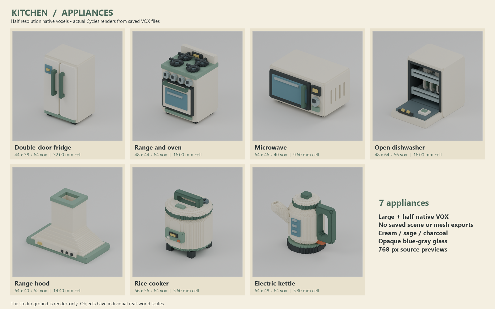

# Kitchen appliances result

Seven newly authored appliances are delivered as **14 native VOX 150 files and 14 actual 768 x 768 PNG previews**, plus a labeled half-resolution contact sheet. Status: ready for coordinated cross-review.

## Delivered paths

Each of `double_door_fridge`, `range_oven`, `microwave`, `dishwasher`, `range_hood`, `rice_cooker`, and `electric_kettle` has `assets/SLUG/{large,half}/SLUG.vox`, `preview.png`, and `metadata.json`.

The source is `build.py`; native-to-preview runner is `preview_pipeline.py`; fresh validator is `validate.py`. Evidence includes `palette.json`, `capture_manifest.json`, `validation.json`, `image_inspection.json`, `pipeline_timing.json`, `timing.json`, `frozen_file_hashes.json`, `STATUS.json`, and `logs/render.log`.

| Appliance | Large grid | Half grid | Occupied voxels large / half | Cell mm large / half |
|---|---|---|---:|---:|
| double_door_fridge | 88 x 76 x 128 | 44 x 38 x 64 | 538,552 / 67,990 | 16 / 32 |
| range_oven | 96 x 88 x 128 | 48 x 44 x 64 | 650,252 / 82,228 | 8 / 16 |
| microwave | 128 x 92 x 80 | 64 x 46 x 40 | 558,832 / 70,722 | 4.8 / 9.6 |
| dishwasher | 96 x 128 x 112 | 48 x 64 x 56 | 388,996 / 49,860 | 8 / 16 |
| range_hood | 128 x 80 x 104 | 64 x 40 x 52 | 193,072 / 25,148 | 7.2 / 14.4 |
| rice_cooker | 112 x 112 x 128 | 56 x 56 x 64 | 609,340 / 79,085 | 2.8 / 5.6 |
| electric_kettle | 128 x 96 x 128 | 64 x 48 x 64 | 300,951 / 41,706 | 2.65 / 5.3 |

## Verification and inspection

- Full authored-to-reparsed occupancy and palette comparisons passed for all 14 VOX files; VOX 150, coordinate uniqueness/bounds, palette indices and nonzero occupancy passed.
- Every large grid has even axes and longest axis 128. Every half grid has exactly halved axes, doubled cell size and identical physical grid extents; actual occupied-cell count decreases. There are no half-postprocess corrections.
- **64 functional native feature probes** passed across both sizes: separated refrigerator doors and pulls; oven grip and four burner rests; microwave grip/vent/window; dishwasher rack slots/chamber/cup opening; hood duct/filter gap; cooker carry handle; kettle handle/vessel/open spout.
- All 14 previews are actual Blender 4.5 Cycles CPU renders of temporary exact boundary geometry built from reopened VOX files. Every pair uses identical large-source camera bounds, camera, lights and render settings: 768px, 24 samples, denoising, AgX, four threads. Native and image hashes are in metadata/capture evidence.
- Every preview was directly viewed using the image tool. Observations and timestamps are in `image_inspection.json`. The contact sheet was composed from the seven actual half previews and also inspected.
- One observed hood defect was corrected: the original underside cutout breached a sloped side shell. A failing native shell probe reproduced it; a shallower inlet plus continuous central airway passed new probes, and only the hood pair was rerendered. Rework render time is included in the totals; `logs/hood_regression_red.log` records the original failure.
- No `.blend`, exchange mesh, engine, image-generated, rigging, animation or collision files were produced. The studio floor exists only transiently for rendering.

## Actual timing

Start: **2026-10-25T05:26:45+00:00 UTC / 2026-10-25T14:26:45+09:00 KST**. Finish: **2026-10-25T05:35:32.090726+00:00 UTC / 2026-10-25T14:35:32.090726+09:00 KST**.

Wall: **527.091 s**. Source authoring until pipeline start: **259.189 s**. Pure grid build: **0.273 s**. Native write/roundtrip: **1.911 s**. Surface build: **8.757 s**. Actual rendering: **174.427 s**. Pipeline total: **186.326 s**. Final native validation: **3.094 s**. Timed production starts at the first recorded clock sample after brief reading; the earlier read is not assigned an invented duration.

## Limits and references

Glass is intentionally opaque blue-gray. The dishwasher has a single static lowered-door pose; remaining doors/lids are closed. Functional elements are stylized and chunky so their voids survive reduction; this is not a mechanical appliance simulation. The single specified camera does not expose every underside feature, so hidden functional geometry is additionally checked directly in native data. No UVs or bitmap materials are required for the supplied solid palette. No external reference artwork was used. The binding reference was `../BRIEF.md`; read-only generic utilities were `../../_tools/voxelkit.py` and `../../_tools/blender_pipeline.py`. No other batch geometry or creative resource was read or reused. Cross-review is coordinated separately by main. Fast mode is not exposed by the spawn API and is not claimed.
