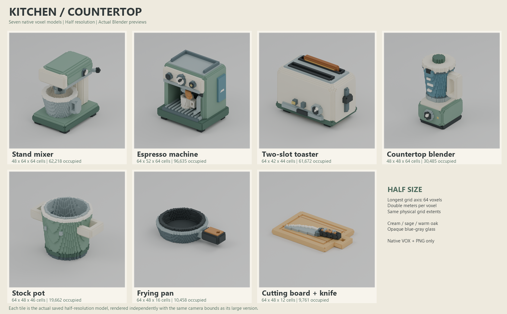

# Countertop kitchen voxel result

Seven original models are ready for review: **14 native VOX150 files, 14 actual 768x768 PNG previews, and one labeled half-size contact sheet**. No mesh or Blender scene files were produced.

Production start: 2026-10-25T05:26:50+00:00 UTC / 2026-10-25T14:26:50+09:00 KST.  
Production finish: 2026-10-25T05:37:31.800054+00:00 UTC / 2026-10-25T14:37:31.800054+09:00 KST.  
Elapsed wall time: **641.800 seconds**.

| Phase | Actual seconds |
|---|---:|
| Prebuild wall, including authoring | 229.262 |
| Grid generation and native build pipeline | 3.003 |
| Render pipeline | 193.053 |
| Temporary surface/studio construction within render pipeline | 12.471 |
| Actual Cycles render calls within render pipeline | 177.677 |
| Final full validation | 2.677 |
| Contact-sheet assembly | 0.382 |

Inspection and evidence preparation overlapped rendering; phase durations are not additive wall time. Earlier untimed diagnostic overhead remains included in wall time.

The recorded render time includes 16 actual calls: 14 delivered previews plus two superseded pot previews from the visual defect correction.

## Delivered native models

| Model | Large grid | Half grid | Large / half occupied cells | Grid extents (m) |
|---|---|---|---:|---|
| stand_mixer | 96 x 128 x 128 | 48 x 64 x 64 | 458,676 / 62,218 | 0.3000 x 0.4000 x 0.4000 |
| espresso_machine | 128 x 104 x 128 | 64 x 52 x 64 | 730,011 / 96,635 | 0.4000 x 0.3250 x 0.4000 |
| toaster | 128 x 84 x 88 | 64 x 42 x 44 | 466,257 / 61,672 | 0.3100 x 0.2034 x 0.2131 |
| blender | 96 x 96 x 128 | 48 x 48 x 64 | 219,676 / 30,485 | 0.3150 x 0.3150 x 0.4200 |
| stock_pot | 128 x 96 x 92 | 64 x 48 x 46 | 135,034 / 19,662 | 0.3800 x 0.2850 x 0.2731 |
| frying_pan | 128 x 96 x 32 | 64 x 48 x 16 | 70,730 / 10,458 | 0.4800 x 0.3600 x 0.1200 |
| cutting_board_knife | 128 x 96 x 24 | 64 x 48 x 12 | 73,771 / 9,761 | 0.4200 x 0.3150 x 0.0788 |

Paths: `assets/<slug>/{large,half}/<slug>.vox`, `preview.png`, and `metadata.json`.

## Validation and visual evidence

Fresh `validate.py` passes all 14 native roundtrips and 66 feature probes from reopened files. It checks VOX150/chunk validity, unique in-grid coordinates, common palette, nonzero occupancy, exact half dimensions, reduced native occupancy, doubled cell size, identical physical extents, 768px PNG headers, native/PNG hashes, camera parity and render settings.

Functional void probes cover mixer bowl/handle/working clearance, espresso cup bay/cup/cup handle, both toaster slots, blender jug/handle, stock-pot bowl/handles, pan bowl/hanging hole and cutting-board hanging hole. No half postprocess was required.

Every render uses the reopened VOX as surface input. Rendering used Blender 4.5, Cycles CPU, 24 samples, denoising, AgX, four fixed threads, and the same large-native camera bounds for each pair. The studio floor is temporary render geometry and is absent from native deliverables.

All 14 PNG previews were individually inspected using the image-viewing tool. Full-object framing, intended silhouette, retained half-size features and native open spaces were reviewed; the contact sheet was inspected separately. Findings are recorded in `visual_inspection.json`; timestamps, camera/lights and SHA256 evidence are in `capture_manifest.json`.

## Limitations and provenance

- Glass is deliberately opaque blue-gray. No transparency, texture, animation, rigging or collision is implied.
- Fine wire, knife edge and control thicknesses are exaggerated for half-size voxel readability. A single common three-quarter camera is supplied for each variant.
- Blender ran headlessly; no GUI review is claimed. Hidden interiors were checked in native data, not by extra camera renders.
- The toaster slot probe was moved from the rounded wall boundary to the actual gap center after a saved-data diagnostic; no geometry was changed for that probe.
- Visual inspection exposed two small stock-pot wall punctures caused by the handle cutter. Saved-data regression probes failed before the fix; preserving the vessel shell corrected both sizes. Both pot previews were then rendered again and re-inspected.
- The kitchen brief and read-only generic voxel utilities are the only references. No external images, other batch geometry or generated scene imagery were used.

Source: `build.py` (`make_assets()` is pure), `preview_pipeline.py`, `validate.py`, `make_overview.ps1`. Evidence: `validation.json`, `capture_manifest.json`, `visual_inspection.json`, `timing.json`, `frozen_file_hashes.json`, `logs/`. Read-only frozen-integrity recheck: `finalize.py --verify-frozen`.
