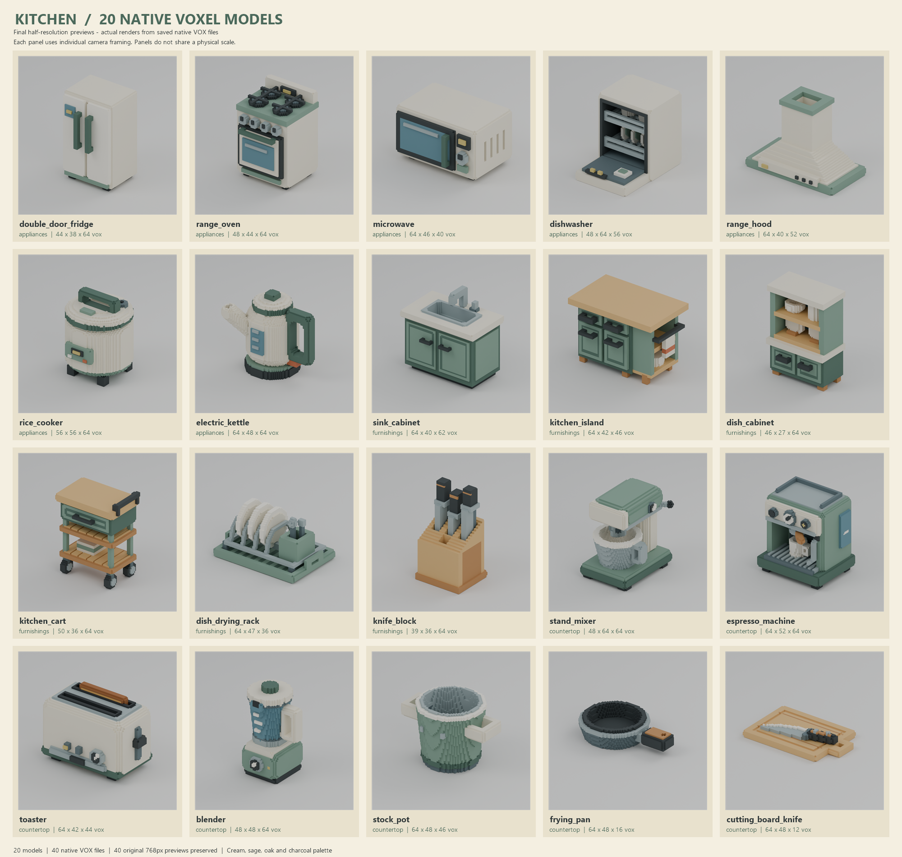

# Kitchen delivery assembly

**Ready for review:** one labeled **5-column x 4-row** contact sheet of all **20 final half-resolution models**, and a complete manifest of **40 VOX files, 40 original 768px previews and 40 metadata files**. All originals remain in their source batches and are unchanged.

Each panel preserves the complete source image. Panels use **individual camera framing, not a shared physical scale**. The sheet is 2000 x 1900 pixels and contains exact asset slugs plus batch/grid labels.

## Files and checks

- `overview_half.png`: composed only from the existing twenty final half previews; directly inspected with the image tool at 2026-10-25T05:43:29+00:00.
- `manifest.json`: all twenty exact slugs, batch ownership, both variants, relative VOX/PNG/metadata paths, SHA256, byte sizes, dimensions and cell scales. It also records each of the twenty sheet source image hashes.
- `validation.json`: successful exact inventory, VOX 150 headers, PNG CRC/decompression and 768px dimensions, native dimensions/scales, hashes and no-forbidden-export checks.
- All **211 frozen evidence files across three original manifests** were verified before and after composition. **120 source originals** (40 VOX + 40 PNG + 40 metadata) are byte-identical before and after assembly. The snapshots are `source_snapshot_before.json` and `source_snapshot_after.json`.
- `assembly.py` performs inventory and integrity checks; `assemble_sheet.ps1` uses System.Drawing to arrange the original images. `composition.json` records actual composition time. No rendering, geometry work, scene regeneration, HTML gallery, ZIP, Git or source mutation occurred.

Manifest SHA256: `7b48b8997f217c24ceadfb222903df05d279ba6f93f47478d513d7de9702b056`. Contact-sheet SHA256: `78cad17b1831a192cc6b4321379d4d76cf30f3e42d1cd5e1a330392902949dc0`.

## Actual timing

Start: **2026-10-25T05:41:14+00:00 UTC / 2026-10-25T14:41:14+09:00 KST**.
Finish: **2026-10-25T05:44:04.211546+00:00 UTC / 2026-10-25T14:44:04.211546+09:00 KST**.
Wall: **170.212 s**. Preflight integrity check: **1.015 s**. Image composition: **0.555 s**. Final integrity check: **1.031 s**. These checks are included in wall time.

No blocker remains. Native shape and per-model rendering reviews were performed by the three original workers; this final assembly does not regenerate or replace those source artifacts. The manifest is authoritative for exact file paths and hashes.
