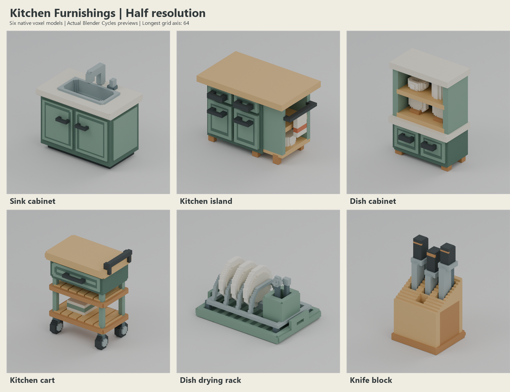

# Kitchen furnishings result

Ready for review: six independently authored furnishings, **12 native VOX 150 files and 12 actual 768 × 768 previews**, plus the labeled half-resolution contact sheet.

## Timing

- Tracked start UTC: 2026-10-25T05:26:58+00:00; KST: 2026-10-25T14:26:58+09:00.
- Finish UTC: 2026-10-25T05:37:13.182933+00:00; KST: 2026-10-25T14:37:13.182933+09:00.
- Elapsed wall: 615.183 seconds. Preflight brief/helper reads preceded the first recorded UTC timestamp and are explicitly excluded from this tracked interval.
- Successful native build scripts: 4.634 seconds.
- Preview pipelines: 233.111 seconds, including 220.191 seconds of actual Cycles rendering and 6.865 seconds of exact surface extraction. These categories overlap.
- 20 frames were actually rendered: 12 initial, then 8 corrected frames. The 12 final frames are delivered.
- Fresh final validation: 4.082 seconds. Additional exploratory checks are documented in logs and included in wall time.
- No image generation, queue wait, package installation, Git operation or shared-scene use. Fast is not exposed by the dispatch API and is not claimed.

## Deliverables and native resolution

Each model is under `assets/SLUG/large/` and `assets/SLUG/half/`, containing `SLUG.vox`, `preview.png` and `metadata.json`.

| Model | Large grid | Half grid | Occupied voxels large / half | Cell size m large / half |
|---|---|---|---|---|
| sink_cabinet | 128 × 80 × 124 | 64 × 40 × 62 | 658722 / 84334 | 0.01 / 0.02 |
| kitchen_island | 128 × 84 × 92 | 64 × 42 × 46 | 460550 / 60719 | 0.011 / 0.022 |
| dish_cabinet | 92 × 54 × 128 | 46 × 27 × 64 | 287172 / 40255 | 0.014 / 0.028 |
| kitchen_cart | 100 × 72 × 128 | 50 × 36 × 64 | 255266 / 34918 | 0.0078 / 0.0156 |
| dish_drying_rack | 128 × 94 × 72 | 64 × 47 × 36 | 144578 / 22414 | 0.0046 / 0.0092 |
| knife_block | 78 × 72 × 128 | 39 × 36 × 64 | 222260 / 30287 | 0.0032 / 0.0064 |

Large longest grid axis is exactly 128, with all axes even. Half dimensions are exactly divided by two, cell size doubles and physical grid extents remain unchanged. Occupancy genuinely decreases. No half postprocessing or added palette shades were used.

## Verification and visual findings

`validation.json` records fresh parsing of all saved native files, exact authored occupancy/palette roundtrip, valid VOX 150, unique in-bounds coordinates, legal palette indices, scale relationships, 48 functional feature probes and physically connected supports. Each image passes 768 px dimensions, PNG CRC/decompression and capture/metadata SHA256 checks. Both variants use identical camera/light settings based on the saved large grid bounds.

All twelve final images were individually inspected with image tools; findings and their exact image hashes are in `visual_inspection.json`. Sink basin, shelf bays, handles, drying slots and unused knife slot remain empty and readable. All six silhouettes remain distinct at half resolution. The contact sheet is assembled only from actual half previews.

The finite correction pass fixed observed contact defects: island rail hooks meet their posts, the display bowl rests on its shelf, plates rest on a rack crossbar, and inserted knife ends reach slot floors. Initial failing support evidence and the original capture manifest remain in `logs/`. The sink and cart previews were retained unchanged. Connectivity is evidence for these intended assemblies; no unrelated parts were fused.

## Capture and provenance

`capture_manifest.json` records source VOX and PNG SHA256, reparse/render UTC timestamps, camera bounds/transform, orthographic scale, all lights, world settings and actual frame duration. Every render surface was created from the reopened VOX in memory using the read-only generic `build_surface` and `add_studio` helpers. No Blender scene or exchange mesh was saved. Rendering used Blender 4.5.12 LTS, Cycles CPU, four threads, 24 samples, denoising, AgX and RGB 8-bit PNG.

Source: `build.py` (pure `make_assets()`), `features.py`, `preview_pipeline.py`, `validate.py`, `support_check.py`, `repair_support.py`, `contact_sheet.ps1`, `finalize.py`; palette in `palette.json`. Audit files include `timing.json`, `STATUS.json`, `native_validation.json`, `validation.json`, `visual_inspection.json`, `frozen_file_hashes.json` and logs.

## Known limitations

- Static colored occupancy only; no animation, collision, rigging, UV textures or scene/exchange formats, as requested.
- Decorative one-voxel oak seams disappear at half resolution. Functional openings are preserved; this simplification is documented rather than patched.
- The common single studio view partly occludes the hutch mug and rear details. Saved-data probes cover hidden clearances; no claim of additional camera views is made.
- Opaque blue-gray color is used for the hutch back; no transparent glass simulation.
- A render-only studio plane provides shadows and is absent from every VOX asset.

## References

Binding local `../BRIEF.md`; read-only generic `../../_tools/API.md`, `voxelkit.py` and `blender_pipeline.py`. No external creative references or another batch's geometry were read or reused during production.
