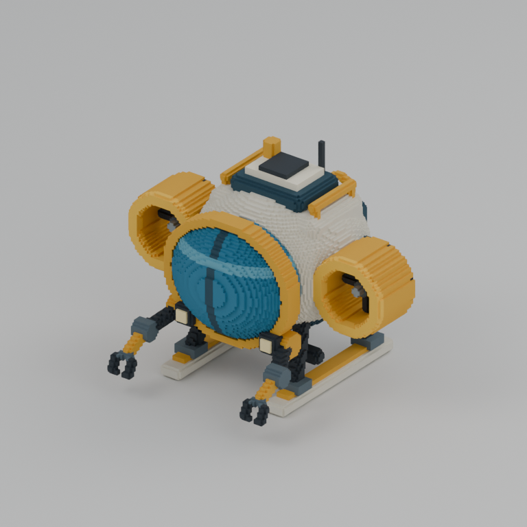
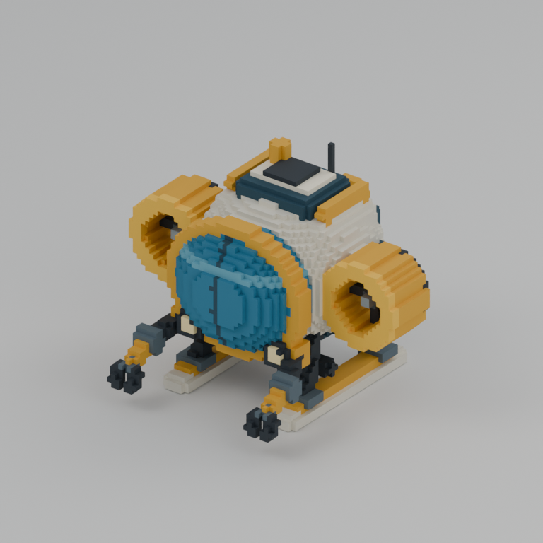
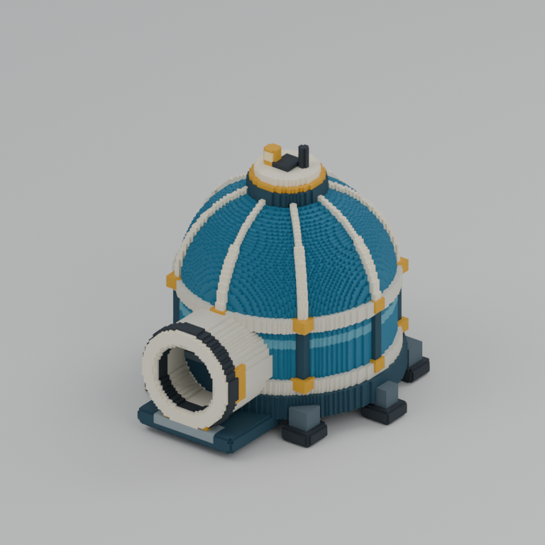
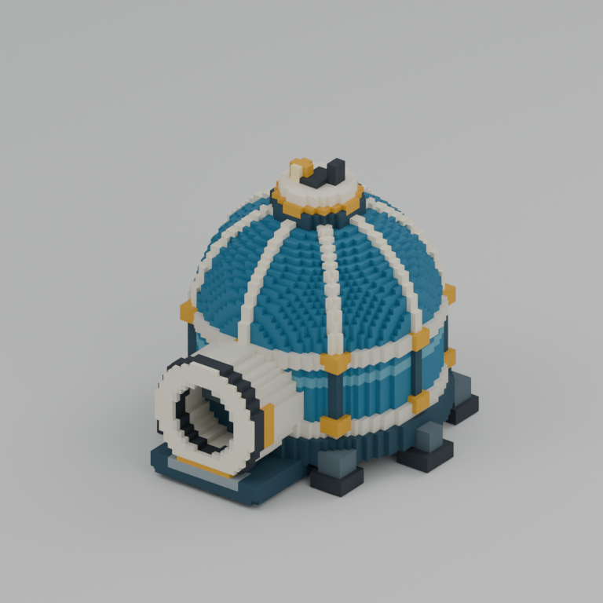
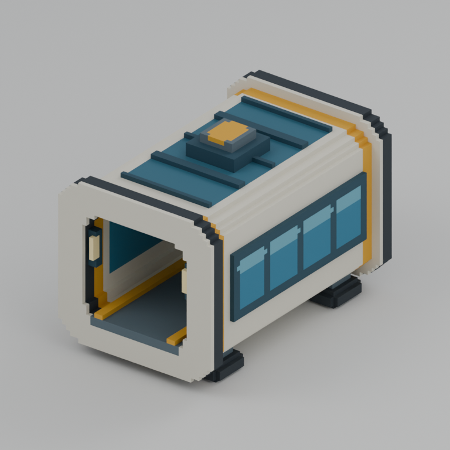
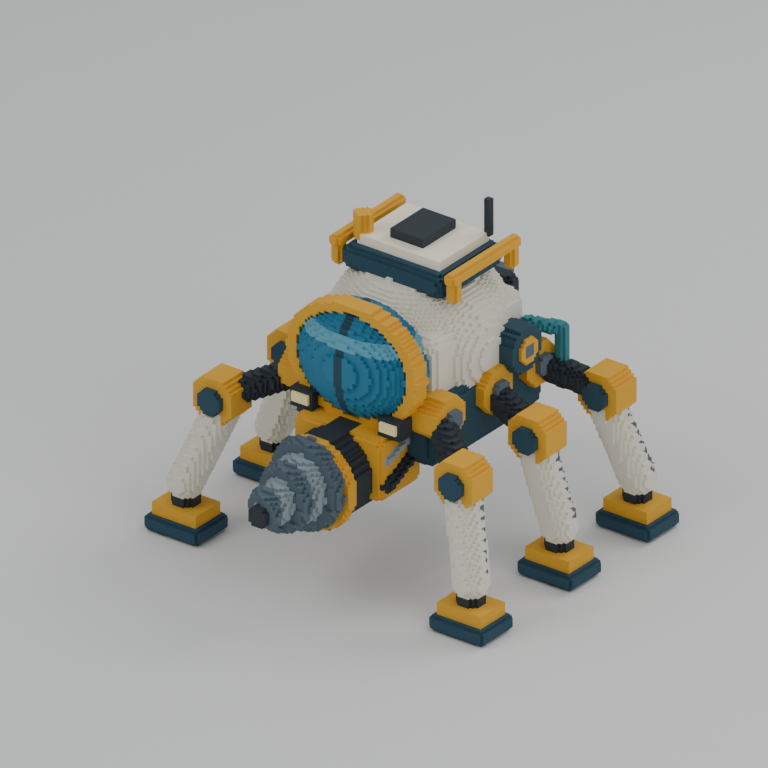
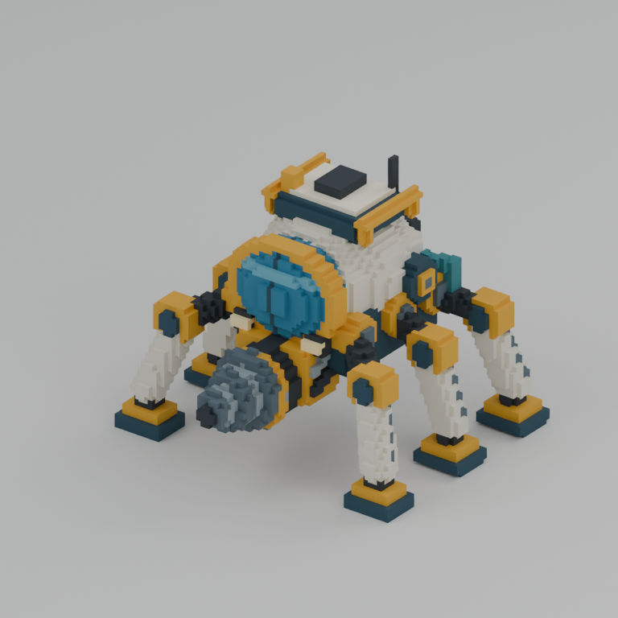
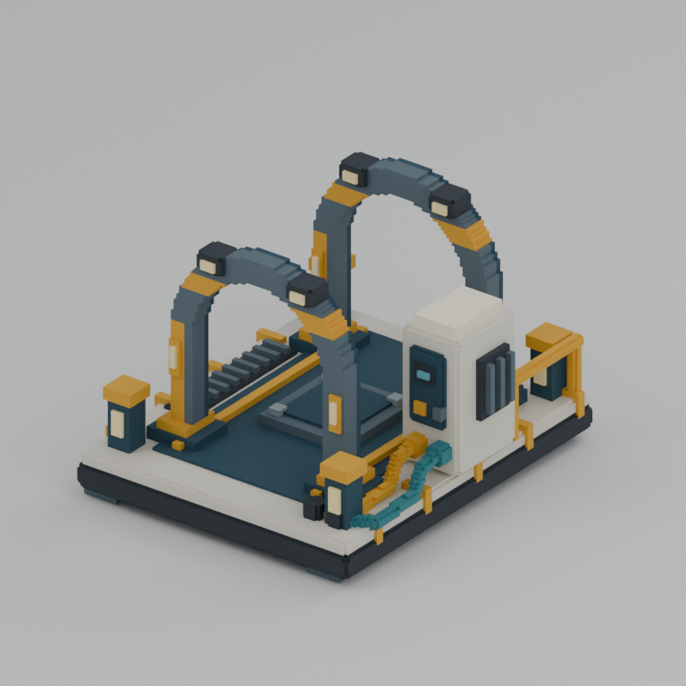
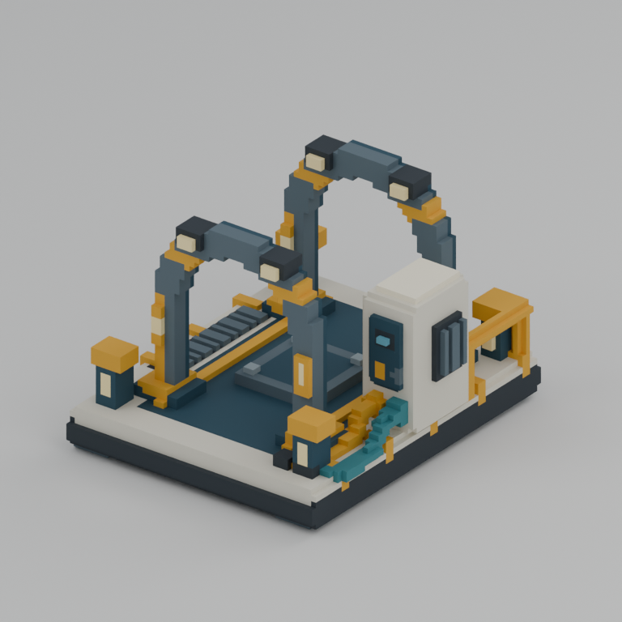

# Underwater voxel delivery

Ready for parent review and frozen. Five original assets are delivered as independent large and half voxel grids, with native VOX, BLEND, GLB, FBX and actual render previews. Native occupied-cell data is authoritative.

Actual start: **2026-10-23T14:43:32Z UTC / 2026-10-23T23:43:32+09:00 KST**. Actual finish: **2026-10-23T14:58:31Z UTC / 2026-10-23T23:58:31+09:00 KST**. Elapsed wall time: **899.618 seconds**. One build/export/render run measured **104.047 seconds** internally; fresh import validation measured **17.669 seconds** internally. These internal durations exclude Blender startup. Tools were available at dispatch; no blocking tool wait or worker image generation occurred.

| Model | Large / half grid | Occupied voxels, large / half | Triangles, large / half | Same physical grid extents (m) |
|---|---|---:|---:|---|
| submersible | 128×112×100 / 64×56×50 | 245,790 / 34,273 | 27,772 / 7,992 | 4.48×3.92×3.5 |
| dome_laboratory | 128×128×108 / 64×64×54 | 496,105 / 65,221 | 23,718 / 7,708 | 7.68×7.68×6.48 |
| connecting_tunnel | 84×128×84 / 42×64×42 | 238,456 / 34,204 | 2,954 / 1,650 | 4.2×6.4×4.2 |
| seabed_miner | 128×128×108 / 64×64×54 | 218,210 / 30,892 | 25,682 / 7,886 | 5.76×5.76×4.86 |
| docking_station | 112×128×94 / 56×64×47 | 220,960 / 31,114 | 4,482 / 2,428 | 6.16×7.04×5.17 |

Each `assets/NAME/{large,half}/` contains `NAME.vox`, `NAME.blend`, `NAME.glb`, `NAME.fbx`, `preview.png` and `metadata.json`. Totals are 10 native files, 30 BLEND/GLB/FBX files, 10 previews and 10 variant metadata records. Large grids have even axes and longest axis 128; each half dimension is exactly half, with doubled meters per voxel and identical physical grid extents. The docking station's 47-cell half height is valid under the clarified brief.

The submersible has a rounded hull and opaque convex viewport, two real through-bored ducted thrusters with recessed rotors, small manipulators and landing skids. The dome laboratory has eight raised meridian ribs, framed opaque window segments, a ring foundation, crown hatch and recessed airlock with a closed inner door. The connecting tunnel is a rounded pressure shell with genuinely open ends, framed side/roof glazing, a walkway, collars and support feet. The seabed miner has six stout articulated legs, a central observation pod and a real tapered drill with a winding raised cutting ridge. The docking station has two open guide arches, a reinforced deck, guide strips, connector pads/posts, side grates, service cabinet and two attached cable runs.

[Final independent validation](validation_export.json) passed **5 models / 10 variants / 30 fresh BLEND/GLB/FBX imports**, with `errors: []`. Native occupancy, coordinates, duplicate rejection, palette indexing, counts, bounds and hashes passed. All imported triangles matched the true outward voxel boundary and correct palette. Degenerate, invalid-boundary, invalid-material and off-grid triangle counts are zero. [Native feature checks](native_feature_checks.json) confirm open thruster quadrants, open airlock recess before its door, empty tunnel passage/end apertures, six miner footpads, both empty arch throats, valid size dimensions and opaque material colors at both resolutions.

All ten final previews were inspected. No geometry correction or additional modeling pass was required; no manual half-grid postprocessing was used. The final recording script rechecked every delivered file hash and the identical large/half camera settings. [delivery_manifest.json](delivery_manifest.json) records hashes, counts and timings. [build.py](build.py) and [palette.json](palette.json) are the independently authored source and named palette.

| Model | Large actual Blender render | Half actual Blender render |
|---|---|---|
| submersible |  |  |
| dome_laboratory |  |  |
| connecting_tunnel |  |  |
| seabed_miner |  |  |
| docking_station |  |  |

Actual capture settings are Cycles CPU, 4 threads, 24 samples, denoising, AgX, 768×768 and paired orthographic cameras. [capture_manifest.json](capture_manifest.json) records each render's timestamps, camera and image hash. BLEND projects contain the asset collection plus a separate preview studio; GLB/FBX exports contain asset geometry only. These images were rendered from the delivered voxel surfaces.

Limitations: glazing is deliberately opaque colored voxel geometry, including the laboratory dome; no transparent simulation or furnished laboratory interior is claimed. These are static asset models without rig, animation, collisions, automatic LOD chain or game-engine integration. Flat palette materials need no texture UVs. Fine fittings and stepped curves simplify at half resolution, and conservative reduction can widen individual occupied boundaries by a large-grid cell while preserving physical grid extents.

Creative reference was limited to the supplied `REF/voxel/underwater/reference.png`. No prior theme creative source/assets, ForestDemo resources, existing Blender scenes or external creative materials were inspected or copied. No image generation, shared live Blender session, Git operations or subagents were used. This is the worker's final assigned theme; no further theme is queued.
